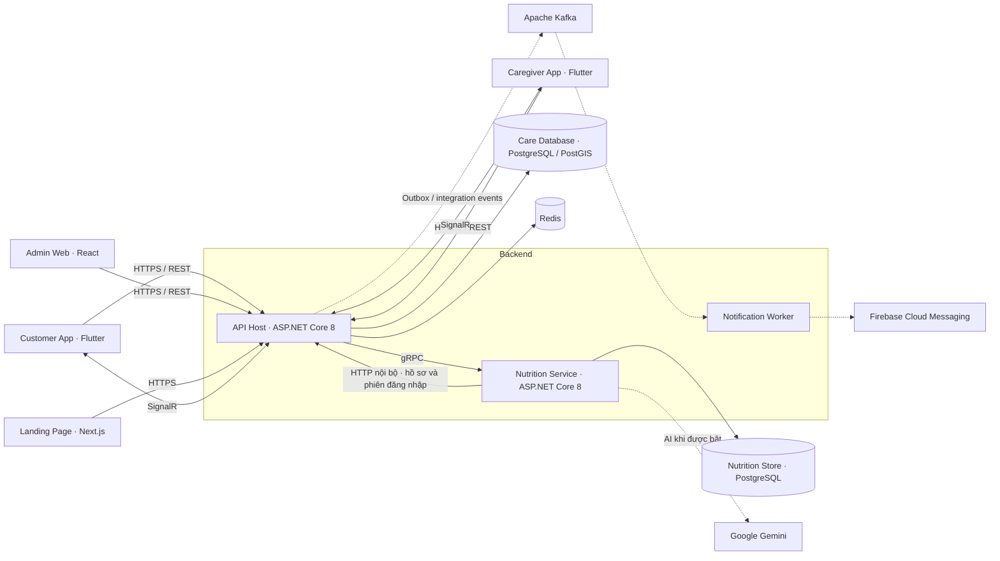

<div align="center">
  
  <h1>CareSitter</h1>
  <p><strong>Chăm sóc người thân, trao gửi yêu thương.</strong></p>
  <p>Nền tảng kết nối gia đình với người chăm sóc người cao tuổi tại nhà.</p>

  <a href="https://github.com/ThwnThwn/CareSitter/actions/workflows/ci.yml"></a>
  <a href="https://github.com/ThwnThwn/CareSitter/actions/workflows/landing.yml"></a>
  <br />
  <a href="https://caresitter-customer-947d2.web.app">Trải nghiệm Customer</a>
  · <a href="#kiến-trúc-hệ-thống">Kiến trúc</a>
  · <a href="#chạy-local">Chạy local</a>
  · <a href="#kiểm-thử">Kiểm thử</a>
  · <a href="https://github.com/ThwnThwn/CareSitter/issues">Báo lỗi &amp; góp ý</a>
</div>

---

## Giới thiệu

CareSitter hỗ trợ gia đình tìm dịch vụ, đặt lịch và theo dõi quá trình chăm sóc người thân. Người chăm sóc có ứng dụng riêng để quản lý lịch làm việc, thực hiện ca và trao đổi với khách hàng; quản trị viên xử lý hồ sơ, dịch vụ, giao dịch và các yêu cầu hỗ trợ trên Admin Web.

Repository được tổ chức theo **monorepo**, gồm backend theo kiến trúc **Modular Monolith**, dịch vụ Nutrition độc lập, hai ứng dụng Flutter, Admin Web và landing page.

## Các phân hệ chính

| Đối tượng | Chức năng trong mã nguồn |
| --- | --- |
| **Gia đình / Customer** | Đăng nhập, quản lý hồ sơ người được chăm sóc, tìm dịch vụ và người chăm sóc, đặt lịch, thanh toán, theo dõi ca, trò chuyện, đánh giá và yêu cầu hỗ trợ. |
| **Người chăm sóc / Caregiver** | Quản lý hồ sơ, lịch làm việc và ca chăm sóc; check-in/check-out, checklist, báo cáo ca, trò chuyện và theo dõi thu nhập. |
| **Quản trị viên / Admin** | Quản lý người dùng, duyệt hồ sơ KYC, danh mục dịch vụ, lịch đặt, khuyến mãi, thanh toán, hoàn tiền, tranh chấp và hỗ trợ khách hàng. |
| **Nutrition** | Hồ sơ dinh dưỡng, đánh giá đầu vào, gợi ý và lưu thực đơn, đổi món, tính dưỡng chất và giải thích kèm nguồn; tra cứu kiến thức bằng GraphRAG và Gemini trong phạm vi được cấu hình. |
| **Landing page** | Giới thiệu dịch vụ, nội dung chăm sóc, gửi yêu cầu tư vấn và trợ lý hỏi đáp theo cấu hình server. |

Các tích hợp thanh toán, bản đồ, AI, thông báo và chat cần cấu hình provider tương ứng. Có mã nguồn không đồng nghĩa mọi chức năng đã được bật ở bản online.

## Kiến trúc hệ thống



Các kết nối nét đứt là tích hợp phụ thuộc cấu hình môi trường. Sơ đồ thể hiện ranh giới logic; mô hình triển khai online hiện tại được mô tả bên dưới.

### Tổ chức backend

Các module **Identity, People, Catalog, Booking, Payments, Promotion, Support** tổ chức theo các tầng Domain, Application, Infrastructure và Controllers. `ApiHost` là nơi đăng ký dependency, bảo mật, endpoint chung và gateway tới Nutrition.

- **REST:** giao tiếp giữa ứng dụng và backend.
- **gRPC:** API Host gọi các nghiệp vụ Nutrition; hợp đồng ở [nutrition.proto](backend/services/nutrition/protos/nutrition.proto).
- **SignalR:** cập nhật thời gian thực cho các luồng được cấp quyền.
- **Kafka + outbox/inbox:** giao tiếp bất đồng bộ, xử lý lặp và retry ở các luồng đã bật.
- **Hangfire:** thực thi và quản lý công việc nền.

### Dinh dưỡng và GraphRAG

Luồng gợi ý thực đơn kiểm tra hồ sơ, ràng buộc và catalog trước khi tạo phương án. Khi được bật, Gemini xếp hạng các phương án đã qua bộ lọc và sinh giải thích có nguồn. AI không bỏ qua các ràng buộc dinh dưỡng và dị ứng của hệ thống.

Luồng hỏi kiến thức truy xuất các đoạn liên quan, dùng Gemini tổng hợp câu trả lời và đối chiếu trích dẫn với nội dung gốc. Nếu thiếu bằng chứng, nhánh đề xuất kiến thức chung được hiển thị riêng với nhãn **AI đề xuất**, không gán nguồn tài liệu như một câu trả lời đã được đối chiếu.

Văn bản đã xử lý được lưu theo từng đoạn trong **JSONL**; graph dùng **JSON với nodes/edges** và liên kết về đoạn bằng `chunk_id`. Artifact, quyền sử dụng nguồn và trạng thái phát hành được kiểm tra trước khi dùng. Các tài liệu và artifact chỉ được cho phép chạy local không được đóng gói lên môi trường online.

Nội dung dinh dưỡng mang tính tham khảo, chưa thay thế tư vấn của chuyên gia y tế.

## Công nghệ

| Thành phần | Công nghệ |
| --- | --- |
| API và nghiệp vụ | C#, .NET 8, ASP.NET Core, EF Core, MediatR |
| Dữ liệu | PostgreSQL 16, PostGIS, Npgsql, Redis 7 |
| Giao tiếp và tác vụ nền | gRPC, SignalR, Apache Kafka, Hangfire |
| Customer & Caregiver | Flutter, Dart, Riverpod, GoRouter, Dio |
| Admin Web | React, TypeScript, Vite, Vitest |
| Landing page | Next.js 16, React, TypeScript, Tailwind CSS |
| AI / truy xuất | Google Gemini, graph và corpus theo phiên bản; Ollama cho thử nghiệm local |
| Tích hợp | Firebase Auth / FCM / Firestore theo cấu hình, Cloudinary, VNPay, payOS, CARTO |
| Chạy và triển khai | Docker Compose, Aspire, GitHub Actions, Render, Supabase, Firebase Hosting |

## Cấu trúc repository

```text
CareSitter/
├── backend/
│   ├── caresitter-be/
│   │   ├── ApiHost/                    # HTTP API, gateway, composition root
│   │   ├── Modules/                    # Bảy module nghiệp vụ
│   │   ├── Shared/                     # Hợp đồng và hạ tầng dùng chung
│   │   └── Services/NotificationWorker/
│   ├── services/nutrition/             # Service, proto, catalog, công cụ và test
│   ├── orchestration/                 # Aspire AppHost cho phát triển local
│   ├── init-db/                       # SQL schema và migration
│   ├── scripts/                       # Khởi chạy, cập nhật DB, kiểm thử
│   └── render/                        # Launcher, TLS, health check, smoke test
├── frontend/
│   ├── customer-app/                  # Flutter cho gia đình
│   ├── caregiver-app/                 # Flutter cho người chăm sóc
│   ├── admin-web/                     # React / Vite
│   └── landing-page/                  # Next.js
├── deploy/                            # Compose, migration, backup và vận hành
├── firebase/                          # Cấu hình và kiểm thử Storage Rules
├── tools/dev/                         # Công cụ phát triển local
└── .github/workflows/                 # CI và các workflow phát hành
```

## Chạy local

### 1. Chuẩn bị môi trường

| Công cụ | Phiên bản tham chiếu trong repository |
| --- | --- |
| .NET SDK cho API / Nutrition | `8.0.425` — [global.json](global.json) |
| .NET SDK cho AppHost | `10.0.401` — [orchestration/global.json](backend/orchestration/global.json) |
| Aspire CLI | `13.6.1` |
| Flutter | `3.47.7`, stable — theo CI |
| Node.js | `24.19.0` — theo CI |
| Hạ tầng local | Docker với Docker Compose v2; bật Linux containers |
| Script vận hành | PowerShell 7 cho các lệnh `pwsh` bên dưới |

Cần cài cả SDK .NET 8 và .NET 10 nếu chạy bằng AppHost. Build Android/iOS cần thêm SDK nền tảng tương ứng; build iOS cần macOS và Xcode.

```powershell
git clone https://github.com/ThwnThwn/CareSitter.git
cd CareSitter
Copy-Item backend/.env.example backend/.env
```

Trong `backend/.env`, cấu hình kết nối PostgreSQL, Redis, JWT, khóa mã hóa và SMTP theo các tên biến trong mẫu. Với DB Docker mặc định, dùng host `localhost`, port `5432` và thông tin local tương ứng với Compose. JWT signing key cần ít nhất 32 ký tự; cấu hình khóa mã hóa theo yêu cầu trong mẫu.

Đặt `KAFKA_ENABLED=false` cho lần chạy cơ bản không dùng broker. Các luồng FCM/Kafka, OAuth, media, thanh toán và AI chỉ bật sau khi có đủ cấu hình riêng. Không thể hoàn tất các luồng provider chỉ bằng việc sao chép file mẫu.

### 2. Khởi động backend

Chạy từ thư mục gốc repository:

```powershell
docker compose --env-file backend/.env -f backend/docker-compose.yml up -d db redis
Push-Location backend/orchestration
dotnet tool install --global Aspire.Cli --version 13.6.1
Pop-Location
pwsh ./backend/scripts/run-apphost.ps1
```

Bỏ qua lệnh cài Aspire CLI nếu đã có đúng phiên bản. AppHost chạy API và Nutrition, quản lý DB Nutrition local khi chưa cung cấp kết nối riêng. Cổng mặc định:

| Endpoint | Địa chỉ local |
| --- | --- |
| API | `http://localhost:5033` |
| Swagger, trong Development | `http://localhost:5033/swagger` |
| API liveness / readiness | `/health/live` · `/health/ready` |
| Nutrition HTTP | `http://localhost:5035` |
| Nutrition gRPC | `http://localhost:5036` |

DB CareSitter mới được bootstrap từ `backend/init-db/00-init.sql`. Với volume đã có dữ liệu, cần áp dụng migration còn thiếu bằng [update-db.ps1](backend/scripts/update-db.ps1); restart container không tự nâng cấp schema. Nguồn schema là SQL trong `backend/init-db/`, không dùng EF migrations để tạo hoặc nâng cấp DB này.

### 3. Khởi động Customer hoặc Caregiver

Ví dụ cho Customer:

```powershell
cd frontend/customer-app
Copy-Item .env.local.example .env.local
```

Đổi hai URL trong `.env.local` sang API local:

```dotenv
BASE_URL=http://localhost:5033/api/v1
HUB_BASE_URL=http://localhost:5033
MAP_PROVIDER=carto
```

```powershell
flutter pub get
flutter run -d chrome --dart-define-from-file=.env.local
```

Caregiver chạy các lệnh Flutter tương tự từ `frontend/caregiver-app`; tự tạo `.env.local` với các tên biến trên. Cấu hình bản đồ, Firebase và Google Sign-In theo tính năng cần thử.

Khi chạy trên điện thoại thật, dùng IP LAN của máy chạy API hoặc domain HTTPS có thể truy cập được. `localhost` trên điện thoại trỏ về chính điện thoại; URL API và hub phải cùng môi trường.

### 4. Khởi động Admin Web và landing page

Mở terminal riêng cho từng ứng dụng, tính từ thư mục gốc repository:

```powershell
cd frontend/admin-web
Copy-Item .env.example .env.local
npm ci
npm run dev
```

Admin dùng `VITE_API_BASE_URL` là origin backend, ví dụ `http://localhost:5033`, không thêm `/api/v1`. Đăng nhập bằng tài khoản có quyền quản trị phù hợp.

```powershell
cd frontend/landing-page
Copy-Item .env.example .env.local
npm ci
npm run dev
```

Landing page dùng `CARESITTER_API_BASE_URL` cho backend và `GEMINI_API_KEY` ở phía server khi bật trợ lý. Xem địa chỉ ứng dụng trong output của dev server.

## Triển khai online

**Trạng thái cập nhật: 14/11/2026.**

| Thành phần | Triển khai hiện tại |
| --- | --- |
| Customer Web | [Firebase Hosting](https://caresitter-customer-947d2.web.app) |
| API + Nutrition | Một service Render Free, hai tiến trình độc lập trong cùng container |
| Care Database | Supabase PostgreSQL / PostGIS |
| Nutrition Store | Project Supabase riêng, runtime role có quyền giới hạn |
| Theo dõi sẵn sàng | [API readiness](https://caresitter-api.onrender.com/health/ready) |

Trên Render, API gọi Nutrition qua **gRPC/TLS ở localhost**; Nutrition đọc hồ sơ và kiểm tra phiên đăng nhập qua endpoint nội bộ của API. Chỉ cổng HTTP của API được công khai; hai tiến trình cùng khởi động lại nếu một tiến trình dừng.

[Dockerfile.render](backend/Dockerfile.render) dùng build context `backend/`, cờ `RENDER_NUTRITION_ENABLED` và cấu hình theo [render.env.example](backend/render/render.env.example). Health check của Render trỏ tới `/health/ready`. DB Nutrition dùng direct connection hoặc session pooler; không dùng transaction pooler cho luồng giữ advisory lock theo phiên.

**Giới hạn hiện tại:** hạ tầng Nutrition đã chạy online, nhưng đánh giá, tạo thực đơn và AI vẫn tắt ở môi trường này trong khi chờ catalog được duyệt và phát hành. Luồng GraphRAG/Gemini hiện được thử trong môi trường local theo phạm vi quyền của nguồn dữ liệu. Chỉ trạng thái khỏe của service không có nghĩa tính năng nghiệp vụ đã được mở.

## Kiểm thử

Chạy từ thư mục gốc repository, trừ các lệnh trong thư mục frontend:

```powershell
# Backend chính
dotnet test backend/CareSitter.sln --nologo

# Nutrition độc lập
dotnet test backend/services/nutrition/CareSitter.Nutrition.sln --nologo

# Baseline: migration, smoke và kiểm thử backend
pwsh ./backend/scripts/test-phase7.ps1 -Repeat 2 -SkipFrontend

# Sau khi build runtime Render: TLS, readiness, DB outage và vòng đời tiến trình
docker build -f backend/Dockerfile.render -t caresitter-render:nutrition backend
pwsh ./backend/render/test-runtime.ps1
```

Test PostgreSQL chuyên biệt cần DB test phù hợp; các bài dựa vào `CARESITTER_TEST_ADMIN_CONNECTION` có thể bị skip khi chưa cấu hình. Dùng DB/container dành riêng cho kiểm thử. Bài smoke Render tạo và dọn PostgreSQL, Redis và container ứng dụng tạm.

```powershell
# Chạy trong frontend/customer-app hoặc frontend/caregiver-app
flutter analyze
flutter test

# Chạy trong frontend/admin-web
npm test
npm run build

# Chạy trong frontend/landing-page
npm test
npm run build
```

[CI](.github/workflows/ci.yml) kiểm tra AppHost, migration và ops, backend baseline, Nutrition với PostgreSQL, hai app Flutter và Admin Web. [Workflow landing](.github/workflows/landing.yml) chạy test và build riêng. Smoke gọi provider thật cần credential và cấu hình opt-in; test bị skip không tính là đã xác nhận tích hợp.

## Cấu hình và đóng góp

- Giữ secret trong file local bị Git bỏ qua hoặc kho biến môi trường phía server. Không đưa JWT key, mật khẩu DB, OAuth secret, service account hay Gemini key vào Flutter, JavaScript bundle hoặc commit.
- Thay đổi module qua hợp đồng công khai; giữ kiểm tra quyền sở hữu dữ liệu, phiên đăng nhập và idempotency ở backend.
- Thay đổi schema bằng SQL migration mới, giữ tương thích với dữ liệu đang có.
- Mỗi PR mô tả vấn đề, hành vi sau sửa và cách kiểm chứng. Chạy kiểm tra phù hợp với phần thay đổi.
- Gửi lỗi và đề xuất qua [GitHub Issues](https://github.com/ThwnThwn/CareSitter/issues); khi báo lỗi, kèm bước tái hiện và log đã loại bỏ thông tin nhạy cảm.

---

<div align="center">
  <strong>CareSitter</strong> · Chăm sóc người thân, trao gửi yêu thương.
</div>
