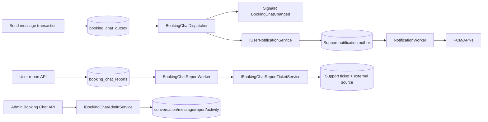

# Kế hoạch hoàn thiện Booking Chat: notification, Admin và kiểm thử Flutter

> Cập nhật: 17/10/2026, Asia/Saigon.  
> Phạm vi: `BCHAT-07-NOTIFY`, `BCHAT-13-ADMIN` và `BCHAT-15A-FLUTTER-TEST`.  
> Trạng thái: đã đối chiếu source; **mới là kế hoạch, chưa triển khai các hạng mục trong tài liệu này**.  
> Git: tài liệu chỉ lưu local; không commit/push khi chưa có yêu cầu riêng.

## 1. Điểm xuất phát đã xác minh

Booking Chat lõi đã có schema, domain, REST metadata/history/send/read, system
message cùng transaction Booking, outbox SignalR, hai màn Flutter và route chat.
Các commit hiện tại ghi nhận backend và hai app; bộ pagination/race test vừa chạy
local trên PostgreSQL đạt **39/39, 0 fail, 0 skip**. Kết quả này chỉ chứng minh
nhóm test đó, chưa thay CI, Firebase/APNs, Admin hoặc thiết bị thật.

Các khoảng trống đã thấy trực tiếp trong source:

- `BookingChatDispatcher` chỉ phát `BookingChatChanged` qua SignalR; chưa tạo
  notification loại `BOOKING_CHAT`.
- `NotificationPrefs.ChatMessage` đã tồn tại, nhưng `NotificationRecipient`
  mới công bố `SupportChatPushEnabled`; đường delivery chưa kiểm preference chat
  theo lịch tại thời điểm phát.
- deep-link allowlist của Customer chưa nhận `/bookings/:id/chat`; Caregiver chưa
  nhận `/shifts/:id/chat`.
- SQL đã có `booking_chat_activity_events` và `booking_chat_reports`, nhưng Booking
  chưa có entity/mapping/use case/controller tương ứng.
- Admin web chỉ có Support Chat; chưa có màn quản trị Booking Chat.
- hai app có feature `booking_chat`, nhưng chưa có test riêng cho repository,
  controller, realtime và màn hình của feature này.

### 1.1 Chuẩn hóa mã công việc

Lịch sử commit đã dùng tên `BCHAT-07` cho Caregiver UI, trong khi kế hoạch gốc dùng
`BCHAT-07` cho notification. Không sửa lịch sử Git. Từ kế hoạch này dùng mã rõ nghĩa:

| Mã thực thi | Ánh xạ backlog gốc | Nội dung |
| --- | --- | --- |
| `BCHAT-07-NOTIFY` | `BCHAT-07` | push, preference, dedup, deep link |
| `BCHAT-13-ADMIN` | `BCHAT-13` | report, ticket, Admin read/block/audit/hold |
| `BCHAT-15A-FLUTTER-TEST` | một phần `BCHAT-15` | test tự động hai app; chưa thay device E2E |

## 2. Kết quả phải đạt

1. Tin user mới đã commit tạo tối đa một notification logic cho đúng người nhận;
   retry có thể phát transport ít nhất một lần nhưng không tạo trùng inbox/ticket.
2. Push không chứa body chat, template params, địa chỉ, dữ liệu sức khỏe hoặc token;
   chỉ có title/body chung và ID/deep link tối thiểu.
3. `ChatMessage=false` chặn push tại thời điểm delivery; SignalR và lịch sử REST vẫn
   hoạt động. Người gửi, caregiver cũ, system message và read receipt không nhận push.
4. User có quyền đọc message mới được report. Retry cùng user/message trả report cũ;
   một report chỉ tạo một Support ticket.
5. Admin được phép có thể xem timeline, report, block/unblock; mọi lần đọc nội dung và
   mutation đều có audit. Unblock không gỡ dispute lock hoặc kéo dài deadline.
6. Conversation có dispute hoặc legal hold đang hiệu lực không được purge.
7. Hai app có test ổn định cho load/send/retry/pagination/read/reconnect/deep link và
   scope caregiver. CI chạy các test này mà không skip.

## 3. Bất biến không được phá vỡ

- PostgreSQL vẫn là nguồn sự thật; SignalR/push chỉ báo có thay đổi.
- Ghi message và Booking outbox nằm cùng transaction hiện tại.
- Dispatcher phải kiểm lại booking, recipient và epoch trước mọi side effect.
- Chỉ message kind `USER_MESSAGE_CREATED` mới có thể tạo push, và chỉ cho bên đối diện.
- Không dùng câu chữ tin nhắn để suy trạng thái booking hoặc chọn notification.
- Không đưa body chat vào Kafka, Booking outbox, push data, metric hoặc log.
- Cursor/deep link không cấp quyền; REST luôn xác thực lại user và scope hiện hành.
- Lock order của mutation Admin: booking row trước, conversation row sau; không tạo
  thứ tự khóa mới cạnh tranh với send/cancel/dispute.
- Report/ticket là at-least-once + idempotent, không cố tạo distributed transaction
  giữa `BookingDbContext` và `SupportDbContext`.
- Không đọc trực tiếp bảng/DbContext của module khác. Module giao tiếp qua interface
  công khai trong `CareSitter.Contracts`.

## 4. Thiết kế module và seam



### 4.1 Notification: giữ `BookingChatDispatcher` là module sâu

Interface ngoài tiếp tục nhỏ: `IBookingChatDispatcher.DispatchPendingAsync(...)`.
Implementation chịu trách nhiệm claim/lease, kiểm quyền, phát SignalR, yêu cầu
notification và đánh dấu kết quả. Không tạo thêm lớp chỉ chuyển tiếp.

Adapter notification dùng interface hiện có `IUserNotificationService`; test dùng fake
adapter. Đây là seam thật vì có implementation production và test adapter.

Quy tắc dispatch:

1. Load conversation, booking, epoch và message bằng ID trong row outbox.
2. Nếu recipient mất quyền thì `DROPPED`; không SignalR, không push.
3. Luôn phát SignalR cho row hợp lệ.
4. Chỉ khi `kind=USER_MESSAGE_CREATED`, message có sender và
   `recipientUserId != senderUserId` mới gọi notification.
5. Dùng chính `booking_chat_outbox.event_id` làm `UserNotificationMessage.EventId`.
6. Notification type `BOOKING_CHAT`; title/body chung, không nội dung message.
7. Payload data tối thiểu: `type`, `bookingId`, `conversationId`, `messageId`,
   `deepLink`, `eventId`, `occurredAt`.
8. Deep link theo recipient role: Customer `/bookings/{id}/chat`, Caregiver
   `/shifts/{id}/chat`.

Nếu notification đã ghi nhưng dispatcher crash trước `MarkSent`, retry dùng cùng
`EventId`; Support notification delivery trả kết quả cũ và không tạo notification mới.
SignalR có thể lặp; client merge theo sequence/event và tải REST nên không sai dữ liệu.

### 4.2 Preference tại delivery

Mở rộng `NotificationRecipient` bằng `ChatMessagePushEnabled`, lấy từ
`NotificationPrefs.ChatMessage`. Kiểm tra ở hai đường:

- worker: `NotificationDeliveryStore` đọc type notification và trả push tokens rỗng
  khi `BOOKING_CHAT` bị tắt; delivery vẫn hoàn tất thành công để không retry vô hạn;
- fallback trực tiếp: `FirebasePushNotificationService` cũng kiểm preference trước
  khi đọc/gửi token.

Như vậy thay đổi preference sau lúc message commit nhưng trước delivery vẫn được tôn
trọng. Preference chỉ điều khiển push; message và unread trong Booking không bị xóa.

### 4.3 Report → Support ticket: port idempotent

Thêm interface công khai nhỏ trong `CareSitter.Contracts`:

```csharp
public interface IBookingChatReportTicketService
{
    Task<BookingChatReportTicketResult> EnsureTicketAsync(
        BookingChatReportTicketRequest request,
        CancellationToken ct = default);
}
```

Request chỉ mang `ReportId`, `ReporterUserId`, `BookingId`, `MessageId`, reason đã
giới hạn và thời điểm; không mang body chat. Support adapter tạo ticket `COMPLAINT`
và mapping external source có unique `(source_type, source_id)`. Retry cùng `ReportId`
trả ticket cũ.

Booking report worker claim row bằng `FOR UPDATE SKIP LOCKED`, lease/fencing token,
retry/backoff/dead-letter tương tự các worker bền vững hiện có. Worker không giữ
transaction Booking trong lúc gọi Support adapter.

### 4.4 Admin: một interface use-case, controller mỏng

Thêm `IBookingChatAdminService` với các hành vi ở mức nghiệp vụ: list, detail,
messages, activities, block, unblock và release legal hold. Controller chỉ bind DTO,
role `ADMIN` và map `Result` sang HTTP.

Admin đọc body qua Booking vì Booking sở hữu message. Không đưa chat body vào Support
ticket hoặc query chéo Support. Tên/avatar nếu cần lấy qua public People lookup hiện có.

### 4.5 Flutter: interface là test surface

Mỗi app giữ feature riêng nhưng tách hai seam nhỏ để controller test không cần Dio,
SignalR hoặc `Ref` thật:

- `BookingChatGateway`: metadata, messages, sendText, sendQuick, markRead;
- `BookingChatChangeSource`: stream changes, connect, disconnect, dispose.

HTTP repository và SignalR hiện tại là production adapters; test dùng in-memory fake.
Không tạo shared package giữa hai app trong đợt này và không test xuyên qua field private.

## 5. Hợp đồng HTTP dự kiến

### 5.1 User report

```http
POST /api/v1/bookings/{bookingId}/chat/messages/{messageId}/reports
Content-Type: application/json

{ "reason": "Nội dung không phù hợp ..." }
```

Response `202 Accepted` cho report mới/PENDING, `200 OK` cho replay đã LINKED; cùng
user/message nhưng reason khác không tạo report thứ hai. Có thể trả trạng thái hiện tại
và `supportTicketId` khi đã link. Không trả body message trong response report.

### 5.2 Admin

```text
GET  /api/v1/admin/booking-chats
GET  /api/v1/admin/booking-chats/{conversationId}
GET  /api/v1/admin/booking-chats/{conversationId}/messages
GET  /api/v1/admin/booking-chats/{conversationId}/activities
PUT  /api/v1/admin/booking-chats/{conversationId}/block
PUT  /api/v1/admin/booking-chats/{conversationId}/unblock
PUT  /api/v1/admin/booking-chats/{conversationId}/legal-hold/release
```

Mutation body luôn có `expectedChangeVersion` và `reason`. Version lệch trả `409`.
List/messages dùng cursor + limit tối đa 100; không dùng offset cho message timeline.

## 6. Dữ liệu và migration

Không sửa migration 44 đã có. Khi bắt đầu code, chọn **số migration kế tiếp thực tế**.
Migration additive cần:

1. mapping/entity cho `booking_chat_activity_events` và `booking_chat_reports` đã có;
2. bổ sung lease/fencing columns cho report worker nếu schema hiện tại chưa đủ;
3. legal hold vô thời hạn rõ nghĩa (`legal_hold_at`, `legal_hold_reason`,
   `legal_hold_released_at`) thay vì giả lập bằng ngày rất xa;
4. bảng Support external ticket source, unique `(source_type, source_id)`, FK ticket;
5. index Admin list theo report/block/update time và index purge loại trừ hold;
6. constraint/status report đủ `PENDING`, `PROCESSING`, `LINKED`, `FAILED`,
   `DEAD_LETTER`.

Purge phải loại trừ conversation nếu:

- `dispute_locked_at IS NOT NULL`; hoặc
- legal hold đã đặt và chưa release; hoặc
- report còn `PENDING/PROCESSING/FAILED/DEAD_LETTER`; hoặc
- `hold_until > now()` cho timed hold hiện có.

Không cascade xóa Support ticket khi message/report bị purge; purge chỉ được chạy sau
khi mọi hold đã được giải quyết theo policy.

## 7. Các phase triển khai

### Phase 0 — khóa baseline và test seam

- Giữ các sửa cursor/race test hiện tại; xác nhận full Booking unit + PostgreSQL.
- Thêm `BookingChatGateway` và `BookingChatChangeSource` ở hai app, không đổi hành vi.
- Viết controller tests cho behavior hiện tại trước khi thêm deep link notification.
- Chuẩn hóa mã task mới trong tài liệu; không sửa commit cũ.

**Gate:** hai app analyze/test xanh; 39 pagination/race test vẫn xanh.

### Phase 1 — `BCHAT-07-NOTIFY`

Backend:

- thêm option `BookingChat:PushEnabled=false` và validation;
- mở rộng recipient preference và cả hai delivery adapters;
- bổ sung nhánh notification trong `BookingChatDispatcher`;
- giữ payload generic, event ID ổn định và skip sender/system/read;
- thêm metric `requested/suppressed/failed`, chỉ label low-cardinality.

Flutter:

- allowlist route `/bookings/:id/chat` và `/shifts/:id/chat`;
- `BOOKING_CHAT` fallback tự dựng route đúng vai trò khi `deepLink` vắng;
- login gate giữ pending route rồi flush sau đăng nhập;
- foreground notification không làm dừng SignalR dùng chung.

**Gate:** integration test chứng minh commit → outbox → notification request; retry
không trùng; preference off không gửi token; caregiver cũ không nhận; hai app test
deep link hợp lệ/phishing/login pending.

### Phase 2 — `BCHAT-13-ADMIN` backend report và legal hold

- thêm entity/configuration/DbSet cho report và activity;
- user report use case kiểm quyền theo epoch trước insert;
- unique user/message xử lý race và replay;
- đặt legal hold + audit trong cùng transaction report;
- report worker + Support ticket port idempotent;
- admin list/detail/messages/activity với audit khi đọc nội dung;
- block/unblock dùng expected version, lock order chuẩn và outbox metadata change;
- release legal hold chỉ khi policy/ticket cho phép, có reason và audit.

**Gate:** PostgreSQL race test report kép, worker crash/retry, block đồng thời send,
unblock sau dispute/deadline, hold thắng purge và unauthorized/IDOR.

### Phase 3 — Admin web

- thêm tab **Chat lịch chăm sóc** trong khu vực Support;
- queue filter `reported`, `blocked`, `dead-letter`, booking/user/time;
- detail có booking context, timeline, report/ticket và audit gần nhất;
- block/unblock/release hold yêu cầu reason, confirm, expected version;
- escape text mặc định, không dùng `dangerouslySetInnerHTML` cho body;
- loading/empty/error/conflict/retry và responsive theo Admin hiện tại.

**Gate:** Vitest cho list/detail, pagination, role error, conflict version, giữ draft
reason khi lỗi; TypeScript build sạch.

### Phase 4 — `BCHAT-15A-FLUTTER-TEST`

Chạy cùng contract trên cả Customer và Caregiver:

- repository request/response: metadata, latest, before/after, send/read/error;
- controller: initial load, merge/dedup sequence, loadMore, timer, realtime refresh;
- send text: trim, busy guard, giữ idempotency key khi lỗi, key mới khi payload đổi;
- quick message: role/status/version/params và retry có chủ đích;
- read: chỉ tăng, không spam cùng message, retry sau lỗi;
- lifecycle: inactive dừng timer/subscription do feature sở hữu, active phục hồi;
- state/UI: unavailable, empty, failed, read-only, long text, loading;
- scope: caregiver cũ bị REST từ chối; state không giữ message của tài khoản trước;
- deep link: cold start, sau login, foreground, duplicate delivery ID và URL lạ.

Widget test không thay device test. Mất mạng thật, background/foreground, FCM/APNs
và nhiều thiết bị chuyển sang Phase 5.

### Phase 5 — tích hợp, CI và thiết bị

- chạy full backend CI với PostgreSQL không skip;
- chạy Flutter analyze/test hai app và Admin test/build;
- local/staging bật chat nhưng giữ push flag tắt để kiểm outbox backlog;
- bật push cho tài khoản nội bộ, test Android FCM và iOS APNs/TestFlight;
- test hai thiết bị, mất signal, mất mạng, app bị kill, login lại, caregiver đổi;
- diễn tập worker crash/retry, dead-letter, backfill, retention dry-run và restore;
- chỉ sau evidence mới cân nhắc pilot; không bật công khai từ kết quả unit test.

## 8. Ma trận test bắt buộc

| Nhóm | Ca tối thiểu |
| --- | --- |
| Notification | recipient đối diện; sender không nhận; system/read không push; preference off; nhiều token; retry cùng event; credential thiếu; provider transient/permanent |
| Scope | caregiver cũ, epoch đóng, booking đổi caregiver, user ngoài booking, session revoke giữa commit và dispatch |
| Deep link | Customer/Caregiver đúng route; thiếu deepLink; cold start; sau login; URL ngoài allowlist; duplicate delivery |
| Report | message nhìn thấy/không nhìn thấy; report trùng; reason sai; worker retry; ticket dedup; Support lỗi tạm thời/vĩnh viễn |
| Admin | non-admin 403; content read audit; list không lộ body; block conflict; unblock không thắng dispute/deadline; legal hold release audit |
| Purge | dispute hold; legal hold; pending/failed report; timed hold; hết retention không hold; dry-run không xóa |
| Flutter | load/merge/pagination/send/read/reconnect/read-only/session switch; state sau dispose; text scale và semantics cơ bản |
| Race | send↔block, report↔purge, hai report, hai worker claim, retry sau crash, Admin expected version |

## 9. Lệnh kiểm chứng dự kiến

Chạy từ root repository, không ghi credential vào lệnh/tài liệu:

```powershell
dotnet test backend/CareSitter.sln --nologo
./backend/scripts/test-races.ps1 -Repeat 3 -Filter "FullyQualifiedName~BookingChat"
./backend/scripts/test-phase7.ps1 -Repeat 2 -SkipFrontend
```

Trong từng app Flutter:

```powershell
flutter analyze
flutter test
```

Trong `frontend/admin-web`:

```powershell
npm test
npm run build
```

Mọi báo cáo phải ghi số pass/fail/skip. PostgreSQL test thiếu connection và bị skip
không được tính là pass.

## 10. Rollout và rollback

### Rollout

1. Deploy migration additive trước, feature/push/report worker vẫn tắt.
2. Deploy code đọc được cả schema cũ/mới trong cửa sổ chuyển tiếp nếu cần.
3. Bật Booking Chat nội bộ; quan sát outbox/dead-letter, chưa bật push.
4. Bật report/Admin cho nhóm vận hành; xác minh audit và hold.
5. Bật push cho tài khoản nội bộ, sau đó pilot giới hạn.
6. Chỉ bật purge thật sau dry-run, backup/restore và policy legal hold được duyệt.

### Rollback

- tắt `BookingChat:PushEnabled` để dừng push mới, vẫn giữ outbox/message;
- tắt worker report nếu Support lỗi diện rộng, không xóa report PENDING/FAILED;
- ẩn Admin UI nếu cần, backend audit/data vẫn giữ;
- tắt ghi mới bằng feature flag nhưng tiếp tục xử lý side effect đã commit theo
  quyết định vận hành; không drop bảng, không sửa migration cũ, không purge để rollback.

## 11. Thứ tự file dự kiến chịu tác động

Backend:

- `Shared/CareSitter.Contracts/Services/INotificationRecipientReader.cs`
- `Shared/CareSitter.Contracts/Services/IBookingChatReportTicketService.cs` (mới)
- `Modules/Identity/Infrastructure/NotificationRecipientReader.cs`
- `Modules/Identity/Infrastructure/FirebasePushNotificationService.cs`
- `Modules/Support/Infrastructure/NotificationDeliveryStore.cs`
- `Modules/Support/Infrastructure/BookingChatReportTicketService.cs` (mới)
- `Modules/Booking/Domain/BookingChatEntities.cs` hoặc tách entity Admin/report riêng
- `Modules/Booking/Application/BookingChat/*`
- `Modules/Booking/Infrastructure/BookingChatDispatcher.cs`
- `Modules/Booking/Infrastructure/BookingChatReportWorker.cs` (mới)
- `Modules/Booking/Infrastructure/BookingChatAdminService.cs` (mới)
- `Modules/Booking/Controllers/BookingChatController.cs`
- `Modules/Booking/Controllers/AdminBookingChatController.cs` (mới)
- `backend/init-db/modules/...` migration additive mới
- Booking/Integration/Messaging tests liên quan.

Frontend:

- `frontend/<app>/lib/features/booking_chat/{data,presentation}`
- `frontend/<app>/lib/app/push/notification_deep_link_service.dart`
- `frontend/<app>/test/features/booking_chat/*` (mới)
- `frontend/<app>/test/core/push/notification_deep_link_service_test.dart`
- `frontend/admin-web/src/features/bookingChat/*` (mới)
- `frontend/admin-web/src/pages/SupportPage.tsx` và test.

## 12. Definition of Done cho đợt này

Đợt này chỉ hoàn tất khi:

- notification generic hoạt động, đúng preference, không trùng logic và không lộ body;
- report tạo đúng một ticket qua retry/crash và giữ legal hold;
- Admin read/block/unblock/audit/hold được test quyền và race;
- hai app có test Booking Chat và deep link, analyze/test xanh;
- Admin test/build xanh; backend unit/integration/PostgreSQL race xanh, không skip;
- CI remote xanh và device evidence FCM Android + APNs iOS được lưu;
- retention dry-run chứng minh dispute/legal hold không bị chọn purge;
- runbook rollout/rollback và tài liệu trạng thái được cập nhật theo bằng chứng thật.

Ngoài phạm vi đợt này: attachment, typing/presence, voice/video, sửa/xóa message,
ETA định tuyến tự động, E2E encryption và rollout công khai không giới hạn.
