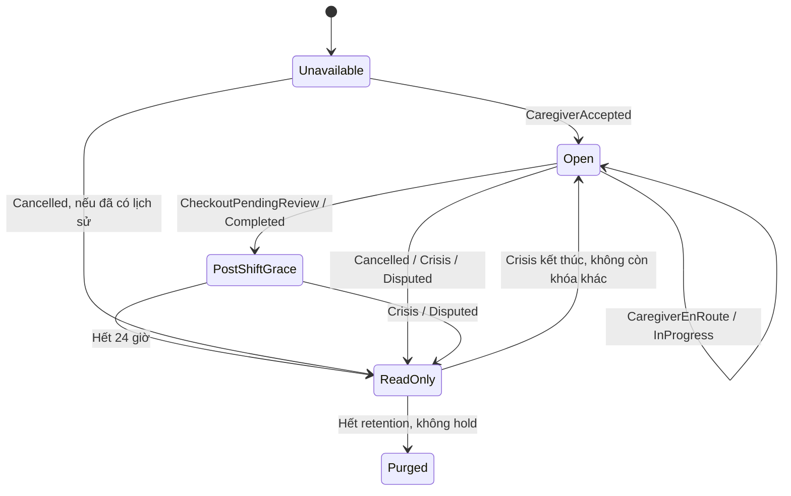
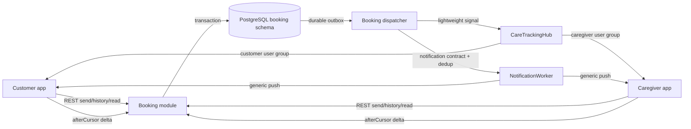

# Kế hoạch chat Customer ↔ Caregiver theo lịch chăm sóc

**Cập nhật:** 15/10/2026, Asia/Saigon.  
**Phạm vi:** Customer app, Caregiver app, module Booking, notification/SignalR
hiện có và panel Admin xử lý báo cáo/khóa chat.  
**Trạng thái:** phần lõi Booking Chat và hai app đã có code; pagination/race test
PostgreSQL gần nhất đạt 39/39. Notification push, Admin/report và test Flutter riêng
chưa hoàn tất. Kế hoạch thực thi phần còn lại nằm tại
[BOOKING_CHAT_REMAINING_IMPLEMENTATION_PLAN.md](BOOKING_CHAT_REMAINING_IMPLEMENTATION_PLAN.md).
Đây vẫn là hợp đồng sản phẩm/kiến trúc chuẩn; không coi mô tả trong tài liệu là bằng
chứng đã nghiệm thu production.

Các quyết định sau review: tạo conversation khi nhận ca; phân quyền theo lần
phân công riêng; cursor có phân trang và phạm vi truy cập; khóa booking khi ghi;
system message lưu cùng transaction; hạn nhắn sau ca cố định; report dùng ticket
hiện có. Thuật ngữ dùng chung ở [GLOSSARY.md](../tong-quan/GLOSSARY.md).

## 1. Quyết định sản phẩm

Xây chat 1:1 gắn với **một booking cụ thể**, theo cách người dùng quen thuộc ở
các ứng dụng marketplace: đầu cuộc trò chuyện luôn có tóm tắt lịch, hai bên có
tin nhắn nhanh theo ngữ cảnh như **“Tôi sắp tới”**, tin mới cập nhật trực tiếp và
có thể xem lại lịch sử sau khi ca kết thúc.

Đây không phải chat hỗ trợ. Hai luồng được tách rõ:

- **Booking chat:** Customer ↔ Caregiver đang được phân công; thuộc module
  Booking và sống theo vòng đời booking.
- **Support chat:** Customer/Caregiver ↔ nhân viên CareSitter; thuộc module
  Support và sống theo vòng đời ticket.

MVP chỉ có text và tin nhắn nhanh. Không có ảnh/tệp, audio/video, gọi trong app,
typing indicator, presence chính xác, xóa/thu hồi hoặc sửa tin. Cuộc gọi hiện có
thể giữ là hành động riêng trên chi tiết lịch.

## 2. Nguyên tắc không được phá vỡ

1. Một booking có tối đa một hội thoại; tạo cùng transaction caregiver nhận ca,
   trước khi hai bên gửi tin. Đọc metadata không tự tạo conversation.
2. Chỉ Customer sở hữu booking và **Caregiver đang được phân công** được đọc/gửi.
   Client không truyền participant để backend tin theo.
3. Caregiver cũ mất quyền ngay khi bị thay thế. Caregiver mới chỉ thấy booking
   context và tin thuộc lần phân công mới, không thấy trao đổi riêng với caregiver
   trước; Customer vẫn thấy toàn bộ lịch sử được chia theo từng lần phân công.
4. Tin “Tôi đang trên đường” không tự đổi booking sang `CaregiverEnRoute`.
   Lệnh **Bắt đầu di chuyển** đổi trạng thái trước; chat chỉ phản ánh kết quả.
5. Tin “Tôi đã đến” không thay cho check-in/GPS. Chỉ check-in hợp lệ mới tạo sự
   kiện hệ thống “Caregiver đã đến”.
6. PostgreSQL là nguồn sự thật. REST dùng cho mọi mutation và phục hồi; SignalR
   chỉ báo có thay đổi.
7. Mỗi lần gửi dùng `Idempotency-Key`; người vẫn có quyền đọc được nhận lại kết
   quả đã commit khi retry cùng key/payload, kể cả chat đã đóng. Người đã mất
   quyền không được đọc response cũ; cùng key nhưng payload khác trả `409`.
8. Không ghi body chat, token, địa chỉ đầy đủ hoặc dữ liệu sức khỏe vào log,
   metric, notification push hay sự kiện realtime.

## 3. Vòng đời hội thoại

Hội thoại không có state machine độc lập dễ lệch với booking. Backend suy trạng
thái chat từ trạng thái booking, người được phân công, thời điểm kết thúc và cờ
khóa vận hành.

| Trạng thái chat | Điều kiện booking | Quyền |
| --- | --- | --- |
| `UNAVAILABLE` | `Draft`, `PendingPayment`, `PaymentReconciliationPending`, `NeedsManualReview`, `Confirmed`, `MatchingFailed`, hoặc chưa có caregiver | Không tạo/gửi; Customer vẫn được đọc lịch sử cũ nếu đã từng có hội thoại; UI giải thích “Có thể nhắn sau khi caregiver nhận lịch” |
| `OPEN` | `CaregiverAccepted`, `CaregiverEnRoute`, `InProgress` | Hai bên đọc và gửi |
| `POST_SHIFT_GRACE` | `CheckoutPendingReview` hoặc `Completed`, và `serverNow < writeClosesAt` | Hai bên đọc và gửi để chốt đồ dùng/thông tin sinh hoạt còn lại |
| `READ_ONLY` | `Cancelled`, `Refunded`, `Disputed`, `Crisis`, từng mở tranh chấp, grace đã hết hoặc Admin khóa | Chỉ đọc theo quyền; hiển thị lý do và hành động hỗ trợ phù hợp |
| `PURGED` | Hết retention và không có legal/dispute hold | Nội dung bị xóa theo job; giữ metadata audit tối thiểu theo policy |

### 3.1 Quy tắc thời gian và thứ tự ưu tiên

- `graceStartedAt` là thời điểm **lần đầu** vào `CheckoutPendingReview`. Nếu ca
  hoàn tất trực tiếp mà chưa checkout, lấy thời điểm transition `Completed` đầu
  tiên do server ghi. `writeClosesAt = graceStartedAt + 24h`; snapshot cấu hình
  vào conversation, không tính lại theo lúc client mở màn hình.
- Hoàn tất, retry, resolve tranh chấp, đổi cấu hình hoặc Admin bỏ khóa không
  được dời `writeClosesAt`. Dù job tự hoàn tất chạy muộn, chat vẫn hết hạn đúng
  giờ; server kiểm deadline ở mỗi lần gửi.
- Thứ tự đánh giá: xác thực/quyền đọc → `PURGED` → khóa Admin hoặc khóa vĩnh
  viễn do đã tranh chấp → trạng thái booking không cho gửi → thời hạn sau ca →
  `OPEN`/`POST_SHIFT_GRACE`. Không có caregiver thì không có người nhận tin mới;
  Customer vẫn đọc lịch sử của mình nếu còn dữ liệu.
- `Crisis → InProgress` mở lại chat nếu không có khóa khác. `Crisis → Completed`
  áp dụng mốc thời gian trên; `Crisis → Cancelled` giữ chỉ đọc. MVP giữ `Crisis`
  chỉ đọc, UI đưa nút SOS/gọi/liên hệ hỗ trợ; đây là policy sản phẩm cần nghiệm
  thu cùng luồng SOS trước pilot.
- Khi lần đầu vào `Disputed`, lưu `disputeLockedAt`. `Disputed → Completed` hoặc
  `Refunded` không mở lại chat; trao đổi tiếp qua ticket. Admin unblock chỉ gỡ
  khóa quản trị, không gỡ khóa tranh chấp hay deadline.
- Thời gian truyền UTC; metadata có `serverNow`, `writeClosesAt`, `canRead`,
  `canSend`, `readOnlyReason`. App có thể khóa composer khi tới hạn, nhưng quyết
  định cuối luôn ở server. Giá trị trạng thái JSON dùng codec `lower_snake_case`.

### 3.2 Dòng thời gian mẫu



Sơ đồ minh họa đường chính; bảng quyền và thứ tự ưu tiên ở trên là hợp đồng chuẩn.
`MatchingFailed` chưa từng có hội thoại vẫn là `UNAVAILABLE`, không tạo chat rỗng.

## 4. Trải nghiệm giống marketplace nhưng đúng nghiệp vụ CareSitter

### 4.1 Điểm vào

- Customer: nút **Nhắn tin** ở thẻ caregiver trong chi tiết booking; badge unread
  ở danh sách lịch và chi tiết lịch.
- Caregiver: nút **Nhắn khách hàng** trong chi tiết ca và màn active shift; badge
  unread ở danh sách ca.
- Notification mở deep link Customer `/bookings/:id/chat` hoặc Caregiver
  `/shifts/:id/chat`.
- Nếu chat chưa khả dụng, nút vẫn hiện disabled với lý do cụ thể; không hiện
  snackbar giả như đã có chức năng.

### 4.2 Cấu trúc màn chat

1. App bar: avatar/tên đối phương, trạng thái booking; chỉ hiện dấu xác minh và
   nút gọi khi backend/dữ liệu liên hệ thật hỗ trợ. Không tự gắn verified cho Customer.
2. Booking context card cố định: mã lịch rút gọn, dịch vụ, ngày giờ và địa chỉ
   rút gọn; chạm để về chi tiết lịch.
3. Banner an toàn: chỉ trao đổi về ca chăm sóc, không thanh toán ngoài hệ thống,
   không dùng chat cho cấp cứu.
4. Timeline: ngày, bubble hai phía, sự kiện hệ thống, trạng thái gửi và dấu
   **Đã xem** chỉ ở tin gửi cuối cùng.
5. Quick-message tray thay đổi theo vai trò/trạng thái.
6. Composer tối đa 2.000 ký tự; có pending/sent/failed và nút thử lại.
7. Khi chỉ đọc, thay composer bằng lý do và hành động **Liên hệ hỗ trợ**.

Giao diện dùng token hiện tại: primary `#006B5B`, primary container `#E6F4F1`,
background `#F5F3EE`, text `#0D1117`, secondary `#FF6B35`; không tạo bảng màu
riêng cho chat. Mọi khoảng cách, radius, typography lấy từ theme dùng chung.

### 4.3 Tin nhắn nhanh theo ngữ cảnh

| Vai trò/trạng thái | Mẫu đề xuất |
| --- | --- |
| Caregiver · `CaregiverAccepted` | “Tôi đã nhận lịch và sẽ đến đúng giờ.” · “Bạn xác nhận giúp tôi địa chỉ nhé.” |
| Caregiver · `CaregiverEnRoute` | “Tôi đang trên đường đến.” · “Tôi sắp tới, dự kiến khoảng 5/10/15/20 phút nữa.” · “Tôi đang đợi tại điểm hẹn.” · “Tôi cần bạn hướng dẫn thêm về điểm đón.” |
| Caregiver · sau check-in hợp lệ | “Tôi đã đến nơi.” |
| Customer · trước ca | “Bạn cứ đến theo địa chỉ trong lịch nhé.” · “Vui lòng gọi khi bạn đến.” · “Tôi sẽ ra đón.” |
| Customer · caregiver đang tới | “Tôi đã nhận được thông báo.” · “Tôi cần thêm ít phút.” |
| Hai bên · sau ca | “Cảm ơn bạn.” · “Tôi đã nhận đủ đồ dùng.” |

Mỗi mẫu có `templateKey`, phiên bản và tham số được whitelist. Server lưu cả
`templateKey`, tham số và **body snapshot** để lịch sử không đổi khi copy được
chỉnh sau này. MVP dùng chip 5/10/15/20 phút do caregiver chọn, ghi rõ **dự kiến**;
ETA tự động từ định tuyến để sau. Backend vẫn kiểm template, phiên bản và tham
số. Tin text tự do không phải bằng chứng trạng thái, dù có chứa câu “Tôi đã đến”.

### 4.4 Sự kiện hệ thống trong timeline

Các mục sau do Booking phát sinh, không mang `senderUserId`, không thể sửa/xóa:

- caregiver đã nhận lịch hoặc được thay thế;
- caregiver bắt đầu di chuyển;
- check-in thành công và ca bắt đầu (một mục hệ thống vì cùng một transition);
- caregiver gửi yêu cầu checkout;
- lịch hoàn tất, hủy, tranh chấp hoặc chuyển sang crisis.

MVP ghi system message **cùng transaction với thay đổi booking**, chỉ hiển thị
sau commit. Sự kiện nhận ca đồng thời tạo conversation và lần phân công đầu tiên;
không cần người dùng gửi text trước. Mỗi system message có `sourceEventId` ổn định,
unique theo conversation để chống trùng; định danh từ booking ID + phiên bản
mutation + loại sự kiện, không tạo ID mới mỗi lần retry. Không suy sự kiện từ câu chữ.

Nếu mutation đi qua nhiều handler, tất cả phải dùng chung writer/transaction
port của Booking; không chỉ thêm listener MediatR hoặc gọi post-commit. Source
hiện có `BookingPostCommitService.RunAsync` bắt lỗi rồi log, nên không được dùng
nó làm cơ chế bảo đảm lưu system message. Outbox chỉ phục vụ side effect sau commit.

### 4.5 Booking đã có trước khi bật tính năng

Backfill có kiểm soát trước khi bật flag: tạo conversation/lần phân công cho
booking đã nhận ca trở đi và có caregiver, với unique constraint và khóa booking.
Chỉ thêm mục “Chat được kích hoạt cho lịch này” cùng snapshot trạng thái hiện tại;
không tạo giả lịch sử nhận ca/check-in trước đây. Mốc grace dùng timestamp đáng
tin hiện có; thiếu mốc thì lịch đã kết thúc chỉ đọc, không cho thêm 24h từ ngày
backfill. Booking chưa nhận ca chờ luồng accept mới. GET thiếu conversation cho
booking đáng lẽ đã có trả trạng thái chưa sẵn sàng và được job đối soát xử lý.

## 5. Kiến trúc mục tiêu



### 5.1 Ranh giới module

- `Booking.Domain`: quy tắc chat theo booking, message kind và lifecycle policy.
- `Booking.Application`: send/query/read/report, quyền, idempotency và pagination.
- `Booking.Infrastructure`: EF mapping, store nguyên tử, outbox dispatcher và
  adapter gọi notification/ticket qua contract công khai.
- `Booking.Controllers`: DTO/REST, HTTP status và rate limit.
- Flutter: `features/booking_chat` dùng repository riêng; không nhét chat vào
  controller của booking wizard hoặc active shift.

MVP không cần service/container/gRPC mới. Chat cần transaction với assignment và
trạng thái booking; để trong Booking giữ bất biến sâu hơn và giảm lỗi phân tán.

### 5.2 Realtime

Tái sử dụng kết nối `/hubs/care-tracking` để hai app không duy trì thêm một socket.
Không gửi body qua hub. Sau commit, server gửi:

```json
{
  "event": "BookingChatChanged",
  "bookingId": "uuid",
  "conversationId": "uuid",
  "changeVersion": 17,
  "eventId": "uuid",
  "changedAt": "2026-10-15T08:30:00Z"
}
```

Fan-out tới `customer-{userId}` và `caregiver-{currentUserId}`, không dùng group
`booking-{id}` cho body/chat. Cách này tránh caregiver cũ còn trong booking group
nhận tín hiệu sau khi bị thay thế. Event không cấp quyền và không mang cursor để
client nhảy tới. Client tải metadata/delta từ cursor đã xử lý của chính nó.

`changeVersion` tăng với message, read cursor, block/unblock, thay đổi phạm vi và
lifecycle. `BookingChatChanged` báo cả thay đổi “đã xem”; không cần tạo message
giả cho read receipt. Dispatcher giữ user đích + epoch tại lúc tạo event, kiểm lại
session/quyền/epoch trước fan-out hoặc gửi thông báo; sự kiện cũ không chuyển sang
caregiver mới. Một signal đã gửi trước khi thu hồi có thể đến muộn, nhưng REST
vẫn từ chối lấy nội dung sau thu hồi. Không tuyên bố thu hồi được dữ liệu đã tải.

MVP chạy một ApiHost; nhiều instance phải có SignalR backplane và test liên
instance trước khi bật. Không coi Kafka tự động là SignalR backplane.

## 6. Dữ liệu và bất biến giao dịch

Chọn số migration kế tiếp **tại lúc bắt đầu code**; không giữ trước một số vì
support chat và các nhánh khác có thể thêm migration trước.

| Bảng | Trường chính | Ràng buộc |
| --- | --- | --- |
| `booking.booking_chat_conversations` | `id`, `booking_id`, `last_sequence`, `change_version`, `scope_version`, `last_message_at`, `grace_started_at`, `write_closes_at`, `dispute_locked_at`, `write_blocked_at`, `write_block_reason`, `blocked_by_user_id`, `retained_until`, `hold_until`, `purged_at`, timestamps | unique `booking_id`; một conversation/booking; timestamp deadline chỉ đặt lần đầu |
| `booking.booking_chat_epochs` | `id`, `conversation_id`, `epoch_number`, `caregiver_profile_id`, `caregiver_user_id`, `started_at`, `ended_at` | unique `(conversation_id, epoch_number)`; tối đa một epoch hiện hành/conversation |
| `booking.booking_chat_messages` | `id`, `conversation_id`, `epoch_id`, `sequence`, `sender_user_id`, `sender_role`, `kind`, `template_key`, `template_version`, `template_params`, `body_snapshot`, `idempotency_key`, `payload_hash`, `source_event_id`, `created_at` | unique `(conversation_id, sequence)`; unique có điều kiện `(conversation_id, sender_user_id, idempotency_key)` cho user message và `(conversation_id, source_event_id)` cho system message |
| `booking.booking_chat_read_cursors` | `conversation_id`, `epoch_id`, `user_id`, `last_read_sequence`, `updated_at` | unique `(conversation_id, epoch_id, user_id)`; cursor chỉ tăng trong epoch |
| `booking.booking_chat_activity_events` | `id`, `conversation_id`, `actor_user_id`, `action`, `reason`, `created_at` | audit block/unblock/report/access change; không chứa body |
| `booking.booking_chat_outbox` | `event_id`, `conversation_id`, `epoch_id`, `recipient_user_id`, `kind`, `change_version`, `message_id`, payload tham chiếu, trạng thái retry/lease | unique event/recipient/kind; ghi cùng transaction Booking; không chứa body |
| `booking.booking_chat_reports` | `id`, `message_id`, `reporter_user_id`, `reason`, `support_ticket_id`, `status`, timestamps | unique `(message_id, reporter_user_id)`; retry tạo một ticket, trạng thái pending/linked/failed |

### 6.1 Lần phân công và quyền xem

`epoch_id` là mã **lần phân công chat**, không dùng `BookingAssignment.Id` làm
điều kiện bắt buộc: code accept hiện cho phép `acceptedOffer` null. Epoch đầu
được tạo khi booking thực sự chuyển sang `CaregiverAccepted`; caregiver được
Customer chọn ở `Confirmed` hoặc chỉ nhận offer chưa có quyền chat.

Mọi message, kể cả system message, thuộc một epoch. Customer đọc tất cả epoch;
caregiver chỉ đọc epoch hiện hành và phải khớp người đang phân công trên booking.
Nếu sau này hỗ trợ thay caregiver, đóng epoch cũ, tạo epoch mới và tăng
`scopeVersion` cùng transaction; cùng người quay lại vẫn là epoch mới. Sự kiện
mở epoch mới không chứa body hay danh tính riêng của caregiver cũ. Không cho gửi
draft của epoch cũ sang người mới: request gửi phải kèm `expectedEpochId`.

MVP không thêm workflow đổi caregiver giữa ca. State machine hiện chưa cho
`Crisis → CaregiverAccepted`; logic phòng vệ và test epoch không được dùng để
ngầm mở transition đó. Mọi workflow phân công mới phải tích hợp contract này
trước khi phát hành.

### 6.2 Transaction và idempotency

Mọi thao tác ảnh hưởng quyền gửi phải thống nhất thứ tự khóa:
**booking row → conversation row → epoch/read/outbox liên quan**. Các lệnh
cancel/checkout/complete/crisis/dispute/accept, Admin block/unblock và job hết
hạn/retention phải tham gia cùng giao thức; chỉ khóa conversation là chưa đủ.

Thứ tự gửi tin trong transaction:

1. Xác thực session, role và kiểm lại quyền đọc dưới khóa booking.
2. Tìm key theo `(conversation, sender, Idempotency-Key)`; kiểm quyền đọc epoch
   của kết quả cũ. Cùng payload trả lại message đã commit, kể cả chat giờ chỉ đọc;
   khác payload trả `409 booking.chat.idempotency_conflict`.
3. Nếu chưa có kết quả, kiểm `expectedEpochId`, trạng thái, deadline và block.
   Sai epoch trả `409 booking.chat.scope_changed`; hết quyền gửi trả
   `409 booking.chat.read_only`, không tự chuyển draft sang người mới.
4. Validate text/template, cấp sequence dưới lock, ghi message, tăng version và
   outbox trong cùng transaction. Chỉ trả thành công sau commit.

Nếu send thắng khóa trước cancel thì tin được lưu trước khi đóng. Nếu cancel
thắng trước, tin mới bị từ chối. Không gọi mạng tới FCM/Support khi đang giữ khóa.
Retry nội bộ không thay key/source event ID. Key lưu cùng message đến retention;
conversation bị purge là tombstone, không tạo lại để retry thành tin mới.

Payload hash gồm loại tin, nội dung chuẩn hóa hoặc template/version/params và
expected epoch. Text trim + NFC, giới hạn 2.000 Unicode scalar values, có giới
hạn request bytes; cho xuống dòng, emoji tiếng Việt, loại control nguy hiểm.
`quick_message` chỉ nhận template/params server cho phép và lưu body snapshot.
Không dùng `MAX(sequence)+1` ngoài lock.

### 6.3 Outbox, notification và report qua module

- System message và message người dùng được lưu tại Booking; notification/ticket
  thuộc Support. Không giả định hai DbContext tự có cùng transaction.
- Dispatcher dùng adapter qua contract công khai, có lease, retry/backoff giới
  hạn và hàng lỗi để replay. Consumer notification dedup bằng event ID; report
  dedup bằng report ID. Nếu contract hiện tại thiếu dedup thì bổ sung trước pilot.
- Notification gửi tới đối phương, không gửi push cho sender hoặc cho từng system
  message. `chatMessage=false` chỉ tắt thông báo theo preference, không tắt lịch
  sử/realtime/unread. Tránh thông báo trùng với notification trạng thái booking.
- Notification giữ user/epoch đích ban đầu; khi epoch không còn hợp lệ thì bỏ,
  không chuyển nội dung sự kiện cũ sang caregiver mới. Push generic đã tới thiết
  bị không thu hồi được; mở deep link luôn xác thực lại.
- Report lưu bền và trả `202` cùng report ID; outbox tạo ticket `COMPLAINT` qua
  Support. Nếu lỗi tạm thời, giữ pending để retry; không báo đã có mã ticket khi
  chưa liên kết. Luồng này không phụ thuộc tính năng support chat mới.

### 6.4 Retention

Pilot đề xuất 180 ngày từ thời điểm đóng vĩnh viễn (cancel/refund, hết grace hoặc
khóa do dispute); không tính từ khóa Crisis/Admin tạm thời. Dispute/report đang
xử lý đặt hold trước khi purge; ticket liên kết báo kết thúc hold qua contract.
Sau xử lý, gia hạn tối thiểu 180 ngày từ lúc giải quyết cuối cùng. Giá trị là cấu
hình đề xuất, được chốt khi nghiệm thu vận hành; mặc định job xóa ở chế độ dry-run
cho tới khi policy được duyệt. Purge giữ tombstone để không tái tạo hội thoại.
Dùng backup/restore PostgreSQL hiện có; thêm kiểm tra phục hồi dữ liệu chat, không
xây hệ backup riêng. Backup hết hạn theo policy chung, không hứa xóa tức thì mọi
bản sao khi purge DB đang chạy.

## 7. REST contract dự kiến

| Method | Endpoint | Mục đích |
| --- | --- | --- |
| `GET` | `/api/v1/bookings/{bookingId}/chat` | Metadata, lifecycle, participant, quick templates và unread |
| `GET` | `/api/v1/bookings/{bookingId}/chat/messages?limit=` | Trang mới nhất; trả cursor để tải cũ và đồng bộ mới |
| `GET` | `/api/v1/bookings/{bookingId}/chat/messages?afterCursor=&limit=` | Delta xuôi; tối đa 100/trang |
| `GET` | `/api/v1/bookings/{bookingId}/chat/messages?beforeCursor=&limit=` | Lịch sử cũ; không dùng đồng thời after/before |
| `POST` | `/api/v1/bookings/{bookingId}/chat/messages` | Text hoặc quick message + `expectedEpochId`; bắt buộc `Idempotency-Key` |
| `PUT` | `/api/v1/bookings/{bookingId}/chat/read` | Body `epochId`, `lastReadMessageId`; server suy sequence và kiểm phạm vi |
| `POST` | `/api/v1/bookings/{bookingId}/chat/messages/{messageId}/report` | Báo cáo nội dung và tạo/liên kết support ticket |
| `GET` | `/api/v1/bookings/{bookingId}/chat/reports/{reportId}` | Reporter còn quyền xem trạng thái pending/linked/failed và ticket của chính mình |
| `GET` | `/api/v1/admin/bookings/{bookingId}/chat` | Metadata quản trị, quyền ADMIN và audit |
| `GET` | `/api/v1/admin/bookings/{bookingId}/chat/messages` | Pagination tương đương; đọc phục vụ xử lý ticket, có reason/ticket context và audit |
| `PUT` | `/api/v1/admin/bookings/{bookingId}/chat/block` | Body `blocked`, `reason`, `expectedChangeVersion`; không cho Admin gửi thay người dùng |

### 7.1 Metadata, cursor và phân trang

Metadata trả `conversationId` nullable, current epoch, `scopeVersion`,
`changeVersion`, quyền/lý do/mốc thời gian, templates, read state theo epoch và
unread. Chưa nhận ca trả `200` với `canSend=false`, không tạo conversation. User
ngoài booking trả `404` để không lộ sự tồn tại; session hết hạn trả `401`.

Response message có `items` theo sequence tăng dần, `nextCursor`, `previousCursor`,
`hasMoreAfter`, `hasMoreBefore`, `highWatermark`, `scopeVersion`. Cursor opaque có
chữ ký, ràng buộc user/conversation/phạm vi/quãng quét; không dùng cursor của tài
khoản khác. `highWatermark` là sequence lớn nhất người gọi được phép thấy ở snapshot,
chỉ tham khảo, **không phải vị trí client đã tải**.

- Mở lần đầu: lấy 50 tin mới nhất (max 100), cursor xuôi ở cuối snapshot; tin cũ
  được giữ để tải qua `previousCursor`, không ngầm coi là đã đọc.
- Delta: server cố định upper bound cho một đợt tải. Client merge xong từng trang
  mới lưu `nextCursor`, rồi lặp khi `hasMoreAfter=true`. Server có thể cho cursor
  vượt phần bị ẩn khi đã quét hết vùng đó; client không tự tăng số sequence.
- Ví dụ server có 250 tin và client đồng bộ từ đầu, trang 1 có 100 tin: cursor
  vẫn tiếp nối sau phần đã quét, tải tiếp 101–200 rồi 201–250; không nhảy từ trang
  1 tới watermark 250. Tin tới sau snapshot sẽ nằm trong đợt delta tiếp theo.
- Tin bị ẩn bởi epoch tạo gap hợp lệ. Không xóa cache hoặc resync vì sequence
  không liên tiếp. Chỉ reset khi server trả `409 booking.chat.scope_changed` hoặc
  `409 booking.chat.cursor_invalid`; lấy metadata mới và bỏ pending send tự động.
- Backward pagination không được ghi đè cursor xuôi. Message POST trả về và signal
  realtime cũng không được đẩy cursor xuôi vượt những tin chưa tải.
- Mọi truy vấn/retry vẫn kiểm quyền hiện tại; cursor không phải giấy cấp quyền.
  Purged trả `410 booking.chat.purged` cho bên còn quyền xem metadata.

### 7.2 Read receipt và unread

Read cursor theo **user + epoch**, tăng bằng `GREATEST`; server chỉ nhận ID message
thuộc đúng epoch/phạm vi. Customer đọc đoạn cũ không đánh dấu đoạn mới đã xem.
Chỉ tăng khi người dùng đã xem đến tin đó; không mark read chỉ vì tải nền.

Unread là số `text`/`quick_message` của đối phương, trong epoch được phép xem và
sau read cursor của epoch đó; không tính tin tự gửi/system event. Không lấy
`lastSequence - lastReadSequence` để suy unread. “Đã xem” dựa cursor của đúng
người nhận trong cùng epoch; dấu read của caregiver mới không áp vào tin cũ.
Read PUT trả metadata mới; chỉ tăng change version và phát signal cho hai phía/
nhiều thiết bị khi cursor thực sự tiến. Request bằng/thấp hơn cursor hiện tại
là no-op, không tạo outbox để tránh vòng lặp read → signal → read. Các bên nhận
signal rồi tải lại read metadata.

Booking list/sync chỉ thêm `chatUnreadCount` và `chatLastMessageAt`, không nhúng
message body; hai trường này đều tính theo quyền người gọi. Chat signal invalidate
badge/query list riêng, không giả tăng `Booking.SyncVersion` khi chỉ đọc tin.
Push dùng nội dung chung “Bạn có tin nhắn mới về lịch chăm sóc”.

## 8. Bảo mật, riêng tư và chống lạm dụng

- Kiểm session đang hoạt động và ownership ở mọi endpoint; role chỉ là điều kiện
  cần, không đủ.
- Caregiver được xác minh qua mapping caregiver profile ↔ user hiện có.
- Rate limit đề xuất: 20 tin/phút/conversation, burst 5/10 giây, 300 tin/ngày/user;
  cấu hình lại từ số liệu pilot.
- Chặn body chỉ whitespace/control character; escape khi render; không cho HTML.
- Notification, log và telemetry chỉ có ID, sequence, kind, độ dài và latency.
- Nút report yêu cầu reason, chỉ báo cáo message được phép xem; chống tạo nhiều
  ticket cho cùng message/reporter. Admin mở từ ticket hoặc chi tiết booking,
  ghi lý do truy cập nội dung; mọi đọc nội dung quản trị có audit.
- Admin web bổ sung panel lịch sử chỉ đọc, nút khóa/bỏ khóa kèm reason và xử lý
  xung đột version. Hai bên vẫn xem lịch sử theo quyền khi bị khóa.
- MVP không có attachment; không tuyên bố vì vậy mà text không thể chứa dữ liệu
  nhạy cảm. Nội dung chat luôn được xử lý như dữ liệu riêng tư.

## 9. State phía Flutter và khả năng phục hồi

Mỗi app dùng controller riêng với state tối thiểu:

```text
BookingChatState
├── conversation metadata + lifecycle
├── ordered messages keyed by sequence
├── forwardCursor / previousCursor / highWatermark
├── scopeVersion / changeVersion / currentEpochId
├── unread + read states by epoch
├── pending sends keyed by localRequestId
└── connection/sync/error state
```

Quy tắc client:

- Optimistic bubble dùng `localRequestId`; response server thay bằng message thật.
- Retry giữ nguyên idempotency key; sửa nội dung phải tạo key mới.
- Khi foreground/reconnect/socket event: tải metadata và delta từ `forwardCursor`;
  lặp đủ trang, serialize/coalesce các đợt sync để response cũ không ghi đè cursor.
- Khi màn chat visible, kiểm tra metadata/delta mỗi 15 giây kể cả socket connected;
  lỗi mạng backoff tối đa 60 giây, dừng timer khi background/dispose. Badge refresh
  khi mở danh sách/foreground dù không nhận được signal.
- Gộp theo message ID/sequence; không append mù.
- Chỉ mark read khi màn visible và tin đã nằm trong vùng người dùng xem; load trước
  chưa tính đã xem. Scroll đọc từng epoch thì cập nhật read cursor epoch tương ứng.
- Đổi epoch hoặc mất quyền: dừng gửi, xóa view/cache không còn được phép xem, không
  tự retry draft sang người khác. Response request cũ bị bỏ nếu session/scope đã đổi.
- Session đổi user phải dispose controller, cache, socket subscription và unread.
- MVP chỉ giữ body/draft/pending trong bộ nhớ theo session, không persist body
  trên thiết bị. Retry trong cùng phiên giữ key; reload tải lại từ server. Không
  hứa giữ draft chưa gửi khi app bị kill; lưu draft offline là scope sau.
- Màn chat chỉ hủy listener/timer do nó tạo; không stop SignalR service dùng chung.

## 10. Backlog theo thứ tự ưu tiên

### P0 — hợp đồng và dữ liệu

1. `BCHAT-01`: chuyển mục 3, 6, 7 thành contract DTO/error và test policy: deadline
   cố định, ưu tiên khóa, cursor, read/unread theo epoch, hạn mức cấu hình.
2. `BCHAT-02`: migration/schema ở mục 6, index message theo conversation/epoch/
   sequence, outbox/report; backfill booking hiện có và job đối soát thiếu chat.
3. `BCHAT-03`: access checker + giao thức khóa chung cho các mutation booking và
   chat; tạo conversation/epoch trong accept. Không mở thêm workflow đổi caregiver.
4. `BCHAT-04`: REST metadata/latest/history/delta/send/read, replay idempotency,
   validation template và cursor có phạm vi. Test 250 tin, limit 100 và gap hợp lệ.
5. `BCHAT-05`: PostgreSQL race: send/cancel/block/dispute/expiry, hai send đồng
   thời, retry sau đóng; phòng vệ epoch và rollback không để lại side effect.
6. `BCHAT-08`: system message ghi cùng transaction với mỗi transition đã liệt kê;
   `sourceEventId` chống trùng, check-in/start chỉ một mục. Đây là P0, không để
   sau UI hoặc chỉ nối listener post-commit. Giữ ID task cũ để theo dõi.

### P1 — realtime và notification

7. `BCHAT-06`: dispatcher lease/retry/replay, `BookingChatChanged` cho cả message,
   read và metadata; kiểm lại recipient/epoch. Đồng bộ khi mất signal và nhiều
   thiết bị; flag pilot giới hạn một ApiHost nếu chưa có backplane.
8. `BCHAT-07`: contract notification có dedup, generic push, preference,
   deep link qua đăng nhập, unread đúng phạm vi; không notification trùng system event.

### P1 — Customer app

9. `BCHAT-09`: route, repository, controller và màn chat theo theme dùng chung.
10. `BCHAT-10`: nối nút **Nhắn tin**, badge unread, booking context card, quick
    message và phục hồi reconnect.

### P1 — Caregiver app

11. `BCHAT-11`: feature chat dùng contract tương đương Customer.
12. `BCHAT-12`: nối chi tiết ca/active shift; quick message “Tôi sắp tới” chỉ
    xuất hiện đúng trạng thái, ETA chip do người gửi chọn; hiện system message
    check-in/start thống nhất với Customer.

### P1 — bắt buộc trước pilot công khai

13. `BCHAT-13`: report async có trạng thái và dedup → ticket hiện có; API + panel
    Admin đọc theo quyền, audit, block/unblock có reason/version; hold cho report.
14. `BCHAT-14`: feature flag mặc định tắt, metrics/alert outbox age và lỗi sync;
    retention dry-run/hold/purge, diễn tập restore bằng backup chung. Runbook bật
    pilot sau backfill; rollback tắt UI/ghi mới nhưng tiếp tục xử lý outbox đã commit,
    không xóa bảng hoặc lịch sử.
15. `BCHAT-15`: accessibility, mạng chập chờn, nhiều thiết bị, notification và
    kiểm thử E2E trên các nền tảng phát hành. Android/iOS chỉ được ghi đã nghiệm
    thu khi có bằng chứng trên thiết bị thật tương ứng.

Thứ tự giao: **backend text + system message bền vững → realtime/read/unread →
Customer UI → Caregiver UI → Admin/report và gate pilot**. Thử nội bộ có thể dùng
flag giới hạn tài khoản sau khi hai app chạy E2E; chưa coi đó là hoàn tất MVP công
khai. Các task P1 ở trên đều nằm trong MVP. Attachment/typing/ETA tự động để sau.

## 11. Ma trận kiểm thử bắt buộc

| Nhóm | Tình huống phải có |
| --- | --- |
| Quyền | user ngoài booking, caregiver cũ, role sai, session bị revoke, booking không tồn tại |
| Lifecycle | checkout t0 → complete t0+20h vẫn hết hạn t0+24h; job hoàn tất muộn; complete trực tiếp; Crisis → InProgress; Disputed → Completed không mở lại; unblock không kéo dài deadline |
| Idempotency/race | retry cùng key/payload sau cancel vẫn trả tin cũ cho bên còn quyền; caregiver mất quyền bị từ chối; khác payload 409; send đồng thời cancel/block/dispute/expiry; rollback |
| Pagination | 250 tin limit 100 tải đủ; tin đến trong lúc phân trang; epoch ẩn tạo gap hợp lệ; cursor sai user/scope; backward/POST/signal không đẩy cursor xuôi; hết snapshot vẫn nhận delta mới |
| Reassignment | caregiver cũ mất quyền ngay; caregiver mới không thấy body của epoch cũ; Customer thấy các đoạn được phân cách; fan-out chỉ tới participant mới |
| Quick message | template sai role/status/version/params; ETA ngoài whitelist |
| Nghiệp vụ | gửi “Tôi đã đến” không đổi status; check-in hợp lệ mới sinh system event |
| System/outbox | tạo conversation trước text; accept không có offer; backfill không giả lịch sử; commit rồi crash trước fan-out; retry worker không trùng system message/push/ticket; event cũ không chuyển cho caregiver mới |
| Realtime | mất socket hoặc một signal khi socket còn connected; polling phục hồi; response đảo thứ tự; reconnect, background/foreground, nhiều thiết bị; không stop socket chung |
| Read | cursor chỉ tăng trong epoch; unread không tính tin tự gửi/system/epoch bị ẩn; read receipt cập nhật khi không có tin mới; caregiver mới không đánh dấu tin cũ đã xem |
| UI | pending/sent/failed/read-only/empty/long text/keyboard/screen reader/text scale |
| Quản trị/vận hành | report retry tạo một ticket, block conflict, Admin đọc có audit, hold thắng purge, dry-run, restore và rollback flag |
| An toàn | session/scope đổi giữa request; cursor không cấp quyền; XSS/control chars/rate limit; không body trong log/push/outbox; deep link xác thực lại |

## 12. Definition of Done

Booking chat chỉ được coi là hoàn thành khi:

- hai app gửi, nhận, đọc lịch sử và phục hồi sau mất mạng không mất/trùng tin;
- quyền được test với caregiver cũ/mới và user ngoài booking;
- quick message không thể giả trạng thái di chuyển/check-in;
- system message được lưu nguyên tử với booking, chỉ xuất hiện sau commit và
  không trùng khi retry; đối chiếu tất cả đường mutate kể cả jobs/Admin/dispute;
- 250 tin/limit 100 và lịch sử bị lọc theo epoch đều đồng bộ đủ; read receipt,
  unread và hết hạn 24h đúng hợp đồng, kể cả mất signal;
- unread, deep link và notification hoạt động trên thiết bị thật;
- schema/migration chạy được trên DB mới và DB đã có dữ liệu, có rollback plan;
- log/metric/push không chứa body hoặc dữ liệu cá nhân nhạy cảm;
- report/block/Admin audit đã nghiệm thu; retention/hold/dry-run và runbook được
  kiểm tra, job xóa chỉ bật sau khi policy được chốt;
- tài liệu API, error code và UI states được cập nhật cùng source;
- CI backend, test Flutter hai app và E2E luồng chính đều pass.

## 13. Ngoài phạm vi MVP

- ảnh, file, audio/video, voice note;
- typing/presence/delivered receipt chính xác đa thiết bị;
- sửa, xóa hoặc thu hồi tin;
- AI đọc nội dung, tự trả lời hoặc phân tích y tế;
- group chat với người thân khác;
- mã hóa đầu cuối;
- gộp booking chat và support chat thành một inbox chung.
- workflow đổi caregiver giữa ca, ETA định tuyến tự động và lưu draft offline.

## 14. Bằng chứng source và kiểm tra tài liệu

Đối chiếu ngày 15/10/2026, không coi tài liệu là bằng chứng đã triển khai:

- [Booking và các mốc checkout](../../backend/caresitter-be/Modules/Booking/Domain/Booking.cs).
- [State machine hiện tại](../../backend/caresitter-be/Modules/Booking/Domain/BookingStateMachine.cs).
- [Accept có thể không có offer](../../backend/caresitter-be/Modules/Booking/Application/Commands/Bookings/AcceptBooking/AcceptBookingCommandHandler.cs).
- [Transaction nhận ca](../../backend/caresitter-be/Modules/Booking/Infrastructure/BookingAcceptanceTransaction.cs).
- [Post-commit hiện có](../../backend/caresitter-be/Modules/Booking/Infrastructure/BookingPostCommitService.cs).
- [Workflow tranh chấp](../../backend/caresitter-be/Modules/Booking/Infrastructure/DisputeBookingWorkflow.cs).
- [Plan support chat riêng](SUPPORT_CHAT_IMPLEMENTATION_PLAN.md).

Lượt chỉnh này chỉ cập nhật hợp đồng, scope, backlog và ma trận nghiệm thu; chưa
chạy migration, test ứng dụng hoặc giao dịch thật. Markdown lưu local theo rule.

