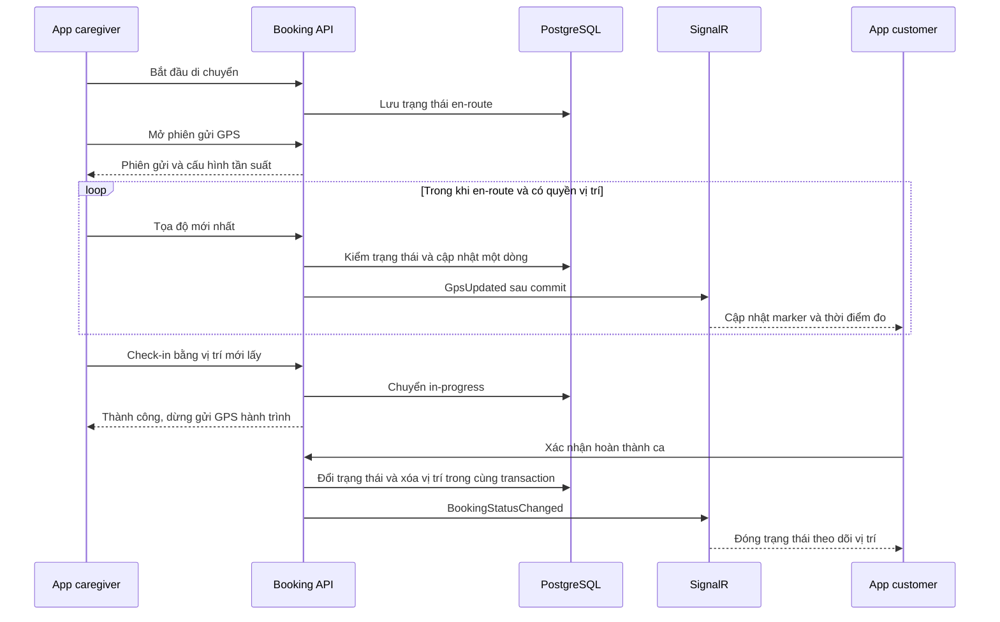

# Plan theo dõi caregiver khi đang đến địa điểm chăm sóc

Ngày: 05/10/2026. Đã triển khai source MVP foreground, migration SQL 33 và test tự động. Chưa deploy hoặc kiểm thử GPS trên thiết bị thật. Quyết định cuối và cách bật tính năng nằm trong [runbook](docs/LIVE_TRACKING.md) và [decisions.md](decisions.md).

Cập nhật cùng ngày: đã đọc đầy đủ ba phần mẫu do người dùng cung cấp (entity/configuration trong tin nhắn, store và migration trong hai file đính kèm). Mục 14 giữ lại review mẫu. Phần khảo sát/đề xuất bên dưới là mốc trước triển khai; runbook mô tả hành vi source hiện tại.

## 1. Phạm vi đã thống nhất

- Customer xem vị trí caregiver đang đến cho đúng booking của mình.
- Chỉ gửi vị trí hành trình trong trạng thái `caregiver_en_route`. Check-in thành công thì dừng gửi.
- Mỗi booking có tối đa một bản ghi vị trí hiện hành, GPS mới ghi đè GPS cũ.
- Khi ca hoàn thành hoặc bị hủy, tự xóa bản ghi vị trí realtime; gói GPS đến trễ không được tạo lại bản ghi.
- Mốc check-in, timeline chăm sóc, báo cáo, thanh toán vẫn lưu theo luồng hiện có.
- Mở rộng module Booking, app caregiver và app customer; dùng lại SignalR và `flutter_map`.
- Lịch sử toàn bộ hành trình, dẫn đường bằng giọng nói và ETA theo giao thông trực tiếp nằm ngoài MVP. Tìm đường/ETA có thể tích hợp sau khi luồng vị trí chạy ổn.

Các con số về chu kỳ gửi, độ cũ, tải thử và lưu dự phòng dưới đây là cấu hình khởi điểm đề xuất, chưa phải kết quả đo hoặc cam kết hiệu năng.

## 2. Kết quả khảo sát mã nguồn

| Thành phần | Hiện trạng và hệ quả | Điểm tích hợp |
| --- | --- | --- |
| Nhận GPS | Handler luôn trả `GpsTrackingDisabled`; HTTP 410. Command chỉ có BookingId, controller không nhận body tọa độ | [PostBookingGpsCommandHandler](../../backend/caresitter-be/Modules/Booking/Application/Commands/Tracking/PostBookingGps/PostBookingGpsCommandHandler.cs), [controller](../../backend/caresitter-be/Modules/Booking/Controllers/BookingTrackingController.cs) |
| Lưu GPS | `booking.gps_tracks` là bảng nhiều điểm; latest đọc bằng sort thời gian. Không phù hợp mục tiêu chỉ giữ một vị trí | [BookingTrackingStore](../../backend/caresitter-be/Modules/Booking/Infrastructure/BookingTrackingStore.cs), [mapping](../../backend/caresitter-be/Modules/Booking/Infrastructure/BookingDbContext.cs) |
| Phát GPS | Có DTO `GpsUpdatedEvent`; notifier tracking hiện chỉ phát timeline | [Hub](../../backend/caresitter-be/Shared/CareSitter.Infrastructure/Hubs/CareTrackingHub.cs), [notifier](../../backend/caresitter-be/Modules/Booking/Application/Ports/IBookingTrackingNotifier.cs) |
| Bắt đầu di chuyển | Cập nhật trạng thái, timeline, sync và notification; chưa khởi động stream vị trí | [handler en-route](../../backend/caresitter-be/Modules/Booking/Application/Commands/Bookings/StartBookingEnRoute/StartBookingEnRouteCommandHandler.cs), [controller caregiver](../../frontend/caregiver-app/lib/features/shifts/presentation/controllers/shift_list_controller.dart) |
| Lấy vị trí caregiver | Bản đồ và check-in lấy vị trí từng lần; repository ghi rõ gửi GPS định kỳ đã tắt | [GpsRepository](../../frontend/caregiver-app/lib/features/shifts/data/repositories/gps_repository.dart), [check-in](../../frontend/caregiver-app/lib/features/shifts/presentation/controllers/shift_checkin_controller.dart) |
| Customer tracking | Đã nghe GPS và animate marker; chưa gọi latest lúc mở/reconnect. Reconnect màn hình chỉ tải lại checklist. ETA đang dùng khoảng cách đường thẳng/vận tốc | [ShiftTrackingScreen](../../frontend/customer-app/lib/features/shift_tracking/presentation/screens/shift_tracking_screen.dart) |
| Kết nối lại | Service có rejoin group nhưng chưa chờ tất cả rejoin thành công trước khi báo reconnect; join chỉ xử lý riêng chuỗi `unauthorized` | [CareSignalRService](../../frontend/customer-app/lib/core/realtime/care_signalr_service.dart) |
| Hoàn thành ca | Có customer/admin xác nhận và job tự xác nhận; xóa chỉ ở một controller sẽ bỏ sót đường tự động | [CompleteBooking](../../backend/caresitter-be/Modules/Booking/Application/Commands/Bookings/CompleteBooking/CompleteBookingCommandHandler.cs), [BookingJobsService](../../backend/caresitter-be/Modules/Booking/Infrastructure/BookingJobsService.cs) |
| Hạ tầng | Có PostgreSQL, Redis cache cho OTP, Hangfire và SignalR. `AddSignalR()` chưa cấu hình backplane trong Program đang đọc | [Program](../../backend/caresitter-be/ApiHost/Program.cs) |
| Mobile | Lockfile đang dùng geolocator 13.0.4. Android manifest app khai báo coarse/fine; iOS mô tả quyền chỉ cho check-in, chưa có background location mode trong Info.plist | [lockfile](../../frontend/caregiver-app/pubspec.lock), [Android manifest](../../frontend/caregiver-app/android/app/src/main/AndroidManifest.xml), [iOS plist](../../frontend/caregiver-app/ios/Runner/Info.plist) |

Kết luận khảo sát chỉ áp dụng cho checkout local đang đọc, không xác nhận trạng thái bản đang deploy. Manifest hợp nhất Android và bản build release cần kiểm tra riêng vì plugin có thể bổ sung khai báo.

## 3. Lợi ích và đánh đổi

| Lợi ích | Cách đạt được | Giới hạn cần chấp nhận |
| --- | --- | --- |
| Gia đình biết caregiver đang đến đâu | GPS thật, timestamp và marker cập nhật | Phụ thuộc mạng, tín hiệu GPS và quyền trên điện thoại |
| Giới hạn số dòng GPS | Khóa chính booking_id, cập nhật tại chỗ | Số lần ghi, WAL và dead tuples vẫn tăng theo tần suất |
| Giảm giữ vị trí không cần thiết | Dừng sau check-in; xóa khi complete/cancel | Không thể xem lại toàn bộ tuyến đường để đối chiếu |
| Chi phí MVP dễ kiểm soát | Dùng backend, DB, SignalR, thư viện map hiện có | Cần đo tải thực tế; máy chủ bản đồ miễn phí có điều kiện sử dụng |
| Dễ bảo đảm xóa và đổi trạng thái đồng thời | Vị trí và booking ở cùng PostgreSQL transaction | Transaction phải ngắn, đúng thứ tự khóa |

Chọn PostgreSQL một dòng/booking cho MVP dù Redis đã có. Redis có thể là bước tối ưu khi phép đo chỉ ra tải ghi là nút thắt; khi chuyển phải giải quyết thêm thứ tự sự kiện, invalidation và race giữa cache với trạng thái DB. Không ghi cùng một luồng GPS vào cả hai nơi trong MVP.

## 4. Luồng và vòng đời

| Trạng thái | Nhận GPS hành trình | Customer thấy gì | Dữ liệu vị trí |
| --- | --- | --- | --- |
| Trước en-route | Từ chối | Caregiver chưa bắt đầu di chuyển | Không tạo tọa độ |
| En-route, chưa có mẫu | Chấp nhận sau khi mở phiên | Đang chờ vị trí | Có thể có dòng phiên với tọa độ null |
| En-route, GPS mới | Chấp nhận có giới hạn | Marker, độ chính xác, lần cập nhật | Ghi đè mẫu cũ |
| En-route, mất tín hiệu | Không bịa mẫu mới | Vị trí cuối, ghi rõ đã cũ | Giữ mẫu cuối đến hạn lưu |
| In-progress/check-out review | Từ chối | Đã đến/đang chăm sóc | Ngừng cập nhật; không trình bày điểm cũ như live |
| Completed/cancelled/refunded | Từ chối | Ca đã kết thúc/hủy | Xóa dòng realtime |
| Crisis/disputed hoặc trạng thái khác | Từ chối | Theo trạng thái nghiệp vụ hiện hữu | Không tự bật tracking để xử lý SOS/tranh chấp; áp dụng hạn lưu dự phòng |

Check-in tiếp tục lấy vị trí mới qua luồng riêng; không dùng điểm trên bản đồ thay thế việc xác thực check-in. Customer không cần cấp quyền vị trí để xem caregiver.

## 5. Dữ liệu và chống ghi lại sau khi xóa

Tạo bảng `booking.live_locations`, không đổi `gps_tracks` thành bảng khác ý nghĩa và không tự xóa lịch sử GPS legacy. Bảng mới thuộc Booking; tối đa một dòng/booking, kể cả trạng thái phiên chưa có tọa độ.

| Cột đề xuất | Kiểu | Mục đích |
| --- | --- | --- |
| `booking_id` | UUID, PK/FK | Ràng buộc một dòng/booking; cascade khi booking bị xóa vật lý |
| `caregiver_id` | UUID | Caregiver hiện được phân công; backend xác định |
| `tracking_session_id` | UUID | Phiên gửi do backend cấp, vô hiệu hóa phiên cũ khi đổi thiết bị |
| `source_instance_id` | UUID | Nhận diện lần chạy bộ gửi, phục vụ mở phiên idempotent; không thay thế JWT |
| `last_sequence` | BIGINT | Thứ tự mẫu trong phiên; tăng đơn điệu |
| `location_version` | BIGINT | Thứ tự bản cập nhật do server cấp trong vòng đời dòng |
| `latitude`, `longitude` | DOUBLE PRECISION, nullable cùng nhau | Chưa có fix thì null; kiểm giới hạn và giá trị hữu hạn |
| `accuracy_meters` | DOUBLE PRECISION, nullable | Độ chính xác của mẫu |
| `speed_mps`, `heading_degrees` | DOUBLE PRECISION, nullable | Vận tốc/hướng nếu thiết bị cung cấp giá trị hợp lệ |
| `captured_at` | TIMESTAMPTZ, nullable | Thời điểm thiết bị đo, không thay bằng thời gian gửi lại |
| `received_at` | TIMESTAMPTZ, nullable | Thời điểm server nhận mẫu được chấp nhận |
| `session_lease_until` | TIMESTAMPTZ | Hạn quyền gửi của một thiết bị, đề xuất 120 giây và gia hạn khi nhận mẫu hợp lệ |
| `expires_at` | TIMESTAMPTZ | Hạn lưu dự phòng do server đặt |

Không cần spatial index cho truy vấn theo booking ID; chỉ thêm index phục vụ dọn dữ liệu khi đo thấy cần. `location_version` và session ID dùng chung trong REST/SignalR. Phiên mới xóa mẫu cũ và đặt trạng thái chờ fix; client không dùng sequence giữa hai phiên để so sánh.

**Giao dịch ghi vị trí:** kiểm JWT/rate limit/input → mở transaction và đặt RLS context nếu dùng → khóa dòng booking (`FOR UPDATE`) → kiểm lại người được phân công và trạng thái en-route → khóa/kiểm dòng phiên → cập nhật mẫu mới → commit → phát SignalR. Mọi đường liên quan cùng khóa booking trước vị trí; không gọi map provider hoặc mạng bên ngoài trong transaction. Quyền People dùng port hiện có, không query runtime chéo module.

**Giao dịch xóa:** đề xuất SQL trigger trên thay đổi trạng thái booking, xóa `live_locations` khi trạng thái kết thúc (`COMPLETED`, `CANCELLED`, `REFUNDED`). Xóa nằm cùng transaction với thay đổi trạng thái, bao phủ cả handler, admin, job tự hoàn tất và đường hoàn tiền. Trigger chỉ đụng bảng của Booking và phải được integration test với DB role thực tế. Không đặt việc xóa chỉ trong post-commit best-effort hoặc trong app customer.

Với thứ tự khóa này: GPS commit trước thì transaction kết thúc ca xóa nó; kết thúc ca commit trước thì GPS đọc trạng thái mới và bị từ chối. Kiểm tra trạng thái ở application rồi upsert ở transaction khác không đủ để bảo đảm điều này. [PostgreSQL: khóa dòng](https://www.postgresql.org/docs/current/explicit-locking.html).

Job Hangfire mỗi 5 phút xóa theo batch các dòng kết thúc còn sót hoặc hết hạn; chạy lặp phải an toàn. Hạn dự phòng đề xuất là 24 giờ từ mẫu hợp lệ cuối cùng, dùng thời gian server. GET không phục vụ dòng đã hết hạn dù job chưa chạy. Ca bị treo vẫn phải hết hạn; heartbeat giả hoặc request sai không gia hạn. Đây là lựa chọn kỹ thuật cần ghi trong cấu hình retention khi triển khai.

Xóa khỏi bảng đang hoạt động không có nghĩa biến mất ngay khỏi backup/WAL hoặc làm file DB nhỏ ngay. UPDATE/DELETE cần autovacuum để tái sử dụng dung lượng; theo dõi dead tuples và WAL, không chạy VACUUM FULL theo mỗi ca. [PostgreSQL: vacuum](https://www.postgresql.org/docs/current/routine-vacuuming.html).

## 6. API, phân quyền và thứ tự sự kiện

Các hợp đồng sau là đề xuất để triển khai; chưa tồn tại đầy đủ trong code.

| API/sự kiện | Hành vi |
| --- | --- |
| `POST /api/v1/bookings/{id}/gps/session` | Chỉ caregiver được phân công, booking en-route. Nhận sourceInstanceId; cấp/resume trackingSessionId, nextSequence, lease/config. Cùng instance retry trả cùng phiên; thiết bị khác chỉ thay phiên khi lease hết hạn. Phiên còn sống trả 409 và thông báo đang gửi từ thiết bị khác |
| `POST /api/v1/bookings/{id}/gps` | Body gồm sessionId, sequence, latitude/longitude, accuracyMeters, speed, heading, capturedAt. Server tự lấy caregiverId/receivedAt. Giữ endpoint cũ, mở lại dưới feature flag |
| `GET /api/v1/bookings/{id}/gps/latest` | Chỉ customer chủ booking, caregiver được phân công, admin theo policy hiện có. Đọc bảng mới; trả thêm sessionId, version, capturedAt/receivedAt và bookingVersion. `Cache-Control: no-store` |
| `GpsUpdated` | Giữ tên event hiện có, thêm các trường thứ tự/tuổi mẫu; phát sau commit tới group booking đã xác thực. Không ghi một booking sync event/notification/timeline cho mỗi điểm GPS |
| `BookingStatusChanged` | Bổ sung bookingVersion nếu cần để xử lý sự kiện đến sai thứ tự; dùng trạng thái này để dừng sender và dọn UI |
| `GET /gps-tracks` legacy | Không thêm lịch sử mới. Giữ hợp đồng cũ cho dữ liệu cũ, không fallback từ latest mới sang lịch sử cũ sau khi live đã bị xóa |

HTTP: 401 cho hết phiên đăng nhập; 403 cho sai quyền; 404 phân biệt booking không tồn tại và chưa có fix bằng mã lỗi; 409 cho trạng thái/phiên không còn cho gửi; 410 khi chức năng bị tắt; 429 có Retry-After; lỗi tạm thời 5xx có backoff. Mẫu trùng sequence trả thành công không ghi/phát lại; sequence cũ bị bỏ qua, không lùi tọa độ. Session mới không được tự mở sau check-in/kết thúc ca.

Tọa độ không hữu hạn hoặc ngoài khoảng bị từ chối. Chuẩn hóa speed/heading âm do thiết bị báo unknown thành null ở client; backend kiểm lại. `capturedAt` quá cũ (đề xuất 60 giây) hoặc quá xa tương lai (30 giây) trả lỗi riêng, không biến mẫu cũ thành mới. Độ chính xác kém phải hiển thị rõ hoặc bỏ theo ngưỡng thử nghiệm; tọa độ có thể bị giả nên không dùng live GPS làm bằng chứng duy nhất cho chấm công/thanh toán.

Không tin owner/caregiver ID từ body. Chuẩn hóa booking ID khi tạo group. Rejoin phải kiểm lại membership; xử lý rõ mọi kết quả ngoài `ok`. Thu hồi phân công/quyền phải làm connection cũ mất quyền xem, không chỉ chặn lần join sau. Không cho người không liên quan đọc qua REST hoặc nghe sự kiện qua group cũ.

Sự kiện GPS cũ có thể còn trên đường truyền khi ca vừa kết thúc. Client bỏ sự kiện nếu đã biết booking không còn en-route, so sánh bookingVersion/session/version và tải lại trạng thái khi có mâu thuẫn. DB bảo đảm không phục hồi bản ghi đã xóa; cập nhật các màn hình là eventual qua SignalR và resync, không hứa rút lại dữ liệu đã tới máy khách.

## 7. Tích hợp app caregiver và customer

### Caregiver

- Tạo service/provider tracking cấp phiên đăng nhập, tách khỏi vòng đời màn hình bản đồ. Bấm đi → API en-route thành công → mở phiên GPS → bắt đầu stream. Mở nhiều màn hình không tạo nhiều sender.
- Trình bày rõ đang chia sẻ vị trí cho ca nào. Xin quyền khi bắt đầu dùng tính năng; từ chối quyền không làm giả vị trí hoặc phá hủy booking. Customer thấy đang chờ vị trí.
- Chu kỳ khởi điểm: đang di chuyển mục tiêu 10 giây/mẫu; có thể giảm còn 5 giây sau khi đo tải/pin. Đứng yên gửi tối đa một mẫu mới mỗi 30 giây. Không dùng `distanceFilter` làm cơ chế duy nhất vì sẽ thiếu trạng thái đứng yên; khi chưa có fix mới phải giữ capturedAt cũ và báo stale, không làm mới timestamp giả.
- Tối đa một request gửi đang chạy và một mẫu mới nhất đang chờ. Mất mạng bỏ mẫu trung gian, có mạng lấy fix mới; không replay cả hành trình. 429 tuân Retry-After; 5xx backoff có jitter; 409/410 dừng và tải lại booking/config.
- Check-in thành công, đổi sang trạng thái ngoài en-route, logout, đổi tài khoản, thu hồi quyền hoặc mất phân công đều dừng sender. Logout hủy subscription, request, mẫu chờ và định danh phiên; retry token không được gửi lại cho tài khoản khác.
- Mỗi response GPS nên có trạng thái cho phép tiếp tục; ngoài ra resync trạng thái khi resume/reconnect. Không phụ thuộc duy nhất vào push để dừng khi customer hủy.
- App khởi động lại kiểm tra booking trên server trước khi khôi phục; không tự bật GPS chỉ vì còn booking ID trong storage.

**Android:** thử location foreground service được khởi động từ thao tác khi app đang hiển thị, có thông báo đang chia sẻ; kiểm merged manifest/service type và quyền theo target SDK. Việc khởi động service từ nền có hạn chế, không thêm quyền nền rộng chỉ để tránh thiết kế vòng đời. [Android location service](https://developer.android.com/develop/background-work/services/fgs/service-types#location).

**iOS:** kiểm capability Location Updates, usage description và cấu hình plugin; chạy thử khóa màn hình/chuyển Maps trên máy thật. Không cam kết chu kỳ chính xác hoặc tiếp tục chạy sau khi người dùng buộc dừng app. Kiểm khả năng duy trì cả GPS và upload, không chỉ việc callback xuất hiện. [Apple background location](https://developer.apple.com/documentation/corelocation/handling-location-updates-in-the-background), [geolocator 13.0.4](https://pub.dev/packages/geolocator/versions/13.0.4).

### Customer

- Đăng ký listener trước, join thành công rồi GET latest; dùng version để snapshot REST cũ không ghi đè event vừa nhận.
- Sau reconnect: chờ rejoin thành công, tải booking và latest, rồi hợp nhất theo version. Sửa join/rejoin không thành công và retry kết nối lần đầu; kiểm số subscriber khi nhiều màn hình dùng cùng booking group.
- Nếu mất SignalR, polling latest mỗi 30 giây khi màn hình đang hiển thị và booking vẫn en-route; dừng khi rời màn hình, logout hoặc kết thúc. Không coi 403/404 là cùng một tình huống.
- Hiển thị các trạng thái chờ fix, cập nhật, GPS kém, vị trí cũ trên 60 giây, mất kết nối và đã đến. Tuổi vị trí dựa trên capturedAt, dùng receivedAt để chẩn đoán mạng; bản cũ không mặc định `DateTime.now()` khi timestamp lỗi.
- Gắn `_mapController` vào `FlutterMap` (hiện có controller nhưng đoạn widget chưa truyền vào); kiểm animation, hủy animation khi dừng, tôn trọng người dùng đang kéo map. Không suy diễn tọa độ tương lai khi thiếu GPS.
- Bỏ polyline lịch sử giả định có đầy đủ hành trình. MVP chỉ hiển thị marker; nếu giữ vài điểm trong RAM để làm mượt thì xóa khi rời/kết thúc, không lưu disk hoặc gọi đó là lịch sử đầy đủ.
- Trong ca chăm sóc chuyển sang nội dung chăm sóc/check-in; không gắn nhãn live cho điểm di chuyển cuối. Xóa marker, lịch sử trong RAM và ETA khi ca kết thúc.

## 8. Map và ETA

Giữ renderer `flutter_map`. Nguồn tiles cấu hình được; không đổi provider là điều kiện để sửa GPS. Hai màn hình hiện dùng tiles OSM công cộng: bổ sung attribution hiển thị rõ, kiểm cache và user agent, không tải hàng loạt/offline. Dịch vụ công cộng không có SLA. [Chính sách OSM](https://operations.osmfoundation.org/policies/tiles/).

Geoapify là ứng viên cho giai đoạn tuyến đường: gói free đang công bố 3.000 credits/ngày, cho phép thương mại trong hạn mức và điều kiện ghi nguồn. Cần khóa API, đo tổng credits của tiles/search/routing và thử tuyến xe máy tại khu vực phục vụ trước khi chọn. Đây là đề xuất, chưa tạo tài khoản hoặc đổi provider. [Giá Geoapify](https://www.geoapify.com/pricing/), [Routing](https://apidocs.geoapify.com/docs/routing/).

Tìm đường là adapter riêng trong Booking hoặc port phù hợp, có timeout/cache/rate limit/quota. Chỉ tính lúc bắt đầu, lệch tuyến đáng kể hoặc chu kỳ thưa; không gọi theo mỗi GPS. Lỗi provider hoặc hết quota vẫn xem được vị trí khi tiles còn dùng được; ẩn ETA/tuyến không hợp lệ. ETA đường thẳng chia vận tốc hiện có nên thay bằng “Chưa có ước tính” cho tới khi route adapter được nghiệm thu; không mô tả ETA ước lượng là dữ liệu giao thông trực tiếp.

## 9. Tải dự kiến và rủi ro

Với N caregiver đồng thời, chu kỳ T giây: tốc độ ghi tối đa thông thường khoảng N/T mẫu mỗi giây, chưa tính mở phiên/retry. Một chuyến 30 phút là 180 lần cập nhật ở 10 giây hoặc 360 ở 5 giây, nhưng vẫn chỉ một dòng logic.

| Caregiver đang đi đồng thời | Gửi mỗi 10 giây | Gửi mỗi 5 giây |
| --- | --- | --- |
| 100 | 10 cập nhật/giây | 20 cập nhật/giây |
| 500 | 50 cập nhật/giây | 100 cập nhật/giây |
| 1.000 | 100 cập nhật/giây | 200 cập nhật/giây |

Số dòng còn giữ gồm cả ca đã check-in nhưng chưa kết thúc/hết hạn. Đây là phép tính lưu lượng, không phải bằng chứng DB hiện tại chịu được tải này. Fanout SignalR tăng theo số người cùng xem; payload, TLS, retry, log, WAL và index phải được đo thực tế.

| Rủi ro | Mức | Biện pháp và bằng chứng cần có |
| --- | --- | --- |
| Gói đến trễ tạo lại dòng đã xóa | Cao | Lock booking + kiểm trạng thái + xóa cùng transaction; race test bằng PostgreSQL thật |
| Xem vị trí sai người/ca | Cao | Ownership REST, membership Hub, revoke group; test hai customer, caregiver khác và reconnect |
| Ngốn pin hoặc bị OS ngắt nền | Cao | Chu kỳ thích ứng, service/capability đúng; đo điện thoại thật, UI stale rõ ràng |
| Gửi tiếp sau hủy/logout | Cao | Server chặn mọi lần ghi, sender dừng theo response/resync; test account switch và token refresh |
| UPDATE nhiều dù ít dòng | Trung bình–cao | Theo dõi DB CPU, WAL, locks, autovacuum; tải tăng dần, giữ transaction ngắn |
| Mẫu cũ/nhảy vị trí/hai thiết bị | Trung bình | Session/sequence/version, capturedAt, lease một source; test duplicate/out-of-order/takeover |
| Lỗi SignalR sau khi DB đã ghi | Trung bình | Post-commit phát best-effort, REST latest để phục hồi; không retry ghi tạo lịch sử |
| Nhiều backend instance không phát tới nhau | Cao khi scale | Kiểm topology; dùng Redis backplane hoặc dịch vụ SignalR khi cần và test cross-instance |
| Xóa mất khả năng xem lại hành trình | Đánh đổi đã chọn | Lưu mốc nghiệp vụ riêng; không hứa có replay hoặc dùng live GPS làm bằng chứng duy nhất |
| Dữ liệu vị trí lọt vào log/backup | Trung bình | Không log tọa độ/payload/token; metrics tổng hợp; áp dụng retention backup riêng |
| Quota map/ETA và chất lượng đường Việt Nam | Trung bình | Adapter, hạn mức/cache, thử tuyến thực tế; degrade rõ ràng khi provider lỗi |
| Ảnh hưởng check-in/thanh toán | Cao | Chỉ thêm bảng/endpoint/trigger hẹp; regression lifecycle, geofence, checkout, dispute và settlement |

Redis cache sẵn có không tự trở thành SignalR backplane. Nếu chạy nhiều instance, cấu hình backplane và affinity theo transport/deployment thực tế; không bật rollout nhiều instance trước khi có test fanout. [Microsoft: SignalR scale](https://learn.microsoft.com/en-us/aspnet/core/signalr/scale?view=aspnetcore-9.0).

## 10. Thứ tự triển khai và đầu ra

| Bước | Công việc | Điều kiện hoàn tất |
| --- | --- | --- |
| P0 — baseline | Ghi phiên bản app/backend, DB role/schema, topology; spike Android/iOS khóa màn hình và upload bằng plugin đang lock; chốt config thử | Biết môi trường nào hỗ trợ; không hứa background trước khi spike đạt |
| P1 — storage và API | SQL mới theo số tiếp theo, entity/mapping, session/validator/store/notifier, rate limit, feature flag, latest, trigger xóa và job dọn | Unit + PostgreSQL integration/race pass; latest không đọc legacy sau xóa |
| P2 — sender | Provider/service GPS, mở phiên, throttle, coalesce, retry, permission/lifecycle, dừng theo trạng thái và logout | Tests với vị trí/mạng/clock giả có kiểm soát; Android build và device spike |
| P3 — customer | REST snapshot + SignalR, reconnect/fallback, freshness, map controller, dọn UI, attribution | Widget/state tests, layout màn nhỏ, không dùng vị trí giả |
| P4 — tích hợp | Hai tài khoản/hai điện thoại, mất mạng/nền/hủy/check-in/auto complete; regression toàn luồng booking | Ghi bằng chứng từng kịch bản; iOS cần môi trường Mac/Xcode và thiết bị |
| P5 — tải và rollout | Tải PostgreSQL/fanout, pin, cleanup, feature flag, dashboard chỉ số, rollback drill | Đạt tiêu chí mục 12 trên hạ tầng staging đã ghi cấu hình |
| P6 — tuyến đường/ETA | Provider adapter và quota, test xe máy/tuyến địa phương | Nghiệm thu riêng; không chặn việc giao live marker nếu chưa chọn provider |

Migration tuân [quy trình SQL của repo](docs/MIGRATIONS.md): thêm file mới trong `init-db`, không sửa SQL đã áp dụng, không dùng EF migration. Số file quyết định lúc triển khai để tránh đụng nhánh đang làm việc; hiện thấy tới 32. Kiểm fresh DB, upgrade từ baseline được hỗ trợ và checksum replay. Không biến đổi/xóa bảng legacy trong migration MVP này.

Các endpoint và DTO vẫn theo cấu trúc Commands/Tracking/Ports đang được refactor. Runtime GPS không tăng `bookings.sync_version`, ghi audit toàn payload hoặc gửi notification mỗi mẫu; chỉ thay đổi nghiệp vụ mới đi qua booking sync. RLS context phải được đặt trong transaction đang đọc/ghi; không dựa vào `SaveChangesAsync` cho các raw SQL trước đó.

## 11. Ma trận kiểm thử

| Nhóm | Kịch bản bắt buộc | Kết quả mong đợi |
| --- | --- | --- |
| Chuẩn | Start → nhiều GPS → customer mở sau → check-in → complete | Marker mới; một dòng; dừng ở check-in; 0 dòng ở complete |
| Phân quyền | Customer khác GET/join, caregiver khác POST, giả caregiverId, access sau reassignment | Không đọc/ghi/nghe trái quyền; group cũ bị xử lý |
| Validation | NaN/infinity, ngoài biên, speed/heading unknown, độ chính xác kém, clock lệch | Lỗi có mã; không ghi sai, không crash map |
| Thứ tự | Request trùng, sequence cũ, REST chậm hơn event, event phiên cũ, hai source | Không lùi marker hoặc phát lại mẫu; lease/takeover đúng |
| Race | Barrier đồng thời POST với cancel/check-in/complete/auto-complete; chạy cả hai thứ tự commit | Terminal không còn dòng, POST đến sau bị chặn, check-in không nhận thêm mẫu |
| Mất mạng | Tắt mạng 2 phút; reconnect; POST timeout dù DB commit; token hết hạn | Coalesce một mẫu, không replay đường đi, latest phục hồi, refresh không tạo sender trùng |
| SignalR | Fail connect đầu, rejoin bị từ chối, mất event, hai màn hình cùng group, nhiều instance | Retry/fallback giới hạn, không unsubscribe nhầm, fanout đúng |
| Vòng đời app | Rời map, khóa màn hình, mở Maps, tắt GPS, thu hồi quyền, battery saver, force-stop, mở lại | Trạng thái thật; không hứa live khi OS ngừng; mở lại kiểm server |
| Kết thúc | Customer/admin complete, Hangfire auto complete, cancel trong/en-route/sau check-in, refund | Trigger xóa nhất quán; không ảnh hưởng timeline/báo cáo/tiền |
| Cleanup | Hết hạn, job chạy lại/chạy đồng thời, crash sau DB commit trước broadcast | GET không lộ dòng hết hạn; job idempotent; resync dọn UI |
| UI | Chưa có fix, thiếu tọa độ đích, marker gần biên, chữ lớn/màn hẹp, timestamp lỗi | Không marker giả, không overflow, nhãn stale chính xác |
| Hồi quy | Geofence check-in, checklist, checkout review, dispute, settlement và booking sync | Hành vi nghiệp vụ hiện có giữ đúng |

Unit tests cho policy tần suất/sequence/validation, fake clock và mạng giúp kiểm timeout chính xác. Race/trigger/PK/retention bắt buộc PostgreSQL thật, không EF InMemory. Widget tests không chứng minh khả năng GPS nền.

Lệnh dự kiến chạy khi đã có implementation: `dotnet test` cho Booking unit, integration và architecture; `flutter analyze` + các test liên quan trong hai app; build Android release. Vì thay schema, chạy gate theo runbook `backend/scripts/test-phase7.ps1 -Repeat 2 -SkipFrontend` trên DB test. Chạy iOS trên Mac/Xcode riêng; môi trường Windows hiện tại không xác nhận được bản iOS.

## 12. Tiêu chí nghiệm thu và vận hành

- 100% ca test phân quyền/race/kết thúc không để vị trí trái quyền hoặc phục hồi dòng terminal.
- Khóa chính bảo đảm tối đa một dòng/booking. Query kiểm terminal join live_locations trả 0 ngay sau transaction commit; dòng hết hạn được job dọn trong 5 phút cộng thời gian chạy batch khi job hoạt động bình thường.
- Mục tiêu staging ban đầu: 100 caregiver đồng thời, mỗi 10 giây, 2 viewer/booking trong 30 phút; POST p95 dưới 500 ms, server-receive tới viewer p95 dưới 2 giây, không deadlock hoặc backlog tăng liên tục. Đây là gate đề xuất cần đo, không phải năng lực hiện có.
- Tăng thử tới 500 caregiver để tìm giới hạn; không mở rộng pilot vượt tải đã đạt. So sánh CPU, connection pool, WAL/giờ, dead tuples, lock waits và latency booking nền trước/sau.
- Đo pin/mạng ít nhất 60 phút trên Android phổ biến và iPhone, so với cùng máy không tracking trong điều kiện gần giống. Ngưỡng đề xuất: pin tăng thêm không quá 5 điểm phần trăm/giờ ở bài thử khóa màn hình; vượt ngưỡng thì chỉnh chu kỳ/accuracy trước rollout. Ghi model/OS, điều kiện mạng và số lần ngắt; không suy từ simulator.
- Chu kỳ 10 giây là mục tiêu; hệ điều hành có thể điều tiết. GPS trên 60 giây phải hiện vị trí cũ; thiếu GPS/không có background support không được hiển thị đang live.
- Metrics gồm accepted/rejected/duplicate GPS, tuổi mẫu, POST latency, delivery latency, reconnect, số dòng active/expired, cleanup failures. Không dùng tọa độ hay booking ID làm nhãn metrics có cardinality cao.
- Feature flag mặc định tắt, bật staging rồi pilot giới hạn. Theo dõi lỗi nền, stale rate, pin và DB trước khi mở rộng. API nên trả cấu hình/tình trạng tắt để mobile ngừng gửi nhanh.
- Rollback: tắt nhận GPS mới, client dừng/resync, giữ cleanup và trigger hoạt động; không rollback bằng xóa bảng/SQL lịch sử, không bật lại API legacy để làm fallback. Latest không được hiển thị nhãn live khi feature đã tắt.

## 13. Trạng thái kiểm tra tại lúc lập plan

Đã kiểm tra source các điểm gửi/nhận/lưu GPS, status handlers, job tự hoàn tất, latest REST, SignalR join/rejoin, manifest/plist, lockfile, cách đăng ký Redis/Hangfire và quy trình migration. Đã đối chiếu tài liệu chính thức về location nền, SignalR scale và PostgreSQL locks/vacuum; nguồn được gắn ngay ở phần liên quan.

Chưa chạy migration, build/test runtime, load test, test nền hoặc đo pin vì turn này tạo plan. Các test/gate ở trên là công việc phải thực hiện khi triển khai, không phải kết quả đã đạt. Chưa tạo khóa bản đồ, thay nhà cung cấp, cài thư viện hoặc thay dữ liệu hiện hữu.

## 14. Cập nhật từ mẫu người dùng cung cấp — 05/10/2026

### Đã đọc đủ ba phần, hiện có một trigger cho ba trạng thái

1. `LiveLocation.cs`: entity + EF configuration được dán trực tiếp trong tin nhắn.
2. `LiveLocationStore.cs`: nội dung file đính kèm `27346f59-abad-48c2-bc71-d2d5f8475675/Pasted text.txt`.
3. `AddBookingLiveLocations.cs`: nội dung file đính kèm `c130ce2a-7ab6-4577-bcf3-700587354aec/Pasted text.txt`.

Migration mẫu khai báo một function `booking.fn_delete_live_location_on_terminal()` và một trigger `trg_booking_delete_live_location`. Trigger chạy sau khi status thay đổi sang `COMPLETED`, `CANCELLED` hoặc `REFUNDED` và xóa dòng theo `NEW.id`. Ba nhánh đã có trong điều kiện; không cần tạo ba trigger riêng. Cách viết trạng thái hoa khớp `BookingStatusCodec.ToDatabase` đang có. Nếu môi trường còn dữ liệu trạng thái chữ thường, phải kiểm kê/chuẩn hóa hoặc xử lý tương thích trước khi chốt trigger.

Xóa vật lý booking là việc của FK `ON DELETE CASCADE`; dọn hết hạn là việc của job. Hai cơ chế này không phải hai trigger bị thiếu. Trigger cũng không tự dọn dữ liệu terminal đã tồn tại trước migration hoặc tự ngăn một writer sai chèn sau khi trạng thái đã terminal; cần kiểm trạng thái dưới khóa và job đối soát như thiết kế.

### Kết quả review tĩnh và việc cần sửa

| Ưu tiên | Phát hiện ở mẫu | Cách xử lý trước khi tích hợp |
| --- | --- | --- |
| P1 | Hướng dẫn chạy `dotnet ef migrations add` và class Up/Down không phù hợp repo SQL-only; integration test hiện cấm compile EF migration/snapshot vào module | Chuyển DDL/function/trigger thành file SQL mới trong `init-db`; chỉ dùng EF cho entity/configuration. Không chạy Up/Down hoặc sửa SQL lịch sử |
| P1 | FK từ live_locations tới bookings đang comment ở cả configuration và migration | Bật FK đúng `booking.bookings(id)` và cascade trong SQL lẫn EF mapping; test xóa booking vật lý |
| P1 | `GetGuid(1)` được gọi trước khi kiểm trạng thái; `bookings.caregiver_id` thực tế nullable | Dùng IsDBNull/Guid?, trả lỗi nghiệp vụ cho chưa phân công; không để booking chưa có caregiver gây 500 |
| P1 | `callerCaregiverId` so trực tiếp với profile ID; store không tự xác minh caller user | Handler lấy user từ JWT và dùng `IPeopleLookupService.IsCaregiverForBookingAsync`; không nhận profile ID đáng tin từ request. Kiểm lại assignment dưới khóa |
| P1 | Có cột session/lease nhưng `WriteAsync` không đọc/kiểm chúng, DTO mẫu không có session | Chọn rõ MVP không lease hoặc triển khai session end-to-end. Không công bố khả năng chặn hai thiết bị chỉ vì có cột nullable |
| P1 | `location_version` bắt đầu lại ở 1 sau khi dòng bị xóa/hết hạn rồi tạo lại; client có thể vẫn giữ version cao | Có generation/session ID thay đổi khi tái tạo và snapshot handshake, hoặc dùng version server không tái sử dụng. Kiểm event cũ sau reconnect; không chỉ so số version |
| P2 | Điều kiện `EXCLUDED.captured_at >= ll.captured_at` nhận lại cùng timestamp, tăng version và phát lại mẫu | Chốt chính sách timestamp bằng nhau: mẫu trùng không ghi/không gia hạn; tối giản dùng strictly newer và bỏ mẫu bằng timestamp, kèm kiểm clock skew. Nếu cần phân biệt mẫu cùng timestamp thì thêm định danh mẫu/sequence |
| P2 | Thiếu CHECK “có tọa độ thì có captured_at/received_at”; accuracy/speed chỉ có cận dưới | Thêm timestamp invariant, version không âm và kiểm giá trị hữu hạn cả ở validator lẫn constraint phù hợp. Không coi `>= 0` là đã loại NaN/+Infinity |
| P2 | `GetDbTransaction()` cần extension namespace Storage, file mẫu chưa import | Thêm `using Microsoft.EntityFrameworkCore.Storage;` và compile trong project thật; chưa xác nhận build mẫu |
| P2 | Store raw SQL chưa đặt context RLS và GET chỉ lọc bookingId/hạn lưu | Bao quanh bằng quyền ứng dụng đúng; nếu dùng RLS đặt context trong transaction đang chạy, test với DB role thật. Không tự thêm SECURITY DEFINER để vượt lỗi quyền |
| P2 | Mẫu mới đặt fillfactor 70, chưa đặt autovacuum riêng; job chỉ xóa expired | Fillfactor là mức thử, bổ sung cấu hình autovacuum dựa trên đo; bổ sung đối soát terminal nếu muốn job dọn cả dòng sót; kiểm batchSize và batch bounded |

`FOR SHARE` trong mẫu là lựa chọn hợp lệ cho writer chỉ đọc booking rồi ghi bảng con: nó chặn UPDATE/DELETE của booking trong transaction, gồm cập nhật status. Điểm này điều chỉnh lựa chọn `FOR UPDATE` mạnh hơn ở mục 5: có thể dùng `FOR SHARE` cho đường chỉ ghi GPS sau khi race tests đạt. Các writer vẫn tranh khóa khi cùng upsert một dòng live_locations; không diễn giải shared lock trên booking thành không có tranh chấp ghi. Không hạ xuống `FOR KEY SHARE`, vì nó không chặn cập nhật status thông thường. Đường mở phiên/đổi phân công phải được kiểm thứ tự khóa riêng. [PostgreSQL row locks](https://www.postgresql.org/docs/current/explicit-locking.html#LOCKING-ROWS).

`fillfactor = 70` và tránh index cột thường đổi giúp tăng cơ hội HOT update, không bảo đảm mọi update đều HOT. Cần đo HOT ratio/dead tuples/WAL; chỉ thêm expires_at index khi lợi ích dọn dữ liệu bù được chi phí ghi. [PostgreSQL HOT](https://www.postgresql.org/docs/current/storage-hot.html). Ràng buộc số thực cần xét các giá trị đặc biệt PostgreSQL hỗ trợ. [PostgreSQL numeric types](https://www.postgresql.org/docs/current/datatype-numeric.html).

### Lịch triển khai MVP/NCKH cập nhật

Người dùng cung cấp các giai đoạn đánh số 0–5 (sáu giai đoạn). Ưu tiên khi thiếu thời gian: **0 → 1 → 3 → 2 foreground → 5**, rồi mới giai đoạn 4 chạy nền. Giai đoạn 3 có thể dùng nguồn sự kiện/vị trí kiểm thử để phát triển, nhưng nghiệm thu luồng thật phải đợi app caregiver ở giai đoạn 2; không đưa tọa độ giả vào sản phẩm.

- 0: ghi quyết định topology, tần suất 10–15 giây, retention 24 giờ, stale 60 giây, schema tối giản/phiên, nội dung chia sẻ vị trí và đối chiếu deployed/local vào decisions.md.
- 1: backend SQL, trigger, latest, feature flag, rate limit, quyền, race tests và các đường complete/admin/job/refund.
- 2: một sender foreground, coalesce một mẫu, timestamp của fix thật, xử lý retry/quyền/logout và dừng khi check-in.
- 3: listener → join → latest, reconcile version/generation, reconnect/polling, nhãn stale và fallback theo trạng thái.
- 4: Android foreground service/iOS background trên máy thật. Có thể giao MVP foreground-only nếu công bố rõ giới hạn; không ghi background là đã đạt khi bỏ giai đoạn này.
- 5: đo độ trễ, mẫu gửi/nhận/bỏ chủ động/mất ngoài ý muốn, pin và DB; viết kết quả/hạn chế. Tỷ lệ mất gói phải tách khỏi các mẫu coalesced/throttled chủ động; ghi điều kiện mạng và đồng bộ clock khi đo end-to-end.

Mẫu bảng rút gọn có 9 cột nền tảng và 4 cột tùy chọn. `location_version` sắp thứ tự kết quả server, còn capturedAt/session/sequence kiểm thứ tự đầu vào và nguồn gửi; đây là các trách nhiệm khác nhau. Phương án bỏ phiên phải ghi rõ đánh đổi nhiều thiết bị và giải pháp version khi dòng được tạo lại, trước khi xem schema là đã chốt.
