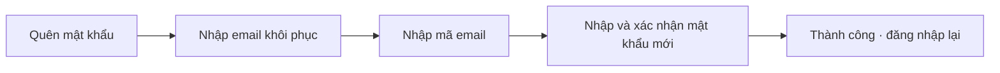
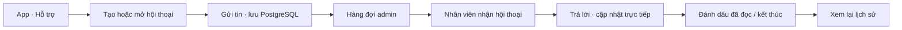

# Kế hoạch phát triển chat hỗ trợ và khôi phục mật khẩu

> **Ghi chú 15/10/2026:** Phần khôi phục mật khẩu trong tài liệu này là bối cảnh
> lịch sử. Kế hoạch thực thi chat hiện hành đã được tách và cập nhật theo source
> tại [`SUPPORT_CHAT_IMPLEMENTATION_PLAN.md`](SUPPORT_CHAT_IMPLEMENTATION_PLAN.md).
> Khi hai tài liệu khác nhau, dùng kế hoạch chat mới làm nguồn chuẩn.

**Ngày lập:** 06/10/2026, Asia/Saigon.  
**Nguồn:** working tree `D:\EXE\CareSitter`, nhánh `develop`.  
**Trạng thái:** chat vẫn là kế hoạch. Phần khôi phục mật khẩu đã triển khai
trong source ngày 06/10/2026; xem [chức năng, cấu hình và bằng chứng kiểm tra](PASSWORD_RECOVERY.md).
Các mục bên dưới giữ lại bản thiết kế ban đầu; không phải mọi hạng mục
vận hành/giai đoạn sau đã hoàn thành. Implement hiện dùng grant trong
record challenge và API recovery-email chung cho xác minh/đổi email;
tài khoản chỉ Google/OTP chưa có luồng tự đổi email.

## 1. Kết quả cần đạt và thứ tự làm

1. Người dùng quên mật khẩu có thể chứng minh quyền sở hữu email khôi phục,
   đặt mật khẩu mới và đăng nhập lại; các phiên cũ bị thu hồi.
2. Customer/caregiver có thể gửi tin nhắn hỗ trợ, xem lịch sử và nhận phản hồi
   từ nhân viên trên admin web; tin đã được server xác nhận không bị mất
   hoặc tạo trùng khi mất mạng.
3. Hai phần theo kiến trúc module hiện có: Identity quản lý khôi phục;
   Support quản lý hội thoại. HTTP DTO riêng, CQRS/MediatR, Domain/policy,
   port và adapter Infrastructure; migration SQL đánh số.

**Thứ tự đề xuất:** nền tảng email/phiên → khôi phục mật khẩu hoàn chỉnh →
chat lưu trữ/API → realtime/admin → nghiệm thu hai app và vận hành.

Không chờ Kafka được bật để làm MVP. PostgreSQL giữ dữ liệu nghiệp vụ;
SignalR phục vụ cập nhật trực tiếp; outbox bền vững phục vụ tác vụ gửi.
Kafka là lựa chọn tích hợp sau, không phải nơi lưu lịch sử chat.

## 2. Hiện trạng đã đối chiếu

| Thành phần | Đã có | Cần bổ sung |
| --- | --- | --- |
| Customer chat | Nút Chat trực tuyến trong support screen hiển thị thông báo đang phát triển | Danh sách hội thoại, màn hình chat, API và cập nhật trực tiếp |
| Caregiver hỗ trợ | Form tạo ticket, upload ảnh hỗ trợ, repository | Hội thoại nhiều tin và danh sách lịch sử chat |
| Admin hỗ trợ | Danh sách/chi tiết ticket, phân công, đổi trạng thái | Inbox hội thoại, nhận ca hỗ trợ, trả lời, chưa đọc và xử lý đồng thời |
| Support backend | Ticket, notification, SupportDbContext | Conversation, message, read cursor, outbox và policy truy cập |
| Customer quên mật khẩu | Nút có `onPressed: () {}` | Luồng nhập email → mã xác minh → mật khẩu mới |
| Identity | OTP đăng nhập qua email/Redis, SMTP, password hasher, access/refresh session trong DB | Challenge/grant dành riêng cho reset, API và kiểm tra nguyên tử |
| Phiên đăng nhập | `AccessSessionValidator` đọc user/session; có revoke all | Đổi mật khẩu, dùng token reset và thu hồi phiên trong cùng transaction |
| Email profile | `UpdateProfileHandler` đổi email sau kiểm định dạng/trùng | Xác minh email khôi phục, tái xác thực khi đổi email, vô hiệu mã cũ |
| Realtime | SignalR và hub care-tracking; hai Flutter app đã có `signalr_netcore` | Hub support riêng, client admin web, reconnect/sync và thu hồi quyền |

Chưa thấy trường `EmailVerifiedAt` trên User trong phạm vi đọc hiện tại.
Không mặc định toàn bộ email cũ đã được xác minh. Dữ liệu migration mới
phải có cách xử lý tài khoản cũ rõ ràng trước khi bật khôi phục.

## 3. Phạm vi MVP được đề xuất

| Nội dung | MVP | Giai đoạn sau |
| --- | --- | --- |
| Người dùng chat | Customer/caregiver đã đăng nhập ↔ nhân viên có quyền ADMIN | Quyền CSKH chi tiết theo nhóm |
| Nội dung chat | Văn bản, thời gian, người gửi, đã gửi/đã đọc, liên kết booking của người gửi nếu có | Ảnh/tệp riêng tư, typing, tìm kiếm nội dung, đánh giá hỗ trợ |
| Tiếp nhận | Hàng đợi chưa phân công, nhận hội thoại, chuyển người xử lý, đóng | SLA tự động, lịch trực và điều phối nâng cao |
| Khôi phục | Email khôi phục đã xác minh, mã riêng, mật khẩu mới, thu hồi mọi phiên | Recovery code, MFA recovery và quy trình mất email nâng cao |
| Tài khoản Google/OTP chưa có mật khẩu | Đăng nhập bằng phương thức hiện có; thiết lập mật khẩu khi đang đăng nhập và tái xác thực | Mở rộng tự thiết lập qua kênh khôi phục sau khi chốt policy |
| Tài khoản có ADMIN | Quy trình hỗ trợ/khôi phục được kiểm soát riêng | Self-service admin sau khi có MFA và policy tương ứng |
| LOCKED/SUSPENDED/DELETED | Giữ trạng thái; hướng dẫn liên hệ kênh hỗ trợ hiện có | Quy trình khiếu nại/mở khóa riêng |
| Mất email/tài khoản nghi bị chiếm | Kênh liên hệ đã xác minh của đơn vị vận hành và xử lý thủ công | Xác minh danh tính/recovery độc lập đầy đủ |

Phạm vi “tự khôi phục tài khoản” ở MVP là khôi phục quyền đăng nhập vì
quên mật khẩu. Việc mở khóa do admin hoặc phục hồi tài khoản bị xóa có
nghiệp vụ riêng. Chat đang yêu cầu đăng nhập nên không thể là kênh duy
nhất để hỗ trợ người bị mất quyền đăng nhập.

Không hứa hỗ trợ 24/7 khi chưa có lịch trực. Kênh ngoài giờ/hotline/email
lấy từ cấu hình vận hành đã xác minh; không dùng số/email mẫu làm thông
tin liên hệ thực tế.

## 4. Luồng quên mật khẩu và khôi phục

### 4.1 Trải nghiệm người dùng

- Customer/caregiver có luồng riêng dưới feature auth, dùng theme và
  component hiện có. Form không hỏi mật khẩu cũ.
- Sau yêu cầu gửi: “Nếu tài khoản đủ điều kiện, hướng dẫn khôi phục sẽ
  được gửi tới email này.” Không xác nhận email có tài khoản hay không.
- Có countdown gửi lại, đổi email, mã sai/hết hạn, lỗi mạng và thử lại.
- Sau thành công: thông báo mọi thiết bị cần đăng nhập lại; không tự đăng nhập.
- Người mất email hoặc tài khoản bị khóa được dẫn tới kênh hỗ trợ ngoài
  đăng nhập; không mở chat cần JWT để rồi gặp vòng lặp đăng nhập.
- Admin web MVP chưa thêm nút reset cho tài khoản ADMIN; tài liệu vận hành
  quy định cách xử lý các trường hợp này.

### 4.2 API đề xuất

| API | Input chính | Response/hành vi |
| --- | --- | --- |
| POST `/api/v1/auth/password-recovery/request` | `email` | HTTP 202, challengeId ngẫu nhiên, expiresIn, resendAfter và thông điệp thống nhất |
| POST `/api/v1/auth/password-recovery/verify` | `challengeId, code` | Reset grant ngắn hạn chỉ dùng để đặt mật khẩu |
| POST `/api/v1/auth/password-recovery/reset` | `resetToken, newPassword, confirmPassword` | HTTP 204; tiêu thụ grant, đổi hash, thu hồi phiên và ghi audit |
| POST `/api/v1/profile/recovery-email/verify/request` | JWT hợp lệ/tái xác thực theo policy | Gửi challenge xác minh email hiện có |
| POST `/api/v1/profile/recovery-email/verify/confirm` | `challengeId, code` | Gắn dấu xác minh vào đúng email hiện tại |
| POST `/api/v1/profile/email-change/request` | JWT, newEmail, bằng chứng tái xác thực | Tạo thay đổi chờ xác minh; chưa thay email đang dùng |
| POST `/api/v1/profile/email-change/confirm` | Challenge của thay đổi email | Chuyển email trong transaction, tăng phiên bản khôi phục, hủy mã/grant cũ |

Các endpoint xác minh/đổi email là phần nền tảng cần cho khôi phục an toàn.
Giữ PUT profile cho dữ liệu cá nhân; email gửi khác email hiện tại phải
đi qua luồng đổi riêng. Cập nhật hai app để không bị lỗi khi lưu profile.

Email không đủ điều kiện vẫn có request response cùng cấu trúc và thời
hạn. Challenge công khai không tiết lộ userId, role hoặc trạng thái user.
Rate limit không dựa vào việc tài khoản có tồn tại.

### 4.3 Dữ liệu và xử lý nguyên tử

Migration Identity bổ sung các trường/bảng dự kiến:

| Dữ liệu | Trường/quy tắc chính |
| --- | --- |
| User | email_verified_at, recovery_version; xác minh gắn với email hiện tại |
| `identity.recovery_challenges` | id, user_id nullable, purpose, email binding, code_hmac, attempts, expires_at, consumed_at, recovery_version |
| `identity.password_reset_grants` | token_hash duy nhất, user_id, challenge_id duy nhất, expires_at, consumed_at, recovery_version |
| `identity.pending_email_changes` | email mới, challenge liên quan, bằng chứng tái xác thực, hết hạn; không đổi user.Email trước xác minh |
| `identity.recovery_email_outbox` | idempotency key, payload mã hóa, lease/retry, trạng thái gửi và thời điểm hết hạn |

Mã reset tách purpose khỏi mã OTP đăng nhập. Giá trị khởi đầu đề xuất:
mã 6 số, hết hạn 10 phút, tối đa 5 lần sai; gửi lại sau 60 giây và tối đa
5 yêu cầu/email/giờ. Reset grant dùng 32 byte ngẫu nhiên, hết hạn 5 phút.
Các giá trị cấu hình được điều chỉnh sau kiểm tra tải và vận hành.

- Code có không gian nhỏ nên lưu HMAC bằng khóa server; reset grant lưu
  hash, không lưu token nguyên văn. Payload gửi email phải mã hóa, có
  thời hạn và xóa phần bí mật sau gửi/hết hạn.
- Khóa user/challenge khi verify; chỉ tạo một grant cho challenge. Request
  mới thay thế challenge còn hạn; lần gửi lại không tạo nhiều mã hợp lệ.
- Reset khóa user/grant, kiểm ACTIVE, chưa xóa, không mang role ADMIN,
  email binding và recovery_version; tiêu thụ grant + đổi password hash +
  thu hồi mọi refresh session + hủy mã/grant khác trong một transaction.
- Mọi đường cấp/rotate session cùng tuân thủ khóa user hoặc cơ chế phiên
  bản bảo mật, để login/refresh đang chạy không tạo phiên cũ sống sót sau reset.
  Kết quả kiểm mật khẩu/token trước khi lấy khóa phải đối chiếu lại phiên
  bản trong transaction cấp phiên; không cấp phiên từ kết quả xác thực cũ.
  Các luồng đổi mật khẩu/email/trạng thái hiện có cũng tăng phiên bản và
  vô hiệu challenge/grant tương ứng.
- `IAccessSessionValidator` tiếp tục kiểm phiên DB; cache không được cho phép
  phiên bị revoke. Xóa Redis cache sau commit, retry khi cache lỗi.
- Email “mật khẩu đã đổi” vào outbox cùng transaction; không chứa mật khẩu.
- SMTP xử lý nền; lỗi provider không làm mất trạng thái reset đã commit
  hoặc làm endpoint tiết lộ email tồn tại. Có retry/backoff và cảnh báo.
- Chuẩn hóa policy mật khẩu dùng chung với register/change-password; kiểm
  giới hạn hasher để tránh cắt ngầm mật khẩu. Không tạo một policy riêng
  chỉ cho reset.
- Giới hạn request/verify/reset theo IP và định danh phù hợp; bộ đếm dùng
  chung giữa instance. Không khóa tài khoản đăng nhập vì yêu cầu reset
  từ bên ngoài; tránh biến tính năng này thành cách gây từ chối dịch vụ.

Nguyên tắc phản hồi thống nhất, mã/token dùng một lần, có hết hạn, đăng
nhập lại và vô hiệu phiên được đối chiếu với
[OWASP Forgot Password](https://cheatsheetseries.owasp.org/cheatsheets/Forgot_Password_Cheat_Sheet.html).
Các TTL, bảng dữ liệu và transaction trên là thiết kế đề xuất cho CareSitter.

### 4.4 Tài khoản cũ và email thay đổi

- Backfill trạng thái verified chỉ khi có bằng chứng sở hữu email hợp lệ;
  không đặt verified cho toàn bộ user chỉ vì email có định dạng đúng.
- Tài khoản chưa có bằng chứng được hướng dẫn xác minh khi đang đăng nhập
  bằng phương thức hiện có. Trường hợp đã mất đăng nhập chuyển hỗ trợ
  thủ công; không đổi email khôi phục chỉ dựa vào tên/số điện thoại cung cấp.
- Đổi email cần tái xác thực phù hợp password/OTP/Google và xác minh email
  mới; gửi thông báo đến email cũ đã được xác minh.
- Token reset gắn với phiên bản/email tại lúc phát hành; đổi email, mật
  khẩu hoặc trạng thái user phải làm token cũ mất hiệu lực.
- Nguy cơ từ email khôi phục vừa bị thay hoặc tài khoản nghi bị chiếm cần
  xác minh độc lập trước phục hồi, theo
  [OWASP về khôi phục sau nghi ngờ xâm phạm](https://cheatsheetseries.owasp.org/cheatsheets/Forgot_Password_Cheat_Sheet.html#account-recovery-after-suspected-compromise).

## 5. Chat hỗ trợ trực tuyến

### 5.1 Luồng customer/caregiver và nhân viên

- Một hội thoại mở cho mỗi user trong MVP. Nếu có cuộc đang mở, nút bắt
  đầu chat mở lại cuộc đó; tránh tạo hàng chục ticket khi bấm nhiều lần.
- Một conversation gắn một ticket trong Support. Dùng trạng thái ticket
  `NEW → IN_PROGRESS → RESOLVED/CLOSED`; không tạo hai bộ trạng thái lệch nhau.
  `RESOLVED/CLOSED` kết thúc quyền gửi; MVP không mở lại cuộc đã kết thúc.
- Admin nhận cuộc NEW bằng thao tác atomic; một người thắng, người còn
  lại nhận 409 và tải trạng thái mới. Người được phân công mới được trả
  lời; chuyển người xử lý có lý do và audit. Admin khác chỉ đọc/triage.
- Customer chỉ gửi trong cuộc của mình đang mở. Cuộc đã đóng chỉ đọc;
  gửi tiếp tạo cuộc/ticket mới, giữ nguyên lịch sử cũ.
- Nếu gắn booking, kiểm membership qua Contracts theo user hiện tại;
  không tin bookingId do client gửi. Chat không tự hoàn tiền hay thay
  đổi trạng thái booking.
- Ngoài giờ vẫn nhận nội dung nếu vận hành cho phép, hiển thị thời gian
  phản hồi dự kiến từ cấu hình. SOS giữ luồng/hotline riêng hiện có.

### 5.2 API và hợp đồng realtime

| API | Vai trò/hành vi |
| --- | --- |
| POST `/api/v1/support/conversations` | CUSTOMER/CAREGIVER; request gồm clientRequestId, subject, firstMessage, bookingId tùy chọn |
| GET `/api/v1/support/conversations` | User xem các cuộc của mình; cursor/limit |
| GET `/api/v1/support/conversations/{id}` | Owner hoặc ADMIN; thông tin ticket, phân công, chưa đọc |
| GET `/api/v1/support/conversations/{id}/messages` | Owner hoặc ADMIN; beforeSequence/afterSequence, limit tối đa 100 |
| POST `/api/v1/support/conversations/{id}/messages` | Owner hoặc admin được phân công; clientMessageId, text |
| PUT `/api/v1/support/conversations/{id}/read` | Tăng lastReadSequence của actor hiện tại; không được đánh dấu tin chưa tồn tại |
| GET `/api/v1/admin/support/conversations` | ADMIN; hàng đợi NEW/đang xử lý/của tôi, phân trang tại server |
| POST `/api/v1/admin/support/conversations/{id}/claim` | Nhận atomic; chuyển trạng thái ticket và audit cùng transaction |
| PATCH `/api/v1/admin/support/conversations/{id}/assignment` | Chuyển admin; expectedVersion, lý do và audit |
| PATCH `/api/v1/admin/support/conversations/{id}/status` | Đóng/giải quyết; expectedVersion, lý do và trạng thái hợp lệ |

Các đường phân công/đổi trạng thái ticket hiện có phải dùng chung service
và khóa/version với chat; không để endpoint cũ vượt kiểm tra người xử lý.

Hub mới: `/hubs/support-chat`; dùng HTTP để ghi tin và đọc dữ liệu,
SignalR để báo thay đổi. Dự kiến `MessageCreated`, `ReadCursorChanged`,
`ConversationChanged`, có eventId/conversationId/sequence/version.
Payload realtime và push ưu tiên tham chiếu/tóm tắt an toàn, không đưa
thông tin sức khỏe hoặc nội dung nhạy cảm vào FCM.

Khi reconnect: xác thực lại → đăng ký cuộc được phép → lấy tin sau cursor
đã lưu → gộp theo messageId/clientMessageId. Initial load lấy trang gần
nhất, kéo lên lấy lịch sử. Sequence do server cấp tăng dần theo conversation;
không dùng giờ trên thiết bị để sắp thứ tự.

### 5.3 Bảng và đảm bảo lưu tin

| Bảng dự kiến | Nội dung/ràng buộc |
| --- | --- |
| `support.chat_conversations` | id, ticket_id unique, owner_user_id, client_request_id, next_sequence, version, last_message_at, closed_at |
| `support.chat_messages` | id, conversation_id, sequence, sender_user_id, sender_role, client_message_id, text, created_at |
| `support.chat_read_cursors` | conversation_id + user_id unique, last_read_sequence, updated_at |
| `support.chat_delivery_outbox` | event_id unique, conversation/message ref, lease, retry, dispatch status |

- Unique `(conversation_id, sequence)` và
  `(conversation_id, sender_user_id, client_message_id)`.
- Unique `(owner_user_id, client_request_id)` cho yêu cầu tạo cuộc;
  partial unique index trên `owner_user_id WHERE closed_at IS NULL`
  bảo vệ giới hạn một cuộc mở/user. `closed_at` là dấu kết thúc đồng bộ
  với trạng thái ticket trong cùng transaction, không là bộ trạng thái riêng.
- Tạo cuộc/ticket, cấp sequence, lưu tin và ghi outbox cùng transaction;
  gửi lại cùng ID/nội dung trả về tin cũ. Cùng ID nhưng nội dung khác nhận 409.
- Đóng cuộc/phân công/gửi tin dùng cùng khóa conversation. Một cuộc mở/user
  được bảo vệ bằng ràng buộc database và trạng thái được đồng bộ với ticket.
- HTTP chỉ báo “Đã gửi” sau commit. SignalR lỗi vẫn có tin trong DB;
  dispatcher retry, client sync/reconcile định kỳ khi kết nối gián đoạn.
- Read cursor chỉ tăng; thông báo “Đã đọc” phản ánh cursor server. Không
  gắn nhãn “Đã nhận” nếu chưa có cơ chế xác nhận delivery của thiết bị.
- Giới hạn ban đầu đề xuất: 2.000 ký tự/tin, 30 tin/user/phút, limit 50 tin
  cho một trang thường. Render text, không render HTML từ nội dung user.
- Thông báo dùng eventId để tránh tạo lặp, tôn trọng `chatMessage` preference.
  Ngoài realtime, notification inbox/FCM cũng cần retry và dedup; không
  gọi gửi provider trong transaction lưu tin.
- Chat API/hub chỉ cho owner và admin đủ điều kiện. UUID hoặc SignalR
  group không được coi là bằng chứng quyền.

SignalR cần rejoin group sau reconnect; group không thay thế kiểm quyền.
JWT hết hạn cần đóng kết nối; việc thu hồi phiên/quyền phải được kiểm lại
hoặc ngắt kết nối đang mở. Tham khảo
[Microsoft: users/groups](https://learn.microsoft.com/en-us/aspnet/core/signalr/groups?view=aspnetcore-8.0)
và [authentication/authorization](https://learn.microsoft.com/en-gb/aspnet/core/signalr/authn-and-authz?view=aspnetcore-8.0).

MVP chạy một ApiHost; trước khi chạy nhiều instance phải có backplane/
dịch vụ SignalR tương ứng và kiểm tra fanout/reconnect. Kafka không tự
thay thế backplane. Thu hồi phiên khi reset cần bao phủ cả kết nối hub
đã mở, để thiết bị cũ không tiếp tục đọc chat.
Chỉ nhận JWT từ query string tại các hub được cho phép; che token trong
log HTTP/proxy và kiểm quyền lại khi subscribe, sau reconnect hoặc khi
phân công/quyền thay đổi.

### 5.4 Giao diện và các trạng thái bắt buộc

| Bề mặt | Bố cục/nội dung đề xuất |
| --- | --- |
| Customer/caregiver | Danh sách cuộc, mở chat, lịch sử theo ngày, ô nhập và nút gửi; booking context nếu có |
| Admin web | Tab Hội thoại trong Hỗ trợ; cột hàng đợi, nội dung chat và thông tin ticket; mobile mở từng vùng |
| Gửi tin | Đang gửi/đã gửi/lỗi; lỗi giữ bản nháp và clientMessageId để retry không trùng |
| Kết nối | Đang kết nối/mất mạng/đang đồng bộ; không hứa trực tuyến khi chỉ có socket nhưng chưa có nhân viên |
| Trống/tải/lỗi | Hướng dẫn bắt đầu, skeleton, lỗi kèm thử lại; không biến lỗi thành lịch sử rỗng |
| Tin mới | Giữ vị trí khi đang đọc lịch sử, có nút xuống tin mới; không tự kéo cuộn ngoài ý muốn |
| Đã đóng | Composer khóa, giải thích và nút tạo cuộc mới; lịch sử vẫn đọc được |
| Phiên hết hạn | Dừng subscription, xóa nội dung cache theo policy, yêu cầu đăng nhập lại |
| Quyền/assignment đổi | Cập nhật người xử lý, khóa trả lời của admin cũ, giữ bản nháp để chuyển hoặc sao chép |

Giữ theme customer/caregiver và vocabulary admin hiện có; đây là kế hoạch
luồng/chức năng, chưa phải bản thiết kế hình ảnh. Cần kiểm keyboard, screen
reader, bàn phím mobile, chữ dài, safe-area, tải lịch sử và thông báo lỗi.

## 6. Backlog triển khai và tiêu chí từng mốc

| Mốc | Công việc | Sản phẩm kiểm tra được | Ước lượng ngày công |
| --- | --- | --- | --- |
| P0 · Email và phiên | Policy tài khoản, schema verified/version, chặn đổi email trực tiếp, workflow xác minh/đổi email, khóa login/refresh/reset | Không thể đổi địa chỉ khôi phục bằng phiên thiếu tái xác thực; dữ liệu cũ có đường xử lý | 2–3 |
| P1 · Reset backend | Challenge/grant, outbox SMTP, 3 API recovery, rate limit, audit và transaction revoke | Reset đúng/sai/hết hạn/replay/đồng thời, lỗi SMTP/Redis đều được kiểm tra | 2–3 |
| P2 · Reset UI | Customer/caregiver 3 bước, profile email pending/verified, kênh hỗ trợ khi mất email | Quên mật khẩu → đăng nhập mới; mọi phiên cũ thất bại | 1–2 |
| P3 · Chat persistence/API | Domain/tables, ticket binding, idempotency/sequence/cursor, claim/assignment/version và adapter | API owner/admin, lưu/truy xuất lịch sử, đóng cuộc và retry không trùng | 2–3 |
| P4 · Chat realtime/UI | Hub/outbox dispatcher, admin inbox, hai Flutter UI, reconnect/notification | Hai app trao đổi với admin, mất mạng/đổi người xử lý vẫn nhất quán | 3–4 |
| P5 · Nghiệm thu/vận hành | PostgreSQL races, HTTP/hub security, browser/mobile, SMTP/FCM thử, migration/rollback/runbook | Checklist nghiệm thu đạt, báo cáo và kiến trúc cập nhật theo bằng chứng | 2–3 |

**Tổng sơ bộ: 12–18 ngày công** cho một người quen codebase, tính cả test
và sửa lỗi trong phạm vi MVP. Đây là ước lượng lập kế hoạch, chưa phải cam
kết ngày giao. Lịch trực, chính sách legacy email hoặc cấu hình provider
chưa sẵn sàng có thể kéo dài nghiệm thu thực tế.

Không đưa SMS, ảnh/tệp chat, chatbot, chat customer↔caregiver, MFA recovery
hoặc phục hồi tài khoản bị xóa vào con số này.

Migration dự kiến `35-identity-password-recovery.sql` và
`36-support-chat.sql` nếu lúc bắt đầu triển khai migration mới nhất vẫn
là 34. Lấy số kế tiếp tại thời điểm làm; không sửa SQL đã áp dụng.

## 7. Kiểm thử và tiêu chí hoàn thành

### Khôi phục mật khẩu

- Email tồn tại/không tồn tại/không đủ điều kiện có cùng kiểu response,
  message và đường xử lý thời gian tương đương; có đo timing và rate limit.
- OTP đăng nhập không đổi được mật khẩu; mã recovery không đăng nhập được.
- Mã hết hạn/sai/quá số lần/gửi lại/token đã dùng đều bị từ chối đúng policy.
- Hai verify chỉ phát một grant; hai reset cùng grant chỉ một thao tác đổi
  mật khẩu; login/refresh đồng thời không giữ phiên cũ sau reset.
- User lock/delete/đổi email/đổi mật khẩu sau phát mã làm mã cũ vô hiệu.
- Password thay đổi và revoke session atomic khi DB/SMTP/Redis lỗi.
- Token/mã/password không xuất hiện trong log, URL, analytics hoặc audit.
- Mật khẩu mới đăng nhập được; mật khẩu/access/refresh token cũ bị chặn;
  socket chat của phiên cũ không tiếp tục nhận nội dung.
- Tài khoản cũ chưa verified, tài khoản Google/OTP, ADMIN và mất email
  có hành vi đúng policy; không bị treo hoặc thông báo thành công giả.
- SMTP sandbox và email thông báo reset được kiểm tra riêng với provider.

### Chat hỗ trợ

- A không đọc/gửi/subscribe/mark-read cuộc của B; thử cả HTTP và hub.
- Admin chưa nhận hoặc đã chuyển ca không gửi được; role/phiên bị revoke
  trong kết nối mở phải ngừng truy cập. BookingId sai ownership bị chặn.
- Bấm tạo hai lần, gửi lại sau timeout hoặc phát event lặp không tạo trùng.
- Gửi/đóng/phân công đồng thời nhất quán; sequence và pagination không
  mất tin; read cursor không lùi hoặc vượt tin đã tồn tại.
- Restart API sau commit trước dispatch vẫn có lịch sử và outbox được retry.
- Reconnect/rejoin/sync phục hồi tin, render đúng thứ tự và giữ vị trí cuộn.
- Chưa đọc và thông báo hoạt động khi app đóng; tắt chatMessage preference
  được tôn trọng. Push không lộ nội dung nhạy cảm.
- UI có loading/rỗng/lỗi/mất mạng/đã đóng, bàn phím và màn hình nhỏ phù hợp.
- Có load test theo mục tiêu pilot được chốt trước P5; mục tiêu ban đầu
  đề xuất 100 kết nối đồng thời, 10 tin/giây, đo thời gian commit và fanout.
  Các con số này là mục tiêu thử, không phải khả năng hiện tại đã xác nhận.

Dùng test unit/domain, integration PostgreSQL thật trong database riêng,
TestServer HTTP/SignalR, Flutter widget/integration và Vitest/browser admin.
Không ghi “đã xong” chỉ từ build hoặc UI dùng HTTP fixture.

## 8. Vận hành, rollout và hồ sơ bàn giao

- Thêm cấu hình recovery TTL/limit, khóa HMAC và bảo vệ payload email;
  dùng `.env.example` để mô tả key, không ghi secret trong tài liệu.
- Đặt feature flag recovery/chat, bật lần lượt theo mốc sau migration
  và nghiệm thu tương ứng; reset không phụ thuộc chat.
- Outbox có lease hết hạn, retry/backoff, giới hạn retry, cảnh báo và thao
  tác gửi lại có kiểm quyền; secret hết hạn không được gửi lại.
- Ghi audit reset/thay email/nhận hoặc chuyển hội thoại/đóng cuộc; tránh
  ghi nguyên nội dung chat, mã, token, mật khẩu và email thô không cần thiết.
- Có metric request/verify/reset, tỷ lệ delivery, queue lag, claim conflict,
  message commit/fanout lag và reconnect; thiết lập cảnh báo dựa vào pilot.
- Hạn lưu/xóa nội dung chat và dữ liệu nhạy cảm phải được đơn vị vận hành
  chốt trước rollout; có backup/restore thử. Không hứa xóa dữ liệu khỏi
  mọi backup khi chưa có quy trình tương ứng.
- Rollback tắt feature, giữ bảng/lịch sử; không drop dữ liệu production.
  Luồng password/OTP hiện có phải tiếp tục hoạt động.
- Bàn giao migration, OpenAPI/contracts, test evidence, runbook lỗi provider,
  hướng dẫn nhân viên, tài liệu xử lý mất email và cấu hình lịch trực.
- Cập nhật báo cáo tổng thể theo từng mốc: “Chưa có, đã có kế hoạch” →
  “Có một phần” → “Đã có” sau đạt tiêu chí tương ứng.

## 9. Điểm cần chốt trước rollout

1. Địa chỉ/hotline hỗ trợ thực, giờ trực và người chịu trách nhiệm hàng đợi.
2. Chính sách xác minh email cũ và xử lý tài khoản mất email/nghi bị chiếm.
3. Thời hạn lưu chat, mục tiêu tải pilot và môi trường SMTP/FCM thử.

Các mục trên là đầu vào vận hành; không cần chờ chúng để viết Domain,
migration, contract và test. Việc tự động cấp quyền khôi phục cho dữ liệu
cũ hoặc công bố lịch hỗ trợ phải chờ quyết định tương ứng.

## 10. Nguồn mã để bắt đầu

- [Customer support screen](../../frontend/customer-app/lib/features/settings/presentation/screens/support_screen.dart)
- [Customer login screen](../../frontend/customer-app/lib/features/auth/presentation/screens/login_screen.dart)
- [Caregiver support screen](../../frontend/caregiver-app/lib/features/settings/presentation/screens/support_screen.dart)
- [Admin SupportPage](../../frontend/admin-web/src/pages/SupportPage.tsx)
- [Identity module](../../backend/caresitter-be/Modules/Identity)
- [Đổi email profile hiện tại](../../backend/caresitter-be/Modules/Identity/Application/Commands/Profile/UpdateProfile/UpdateProfileHandler.cs)
- [AccessSessionValidator](../../backend/caresitter-be/Modules/Identity/Infrastructure/AccessSessionValidator.cs)
- [Support module](../../backend/caresitter-be/Modules/Support)
- [SignalR hiện tại](../../backend/caresitter-be/Shared/CareSitter.Infrastructure/Hubs/CareTrackingHub.cs)
- [Migration SQL](../../backend/init-db)
