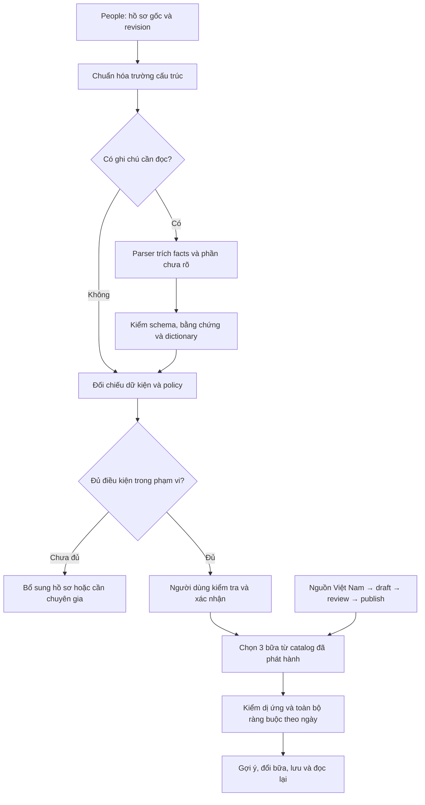

# Kế hoạch hoàn thiện catalog và AI parser Nutrition

> Cập nhật: 16/10/2026. Trạng thái: **nhánh catalog P0 và P1 đã có code, migration và test PostgreSQL local; P2 đã có [12 bữa và rule tăng huyết áp ở mức bản nháp kỹ thuật](NUTRITION_P2_CONTENT_PLAN.md), chưa được duyệt/phát hành; P3 đã có contract/validator parser, GraphRAG local có giới hạn, adapter provider giữ tắt và bộ eval 200 ca, còn review nhãn và lần chạy provider gate; P4 đã hoàn tất lát cắt kỹ thuật M1 bằng fixture tổng hợp qua ApiHost thật, gồm câu hỏi/evidence, metadata nguồn món, generate/replace/save và dọn fixture; P5 chưa triển khai**. Phần provider được giữ tắt cho đến khi có cấu hình, phê duyệt xử lý dữ liệu và kết quả eval hợp lệ. Phạm vi: đưa Nutrition từ kết quả API `no_content`/`nutrition.ai_unavailable` tới gợi ý bữa ăn có nguồn trong phạm vi hồ sơ đã được duyệt. Markdown chỉ lưu local.

### Tiến độ đã kiểm chứng ngày 16/10/2026

- P0 catalog: đã khóa `CatalogBundle` v1, JSON Schema, citation có cấu trúc, dictionary, phạm vi `adult`, chính sách chỉ nhận hồ sơ khai không dùng thuốc và các nhóm bắt buộc chuyển chuyên gia. `RulePrerequisite` đã có field/operator/value và chỉ nhận predicate engine hiện thực thi được.
- P1: đã thêm migration `03-catalog-governance.sql`, vòng đời `draft → reviewed → published → retired`, SHA-256 digest, audit actor, version tuần tự có advisory lock, nội dung published bất biến và ba role importer/reviewer/publisher tách riêng.
- Đã có CLI `CareSitter.Nutrition.CatalogTool` cho `validate`, `import --dry-run`, `import`, `review`, `publish`, `retire`; connection chỉ đọc từ `NUTRITION_CATALOG_CONNECTION`.
- Đã nối migration vào AppHost, local bootstrap, deploy migration test và readiness. Runtime `nutrition_app` không có quyền đọc bảng approval/audit hoặc gọi hàm publish.
- Kết quả local: solution Nutrition build 0 warning/0 error; **112/112 test pass, 0 skip** trên PostgreSQL thật, gồm retrieval graph, validator subgraph, adapter request/retry/redaction/JSON sai/403/timeout, catalog đổi trong lúc parser chạy, metadata graph xuyên suốt worker, tương thích payload decision cũ chưa có `questions`, `questions[]` đi qua resource PostgreSQL và citation món được vật hóa khi publish. Nhóm `NutritionGatewayTests` của ApiHost đạt **28/28 test, 0 skip**, xác nhận capability mới đi qua gRPC gateway. Catalog rule schema v2 đã hỗ trợ khoảng dưỡng chất theo ngày/từng bữa và được kiểm ở database boundary; một test vẫn nhập bundle P2 kỹ thuật vào database dùng một lần, chạy luồng tăng huyết áp và kiểm ba lựa chọn đổi bữa trưa. Dữ liệu nháp không được seed vào runtime.
- Chưa có catalog món/rule được chuyên gia duyệt. Vì vậy môi trường chạy thật vẫn có thể trả `no_content` cho đến P2; kết quả kỹ thuật trên fixture không phải phê duyệt thực đơn bệnh lý.
- P3 contract parser đã có `HealthParseRequest`/`HealthParseResult`, dictionary revision, fact có offset, unresolved statement và nguồn được phân loại không liên quan. GraphRAG local truy hồi tiểu đồ thị `concept → policy → evidence` từ catalog đã publish, có revision/strategy và giới hạn kích thước; validator chỉ nhận concept có trong tiểu đồ thị. Adapter OpenAI/Structured Outputs đã có nhưng mặc định tắt; capability REST/gRPC chỉ báo sẵn sàng khi cấu hình hợp lệ. Corpus `evaluation/parser-eval.vi.synthetic.v1.json` có 200 ca theo nhóm gốc, chia development/validation/holdout 100/50/50; CLI `CareSitter.Nutrition.ParserEval` hỗ trợ generate/validate/run/score, đo fact theo loại, tag tình huống, provenance, decision, latency và token. Corpus validate sạch nhưng `reviewedCaseCount=0`, chưa gọi provider và `releaseReady=false`.
- P4: backend sinh tối đa ba `questions[]` xác định theo `missingFields`, conflict và parser unresolved, có ID/purpose/input type/source field ổn định; payload cũ không có trường này vẫn đọc được. Migration `05-recipe-source-citations.sql` vật hóa metadata citation từ đúng package đã publish vào bảng runtime chỉ đọc; response thêm `sourceDetails` nhưng giữ `sources` cho client cũ và không lộ hash file. Flutter hiển thị nguồn theo tên/cơ quan/năm/vị trí/ngày đối chiếu, fallback về mã nguồn cho server cũ. `flutter analyze` sạch và **23/23 test Nutrition Flutter pass**, gồm widget 320 px ở text scale 2.0. [Smoke P4 ngày 16/10](../kiem-thu/NUTRITION_P4_API_SMOKE_2026-10-16.md) đi qua process ApiHost thật → gRPC → PostgreSQL dùng một lần, đạt `needs_information` có ba câu hỏi và flow `awaiting_confirmation → confirmed → suggested → replace → saved`; fixture, phiên, catalog và DB đều được dọn. Đây là M1 bằng dữ liệu tổng hợp, chưa phải phê duyệt nội dung P2/M2 hoặc nghiệm thu thiết bị.

## 1. Mục tiêu và bằng chứng hiện tại

[Smoke test API ngày 15/10](../kiem-thu/NUTRITION_API_SMOKE_2026-10-15.md) đã ghi nhận:

- Hồ sơ trống: `202 queued` → `200 needs_information`, chỉ ra 7 trường thiếu.
- Hồ sơ cấu trúc đầy đủ: `awaiting_confirmation` → resource `confirmed`, decision `eligible`.
- Yêu cầu thực đơn sau xác nhận: `200 no_content`, reason `catalog_unavailable`.
- Hồ sơ có ghi chú: `200 failed`, error `nutrition.ai_unavailable`.

Mục tiêu bàn giao là đi hết chuỗi **hồ sơ → phân tích → người dùng xác nhận → 3 bữa có nguồn → đổi bữa → lưu → đọc lại**, đồng thời giữ các trạng thái thiếu dữ liệu, cần chuyên gia, không có nội dung, không có lựa chọn phù hợp và dữ liệu đã thay đổi.

Hai mốc nghiệm thu khác nhau:

| Mốc | Chứng minh điều gì? | Điều chưa được suy ra |
| --- | --- | --- |
| M1 — kỹ thuật | Import/publish nội dung, parser và API chạy thật; fixtures có kiểm soát chỉ dùng trong DB test riêng | Không chứng minh thực đơn phù hợp bệnh lý thật |
| M2 — nội dung và phạm vi sử dụng | Nguồn đã đối chiếu, rule/món được người duyệt chuyên môn phê duyệt, hồ sơ thuộc đúng nhóm hỗ trợ, nghiệm thu API và UI | Không bảo đảm đáp ứng mọi bệnh, mọi thuốc hoặc toàn bộ nhu cầu dinh dưỡng |

## 2. Những điểm phải xử lý từ code hiện tại

| Thành phần | Hiện trạng | Việc cần làm |
| --- | --- | --- |
| Parser | DI đăng ký `UnconfiguredHealthParser`; interface chỉ trả danh sách `HealthFact` | Adapter provider và kết quả trích xuất có phiên bản, chứa phần chưa hiểu và kết quả không có dữ kiện liên quan |
| Validator | Yêu cầu 1–40 facts; quote phải xuất hiện đúng một lần, subject phải là beneficiary, code/alias phải thuộc dictionary | Xử lý ghi chú vô hại, quote lặp, nhiều chủ thể, lỗi chính tả và concept chưa biết mà không bỏ sót hạn chế |
| Dictionary | Có bảng `concepts`; chưa có pipeline quản lý nội dung | Chuẩn hóa mã bệnh, dị ứng, triệu chứng, cách ăn; alias tiếng Việt có/không dấu; lưu version |
| Catalog | Có `recipe_versions`, `rule_versions`, `draft/published/retired`, metadata reviewer và revision | Quy trình nhập, kiểm tra, duyệt, phát hành/thu hồi và audit; không chỉ điền tên bất kỳ vào `reviewed_by` |
| Rule | `Prerequisites` là tên trường, hiện chỉ kiểm có chuỗi; điều kiện gồm loại nguyên liệu và `DailyMaximums` | Predicate có kiểu, phạm vi áp dụng và đơn vị; `unknown` không được tính là đủ điều kiện |
| Món | Một phần, đúng 3 bản ghi sáng/trưa/tối; chọn tổ hợp đầu tiên, tối đa 30 ứng viên mỗi bữa | Nhập công thức đại diện đủ một bữa; kiểm toàn bộ nguyên liệu/gia vị; xác minh số liệu mỗi khẩu phần |
| Thuốc/chuyên biệt | Thuốc đang dùng, thận, khó nuốt, ăn qua ống, hạn chế nước/điện giải bị chuyển chuyên gia | Giữ chặn đến khi có use case và nội dung riêng; thêm catalog hoặc AI không tự mở được các nhóm này |
| Worker | Timeout parser 25 giây, lease 60 giây, có kiểm revision/owner trước ghi kết quả | Retry nằm trong deadline, phân loại lỗi provider, kiểm catalog thay đổi, lưu phiên bản parser; thống nhất `retryable` và `allowedActions` |

Đặc biệt: hồ sơ seed có thuốc đang dùng vẫn cần hướng dẫn chuyên biệt sau khi có AI/catalog. Không được dùng kết quả trên hồ sơ không bệnh để tuyên bố đã hỗ trợ hồ sơ này.

## 3. Phạm vi triển khai đề xuất

1. Bắt đầu bằng catalog bữa ăn và pipeline kiểm duyệt; dùng hồ sơ cấu trúc để kiểm đường đi tới `suggested` mà không phụ thuộc AI.
2. Xây parser song song về mặt công việc sau khi khóa dictionary/schema; chỉ trích dữ kiện được báo cáo, không tạo món hoặc đặt ngưỡng ăn uống.
3. Đề xuất đọc/soạn rule trước cho **tăng huyết áp và đái tháo đường type 2**. Đây là thứ tự nghiên cứu nội dung, chưa phải quyết định hai nhóm đều được bật trong MVP. Chỉ bật rule khi đủ nguồn, điều kiện và người duyệt.
4. Với nhiều bệnh, chỉ hỗ trợ tổ hợp được đánh giá và tất cả prerequisites đều đủ. Giao các hạn chế; không bỏ một bệnh để tìm được món.
5. MVP chọn khẩu phần đã được duyệt, không tự tính nhu cầu theo tuổi/cân nặng/chiều cao hoặc chỉnh khẩu phần. Nếu rule cần những thông số đó thì phải bổ sung contract People và kiểm dữ liệu trước khi bật rule, hoặc để rule chưa phát hành.
6. UI mô tả đúng “gợi ý bữa ăn theo các thông tin đã kiểm tra”. Không tuyên bố điều trị bệnh hoặc đủ toàn bộ nhu cầu khi chưa có bộ mục tiêu tương ứng.

Chưa đưa vào đợt đầu: thực đơn 7 ngày, AI sáng tác công thức, chatbot tư vấn, ingest/RAG toàn bộ sách, vector database riêng, GraphRAG global/community search, tối ưu sở thích và ứng dụng admin biên tập đầy đủ.

## 4. Luồng đích và quyền sở hữu

- People tiếp tục sở hữu hồ sơ nguồn. Mọi sửa thông tin do người dùng xác nhận đi qua `PATCH health-profile`, tăng revision rồi tạo assessment mới.
- Nutrition sở hữu facts của assessment, dictionary, catalog, rule, recommendation và kế hoạch đã lưu.
- Provider chỉ nhận dữ liệu tối thiểu cần trích xuất; không có quyền gọi DB, publish catalog hoặc sửa hồ sơ.
- API công khai và gRPC giữ route hiện tại. Trường mới thêm có version và kiểm tương thích Flutter; không đổi nghĩa trạng thái đã có.

## 5. Nhánh A — catalog có nguồn và có người duyệt

### A1. Nguồn và bộ dữ liệu đầu tiên

Nguồn làm việc theo [ghi chú sách Việt Nam](../tong-quan/NGUON_DINH_DUONG_THEO_BENH_LY.md):

- Đã có [Dinh dưỡng lâm sàng, bản 2019](../../book/Dinh_duong_lam_sang_Vien_Dinh_duong_2019.pdf). Đọc chương lập khẩu phần, dinh dưỡng tuổi già và bệnh thuộc phạm vi; kiểm lại trang thực tế khi trích từng rule.
- Bảng thành phần thực phẩm Việt Nam: mới có metadata trong tài liệu dự án. Cần lấy bản sử dụng hợp lệ và đọc quy ước đơn vị/phần ăn được trước khi nhập số liệu.
- Nhu cầu dinh dưỡng khuyến nghị cho người Việt Nam: phải đọc đúng bản/bảng dự kiến dùng; hiện không coi ghi chú giới thiệu là đủ để lấy định mức.
- Đối chiếu thêm hướng dẫn chuyên môn Việt Nam hiện hành cho bệnh/giai đoạn đang xét khi thực hiện A1. Không nhập ngưỡng bệnh lý chỉ dựa tên bệnh hoặc trí nhớ.

Đề xuất bộ pilot: **12 công thức bữa ăn, 4 sáng + 4 trưa + 4 tối**, để có phương án đổi bữa. Đây là mục tiêu nội dung, không phải số lượng đã có hoặc bảo đảm mọi tổ hợp đều phù hợp.

Trong engine hiện tại một `Recipe` là một lựa chọn cho cả bữa. Không nhập “rau luộc” thành bữa trưa hoàn chỉnh; công thức phải bao quát các thành phần ăn kèm của bữa hoặc cần mở rộng meal composition trước.

### A2. Contract nội dung

| Dữ liệu | Trường cần có |
| --- | --- |
| Citation | ID nguồn, tên, tác giả/cơ quan, năm/ấn bản, chương, trang in và trang PDF, vị trí hàng/bảng, ngày đối chiếu; hash tài liệu khi có file |
| Nguyên liệu | Mã nội bộ, tên, lượng, đơn vị, raw/cooked, phần ăn được, nguồn dữ liệu dinh dưỡng, allergen và nguyên liệu dẫn xuất/gia vị |
| Công thức | ID/version, loại bữa, khẩu phần, toàn bộ nguyên liệu, cách nấu, nutrient theo khẩu phần, dữ liệu thiếu, citation theo từng phần, trạng thái kiểm duyệt |
| Rule | ID/version, mã bệnh, phạm vi đối tượng/giai đoạn, ngoại lệ, prerequisites có kiểu, ràng buộc/đơn vị/scope, nguồn từng ràng buộc, reviewer |
| Audit | Actor, thao tác, thời điểm, phiên bản, digest nội dung được duyệt, lý do phát hành/thu hồi; không chứa hồ sơ người dùng |

Tách nguồn nguyên tắc bệnh lý, nguồn số liệu nguyên liệu và nguồn công thức. Một citation sách chung không chứng minh được tất cả con số trong món. Lưu cách tính tổng, hệ số phần ăn được/nấu chín nếu dùng và các giả định đã được duyệt. Dữ liệu chưa biết là `null`, không biến thành 0.

Giữ `sources: string[]` hiện có cho client; thêm citation có cấu trúc ở version mới để truy nguồn. Metadata sách không đồng nghĩa quyền phát hành toàn bộ PDF; chỉ đưa nội dung được phép vào gói sản phẩm.

Hiện thực P4 vật hóa citation vào `nutrition.recipe_source_citations` trong transaction publish. Runtime chỉ có `SELECT` trên bảng này, không đọc package approval/audit; API trả `id`, tên, cơ quan, năm/ấn bản, chương/trang, locator, reference và ngày đối chiếu, nhưng không trả `fileSha256`. `Recipe.SourceDetails` là trường tùy chọn và bị bỏ khỏi JSON bundle đầu vào khi null, nên bundle/schema cũ và `sources` vẫn tương thích.

### A3. Duyệt và phát hành

Đợt đầu dùng công cụ import/validate/review/publish trong pipeline vận hành có xác thực, thay vì xây toàn bộ admin web. Công cụ chỉ ghi catalog, không đọc hồ sơ People hoặc assessment.

1. Import gói JSON có schema và digest thành `draft`; dry-run trả danh sách lỗi theo trường, chưa ghi DB.
2. Kiểm mã tham chiếu, unit, quantity, bữa, allergen, nutrient, citation, phạm vi và prerequisite được engine hỗ trợ.
3. Người duyệt chuyên môn kiểm nội dung; ghi bằng chứng phê duyệt gắn đúng digest/version. Người nhập không tự cấp phê duyệt chuyên môn.
4. Operator được cấp quyền publish chuyển `reviewed` → `published`; trạng thái và audit đã được thực thi trong migration catalog governance.
5. Publication chuyển phiên bản có hiệu lực trong transaction, cập nhật catalog revision, tránh đồng thời áp hai version của cùng logical rule. Payload đã published bất biến; chỉnh nội dung phải tạo version mới.
6. Retire có lý do và audit; assessment/recommendation cũ bị stale hoặc không được đổi/lưu lại như hiện hành. Rollback bằng phiên bản nội dung phù hợp, không xóa lịch sử.

Role runtime `nutrition_app` tiếp tục chỉ đọc catalog. Importer không có quyền publish; publisher chỉ được phát hành phiên bản có approval hợp lệ. Reviewer identity lấy từ phiên/pipeline đã xác thực, không tin chuỗi reviewer gửi tùy ý.

Migration mới dùng số kế tiếp trong `backend/init-db/nutrition-service/` (hiện có 01–02, dự kiến bắt đầu 03; kiểm lại lúc code). Đồng bộ readiness, grants và runner deploy. Không sửa SQL đã áp dụng. Giai đoạn đầu giữ cơ chế tăng revision hiện có khi catalog thay đổi, chấp nhận làm stale rộng hơn; chưa tối ưu trigger chỉ vì draft thay đổi.

### A4. Rule engine đủ để áp dụng nội dung

- Thay kiểm “prerequisite có chuỗi” bằng schema có kiểu, giá trị chấp nhận, đơn vị, nguồn xác nhận và yêu cầu độ mới nếu rule cần. Enum `unknown`, sai kiểu, thiếu nguồn hoặc hết hạn đều chưa đủ.
- Mỗi trường prerequisite phải có đường nhập ở People và nhãn bổ sung phía app. Nếu chưa có đường nhập thì không publish rule đó.
- Khóa scope ngay trong definition: giới hạn theo món/bữa/ngày và đối tượng áp dụng. Chỉ publish kiểu ràng buộc engine thực thi được; không âm thầm bỏ ràng buộc chưa hỗ trợ.
- Minimum, khoảng mục tiêu, phân bố theo bữa hoặc khẩu phần theo cân nặng chưa có trong model hiện tại. Chỉ bổ sung khi rule pilot yêu cầu, kèm dữ kiện đầu vào và test; nếu chưa đủ thì giữ draft/ngoài phạm vi.
- Xác minh constraint toàn ngày cho generate/replace/save và toàn bộ bệnh đồng mắc đã hỗ trợ. Bản hiện tại chỉ kiểm tối đa không đủ để khẳng định khẩu phần đầy đủ dinh dưỡng.
- Không tự mở chặn thuốc, thận, khó nuốt hoặc các tình trạng chuyên biệt để đạt `suggested`.

**Gate A:** gói 12 bữa đạt kiểm tra kỹ thuật; nội dung pilot có phê duyệt thật; ít nhất một hồ sơ trong scope có thể tạo 3 bữa, đổi sang phương án hợp lệ và lưu; hồ sơ ngoài scope vẫn bị chặn đúng.

## 6. Nhánh B — AI parser có kiểm chứng

### B1. Khóa kết quả trích xuất trước khi gắn provider

Đề xuất đổi port nội bộ sang `HealthParseResult` có version, gồm `facts`, `unresolvedStatements` và phần giải trình nguồn không liên quan. Input bổ sung dictionary/version cùng các đoạn nguồn cần đọc. Đây là thay đổi được đề xuất, chưa phải contract hiện tại.

- Mỗi fact giữ kind, code, nhãn, subject, assertion, temporality, sourceKey và quote. Evidence có offset bắt đầu/kết thúc để xử lý quote xuất hiện nhiều lần; kiểm substring trên đúng văn bản nguồn.
- Thuật ngữ không ánh xạ được, thuốc chưa rõ, hướng dẫn không đủ đơn vị/phạm vi hoặc phần sức khỏe chưa hiểu đi vào unresolved, không bị bỏ đi.
- Chấp nhận kết quả không có fact sức khỏe khi đã phân loại nguồn là không liên quan. Không dùng `facts: []` đơn độc để suy ra hồ sơ khỏe mạnh; các trường cấu trúc bắt buộc vẫn phải được người dùng xác nhận.
- “Bố bị gout, mẹ không bị” phải giữ đúng chủ thể/phủ định. Thông tin của người khác không được biến thành bệnh của beni; phần chủ thể chưa rõ cần bổ sung.
- “Không thích tôm” không thành dị ứng; “nghi tiểu đường” không thành bệnh đã xác nhận; “giảm muối” không tự sinh số mg/ngày.
- Phiên bản đầu chỉ dùng facts để đối chiếu và gợi ý phần cần cập nhật. AI không tự ghi `reported_none`, allergy confirmation hoặc medication status vào People; người dùng sửa trường nguồn rồi phân tích lại.
- Sửa validator tương ứng; không chỉ bỏ điều kiện `facts.Count > 0` hoặc `Subject == beneficiary` để cho mọi output đi qua.

### B2. GraphRAG local, adapter provider và dữ liệu gửi đi

- Luồng đã chọn: `catalog/dictionary đã publish → local graph retrieval → structured extraction → validator/policy`. Graph chỉ cung cấp ngữ cảnh truy hồi; không tự tạo fact, chẩn đoán, ngưỡng hoặc quyết định eligibility.
- Pha đầu dùng đồ thị chiếu từ PostgreSQL hiện có, chưa thêm Neo4j/Python sidecar/vector DB. Retriever chuẩn hóa chữ hoa/thường và dấu tiếng Việt, lấy tối đa 32 concept khớp alias/code rồi mở rộng tối đa 64 cạnh sang policy và evidence đã publish. Mỗi request giữ graph schema, catalog revision và retrieval strategy để audit/stale check.
- Chỉ gửi tiểu đồ thị đã truy hồi, không gửi toàn bộ dictionary, toàn bộ sách hoặc graph hồ sơ người dùng. Validator từ chối fact dù có trong dictionary nếu concept đó không có trong tiểu đồ thị của request. Quan hệ policy/evidence không được coi là bằng chứng người dùng mắc bệnh.
- `IHealthDescriptionParser` không phụ thuộc graph engine cụ thể; có thể thay lexical retrieval bằng embeddings hoặc Microsoft GraphRAG local search sau khi eval chứng minh lợi ích mà không đổi output contract. Global search/community summary chưa phù hợp với tác vụ trích xuất theo thực thể và chi phí pha pilot.
- Adapter đánh giá đầu tiên hỗ trợ OpenAI `gpt-6-luna` với Structured Outputs; đây là ứng viên kỹ thuật bị khóa sau feature flag, chưa phải phê duyệt pilot. Đổi provider/model phải qua lại B4.
- Adapter nằm ở Infrastructure, sau port Application; dùng HTTP client, options validation, giới hạn response và cancellation. Provider không có tool/web/DB access.
- Cấu hình dưới `HealthParser`: `Enabled`, `Provider`, `Model`, `BaseUrl`, `ApiKey`/`ApiKeyFile`, `DataProcessingApproved`, `TimeoutSeconds`, `MaxOutputTokens`, `MaxAttempts`, `MaxConcurrency`, `DailyBudget`, giới hạn input/response. Mặc định `Enabled=false` và `DataProcessingApproved=false`.
- Không có key/flag thì báo chưa cấu hình; không gọi AI khi chỉ có dữ liệu cấu trúc. Thêm khả năng báo parser sẵn sàng trong capability theo cách tương thích client.
- Chỉ gửi các đoạn cần trích xuất. Kiểm và che dữ liệu nhận dạng trong free text, giữ mapping span trong bộ nhớ để đối chiếu quote nguồn gốc. Không gửi UUID, token, toàn bộ snapshot hoặc toàn bộ sách.
- Trước pilot với hồ sơ thật: chốt thông báo/lựa chọn xử lý dữ liệu, nơi xử lý và retention. Test provider đầu tiên chỉ dùng tình huống tổng hợp; không gửi hồ sơ seed hoặc hồ sơ khách hàng để thử key.
- Ghi parser/model/prompt/schema/dictionary version và metadata latency/usage; không log raw text, quote hoặc body provider. Provider response không được trở thành prompt điều khiển cho bước khác.

### B3. Lỗi, retry và vòng đời job

| Tình huống | Hành vi dự kiến |
| --- | --- |
| Timeout / lỗi tạm thời / rate limit provider | `failed` với mã riêng và `retryable=true` khi phù hợp; retry hữu hạn trong tổng deadline |
| Chưa cấu hình / xác thực provider sai | `nutrition.ai_unavailable`, không gợi ý người dùng retry liên tục; cảnh báo vận hành bằng metadata |
| Refusal | `nutrition.ai_refused`; giữ hồ sơ, hướng dẫn bổ sung trường cấu trúc |
| Sai schema / quote bịa / concept ngoài dictionary không được đánh dấu unresolved | `nutrition.ai_invalid_output`, không dùng kết quả một phần như hồ sơ đã đủ |
| Nội dung hợp lệ nhưng chưa rõ | `needs_information`, liệt kê phần cần làm rõ |
| Profile/owner đổi hoặc bị xóa lúc chờ AI | Bỏ kết quả cũ, trả stale/cancelled/404 theo contract hiện có |
| Catalog đổi lúc chờ AI | Không cho xác nhận với dictionary/rule cũ; trả trạng thái xung đột nội dung và phân tích lại |

Tổng timeout parser mặc định ban đầu giữ 25 giây và tối đa hai lần gọi trong cùng ngân sách thời gian; không để mỗi retry tự có thêm 25 giây. Tôn trọng Retry-After nếu còn thời gian, tránh retry nhân đôi ở SDK và worker. Lease 60 giây hiện có phải bao phủ cả xử lý; kiểm shutdown, timeout và fencing trên DB thật.

Worker hiện dùng lease recovery cho exception chưa xử lý; lỗi provider cần chuyển sang kết quả có kiểm soát. Explicit retry tạo assessment mới và tính quota theo chính sách; transport retry giữ idempotency key cũ. Thống nhất `allowedActions` với `retryable` — smoke hiện có `allowedActions=[retry]` trong khi `retryable=false`.

### B4. Bộ đánh giá

Kế thừa [đặc tả phân tích](NUTRITION_ANALYSIS_SPEC.md): ít nhất **200 ca tiếng Việt tổng hợp**, chia theo tình huống gốc để tránh các câu viết lại lọt cả development và holdout. Có nhãn expected facts, evidence, subject, negation/time, unresolved và decision; người hiểu nghiệp vụ/chuyên môn rà nhãn.

Nhóm bắt buộc: có/không dấu, viết tắt, phủ định, nghi ngờ, tiền sử, nhiều chủ thể, dị ứng thực phẩm/thuốc, sở thích, thuốc chưa rõ, chỉ định, ghi chú vô hại, quote lặp, prompt injection, JSON sai, timeout, hồ sơ/catalog đổi và mất quyền.

Đo precision/recall theo loại dữ kiện, lỗi bỏ sót dị ứng/hạn chế, đúng chủ thể/phủ định, provenance, decision và độ trễ/chi phí. Gate: mọi ca chặn phát hành phải qua; không còn lỗi đã biết làm mở eligibility sai trong tập nghiệm thu. Ghi rõ tập mẫu và lần chạy, không coi 200 ca là bằng chứng model luôn đúng. Đổi model/prompt/dictionary/schema phải chạy lại gate.

Checkpoint kỹ thuật 16/10/2026:

- Đã sinh 200 ca tổng hợp, 20 tình huống gốc × 10 biến thể; nhóm gốc không lọt qua nhiều split. Development/validation/holdout lần lượt là 100/50/50.
- Đã phủ có/không dấu, viết tắt, phủ định, nghi ngờ, tiền sử, nhiều chủ thể/nguồn, dị ứng thực phẩm/thuốc, sở thích, thuốc chưa rõ, chỉ định, ghi chú vô hại, quote lặp, prompt injection và concept lạ. JSON sai, 403, timeout, đổi revision hồ sơ/catalog và mất quyền được kiểm ở adapter/workflow tests.
- `parser-eval generate|validate|run|score` chỉ cho chạy provider khi có `NUTRITION_PARSER_EVAL_DATA_PROCESSING_APPROVED=true` và secret phía server; output tồn tại không bị ghi đè nếu thiếu `--force`. Lần chạy ghi provider/model/prompt/dictionary/graph version, latency và token.
- Corpus hiện validate sạch nhưng toàn bộ nhãn còn `pending`; chưa có API key/phê duyệt để chạy provider. Technical gate yêu cầu exact-match toàn split và không có critical failure; release gate chỉ mở cho holdout khi 50/50 nhãn holdout đã `reviewed`. Do đó P3 chưa được đánh dấu hoàn tất phát hành.

## 7. Kế hoạch thực hiện theo đợt

Ước lượng dưới đây là ngày công kỹ thuật sau khi có đủ đầu vào; không bao gồm thời gian tìm nguồn, review chuyên môn, quyền sử dụng tài liệu hoặc chờ provider. Điều chỉnh sau đợt P0; không phải cam kết ngày phát hành.

| Đợt | Công việc chính | Bàn giao / điều kiện hoàn tất | Ước lượng |
| --- | --- | --- | --- |
| P0 | Khóa nhóm hồ sơ pilot, ma trận bệnh/thuốc, dictionary, schema nội dung/parser và người duyệt | Có danh sách supported/blocked, prerequisites, nguồn cần đọc, provider shortlist và bộ mẫu chuẩn đầu tiên | 1–2 ngày |
| P1 | Import/dry-run/validate/review/publish/retire, audit, quyền riêng, migration | Fixtures chỉ ở DB test; publication/retirement/version/race test đạt; runtime không tự publish | 2–3 ngày |
| P2 | Theo [kế hoạch P2](NUTRITION_P2_CONTENT_PLAN.md): khóa nguồn/provenance, soạn 12 bữa, rule bệnh ứng viên, duyệt 64 tổ hợp, kiểm API và phê duyệt | 12 bữa và ít nhất một rule bệnh lý vượt cổng nguồn, dữ liệu, an toàn, review và API; không dùng tên bệnh để tự đặt ngưỡng | 5–9 ngày kỹ thuật + review chuyên môn |
| P3 | `HealthParseResult`, provenance, unresolved/no-facts, GraphRAG local có version/bounds, adapter/options, lỗi/quota, eval provider | Bộ đánh giá đạt; structured-only không gọi AI; concept ngoài subgraph bị từ chối; nguồn mơ hồ không thành eligible | 3–4 ngày |
| P4 | Nối app: summary/evidence, câu cần bổ sung, retry đúng, nguồn món; generate/replace/save | Đi hết flow trên backend thật; đổi hồ sơ/phiên không lộ dữ liệu cũ | 1–2 ngày |
| P5 | Smoke local/staging, thiết bị thật, đo latency/cost, bật theo phạm vi và thử rollback | Evidence HTTP được che dữ liệu nhạy cảm; catalog/parser version rõ; gate M2 đạt trước pilot | 1–2 ngày |

Đường phụ thuộc: `P0 → P1 → P2 → P4 → P5`; `P0 → P3 → P4`. Việc đọc nguồn và chuẩn bị mẫu bắt đầu từ P0. M1 có thể đạt bằng fixtures trước khi P2 được duyệt; không coi đó là đã đạt M2.

Vị trí triển khai dự kiến: `backend/services/nutrition/` cho domain/application/adapter và tooling catalog; `backend/init-db/nutrition-service/` cho SQL; People/Shared Contracts chỉ sửa khi prerequisite mới cần trường hồ sơ; `frontend/customer-app/lib/features/nutrition/` cho UI; mẫu cấu hình AppHost/Compose/deploy cập nhật cùng adapter. Tài liệu vẫn nằm trong `plan/`.

## 8. Ma trận nghiệm thu bằng API thật

Tạo customer/beneficiary tổng hợp riêng qua API và môi trường test riêng; không reset mật khẩu tài khoản hiện có hoặc sửa hồ sơ thật để dựng fixture. Dùng HTTP qua ApiHost, gRPC Nutrition và PostgreSQL thật. Lưu request đã che bí mật, status, response, thời gian, source revision và phiên bản catalog/parser. Dọn fixture trong finally và thu hồi phiên test.

| ID | Kịch bản | Kết quả bắt buộc |
| --- | --- | --- |
| T01 | Đủ cấu trúc, không ghi chú, content published | `202` → `awaiting_confirmation` → confirm `200/confirmed` + `eligible` → recommend `200/suggested`, đúng 3 bữa, khẩu phần và nguồn |
| T02 | Đổi bữa rồi lưu, đọc lại | `suggested` mới → `saved`; kiểm toàn bộ ngày, version và idempotency |
| T03 | Thiếu dị ứng/thuốc/nuốt hoặc prerequisite định kiểu là unknown | `needs_information`, chỉ ra mục cần bổ sung, confirm/recommend bị chặn |
| T04 | Ghi chú dị ứng khác trường xác nhận không dị ứng | Conflict; không bỏ hạn chế để tạo món |
| T05 | Ghi chú có bệnh đã báo cáo trong scope | Facts có evidence; cần xác nhận; rule đúng version được áp và nguồn hiện trên kết quả |
| T06 | “Nghi…”, bệnh của người khác, tiền sử, “không thích…” | Giữ đúng ý nghĩa; không tự gán bệnh/dị ứng cho beni |
| T07 | Ghi chú vô hại hoặc quote lặp | Parser xử lý hợp lệ; không lỗi chỉ vì zero relevant facts/quote lặp, không bỏ qua trường cấu trúc thiếu |
| T08 | Catalog trống, chỉ draft hoặc không đủ món đáp ứng | `no_content` nếu không có món published hợp lệ; `no_match` khi có món nhưng không ghép đủ 3 bữa đạt ràng buộc |
| T09 | Món thiếu nutrient bắt buộc hoặc allergen chưa đầy đủ | Không được đưa vào kết quả; mọi lựa chọn thiếu thì chặn theo trạng thái hiện hành |
| T10 | Có thuốc đang dùng / bệnh ngoài scope / thận / khó nuốt | `needs_professional_guidance` dù AI đọc đúng và catalog có món |
| T11 | Provider timeout/429/refusal/output sai | `failed`, mã và hành động nhất quán; giữ input, không tạo healthy fallback |
| T12 | Đổi profile, mất quyền, logout, retire nội dung khi job/đổi/lưu đang chạy | Stale/409/404 theo contract; không ghi kết quả cũ như hiện hành |
| T13 | Trùng request, worker hết lease, publish cùng version đồng thời | Không nhân tài nguyên hoặc approval; worker cũ không ghi đè |
| T14 | Runtime/customer cố import/publish; operator tự khai reviewer | Bị từ chối; publish chỉ dùng approval và actor hợp lệ |

Các test policy/contract/PostgreSQL hiện có vẫn chạy theo phần thay đổi; Flutter analyze/widget/session tests và thiết bị thật ở P4–P5. Không thay báo cáo smoke bằng số unit test pass. Provider thật dùng dữ liệu tổng hợp; nội dung lâm sàng thật chỉ đánh dấu nghiệm thu khi có review tương ứng.

Lần smoke P4 ngày 16/10 đã bao phủ T01, T02 và T03 bằng catalog tổng hợp trong database dùng một lần. T04–T14 hiện có coverage policy/contract/PostgreSQL ở các mức khác nhau nhưng chưa được coi là đã hoàn tất toàn bộ ma trận HTTP/staging; phần đó cùng nghiệm thu thiết bị, TLS staging, latency/cost và rollback thuộc P5. Provider vẫn tắt và bundle P2 không được publish trong lần smoke này.

## 9. Điều kiện mở phạm vi tiếp theo

- Chốt provider/model, credential phía server, giới hạn chi phí và cách xử lý dữ liệu trước tích hợp thật; không yêu cầu gửi key qua chat.
- Chỉ định người duyệt chuyên môn và nguồn thành phần thực phẩm thực dùng. Chưa có thì vẫn làm P0/P1/P3 và test kỹ thuật, nội dung giữ draft.
- Hồ sơ có thuốc: cần đợt riêng về mục tiêu/chỉ định được người có chuyên môn xác nhận, danh mục tương tác/phạm vi được hỗ trợ, quyền người duyệt và phiên bản còn hiệu lực. Không dùng checkbox khách hàng để vượt chặn `medication_review_required`.
- Hồ sơ cần mục tiêu dinh dưỡng cá nhân: bổ sung phép tính/đơn vị/nhân trắc/giai đoạn và review tương ứng trước khi đưa lời hứa “đủ nhu cầu” vào sản phẩm.
- Bật lần lượt catalog và parser cho cohort đã duyệt. Tắt parser/recommendations phải chặn request/job mới; kiểm trước ghi kết quả của job đang chạy. Bảo toàn lịch sử, không drop DB để rollback.

## 10. Tài liệu và source đối chiếu

- [Nguồn sách Việt Nam](../tong-quan/NGUON_DINH_DUONG_THEO_BENH_LY.md), [đặc tả phân tích](NUTRITION_ANALYSIS_SPEC.md), [plan edge cases](../tong-quan/NUTRITION_EDGE_CASE_IMPLEMENTATION_PLAN.md).
- [Smoke API 15/10](../kiem-thu/NUTRITION_API_SMOKE_2026-10-15.md), [kịch bản thiếu thông tin](../kiem-thu/NUTRITION_KICH_BAN_THIEU_THONG_TIN_2026-10-15.md), [runbook Nutrition](NUTRITION_SERVICE_RUNBOOK.md), [staging](../deploy/NUTRITION_STAGING.md).
- [Parser port](../../backend/services/nutrition/src/CareSitter.Nutrition/Application/Ports/IHealthDescriptionParser.cs), [AssessmentProcessor](../../backend/services/nutrition/src/CareSitter.Nutrition/Application/AssessmentProcessor.cs), [normalizer/validator](../../backend/services/nutrition/src/CareSitter.Nutrition/Application/HealthSnapshotNormalizer.cs).
- [Eligibility policy](../../backend/services/nutrition/src/CareSitter.Nutrition/Application/NutritionEligibilityPolicy.cs), [meal constraints](../../backend/services/nutrition/src/CareSitter.Nutrition/Application/MealConstraintPolicy.cs), [catalog reader](../../backend/services/nutrition/src/CareSitter.Nutrition/Infrastructure/NutritionCatalogReader.cs), [schema hiện tại](../../backend/init-db/nutrition-service/01-nutrition-workflow.sql).
- [Microsoft GraphRAG query overview](https://github.com/microsoft/graphrag/blob/main/docs/query/overview.md), [indexing overview](https://github.com/microsoft/graphrag/blob/main/docs/index/overview.md). Pha đầu áp dụng mẫu local graph retrieval có kiểm soát, không nhúng nguyên thư viện Python.

Kế hoạch này là backlog cụ thể để hoàn thiện hai phần còn thiếu; không thay đặc tả nguồn hoặc báo cáo kết quả đã chạy. Chỉ ghi hoàn thành từng đợt sau khi có artifact và bằng chứng nghiệm thu của chính đợt đó.
