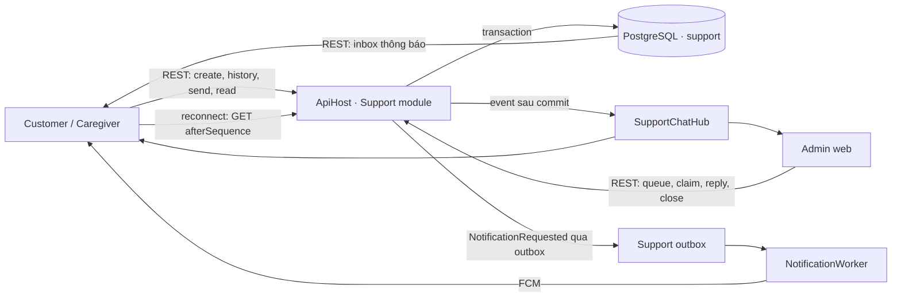
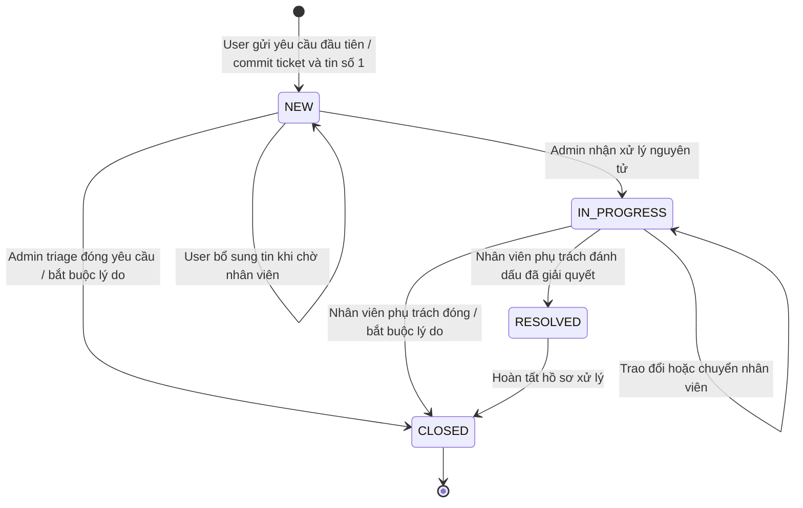

# Kế hoạch triển khai chat hỗ trợ trực tuyến CareSitter

**Cập nhật:** 15/10/2026, Asia/Saigon.  
**Phạm vi đối chiếu:** working tree `D:\EXE\CareSitter`; Customer app, Caregiver app,
Admin web, module Support, notification outbox và SignalR hiện có.  
**Trạng thái backend (15/10/2026):** đã có mã local cho migration 40, REST chat,
quản lý ticket/assignment, SignalR, inbox notification và push outbox có flag;
chưa commit/push. Build, architecture test, unit test Support và 3 bài PostgreSQL
chat đạt (luồng chính, retry, cạnh tranh tạo/claim/gửi, inbox + push outbox và
preference tắt push). Chưa nghiệm thu đầy đủ
ma trận race, Kafka/FCM, E2E và các frontend. Endpoint ticket cũ dùng
cùng chat service khi có conversation: assign cần header `X-Expected-Version`,
status cần `expectedVersion` và `reason` trong body; client cũ thiếu version nhận
conflict rõ ràng.
Tài liệu này là nguồn kế hoạch chuẩn cho chat hỗ trợ. Phần chat trong
[`CHAT_RECOVERY_PLAN.md`](CHAT_RECOVERY_PLAN.md) chỉ còn là bối cảnh lịch sử.

## 1. Quyết định điều hành

Triển khai **chat giữa Customer/Caregiver đã đăng nhập và nhân viên CareSitter**
ngay trong module Support của modular monolith hiện tại. PostgreSQL là nguồn sự
thật; REST ghi và đọc dữ liệu; SignalR chỉ báo thay đổi trực tiếp; hệ thống
notification hiện có báo tin khi ứng dụng không mở.

Không tách microservice và không thêm gRPC trong MVP. Chat chưa có nhu cầu gọi
nội bộ tải lớn hoặc contract streaming giữa service; tách sớm sẽ thêm DB, deploy,
auth, retry và quan sát vận hành mà chưa giải quyết thêm giá trị người dùng. Khi
cần tách service sau này, REST DTO và integration event đã version hóa là ranh
giới chuyển đổi.

Một conversation gắn **1:1 với một support ticket**:

- ticket sở hữu trạng thái `NEW → IN_PROGRESS → RESOLVED/CLOSED`, priority,
  booking liên quan và người xử lý;
- conversation sở hữu sequence tin nhắn và cursor đã đọc; trạng thái kết nối là
  trạng thái tạm thời của client, không phải trạng thái nghiệp vụ lưu trong DB;
- không tạo hai state machine có thể lệch nhau;
- một user chỉ có tối đa một conversation đang mở trong MVP;
- cuộc đã đóng chỉ đọc; yêu cầu tiếp theo tạo ticket/conversation mới.

MVP chỉ có tin nhắn văn bản. Ảnh/tệp, typing indicator, chatbot, tìm kiếm toàn văn
và internal note của nhân viên được để sau khi luồng văn bản đã ổn định. Chat
Customer↔Caregiver được thiết kế thành
[luồng riêng gắn booking](BOOKING_PARTY_CHAT_IMPLEMENTATION_PLAN.md), không mở
rộng conversation của Support. SOS/khẩn cấp tiếp tục dùng luồng riêng; chat
không được quảng bá như kênh cấp cứu hoặc tư vấn y khoa.

## 2. Hiện trạng đã xác minh trong source

| Bề mặt | Đã có trong source | Khoảng trống cần làm |
| --- | --- | --- |
| Customer | `SupportScreen` có hotline, email và nút **Chat trực tuyến** | Nút chat chỉ hiện snackbar “đang được phát triển”; chưa có route, repository, state hoặc lịch sử |
| Caregiver | Form tạo support ticket, tối đa 5 ảnh, hotline/email | Chưa có conversation nhiều tin, danh sách lịch sử, unread và realtime |
| Admin | `SupportPage` có tab ticket/yêu cầu tư vấn; có list, drawer, assign và đổi trạng thái | Chưa có hàng đợi hội thoại, message pane, read state và cập nhật trực tiếp |
| Support backend | `SupportTicket`, controller, CQRS, PostgreSQL, notification/delivery, audit và Kafka outbox | Chưa có conversation/message/read cursor; assign hiện chưa có optimistic concurrency |
| Realtime | `/hubs/care-tracking`, kiểm session và membership, Flutter có service reconnect | Chưa có support hub và client Admin; không được ghép nghiệp vụ chat vào hub tracking |
| Notification | Inbox, FCM/SMTP worker, preference `chatMessage`, outbox/inbox | `chatMessage` hiện có nghĩa gần với tin caregiver; cần preference mới `supportChatMessage` để không đổi nghĩa hợp đồng cũ |
| Migration | Nguồn schema là `backend/init-db`; migration mới nhất hiện là `39-consultation-requests.sql` | Chat dùng số kế tiếp tại lúc code, dự kiến `40-support-chat.sql` |

Hai app đang để thông tin hotline/email khác nhau và có giá trị mang tính mẫu.
Trước pilot phải đưa contact, giờ trực và thời gian phản hồi về cấu hình đã được
vận hành xác nhận; không công bố “24/7” nếu chưa có lịch trực thật.

## 3. Mục tiêu sản phẩm và chỉ số

### 3.1 Kết quả người dùng

1. Customer/Caregiver mở Trung tâm trợ giúp, gửi câu hỏi một lần và thấy ngay
   trạng thái đã lưu.
2. Nhân viên thấy yêu cầu mới, nhận xử lý nguyên tử và trả lời trên Admin web.
3. Hai phía nhận tin mới trực tiếp khi online; khi reconnect có thể đồng bộ mọi
   tin đã bỏ lỡ, đúng thứ tự và không trùng.
4. Người dùng xem lại lịch sử sau khi ticket đóng nhưng không thể gửi thêm vào
   conversation đã đóng.
5. Không người dùng hoặc nhân viên ngoài phạm vi nào đọc được nội dung hội thoại.

### 3.2 Mục tiêu pilot

| Chỉ số | Mục tiêu ban đầu | Cách đo |
| --- | --- | --- |
| Ghi tin thành công | ≥ 99,9% request hợp lệ, không tính lỗi mạng phía client | HTTP status + metric commit |
| Độ trễ commit | p95 < 500 ms trong tải pilot | Histogram từ API |
| Online fan-out | p95 < 2 giây sau commit khi SignalR hoạt động bình thường | E2E probe gửi tin qua REST, chờ client khác đồng bộ thấy messageId; dùng cùng đồng hồ của test runner |
| Tin trùng | 0 khi retry cùng idempotency key | Unique constraint + integration test |
| Rò dữ liệu chéo tài khoản | 0 | Test authorization HTTP và SignalR |
| Tuổi ticket NEW | hiển thị và cảnh báo theo SLA vận hành đã chốt | Queue-age metric |

Đây là mục tiêu kiểm thử/pilot, chưa phải số liệu production đã đạt. SLA phản hồi
với người dùng chỉ được hiển thị sau khi người chịu trách nhiệm và lịch trực được
chốt.

## 4. Phạm vi MVP và phần để sau

| Có trong MVP | Để sau MVP |
| --- | --- |
| Customer và Caregiver chat với ADMIN | Role `SUPPORT_AGENT` riêng và phân đội |
| Một conversation mở/user | Nhiều conversation mở theo chủ đề |
| Text thuần, tối đa 2.000 ký tự | Ảnh, PDF, audio và malware scan |
| Gắn booking tùy chọn, kiểm quyền server | Tự đọc/chẩn đoán nội dung y tế |
| Hàng đợi NEW, “Của tôi”, đang xử lý, đã đóng | SLA routing, ca trực, auto assignment |
| Claim, chuyển người xử lý, resolve/close có audit | Internal note, canned replies, chatbot |
| Read cursor, unread count, retry và reconnect | Typing, presence chính xác, delivered receipt đa thiết bị |
| Notification chung, không chứa nội dung chat | Push preview nội dung do người dùng tùy chọn |

Gemini hoặc AI chỉ có thể được cân nhắc sau MVP để gợi ý câu trả lời cho nhân
viên. Không tự gửi, không chẩn đoán y tế và không đưa nội dung chat vào provider
bên ngoài trước khi có policy dữ liệu, consent và đánh giá bảo mật.

## 5. Kiến trúc mục tiêu



### 5.1 Nguyên tắc nhất quán

- HTTP trả “đã gửi” chỉ sau khi message và sequence đã commit.
- Hub không nhận lệnh `SendMessage`; mọi mutation đi qua REST để có validation,
  idempotency, rate limit và response rõ ràng.
- SignalR là fast path. Client đồng bộ bằng `afterSequence` khi reconnect,
  foreground và định kỳ trong lúc màn hình mở, kể cả khi socket vẫn báo connected.
  Hợp đồng phân trang/đồng bộ ở mục 7.3 bảo vệ trường hợp mất một sự kiện đơn lẻ.
- Mỗi phản hồi của nhân viên tạo notification inbox trong cùng transaction với
  message; nếu bật push thì ghi cả delivery và Kafka outbox trước commit. Không
  quyết định gửi dựa vào presence “offline” vì MVP chưa có presence đáng tin.
  Push chỉ ghi “Bạn có phản hồi mới từ CareSitter”, không chứa body chat.
- Kafka không phải nguồn lịch sử và không thay thế SignalR backplane. MVP một
  ApiHost không cần backplane; trước khi scale nhiều instance phải thêm Redis
  backplane/Azure SignalR và test fan-out liên instance.
- Không thêm container/service mới cho MVP. DB, backup và secret tiếp tục theo
  hạ tầng backend hiện tại.

### 5.2 Ranh giới module

- `Support.Domain`: `ChatConversation`, `ChatMessage`, quy tắc đóng/gửi/claim.
- `Support.Application`: command/query, quyền, idempotency, pagination và port.
- `Support.Infrastructure`: EF mapping, store nguyên tử, notification/outbox.
- `Support.Controllers`: REST DTO, HTTP status và rate-limit policy.
- `Shared/CareSitter.Infrastructure/Hubs`: `SupportChatHub`; chỉ dùng port công
  khai để kiểm quyền, không truy cập thẳng `SupportDbContext`.
- `ApiHost`: đăng ký hub, feature flag, CORS/WebSocket; không chứa nghiệp vụ.

Booking context được kiểm qua `CareSitter.Contracts`; Support không đọc bảng
Booking hoặc gọi `BookingDbContext` trực tiếp.

## 6. Mô hình dữ liệu và bất biến

### 6.1 Migration dự kiến

Tạo migration số kế tiếp trong `backend/init-db`; với trạng thái ngày 15/10 là
`40-support-chat.sql`. Không sửa migration đã áp dụng và không dùng EF migration.

| Bảng/thay đổi | Trường chính | Ràng buộc bắt buộc |
| --- | --- | --- |
| `support.chat_conversations` | `id`, `ticket_id`, `owner_user_id`, `create_key`, `create_payload_hash`, `last_sequence`, `staff_last_read_sequence`, `version`, `last_message_at`, `closed_at`, timestamps | unique `ticket_id`; unique `(owner_user_id, create_key)`; partial unique một conversation chưa đóng/user; `closed_at` được đặt ngay khi RESOLVED hoặc CLOSED |
| `support.chat_messages` | `id`, `conversation_id`, `sequence`, `sender_user_id`, `sender_role`, `idempotency_key`, `body`, `payload_hash`, `created_at` | unique `(conversation_id, sequence)` và `(conversation_id, sender_user_id, idempotency_key)` |
| `support.chat_read_cursors` | `conversation_id`, `user_id`, `last_read_sequence`, `updated_at` | primary/unique `(conversation_id, user_id)`; cursor chỉ tăng và không vượt `last_sequence` |
| `support.support_tickets` | thêm `version bigint` nếu chưa có | update/claim theo `expectedVersion`; tăng version mỗi mutation |
| `support.chat_activity_events` | `id`, `conversation_id`, `actor_user_id`, `action`, `from_status`, `to_status`, `from_admin_id`, `to_admin_id`, `reason`, `created_at` | Ghi tạo/claim/transfer/resolve/close trong cùng transaction với mutation; không ghi body chat |

Không cần bảng delivery riêng trong MVP. Tin đã commit được phục hồi qua REST;
notification ngoài app dùng outbox hiện có. Nếu sau pilot cần guarantee riêng
cho fan-out, thêm dispatcher outbox bằng migration mới dựa trên số liệu thực.

### 6.2 Bất biến giao dịch

- Tạo conversation đồng thời tạo ticket và first message trong một transaction.
- `SupportTicket.Description` giữ snapshot của first message để màn ticket cũ
  vẫn đọc được; lịch sử hội thoại sau đó chỉ lấy từ `chat_messages`.
- Sequence được cấp dưới row lock/atomic update trên conversation.
- Cùng user + idempotency key + cùng payload trả lại response cũ.
- Cùng key nhưng payload khác trả `409 support.chat.idempotency_conflict`.
- Claim ticket dùng compare-and-swap theo `expectedVersion`; chỉ một admin thắng.
- Admin chỉ gửi nếu đang được assign; admin khác có thể triage/read theo policy
  nhưng không reply.
- `RESOLVED/CLOSED` khóa composer và đặt `closed_at` trong cùng transaction. Nếu
  gửi commit trước khi close lấy khóa, cả hai có thể thành công theo thứ tự;
  nếu close commit trước, tin mới bị từ chối. Không có tin commit sau kết thúc.
- Read cursor dùng `GREATEST(current, requested)` và từ chối sequence chưa tồn tại.
- BookingId phải thuộc Customer/Caregiver hiện tại; không tin ID client gửi.

### 6.3 Vòng đời một conversation

Trạng thái API lấy từ ticket liên kết; không thêm cột `conversation.status`.
`closed_at` có nghĩa **đã kết thúc trao đổi**, nên có giá trị ở cả RESOLVED và
CLOSED. Client không tự suy ra kết thúc từ mất mạng, logout hoặc hết giờ trực.



| Trạng thái | Nhãn người dùng | Quyền gửi | Hành động vận hành | Hệ quả lưu trữ |
| --- | --- | --- | --- | --- |
| Chưa tạo (draft phía client) | Soạn yêu cầu hỗ trợ | Chưa có message trên server | User nhập chủ đề/nội dung; rời form không tạo ticket rỗng | Chỉ tạo DB khi submit hợp lệ |
| `NEW` | Đang chờ tiếp nhận | Owner được bổ sung; admin phải claim trước khi trả lời | Bất kỳ ADMIN hợp lệ được claim hoặc đóng triage có lý do | `assigned_admin_id=null`, `closed_at=null`; tính thời gian chờ từ createdAt |
| `IN_PROGRESS` | Đang hỗ trợ | Owner và admin đang được assign | Admin phụ trách trả lời, chuyển người, resolve hoặc close | Có người phụ trách, `closed_at=null` |
| `RESOLVED` | Đã giải quyết | Chỉ đọc, kể cả tin admin | Giữ kết quả; admin phụ trách có thể chuyển sang CLOSED | Đặt `closed_at`, giải phóng giới hạn một cuộc mở/user ngay lúc resolve |
| `CLOSED` | Đã đóng | Chỉ đọc | Xem lịch sử; không claim/reassign/reopen | Giữ `closed_at` cũ nếu đã RESOLVED; không xóa tin |

**Quy tắc thao tác:**

1. Tạo mới: subject 3–255 ký tự, firstMessage 10–2.000 ký tự sau trim để tương
   thích `SupportTicket.Create`; các tin tiếp theo 1–2.000 ký tự. Chuẩn hóa CRLF
   thành LF trước kiểm độ dài/hash; dùng cùng quy ước độ dài UTF-16 ở C#/Dart/JS.
   Type ban đầu `GENERAL`, priority `MEDIUM` do server quyết định. Booking tùy
   chọn được kiểm quyền và giữ nguyên trong cuộc ở MVP.
2. Nhận xử lý: chỉ NEW chưa assign; `expectedVersion` đúng và admin còn quyền.
   Hai admin cùng claim chỉ một người thắng; người còn lại tải metadata mới.
3. Chuyển người: chỉ IN_PROGRESS; admin đang phụ trách chủ động chuyển cho một
   tài khoản ADMIN còn hoạt động, có lý do và version. Không tự bỏ assignment
   khi nhân viên logout. Trường hợp nhân viên bị khóa/nghỉ ca, ADMIN khác được
   quyền takeover bằng cùng endpoint với `takeover=true`, lý do bắt buộc và audit
   hành động riêng; đây là ngoại lệ vận hành được kiểm quyền trên server.
4. Chờ khách phản hồi là nhãn hiển thị suy ra từ tin gần nhất; không thêm status
   WAITING_CUSTOMER. Hết giờ trực hoặc không trả lời không tự đóng trong MVP.
5. Resolve cần tóm tắt kết quả; close trực tiếp cần lý do. Đây là nội dung người
   dùng được xem, không dùng để ghi chú nội bộ. Admin khác muốn kết thúc cuộc
   IN_PROGRESS phải takeover trước. NEW được đóng triage mà không cần claim.
6. RESOLVED/CLOSED không mở lại. User chọn “Tạo yêu cầu mới”; server tạo ID/ticket
   mới, lịch sử cũ vẫn truy cập được. Queue `closed` bao gồm cả hai trạng thái,
   hiển thị đúng nhãn riêng. RESOLVED không bắt buộc tự chuyển CLOSED theo timer.
7. Lịch sử tồn tại đến hạn retention đã được phê duyệt; khi dọn phải xử lý cả
   snapshot trong ticket description và bản ghi liên quan, không chỉ messages.

Ví dụ: user gửi tin #1 → NEW; admin A claim → IN_PROGRESS; hai phía trao đổi
#2–#5; A chuyển cho B → vẫn IN_PROGRESS; B phản hồi #6 rồi resolve → RESOLVED,
composer khóa. User có vấn đề tiếp theo tạo cuộc mới ở NEW với sequence bắt đầu
từ 1. Cuộc cũ có thể được B chuyển CLOSED mà không mở lại quyền gửi.

### 6.4 Cùng một cửa ghi cho ticket và chat

- Bắt buộc đưa cả `PUT /api/v1/support/tickets/{id}/assign` và `/status` hiện có
  qua cùng application service/store khi ticket có conversation. Không để
  controller/handler cũ gọi setter rồi `SaveChanges` riêng cho ticket chat.
- Dùng thứ tự khóa cố định: ticket trước, conversation sau. Gửi tin, claim,
  transfer/takeover, resolve/close đều lấy các khóa này, rồi kiểm lại status,
  assignment, version trong transaction. Tạo cuộc dùng unique constraint để xử
  lý cạnh tranh giữa các transaction chưa có row; transaction thua rollback và
  tra lại cuộc đang mở để trả conflict có kiểm quyền.
- Mutation ticket chat tăng cả ticket.version và conversation.version. Gửi tin
  và read cursor tăng conversation.version để client nhận biết metadata đổi;
  không làm tăng ticket.version khiến thao tác phân công xung đột vì tin mới.
  DTO phải ghi rõ `ticketVersion`, `conversationVersion`; `expectedVersion` cho
  claim/assignment/status luôn là ticketVersion.
- Endpoint ticket cũ nhận thêm expectedVersion cho ticket chat; nếu client cũ
  không gửi, từ chối mutation với lỗi rõ ràng và hướng về tab Hội thoại. Ticket
  không gắn chat giữ hợp đồng cũ. Kiểm thử cả hai đường API, không chỉ đường mới.
- Activity event phải lưu cùng transaction. Audit logger hiện gọi sau SaveChanges
  không tự bảo đảm việc này; có thể relay activity sang audit chung bằng job
  idempotent theo event ID, không ghi lại nội dung tin nhắn.

### 6.5 Idempotency và retry sau thay đổi trạng thái

- Scope tạo cuộc: `(ownerUserId, createKey)`; gửi tin:
  `(conversationId, senderUserId, idempotencyKey)`. Key do client tạo một lần cho
  một thao tác; giữ nguyên key/payload khi timeout hoặc retry cùng thao tác.
- Thứ tự xử lý: xác thực session và quyền đọc tài nguyên → tìm kết quả đã commit
  theo key → so sánh hash → nếu trùng trả kết quả gốc → nếu chưa tồn tại mới kiểm
  điều kiện ghi hiện tại và thực hiện transaction. Đối với create, tra key trước
  kiểm tra đã có cuộc mở khác. Không replay dữ liệu cho session mất quyền đọc.
- Khi tìm thấy kết quả gốc, việc cuộc đã đóng hoặc admin đã chuyển assignment
  không biến một lần gửi thành công trước đó thành lỗi. Response replay giữ ID,
  sequence, body, createdAt và có cờ `replayed=true`; metadata hiện tại đọc riêng.
- Hash gồm payload đã chuẩn hóa: create có subject/firstMessage/bookingId; send
  có body và conversationId. Key cũ với payload khác trả 409, không ghi đè.
- Giữ key/hash suốt thời gian giữ conversation/message. Việc purge phải ghi rõ
  ranh giới bảo đảm retry; không tự gửi lại thao tác cũ sau khi dữ liệu đã hết hạn
  retention. Không đặt TTL ngắn làm mất chống trùng trong một cuộc vẫn còn lưu.
- Client đổi nội dung của thao tác đã xác định thất bại thì dùng key mới; nếu
  kết quả lần trước chưa rõ, reconcile key/lịch sử trước, không đổi key rồi gửi
  lại ngay. Message DTO trả clientMessageId là idempotency key cho đúng người gửi;
  không lộ key của người khác. Snapshot create replay lưu bằng first message và
  ticket ban đầu, không trả trạng thái ticket mới như kết quả tạo ban đầu.

### 6.6 Notification bền vững và điều kiện môi trường

- Tách phần enqueue khỏi `UserNotificationService.NotifyAsync`: adapter enqueue
  nhận cùng SupportDbContext/unit of work, chỉ thêm notification, delivery và
  Kafka outbox vào transaction chat; không tự BeginTransaction/Commit và không
  gọi FCM. Handler commit một lần sau khi cả message và các bản ghi đã sẵn sàng.
- Mỗi phản hồi admin tạo một inbox cho owner, dedup theo messageId + recipient
  + channel bằng unique constraint/event ID ổn định. Notification preference
  mới `supportChatMessage` điều khiển push, không tắt lịch sử chat/inbox; cần bổ
  sung DTO Identity, settings UI, delivery filter và deep link trên cả hai app.
- Với `SupportChat:PushEnabled=true`, bắt buộc cấu hình Kafka messaging và
  notifications enabled, relay/worker và FCM hợp lệ; cấu hình mâu thuẫn phải
  fail validation. Broker gián đoạn sau khi chạy: giữ outbox chờ retry, không
  mất tin và không rollback message chỉ vì provider chưa gửi được.
- Khi push tắt/Kafka chưa bật ở local: chat, inbox và đồng bộ REST vẫn hoạt động;
  ghi rõ chưa nghiệm thu push. Không fallback sang gửi FCM trực tiếp không bền.
  Pilot có tiêu chí thông báo khi đóng app chỉ đạt khi bật và test worker thật.
- MVP không suy luận offline từ socket. Gửi push theo preference trên mỗi phản
  hồi; app đang mở đúng cuộc suppress hiển thị thông báo cục bộ trùng. Provider
  có thể giao lặp khi timeout; inbox dedup theo event ID, không hứa exactly-once
  cho popup push trên mọi thiết bị. Tin user cập nhật queue Admin, không broadcast
  body qua notification chung cho toàn bộ nhân viên.

## 7. Hợp đồng REST và realtime

### 7.1 REST

Mọi endpoint yêu cầu JWT hợp lệ. `Idempotency-Key` UUID là bắt buộc cho hai POST
tạo dữ liệu; server lưu payload hash và echo key trong response.

| Method và path | Quyền | Hành vi |
| --- | --- | --- |
| `GET /api/v1/support/chat-config` | User đăng nhập | Feature/push flags công khai, contact/giờ trực, giới hạn nội dung và chu kỳ reconcile; không trả secret |
| `POST /api/v1/support/conversations` | CUSTOMER, CAREGIVER | Tạo ticket + conversation + first message; nếu có cuộc mở khác thì trả `409` kèm ID cuộc đang mở để client điều hướng và giữ draft |
| `GET /api/v1/support/conversations?cursor=&limit=` | owner | Lịch sử của tài khoản, server pagination; mặc định 20, tối đa 50 |
| `GET /api/v1/support/conversations/{id}` | owner, ADMIN | Metadata, ticket, assignment, unread và version |
| `GET /api/v1/support/conversations/{id}/activities?cursor=&limit=` | owner, ADMIN | Timeline tạo/nhận/chuyển/kết thúc; owner chỉ thấy bản tóm tắt công khai và kết quả, ADMIN thấy actor/lý do vận hành theo quyền |
| `GET /api/v1/support/conversations/{id}/messages?beforeSequence=&afterSequence=&limit=` | owner, ADMIN | Lấy trang gần nhất hoặc delta; tối đa 100 |
| `POST /api/v1/support/conversations/{id}/messages` | owner hoặc admin được assign | Gửi text, idempotent; trả message đã commit |
| `PUT /api/v1/support/conversations/{id}/read` | participant được phép | Tăng read cursor |
| `GET /api/v1/admin/support/conversations?queue=&cursor=&limit=` | ADMIN | Queue `new`, `mine`, `active`, `closed`; filter server-side |
| `POST /api/v1/admin/support/conversations/{id}/claim` | ADMIN | Claim atomic với `expectedVersion` |
| `PATCH /api/v1/admin/support/conversations/{id}/assignment` | ADMIN phụ trách hoặc ADMIN takeover | targetAdminId, takeover, expectedVersion, lý do bắt buộc; theo mục 6.3 |
| `PATCH /api/v1/admin/support/conversations/{id}/status` | ADMIN được assign; ADMIN triage với NEW | Resolve/close theo mục 6.3, expectedVersion và lý do/kết quả bắt buộc |

Response dùng DTO, không serialize EF entity. Lỗi tối thiểu cần ổn định:

- `support.chat.not_found` — `404`, không tiết lộ conversation của user khác;
- `support.chat.forbidden` — `403` cho hành vi đã xác định tài nguyên nhưng sai role;
- `support.chat.closed`, `support.chat.not_assigned`, `support.chat.version_conflict`,
  `support.chat.idempotency_conflict`, `support.chat.open_conversation_exists` — `409`;
- `support.chat.rate_limited` — `429`;
- `support.chat.disabled` — `503` cho mutation/hub khi feature flag tắt;
  đọc config/lịch sử vẫn được kiểm quyền và phục vụ theo runbook rollback.

### 7.2 SignalR

Hub mới: `/hubs/support-chat`, `[Authorize]`, đóng khi token hết hạn và dùng
`IAccessSessionValidator`/`RealtimeSessionRegistry` giống hub tracking.

Client methods:

- `JoinConversation(conversationId)`; cursor chỉ dùng trong REST, không có cơ chế replay riêng qua hub;
- `LeaveConversation(conversationId)`.

Server events:

- `MessageCreated { eventId, conversationId, messageId, sequence, createdAt }`;
- `ReadCursorChanged { conversationId, userId, lastReadSequence }` chỉ gửi cho cùng user; peer nhận tín hiệu ConversationChanged rồi lấy receipt tổng hợp qua REST;
- `ConversationChanged { conversationId, ticketStatus, assignedAdminId, ticketVersion, conversationVersion }`;
- `AdminQueueChanged { conversationId, changeType, ticketVersion, conversationVersion }` cho role ADMIN.

Hub kiểm tra role, ownership và session ở mỗi lần join; ADMIN hợp lệ được đọc
để triage, assignment chỉ giới hạn ghi; group name
không phải bằng chứng quyền. Event chỉ là tín hiệu; client refetch/delta sync,
gộp theo `messageId` và sequence. Reconnect phải rejoin conversation đang mở rồi
gọi REST `afterSequence` trước khi báo trạng thái đã đồng bộ.

Khi kết nối, ADMIN hợp lệ được server tự đưa vào group hàng đợi admin để nhận
`AdminQueueChanged`; client không được tự join group này bằng tên do nó cung cấp.

### 7.3 Phân trang và đồng bộ không phụ thuộc reconnect

- Không cho beforeSequence và afterSequence cùng xuất hiện; tham số âm/sai định
  dạng trả 400. Mặc định 50, tối đa 100; response gồm items, hasMore,
  nextBeforeSequence/nextAfterSequence và highWatermarkSequence.
- Initial load lấy N tin mới nhất rồi trả items theo sequence tăng dần. Lịch sử
  cũ dùng `sequence < beforeSequence`, lấy N gần nhất trước mốc, trả tăng dần.
  Delta dùng `sequence > afterSequence`, lấy N kế tiếp theo thứ tự tăng dần.
- highWatermarkSequence chụp tại đầu phiên sync; các trang kế tiếp truyền lại
  mốc này, chỉ lấy tới mốc đó. Client lặp tới hết hasMore rồi bắt đầu lượt mới nếu
  có thêm tín hiệu. Không nhảy cursor lên sequence từ event khi chưa tải tin.
- Subscription trước, sau đó tải snapshot/delta; sự kiện đến trong lúc tải chỉ
  đánh dấu cần sync thêm. Một vòng sync/conversation tại một thời điểm, merge
  bằng messageId/sequence; không coi trang đầu 100 tin là đã đồng bộ hết.
- Initial load lưu riêng oldestLoadedSequence và lastSyncedSequence: chủ động
  chưa tải lịch sử cũ không phải mất tin. Gap sau lastSyncedSequence phải fetch bù.
- Khi chat/queue đang hiển thị: reconcile mỗi 15 giây có jitter, kể cả socket
  connected; lỗi tăng backoff tối đa 60 giây, dừng timer khi màn bị dispose hoặc
  app background. Vừa foreground/reconnect thì sync ngay. Poll queue lấy lại
  trang hiện tại và số chưa đọc; không duy trì timer cho mọi cuộc trong lịch sử.
- Metadata/status/read receipts cũng được refetch khi reconcile, để bỏ lỡ
  ConversationChanged/ReadCursorChanged không khiến UI khóa/mở composer sai.
- Danh sách cuộc/queue dùng cursor có sort và ID tie-breaker; queue là danh sách
  biến động nên khi có thay đổi refresh trang đầu, dedup theo ID. API có filter
  `active=true` cho owner để tìm cuộc đang mở mà không dò toàn bộ lịch sử.

### 7.4 Read/unread, phiên đăng nhập và quyền socket

- Unread mỗi actor = số tin của phía đối diện có sequence lớn hơn cursor của
  actor; không lấy `lastSequence - lastReadSequence` vì có tin do chính mình gửi.
  ADMIN có cursor riêng, không dùng một admin đọc để đánh dấu mọi admin đã đọc.
- User thấy “Nhân viên đã đọc” từ cursor lớn nhất của những admin từng được
  assign và thực sự mark-read trong lúc được assign. Admin triage chỉ cập nhật
  cursor cá nhân; không tạo receipt đại diện nhân viên. Lưu thêm
  `staff_last_read_sequence` trên conversation, chỉ tăng khi admin phụ trách đọc.
- Chỉ mark-read khi conversation đang hiển thị/foreground và tin đã được render
  trong vùng đọc; push đã tới, fetch nền hoặc notification được mở không tự đánh
  dấu đã đọc toàn bộ. DTO trả unreadCount, ownLastReadSequence và receipt của
  phía đối diện; không trả danh sách toàn bộ cursor nhân viên cho khách.
- Dữ liệu cache/draft/pending keyed theo userId và conversationId. MVP giữ body
  draft/pending trong bộ nhớ; không hứa giữ draft qua reload/đóng app. Reload lấy
  lịch sử server để đối chiếu, không tự resend pending bằng key mới. Nếu cần
  resume pending qua restart, bổ sung thiết kế lưu trữ an toàn trước khi mở rộng.
- Logout/đổi tài khoản: session owner ngắt support socket, hủy mọi request,
  subscription/timer, xóa cache/draft và bỏ response trả về từ phiên cũ bằng
  session generation. Màn hình dispose chỉ gỡ subscription của màn hình.
- Server kiểm session ở REST/hub và watchdog; logout/revoke/khóa user hoặc gỡ
  ADMIN phải ngắt connection liên quan, không chỉ kiểm lúc join. Tái sử dụng
  registry hiện có nhưng kiểm chứng thêm role-revocation; không mặc định JWT
  claim cũ tự cập nhật. Test ngắt quyền kết nối đang mở là release gate.

## 8. Trải nghiệm người dùng

### 8.1 Customer và Caregiver

Luồng chính:

1. **Trung tâm trợ giúp** → **Chat với CareSitter**.
2. Nếu có conversation mở, vào thẳng conversation; nếu chưa có, nhập chủ đề,
   nội dung đầu tiên và booking liên quan tùy chọn.
3. Sau submit, hiển thị message ở trạng thái đang gửi; chuyển thành đã gửi sau
   response commit. Lỗi giữ nguyên draft và idempotency key để thử lại.
4. Banner đầu màn hình nêu giờ hỗ trợ/thời gian dự kiến từ cấu hình và cảnh báo
   “Không dùng cho tình huống khẩn cấp”.
5. Conversation đóng hiển thị lý do/trạng thái, khóa composer, có nút tạo yêu
   cầu mới và vẫn xem được lịch sử.

Customer và Caregiver dùng cùng cấu trúc feature-first:

```text
features/support_chat/
├── data/models, repositories
├── domain/ (khi có policy/model thuần)
└── presentation/controllers, screens, widgets
```

Không đưa HTTP, SignalR hoặc logic retry vào widget. Service realtime dùng chung
quản lý reconnect/ref-count; màn hình chỉ hủy subscription do mình tạo và không
`stop()` connection dùng chung.

### 8.2 Admin web

Thêm tab **Hội thoại** trong Support:

- desktop: queue bên trái, conversation ở giữa, ticket/booking context bên phải;
- màn hình hẹp: từng vùng thành route/panel tuần tự, không ép ba cột;
- filter `Mới`, `Của tôi`, `Đang xử lý`, `Đã đóng`; badge chưa đọc và tuổi queue;
- CTA `Nhận xử lý`, reply composer, chuyển người xử lý và resolve/close;
- khi claim conflict, tải trạng thái mới và thông báo ai đã nhận;
- giữ draft trong phiên khi mất mạng hoặc assignment đổi; admin cũ không thể gửi
  tin mới. Takeover có lý do hiển thị rõ trong lịch sử xử lý.

### 8.3 Trạng thái UI bắt buộc

- skeleton tải lịch sử/queue;
- empty state giải thích cách bắt đầu;
- offline/đang kết nối/đang đồng bộ;
- send pending/sent/failed/retry;
- tin mới khi đang đọc lịch sử, không tự kéo người dùng xuống;
- hết phiên, mất quyền, assignment đổi và conversation đóng;
- keyboard/safe area, màn hình 360 px, text scale và semantic label;
- contrast WCAG AA, touch target tối thiểu 44 px, motion 150–250 ms và giảm
  chuyển động theo thiết bị.

Giữ tokens/theme hiện tại của từng app và vocabulary Admin. Không tạo một theme
chat riêng, không dùng gradient/glass/card lồng card. Thời gian hiển thị theo giờ
Việt Nam nhưng lưu/truyền UTC.

## 9. Bảo mật, riêng tư và giới hạn phi y tế

- Server suy ra user từ JWT; không nhận `ownerUserId`, `senderUserId` hoặc role
  như dữ liệu đáng tin từ client.
- Authorization kiểm ở REST lẫn hub; test IDOR cho list/detail/message/read/join.
- Body là text thuần, trim, giới hạn 2.000 ký tự; không render HTML/Markdown do
  user gửi. Rate limit đề xuất 30 tin/user/phút và burst nhỏ theo conversation.
- Không log body, draft, push preview, access token hoặc dữ liệu nhạy cảm. Log
  message ID, conversation ID, status, latency và correlation ID.
- Chat là hỗ trợ vận hành dịch vụ chăm sóc phi y tế. UI không hỏi chẩn đoán,
  đơn thuốc hoặc chỉ số điều trị. Nếu user tự gửi thông tin nhạy cảm, nhân viên
  chỉ xử lý trong phạm vi hỗ trợ và hướng dẫn kênh phù hợp; không dùng chat để
  đưa phác đồ/chẩn đoán.
- Cảnh báo khẩn cấp dẫn về luồng SOS/hotline đã được xác minh. Không dùng câu
  “phản hồi trong 5 phút” hoặc “24/7” khi chưa có năng lực vận hành tương ứng.
- Retention đề xuất ban đầu 12 tháng sau khi đóng, nhưng phải được Product/Ops
  và người phụ trách pháp lý chốt trước production. Có job xóa, audit tối thiểu,
  backup/restore và quy tắc xử lý yêu cầu xóa trước khi bật thật.

## 10. Backlog thực thi

| ID | Owner chính | Công việc | Điều kiện hoàn thành | Ngày công |
| --- | --- | --- | --- | ---: |
| CHAT-00A | Tech lead/Product | Chốt contract, vòng đời, quyền takeover, validation và hành vi retry | DTO/error/transition matrix có phiên bản; chốt trước migration/API | 0,5 |
| CHAT-00B | Product/Ops | Contact thật, giờ trực, SLA, retention và escalation | Decision log có owner/ngày hiệu lực; hoàn tất trước pilot, làm song song phát triển | 0,5 |
| CHAT-01 | Backend/DB | `40-support-chat.sql`, mapping, activity event và dedup notification | Bootstrap mới + update DB cũ pass; schema/checksum được đối chiếu | 1–1,5 |
| CHAT-02 | Backend | Store nguyên tử dùng chung API ticket/chat, version, replay, lifecycle và audit | Unit + PostgreSQL race qua cả endpoint mới/cũ; OpenAPI/DTO ổn định | 2,5–3,5 |
| CHAT-03 | Backend/Realtime | Hub, session/role revoke, notification enqueue cùng transaction, preference và cấu hình worker | Crash trước/sau commit, Kafka tắt/lỗi, dedup và permission test pass | 2–3 |
| CHAT-04 | Customer FE | Repository/controller/routes, create/open/history/send/read và mọi state UI | Widget/integration test; small screen/text scale; không phá Support hiện tại | 1,5–2 |
| CHAT-05 | Caregiver FE | Tích hợp chat và chuyển form ticket thành fallback theo flag | Cùng contract/state với Customer; ticket cũ vẫn truy cập được | 1–1,5 |
| CHAT-06 | Admin FE | Queue, message pane, claim/reply/transfer/close, realtime refresh | Vitest + browser flow; conflict và mất mạng có xử lý | 1,5–2 |
| CHAT-07 | QA/Security | Race, IDOR, mất event khi socket còn mở, session revoke, delta nhiều trang, E2E | Ma trận acceptance có evidence; không có lỗi P0/P1 | 2–3 |
| CHAT-08 | Ops/Release | Dashboard/alert, runbook, backup/restore, feature flag và pilot | Rollback đã diễn tập; pilot có owner trực và metric | 1–1,5 |

**Tổng sau review:** **13,5–19 ngày công**, đã tính việc nối API ticket cũ, notification
nguyên tử và regression phục hồi. Bảng trước cộng đúng là 11,5–16 ngày công;
ước lượng mới tăng theo phạm vi đã làm rõ, không chỉ sửa phép cộng.
Với một Backend và một Frontend, dự trù **10–14 ngày làm việc phát triển/nghiệm
thu**, sau đó **2–3 ngày làm việc quan sát pilot**. Thời gian chờ quyết định Ops,
provider hoặc sửa lỗi pilot nằm ngoài cam kết lịch; đây là dự toán, chưa phải ngày
giao cố định. Chưa gồm attachments, chatbot, SUPPORT_AGENT riêng hoặc nhiều ApiHost.

### Thứ tự triển khai bắt buộc

```text
CHAT-00A → CHAT-01 → CHAT-02 → CHAT-03 ────────┐
                          ├→ CHAT-04 ─────────┤
                          ├→ CHAT-05 ─────────┤→ CHAT-07 → CHAT-08
                          └→ CHAT-06 ─────────┘             ↑
CHAT-00B (Ops làm song song; phải xong trước pilot) ──────────┘
```

Frontend chỉ bắt đầu nối API sau khi DTO/error/sequence/idempotency contract của
CHAT-02 được khóa. Có thể dựng widget với fake repository song song, nhưng không
coi dữ liệu mock là bằng chứng tích hợp.

## 11. Kế hoạch kiểm thử

### Backend và database

- Domain transition: create, assign, transfer, resolve/close và gửi sau đóng.
- PostgreSQL race: hai create cùng user, hai send cùng key, hai claim, send/close,
  read cursor đồng thời và sequence liên tiếp.
- Authorization: user A không list/get/send/read/join conversation B; admin chưa
  assign không reply; booking không thuộc user bị từ chối.
- Idempotency: timeout/retry cùng payload trả cùng ID; đổi payload trả conflict.
- Pagination: before/after, biên trang, không mất/trùng khi có tin mới.
- Session: token hết hạn/revoke làm REST và socket dừng quyền.
- Notification: event lặp không tạo nhiều notification; preference
  `supportChatMessage=false` chặn push nhưng giữ inbox; push không có body chat.
- Gọi assign/status qua API ticket cũ không vượt ownership/assignment/version
  hoặc làm lệch closed_at; ticket không có chat vẫn tương thích.
- Tạo/claim/resolve/close/transfer/takeover có activity event cùng commit; fault
  injection trước commit rollback tất cả, sau commit giữ đủ dữ liệu để relay.
- Retry message/create sau mất response rồi close, resolve, transfer hoặc đã
  tạo cuộc mới: key đã commit trả kết quả gốc khi actor còn quyền đọc; payload
  khác trả 409, session mất quyền không được replay.
- Gửi đồng thời transfer/close: kiểm assignment/status dưới cùng khóa; không
  có tin mới của admin cũ commit sau khi transfer thắng.
- Message + notification inbox + delivery/outbox commit nguyên tử; crash giữa
  các bước không tạo trạng thái thiếu thông báo. Kafka tắt/push tắt vẫn dùng
  chat/inbox; push bật nhưng cấu hình sai bị từ chối; broker lỗi giữ backlog.
- First message 9/10/2.000/2.001 ký tự, subject 2/3/255/256, CRLF và emoji có
  kết quả nhất quán giữa client/server.

### Flutter/Admin/E2E

- loading, empty, error, offline, retry, close, expired session, permission đổi;
- draft và idempotency key sống qua retry nhưng bị xóa đúng lúc sau success;
- reconnect tải các sequence còn thiếu, không nhân đôi và không sai thứ tự;
- scroll lịch sử, tin mới, keyboard/safe area, 360–430 px và text scale;
- Admin claim conflict, transfer, close và queue refresh;
- E2E: Customer tạo → Admin claim/reply → Customer đọc → Admin close;
- E2E tương tự cho Caregiver và cho trường hợp app đóng/nhận notification.
- Làm rơi MessageCreated và ConversationChanged trong khi socket vẫn connected:
  reconcile khôi phục tin, metadata và queue trong chu kỳ đã cấu hình.
- Thiếu hơn 100 tin: delta lấy đủ nhiều trang đến highWatermark; event xen giữa
  trang không gây nhảy cursor, duplicate, mất tin hoặc vòng lặp không kết thúc.
- Unread không tính tin mình gửi; triage read không báo “nhân viên đã đọc”; hai
  admin có cursor riêng và receipt staff không lùi khi chuyển người.
- Logout A → login B khi HTTP A chưa trả: không hiện draft/message/notification
  của A trong phiên B. Hết quyền ADMIN khi socket đang mở phải ngắt truy cập.
- NEW đóng triage; IN_PROGRESS chuyển/resolve; RESOLVED tạo cuộc mới được ngay,
  CLOSED không reopen; UI đúng nhãn và reason ở từng bước.

Mốc kiểm chứng tối thiểu trước pilot:

```powershell
# Chạy tại D:\EXE\CareSitter
dotnet test backend/CareSitter.sln --nologo
./backend/scripts/test-races.ps1 -Repeat 3
./backend/scripts/test-phase7.ps1 -Repeat 2 -SkipFrontend

# Chạy tại từng app Flutter
flutter analyze
flutter test

# Chạy tại frontend/admin-web
npm test
npm run build
```

Test skip không tính là pass. Race/idempotency cần PostgreSQL thật trong database
test riêng; build thành công không thay cho E2E ba bề mặt.

## 12. Rollout, quan sát và rollback

### Feature flags/cấu hình

- Options mới bind section `SupportChat`, các tên dưới đây là **đề xuất cần
  implement**, chưa phải cấu hình được source hiện tại đọc:
- `SupportChat__Enabled=false` mặc định;
- `SupportChat__PushEnabled=false` cho local chưa có worker; bật và kiểm tra
  Kafka/FCM trước nghiệm thu thông báo khi đóng app;
- `SupportChat__MessageMaxLength=2000`;
- `SupportChat__RateLimitPerMinute=30`;
- reconcile mặc định 15 giây, backoff tối đa 60 giây; giá trị public trong
  support config DTO để client không tự lệch chính sách;
- giờ trực, timezone và response target lấy từ cấu hình server đã xác minh;
- client chỉ nhận public feature flag/contact, không chứa secret.

### Metric và cảnh báo

- conversation tạo mới, queue age, active/mine/closed;
- message commit count/error/latency;
- idempotency hit/conflict và claim/version conflict;
- hub connection/reconnect/join denied/fan-out latency;
- notification outbox lag/retry/DLQ;
- API 401/403/409/429 theo route, không gắn body chat vào label/log.

Cảnh báo pilot: commit error tăng, outbox lag, queue NEW vượt SLA, tỷ lệ reconnect
bất thường hoặc authorization denied tăng đột biến.

### Các bước phát hành

1. Merge code với flag tắt; áp migration expand-only.
2. Bật ở local/integration, chạy test và E2E ba bề mặt.
3. Bật staging cho tài khoản nội bộ; diễn tập mất mạng, restart API, revoke
   session, backup/restore và rollback flag.
4. Pilot nhóm nhỏ có nhân viên trực; theo dõi metric 2–3 ngày làm việc.
5. Mở rộng theo cohort sau khi không còn P0/P1 và SLA queue đạt mục tiêu.

Rollback bằng cách tắt flag và giữ nguyên bảng/lịch sử. Không drop migration
production. Hotline/email/ticket cũ tiếp tục là fallback.
Khi flag tắt, chặn mutation chat qua cả API mới và API ticket cũ có conversation;
đọc lịch sử vẫn có thể giữ nếu không phải sự cố bảo mật. Socket bị ngắt khi áp
dụng cấu hình tắt; outbox đã commit tiếp tục xử lý trừ khi Ops chủ động tạm dừng
worker theo runbook. Không rollback binary cũ có endpoint ticket chưa được bảo
vệ khi đã có dữ liệu chat; giữ bản sửa tương thích hoặc chặn các mutation đó ở
gateway trước rollback. Feature flag không tự bảo vệ endpoint trong binary cũ.

## 13. Definition of Done

Chat chỉ được ghi **Đã có** khi đủ tất cả điều kiện:

- [ ] Customer và Caregiver tạo/mở conversation, gửi/đọc lịch sử thật từ API.
- [ ] Admin thấy queue, claim nguyên tử, reply, transfer và close có audit.
- [ ] REST/hub chặn truy cập chéo user, sai assignment và session đã revoke.
- [ ] Retry/mất response không tạo conversation hoặc message trùng.
- [ ] Restart API hoặc mất SignalR không mất tin; reconnect bù đủ sequence.
- [ ] Socket còn connected nhưng mất event vẫn được reconcile; delta hơn 100
  tin phục hồi đủ và queue/status/read state không bị treo.
- [ ] API ticket cũ tuân thủ cùng policy/transaction; activity audit và notification
  intent không bị mất khi process dừng sau commit.
- [ ] Vòng đời NEW/IN_PROGRESS/RESOLVED/CLOSED, takeover, kết thúc và tạo cuộc mới
  đạt bảng chuyển trạng thái mục 6.3; retry sau kết thúc trả đúng kết quả cũ.
- [ ] Unread/read cursor nhất quán qua nhiều lần mở app.
- [ ] Notification offline hoạt động và không lộ body chat.
- [ ] UI có đầy đủ loading/empty/error/offline/closed/session states, responsive
  và accessibility tối thiểu.
- [ ] Migration mới/cũ, race test, backend, hai Flutter app, Admin test/build và
  E2E ba bề mặt có evidence pass; không tính test bị skip.
- [ ] Feature flag, metric/alert, runbook, backup/restore, rollback và người trực
  pilot đã được xác nhận.
- [ ] Báo cáo chức năng/kiến trúc được cập nhật theo bằng chứng; không đánh dấu
  production chỉ vì đã có UI hoặc build pass.

## 14. Điểm cần chủ dự án chốt trước pilot

Các việc này không chặn Backend/Frontend bắt đầu sau khi contract được duyệt,
nhưng chặn việc bật chat cho người dùng thật:

1. Hotline, email, giờ trực, ngày trực và người chịu trách nhiệm queue.
2. SLA phản hồi được phép hiển thị; hành vi ngoài giờ.
3. Retention chat và quy trình yêu cầu xóa/xuất dữ liệu.
4. Ai được quyền ADMIN xử lý chat trong MVP và quy trình chuyển ca.
5. Kênh escalation cho SOS, thanh toán, tài khoản bị chiếm và nội dung vượt phạm
   vi chăm sóc phi y tế.

## 15. Điểm bắt đầu trong source

- [Customer support screen](../../frontend/customer-app/lib/features/settings/presentation/screens/support_screen.dart)
- [Caregiver support screen](../../frontend/caregiver-app/lib/features/settings/presentation/screens/support_screen.dart)
- [Admin SupportPage](../../frontend/admin-web/src/pages/SupportPage.tsx)
- [Support module](../../backend/caresitter-be/Modules/Support)
- [CareTrackingHub làm mẫu session/reconnect](../../backend/caresitter-be/Shared/CareSitter.Infrastructure/Hubs/CareTrackingHub.cs)
- [ApiHost map hub](../../backend/caresitter-be/ApiHost/Program.cs)
- [Nguồn migration SQL](../../backend/init-db)

## 16. Checklist tiến độ thực hiện (15/10/2026)

Checkbox dưới đây theo **bằng chứng hiện có ở local**; checklist Definition of Done
ở mục 13 vẫn để trống cho đến khi nghiệm thu đủ cả backend, UI và vận hành.

- [x] Có migration `40-support-chat.sql`, EF mapping và ràng buộc một
  conversation/ticket, một conversation mở/user.
- [x] Có REST cho tạo, danh sách, chi tiết, tin nhắn, read cursor và các thao tác
  Admin; hai API ticket cũ đi qua chat service khi ticket có conversation.
- [x] Có idempotency key, transaction/khóa, version cho claim/assignment/status;
  SignalR chỉ phát ID/metadata sau commit.
- [x] Phản hồi Admin ghi inbox notification cùng transaction; khi bật push thì
  ghi delivery và Kafka outbox, không đưa nội dung chat vào event.
- [x] Build backend sạch; 30 architecture test, 7 Support unit test và 3
  PostgreSQL chat integration test đạt trên database test riêng.
- [ ] Kiểm thử HTTP và SignalR thực với Customer, Caregiver, Admin, bao gồm
  session bị revoke, IDOR, transfer/takeover và mất kết nối.
- [ ] Chạy đủ ma trận race, rollback/fault injection, phân trang hơn 100 tin và
  hồi phục khi sự kiện realtime bị rơi.
- [ ] Chạy lại toàn bộ Messaging suite, kiểm FCM/worker thật và push khi app đóng.
- [ ] Tích hợp và kiểm thử UI Customer, Caregiver, Admin cùng E2E ba bề mặt.
- [ ] Xác nhận cấu hình giờ trực/SLA, metric-alert, backup/restore, staging và
  người trực trước pilot.

