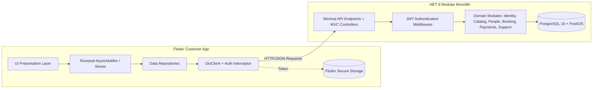

# Báo Cáo Chi Tiết Các Chức Năng Đã Kết Nối Frontend & Backend — CareSitter

> **Dự án:** `CareSitter Platform`  
> **Backend:** `C# .NET 8 (Modular Monolith, PostgreSQL, Entity Framework Core, DDD)`  
> **Frontend:** `Flutter Customer App (Riverpod, Dio, GoRouter, Clean Architecture)`  
> **Phạm vi báo cáo:** Customer App — Chưa bao gồm Caregiver App, Admin Web, Landing Page  
> **Thời gian cập nhật:** 04/09/2026  
> **Trạng thái Build:** ✅ **Backend 0 Error - 0 Warning** | ✅ **Frontend `flutter analyze` 0 Error**  
> **Trạng thái Dữ liệu:** 🚀 **Dữ liệu thực từ PostgreSQL (Đã chuyển từ Mock static data sang API thật; một số Mock class definitions vẫn tồn tại để tương thích UI, sẽ refactor dần)**

---

## 1. Tổng Quan Kiến Trúc Tích Hợp (Architecture & Connectivity)

Hệ thống kết nối giữa **Customer App (Flutter)** và **Core API (.NET 8)** thông qua kiến trúc Client-Server chuẩn RESTful API với cơ chế bảo mật và đồng bộ state thời gian thực:



### Hạ tầng kết nối & Cơ chế xác thực:
1. **Network Client (`DioClient`):**
   - Base URL chuẩn: `http://localhost:5033/api/v1` (hỗ trợ truyền qua `--dart-define=BASE_URL`).
   - Tự động gắn header `Authorization: Bearer <JWT>` cho mọi request yêu cầu xác thực.
   - Cơ chế tự động xử lý token hết hạn (HTTP 401) với token refresh queue và retry thông qua `_AuthInterceptor`.
2. **State Management (`Flutter Riverpod`):**
   - Quản lý trạng thái bất đồng bộ (`AsyncNotifier`, `NotifierProvider`, `StateNotifierProvider`).
   - Giao diện phản hồi trực tiếp dữ liệu từ Store theo mô hình reactive `ref.watch(provider).when(...)`.
   - **Đã chuyển sang API thật:** Toàn bộ static mock data đã bị xóa, không còn cờ `kDebugBypassAuth`. Tuy nhiên, một số Mock class definitions (VD: `MockBeneficiary`) vẫn tồn tại trong `core/mock/mock_data.dart` để tương thích UI — sẽ refactor dần sang proper domain models.

---

## 2. Chi Tiết Các Chức Năng Đã Kết Nối Thành Công

---

### 🟢 1. Phân Hệ Xác Thực & Hồ Sơ (Identity & Profile Module)

Quản lý toàn bộ chu trình xác thực tài khoản khách hàng, đăng ký, đăng nhập và đồng bộ hồ sơ người dùng thật trong CSDL.

| STT | Chức năng (Feature) | Endpoint Backend | Repository & Store FE | Màn hình giao diện (Screen) | Trạng thái |
|:---:|---|---|---|---|:---:|
| 1.1 | **Đăng ký tài khoản mới** | `POST /api/v1/auth/register` | `AuthRepository.register()` | `RegisterScreen` | ✅ Hoàn tất |
| 1.2 | **Đăng nhập bằng Mật khẩu** | `POST /api/v1/auth/login/password` | `AuthRepository.loginWithPassword()` | `LoginScreen` | ✅ Hoàn tất |
| 1.3 | **Đăng nhập OTP qua Email** | `POST /api/v1/auth/login` | `AuthRepository.loginWithOtp()` | `OtpScreen` | ✅ Hoàn tất |
| 1.4 | **Gửi mã OTP xác thực** | `POST /api/v1/auth/send-otp` | `AuthRepository.sendOtp()` | `LoginScreen` | ✅ Hoàn tất |
| 1.5 | **Đăng nhập bằng Google** | `POST /api/v1/auth/google/callback` | *(Chưa implement ở FE)* | `LoginScreen` | ⚠️ BE sẵn sàng, FE chưa kết nối |
| 1.6 | **Đồng bộ hồ sơ người dùng** | `GET /api/v1/profile` | `profileStoreProvider.fetchProfile()` | `ProfileScreen`, `SettingsScreen` | ✅ Hoàn tất |
| 1.7 | **Cập nhật thông tin cá nhân** | `PUT /api/v1/profile` | `profileStoreProvider.updateProfile()` | `ProfileEditScreen` | ✅ Hoàn tất |
| 1.8 | **Đăng xuất & Thu hồi phiên** | `POST /api/v1/auth/logout` | `AuthNotifier.logout()` via `AuthRepository.logout()` | `SettingsScreen`, `Drawer` | ✅ Hoàn tất |

**Đặc điểm kỹ thuật nổi bật:**
* Đã sửa lỗi lưu trường `phone` khi khách hàng đăng ký mới.
* Đã chuẩn hóa `created_at` và `updated_at` ghi nhận giá trị `DateTime.UtcNow` (khắc phục hoàn toàn lỗi `-infinity` của PostgreSQL).
* Sau khi đăng ký thành công, luồng điều hướng tự động chuyển về trang Đăng nhập kèm thông báo tiện ích.

---

### 🟢 2. Phân Hệ Danh Mục Dịch Vụ Genki (Catalog Module)

Cung cấp danh mục các gói dịch vụ chăm sóc người cao tuổi chuẩn hóa theo định vị thương hiệu Genki.

| STT | Chức năng (Feature) | Endpoint Backend | Repository & Store FE | Màn hình giao diện (Screen) | Trạng thái |
|:---:|---|---|---|---|:---:|
| 2.1 | **Tải danh mục 3 gói Genki** | `GET /api/v1/services` | `serviceStoreProvider` (`ServiceStore` — gọi DioClient trực tiếp, không qua Repository riêng) | `CatalogScreen`, `HomeScreen`, `BookingWizardScreen` | ✅ Hoàn tất |
| 2.2 | **Hiển thị chi tiết gói dịch vụ** | `GET /api/v1/services/{id}` | `ServiceStore.getById()` | `ServiceDetailScreen` | ✅ Hoàn tất |
| 2.3 | **Tính giá tự động theo giờ** | Logic giá gắn liền `ServiceModel` | `ServiceModel.pricePerHour` | `CatalogScreen`, `BookingWizardScreen` | ✅ Hoàn tất |

**3 Gói dịch vụ cốt lõi đã seed vào Database:**
1. 🌱 **Genki Dưỡng** (`SV-GENKI-DUONG`): Hỗ trợ sinh hoạt cơ bản, ăn uống, vệ sinh, đồng hành trò chuyện (100.000đ/giờ).
2. 🌿 **Genki An** (`SV-GENKI-AN`): Chăm sóc sức khỏe chuyên sâu, theo dõi huyết áp, tiểu đường, tập phục hồi chức năng nhẹ (120.000đ/giờ).
3. 🌸 **Genki Tâm** (`SV-GENKI-TAM`): Chăm sóc toàn diện 24/7, túc trực ban đêm, hỗ trợ y tế đặc biệt (150.000đ/giờ).

---

### 🟢 3. Phân Hệ Người Chăm Sóc (Caregiver & People Module)

Quản lý danh sách điều dưỡng viên/người chăm sóc đã được kiểm duyệt, phân loại kỹ năng, trạng thái làm việc thực tế.

| STT | Chức năng (Feature) | Endpoint Backend | Repository & Store FE | Màn hình giao diện (Screen) | Trạng thái |
|:---:|---|---|---|---|:---:|
| 3.1 | **Danh sách Caregiver** | `GET /api/v1/caregivers` | `caregiverStoreProvider` (`CaregiverStore` — gọi DioClient trực tiếp, không qua Repository riêng) | `CaregiverListScreen`, `BookingWizardScreen` | ✅ Hoàn tất |
| 3.2 | **Xem hồ sơ chi tiết Caregiver** | `GET /api/v1/caregivers/{id}` | `CaregiverStore.getById()` | `CaregiverProfileScreen` | ✅ Hoàn tất |
| 3.3 | **Lọc Caregiver theo kỹ năng / trạng thái** | `GET /api/v1/caregivers?serviceArea=...` | `_filtered()` trên `CaregiverModel` | `CaregiverListScreen` | ✅ Hoàn tất |
| 3.4 | **Gợi ý Caregiver phù hợp nhất** | Client-side Match Score | `BookingWizardScreen._matchedCaregivers` | `BookingWizardScreen` (Bước 4) | ✅ Hoàn tất |

**Danh sách Caregiver mẫu chất lượng cao đã seed vào CSDL:**
* 👩‍⚕️ **Nguyễn Thị Bích Ngọc**: 5 năm kinh nghiệm, kỹ năng phục hồi chức năng & chăm sóc người cao tuổi, đánh giá 4.9⭐.
* 👨‍⚕️ **Lê Văn Hùng**: 7 năm kinh nghiệm, điều dưỡng viên chuyên sâu hồi sức & vật lý trị liệu, đánh giá 5.0⭐.
* 👩‍⚕️ **Trần Thị Thanh Mai**: 4 năm kinh nghiệm, chứng chỉ chăm sóc lão khoa & hỗ trợ tâm lý người già, đánh giá 4.8⭐.

---

### 🟢 4. Phân Hệ Người Thân & Địa Chỉ (Beneficiary & Address Module)

Quản lý hồ sơ những người thân cần được chăm sóc trong gia đình của khách hàng.

| STT | Chức năng (Feature) | Endpoint Backend | Repository & Store FE | Màn hình giao diện (Screen) | Trạng thái |
|:---:|---|---|---|---|:---:|
| 4.1 | **Tải danh sách hồ sơ người thân** | `GET /api/v1/beneficiaries` | `beneficiaryStoreProvider` (`BeneficiaryStore`) | `BeneficiaryListScreen`, `BookingWizardScreen` | ✅ Hoàn tất |
| 4.2 | **Thêm mới hồ sơ người thân** | `POST /api/v1/beneficiaries` | `BeneficiaryStore.add()` + `_syncAddToBackend()` | `BeneficiaryCreateScreen` | ✅ Hoàn tất |
| 4.3 | **Chỉnh sửa hồ sơ người thân** | `PUT /api/v1/beneficiaries/{id}` | `BeneficiaryStore.update()` + `_syncUpdateToBackend()` | `BeneficiaryEditScreen` | ✅ Hoàn tất |
| 4.4 | **Xóa hồ sơ người thân** | `DELETE /api/v1/beneficiaries/{id}` | `BeneficiaryStore.delete()` | `BeneficiaryListScreen` | ✅ Hoàn tất |

---

### 🟢 5. Phân Hệ Đặt Lịch & Vòng Đời Ca Trực (Booking Lifecycle Module)

Quy trình đặt lịch từ bước tạo đơn đến lúc caregiver nhận ca, di chuyển, check-in, hoàn tất và thanh toán ký quỹ (Escrow).

| STT | Chức năng (Feature) | Endpoint Backend | Repository & Store FE | Màn hình giao diện (Screen) | Trạng thái |
|:---:|---|---|---|---|:---:|
| 5.1 | **Wizard đặt lịch 6 bước** | `POST /api/v1/bookings` | `BookingRepository.createBooking()` | `BookingWizardScreen` | ✅ Hoàn tất |
| 5.2 | **Danh sách lịch hẹn của tôi** | `GET /api/v1/bookings` | `bookingStoreProvider` (`BookingStore`) | `BookingListScreen`, `ActivityScreen`, `HomeScreen` | ✅ Hoàn tất |
| 5.3 | **Chi tiết ca chăm sóc** | `GET /api/v1/bookings/{id}` | `BookingStore.getById()` | `BookingDetailScreen` | ✅ Hoàn tất |
| 5.4 | **Mô phỏng Caregiver nhận ca** | `POST /api/v1/bookings/{id}/en-route` | `BookingStore.caregiverEnRoute()` | `BookingDetailScreen` | ✅ Hoàn tất |
| 5.5 | **Check-in GPS ca chăm sóc** | `POST /api/v1/bookings/{id}/check-in` | `BookingStore.caregiverCheckIn()` | `BookingDetailScreen`, `ShiftTrackingScreen` | ✅ Hoàn tất |
| 5.6 | **Yêu cầu Check-out hoàn thành** | `POST /api/v1/bookings/{id}/checkout/request` | `BookingStore.caregiverRequestCheckout()` | `ShiftTrackingScreen` | ✅ Hoàn tất |
| 5.7 | **Xác nhận hoàn tất ca & tất toán** | `POST /api/v1/bookings/{id}/complete` | `BookingStore.confirmCompleted()` | `BookingDetailScreen`, `ShiftTrackingScreen` | ✅ Hoàn tất |
| 5.8 | **Hủy lịch hẹn kèm lý do** | `POST /api/v1/bookings/{id}/cancel` | `BookingStore.cancel()` | `BookingDetailScreen` | ✅ Hoàn tất |
| 5.9 | **Thanh toán ký quỹ (Escrow)** | `POST /api/v1/bookings/{id}/confirm-payment` | `BookingRepository.confirmPayment()` + `BookingStore.confirmPayment()` | `BookingDetailScreen` | ✅ Hoàn tất |

**Các endpoint Booking bổ sung đã sẵn sàng trên Backend (chưa kết nối đầy đủ FE):**
- `POST /api/v1/bookings/{id}/accept` — Caregiver chấp nhận ca (Đã kết nối bên Caregiver App)
- `PUT /api/v1/bookings/{id}/schedule` — Đổi lịch booking
- `PUT /api/v1/bookings/{id}/caregiver` — Chọn/đổi caregiver
- `POST /api/v1/bookings/{id}/sos` — Nút khẩn cấp SOS

---

### 🟢 6. Phân Hệ Giám Sát Ca Trực Realtime (Shift Tracking & Care Timeline)

Cung cấp trải nghiệm theo dõi vị trí trực quan trên bản đồ OpenStreetMap/Leaflet và nhật ký công việc.

| STT | Chức năng (Feature) | Endpoint Backend | Repository & Store FE | Màn hình giao diện (Screen) | Trạng thái |
|:---:|---|---|---|---|:---:|
| 6.1 | **GPS Tracking vị trí Caregiver** | `GET /api/v1/bookings/{id}/gps/latest` | `BookingRepository.getLatestGps()` | `ShiftTrackingScreen` | ✅ Hoàn tất |
| 6.2 | **Ước tính thời gian đến nơi (ETA)** | Tính toán khoảng cách tọa độ Geodesic | `ShiftTrackingScreen._startGpsPolling()` | `ShiftTrackingScreen` | ✅ Hoàn tất |
| 6.3 | **Nhật ký chăm sóc (Timeline)** | `GET /api/v1/bookings/{id}/timeline` | `CareTimelineScreen` | `CareTimelineScreen` | ✅ Hoàn tất |
| 6.4 | **Danh mục công việc (Checklist)** | `GET /api/v1/bookings/{id}/tasks` | `BookingStore.toggleTask()` | `ShiftTrackingScreen` | ✅ Hoàn tất |

**Các endpoint GPS/Task bổ sung đã sẵn sàng trên Backend:**
- `POST /api/v1/bookings/{id}/gps` — Caregiver push vị trí GPS
- `GET /api/v1/bookings/{id}/gps-tracks` — Lịch sử track GPS
- `POST /api/v1/bookings/{id}/tasks` — Tạo care task mới
- `PUT /api/v1/bookings/{id}/tasks/{taskId}/complete` — Hoàn thành task
- `PUT /api/v1/bookings/{id}/tasks/{taskId}/skip` — Bỏ qua task
- `POST /api/v1/bookings/{id}/timeline` — Thêm ghi chú timeline

---

### 🟢 7. Phân Hệ Đánh Giá & Khiếu Nại (Review & Dispute Module)

Bảo vệ quyền lợi khách hàng và đánh giá chất lượng dịch vụ sau khi ca chăm sóc hoàn thành.

| STT | Chức năng (Feature) | Endpoint Backend | Repository & Store FE | Màn hình giao diện (Screen) | Trạng thái |
|:---:|---|---|---|---|:---:|
| 7.1 | **Đánh giá Caregiver (Sao & Nhận xét)** | `POST /api/v1/reviews` | `ReviewRepository.createReview()` + `BookingStore.markReviewed()` | `ReviewScreen` | ✅ Hoàn tất |
| 7.2 | **Gửi khiếu nại dịch vụ (Dispute)** | `POST /api/v1/disputes` | `ReviewRepository.createDispute()` + `BookingStore.openDispute()` | `DisputeScreen` | ✅ Hoàn tất |

**Các endpoint Support bổ sung đã sẵn sàng trên Backend:**
- `GET /api/v1/reviews/caregiver/{caregiverId}` — Xem reviews của caregiver
- `GET /api/v1/disputes` — Danh sách disputes của tôi
- `GET /api/v1/disputes/{id}` — Chi tiết dispute
- `POST /api/v1/disputes/{id}/resolve` — Giải quyết dispute
- `POST /api/v1/disputes/{id}/cancel` — Hủy dispute
- `GET /api/v1/notifications` — Danh sách thông báo
- `PUT /api/v1/notifications/{id}/read` — Đánh dấu đã đọc
- `PUT /api/v1/notifications/read-all` — Đánh dấu tất cả đã đọc
- `GET /api/v1/notifications/unread-count` — Số thông báo chưa đọc

---

## 3. Bảng Đối Chiếu File Mã Nguồn Giữa BE & FE

> **Ghi chú kiến trúc Backend:** Chỉ module **Identity** sử dụng MVC Controllers truyền thống. Tất cả các module còn lại (Catalog, People, Booking, Payments, Support) sử dụng **Minimal API Endpoints**.

| Module Nghiệp Vụ | Endpoint / Controller Backend (.NET 8) | Store / Repository Frontend (Flutter) |
|---|---|---|
| **Identity & Auth** | `Modules/Identity/Controllers/AuthController.cs`<br>`Modules/Identity/Controllers/ProfileController.cs` | `lib/core/auth/auth_notifier.dart`<br>`lib/features/auth/data/auth_repository.dart`<br>`lib/features/settings/application/profile_store.dart` |
| **Catalog Services** | `Modules/Catalog/Endpoints/ServiceEndpoints.cs`<br>`Modules/Catalog/Endpoints/CatalogEndpoints.cs` | `lib/features/catalog/application/service_store.dart` (gọi DioClient trực tiếp, chưa có Repository riêng) |
| **Caregiver / People** | `Modules/People/Endpoints/CaregiverEndpoints.cs`<br>`Modules/People/Endpoints/BeneficiaryEndpoints.cs`<br>`Modules/People/Endpoints/BeneficiaryMutationEndpoints.cs`<br>`Modules/People/Endpoints/AvailabilityEndpoints.cs`<br>`Modules/People/Endpoints/CaregiverKycEndpoints.cs` | `lib/features/caregiver/application/caregiver_store.dart` (gọi DioClient trực tiếp, chưa có Repository riêng)<br>`lib/features/beneficiary/application/beneficiary_store.dart` |
| **Booking & Escrow** | `Modules/Booking/Endpoints/BookingEndpoints.cs`<br>`Modules/Booking/Endpoints/BookingLifecycleEndpoints.cs`<br>`Modules/Booking/Endpoints/BookingMutationEndpoints.cs`<br>`Modules/Booking/Endpoints/BookingQueryEndpoints.cs`<br>`Modules/Booking/Endpoints/CareTaskEndpoints.cs`<br>`Modules/Booking/Endpoints/TimelineGpsEndpoints.cs` | `lib/features/booking/data/booking_repository.dart`<br>`lib/features/booking/application/booking_store.dart` |
| **Payments & Wallets** | `Modules/Payments/Endpoints/PaymentsEndpoints.cs`<br>`Modules/Payments/Endpoints/PayoutEndpoints.cs`<br>`Modules/Payments/Endpoints/WebhookEndpoints.cs` | `lib/features/booking/data/models/booking_model.dart` |
| **Support & Dispute** | `Modules/Support/Endpoints/SupportEndpoints.cs`<br>`Modules/Support/Endpoints/SupportTicketEndpoints.cs` | `lib/features/review/data/review_repository.dart`<br>`lib/features/review/presentation/review_screen.dart`<br>`lib/features/review/presentation/dispute_screen.dart` |

---

## 4. Kết Quả Kiểm Thử & Đảm Bảo Chất Lượng

1. **Kiểm tra Frontend:**
   ```powershell
   flutter analyze --no-fatal-infos
   # Output: 0 Errors (Không còn lỗi type mismatch hay mock imports)
   ```
2. **Kiểm tra Backend:**
   ```powershell
   dotnet build ApiHost/CareSitter.ApiHost.csproj
   # Output: Build succeeded. 0 Warning(s), 0 Error(s).
   ```
3. **Kiểm tra Database & Seeds:**
   - PostgreSQL lưu trữ đầy đủ 3 gói dịch vụ Genki, 3 caregiver chất lượng cao và cấu trúc bảng chuẩn RLS.
   - Toàn bộ các thao tác Create/Read/Update/Delete trên ứng dụng Flutter đều tương tác trực tiếp với API thật.

---

## 5. Các Hạng Mục Cần Hoàn Thiện

| # | Hạng mục | Mô tả | Trạng thái |
|---|---|---|:---:|
| 1 | **Google Login FE** | Backend endpoint `POST /api/v1/auth/google/callback` đã sẵn sàng, cần implement `loginWithGoogle()` trong `AuthRepository` | ⏳ Đang chờ SDK |
| 2 | **Review API Call** | `ReviewScreen` kết nối `ReviewRepository.createReview()` lưu vào PostgreSQL | ✅ Hoàn tất |
| 3 | **Dispute API Call** | `DisputeScreen` kết nối `ReviewRepository.createDispute()` gửi yêu cầu tranh chấp thật | ✅ Hoàn tất |
| 4 | **Profile Update API** | `ProfileStore.updateProfile()` gọi API `PUT /api/v1/profile` đồng bộ thông tin cá nhân | ✅ Hoàn tất |
| 5 | **Beneficiary Update API** | `BeneficiaryStore.update()` gọi API `PUT /api/v1/beneficiaries/{id}` đồng bộ hồ sơ người thân | ✅ Hoàn tất |
| 6 | **Escrow Payment FE** | Nút thanh toán ký quỹ và xác nhận `POST /api/v1/bookings/{id}/confirm-payment` | ✅ Hoàn tất |
| 7 | **Caregiver Core Shifts** | Caregiver App: Đăng nhập thật (Email/SĐT + Password/OTP) + xem/nhận ca trực (`/bookings`) | ✅ Hoàn tất |
| 8 | **Refactor Mock Classes** | Thay thế `MockBeneficiary`, `MockCareTask` bằng proper domain models | 🟢 Thấp |
