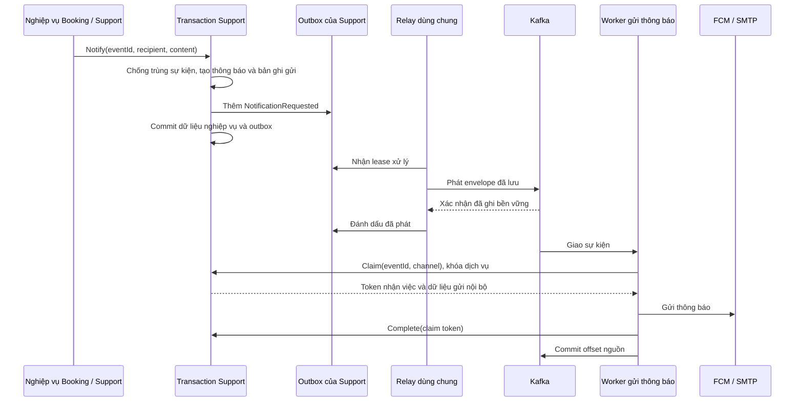

# Kiến trúc Kafka messaging cho CareSitter

**Trạng thái:** đã triển khai nền tảng messaging dùng chung. Phần tích hợp
nghiệp vụ Nutrition được để lại cho đến khi dịch vụ này được xây dựng.

## Bối cảnh và quyết định

Backend hiện chạy các module nghiệp vụ trong cùng một API host. Việc gửi
thông báo được xử lý bởi một worker chạy riêng, để nhà cung cấp gửi thông báo
phản hồi chậm không làm chặn request của khách hàng. Nutrition là dịch vụ
riêng đang được đề xuất; mã nguồn hiện chưa có `NutritionDbContext` hoặc
nghiệp vụ chọn bữa ăn để tích hợp.

Sự kiện được truyền qua Kafka dưới dạng JSON, với cơ chế **at-least-once**:
một sự kiện có thể được giao nhiều lần, nên bên xử lý phải chống xử lý trùng.
Mỗi module sở hữu outbox trong PostgreSQL của mình và dùng inbox trong
transaction nghiệp vụ. Outbox lưu sự kiện cần phát; inbox ghi nhận sự kiện
đã xử lý. Các contract MediatR và cơ chế dispatch hiện có của Payments được giữ.

Thư viện `Confluent.Kafka` được cố định ở phiên bản `2.12.0`. Kafka chạy một
broker KRaft với image `apache/kafka:3.9.1`, lưu dữ liệu bền vững, dùng hệ số
nhân bản `RF=1` và tạo topic bằng bước khởi tạo riêng.

## Ranh giới giữa các project

- `Contracts` chỉ chứa DTO của sự kiện truyền qua mạng.
- `Abstractions` chỉ phụ thuộc vào `Contracts`.
- `Kafka` chứa adapter truyền nhận, không phụ thuộc EF Core.
- `Persistence` chứa adapter EF Core, không phụ thuộc Kafka.

Mỗi module hiện có một project chứa cả thư mục `Infrastructure`. Project
của module tham chiếu `Persistence` để dùng adapter tại lớp Infrastructure;
`Application` và `Domain` không import `Persistence` hoặc `Confluent`.
Các test kiến trúc kiểm tra những ranh giới này.

## Outbox, inbox và xử lý lỗi

Mỗi host có một relay để quét các kho outbox do module sở hữu. Transaction
nghiệp vụ thêm envelope (phần bao chứa payload và metadata của sự kiện)
vào outbox, không gọi lưu độc lập. ID và envelope của sự kiện được giữ
nguyên qua mọi lần thử gửi lại.

Relay dùng lease để giữ quyền xử lý bản ghi trong một khoảng thời gian và
gia hạn trước mỗi lần phát. Cơ chế kiểm tra chủ sở hữu lease ngăn relay cũ
hoàn tất bản ghi đã được một relay khác nhận. Nếu chưa xác định chắc chắn
broker đã xác nhận nhận bản tin, sự kiện vẫn ở trạng thái chờ.
Outbox đã phát được giữ 7 ngày; inbox được giữ 14 ngày, dài hơn thời gian
giữ dữ liệu 7 ngày của topic.

Consumer xử lý tuần tự và thử lại trong giới hạn thời gian đã được kiểm tra
khi khởi động. Consumer chỉ commit offset sau khi handler thành công hoặc
việc đưa bản tin vào DLQ đã được broker xác nhận. Offset là vị trí bản tin
trong partition; commit offset ghi nhận consumer đã xử lý đến vị trí đó.

Handler dùng database quản lý transaction inbox trong chính DbContext của
mình. Handler gọi API dùng endpoint idempotent của dịch vụ sở hữu tác động
nghiệp vụ: gọi lại cùng yêu cầu không tạo thêm tác động.
Các phiên bản DTO đã đăng ký có thể cùng tồn tại. Mỗi phiên bản có thay đổi
không tương thích nên dùng một kiểu DTO riêng để producer xác định kiểu
sự kiện một cách rõ ràng.

## Danh mục sự kiện

| Định danh truyền qua mạng | Topic | Khóa phân vùng | Trạng thái tích hợp |
| --- | --- | --- | --- |
| caresitter.notifications.requested v1 | caresitter.notifications.events.v1 | ID người nhận | Transaction Support và worker chạy riêng |
| caresitter.payments.succeeded v1 | caresitter.payments.events.v1 | ID booking | Transaction Payments và relay; luồng MediatR hiện có của Booking vẫn hoạt động |
| caresitter.nutrition.mealplan-selected v1 | caresitter.nutrition.events.v1 | ID booking | Đã có contract và topic; producer/consumer nghiệp vụ chờ dịch vụ Nutrition |

Sự kiện thông báo chỉ mang các ID, tên kênh và khóa mẫu thông báo.
Tiêu đề, nội dung, token thiết bị và email người nhận được lấy qua API nội
bộ của Support. Chi tiết sức khỏe và dị ứng không được ghi vào log sự kiện.

Topic chính có 3 partition; DLQ có 1 partition. Tên DLQ mặc định là
`<topic>.dlq`; có thể cấu hình tên riêng bằng `KAFKA_TOPIC_*_DLQ`.
Endpoint gửi thông báo dùng khóa xác thực dịch vụ, so sánh khóa theo cơ chế
constant-time và kiểm tra token của lượt nhận việc khi hoàn tất.
Caddy chặn `/internal/*` trước khi định tuyến vào API.

## Luồng thông báo đã triển khai

Luồng bữa ăn dự kiến: `SaveMealSelection` trong transaction của Nutrition
→ outbox Nutrition → relay dùng chung → `MealPlanSelected` → handler nghiệp
vụ đã đăng ký. Luồng Nutrition này chưa được triển khai trong mã nguồn hiện tại.

## Đặc điểm và giới hạn

- Worker dừng sau khi nhà cung cấp chấp nhận gửi nhưng trước khi hoàn tất
  lượt nhận việc có thể khiến thông báo được gửi lại. Khi một phần batch
  FCM thành công, lần thử lại cũng có thể gửi lại cho người đã nhận.
  Không có bảo đảm nhà cung cấp chỉ gửi đúng một lần.
- `RF=1` chịu được việc broker khởi động lại nếu volume còn nguyên, không
  bảo vệ khi mất dữ liệu trên đĩa. Compose triển khai tùy chọn không mở
  cổng broker ra ngoài; Compose local mở cổng trên loopback cho API Windows.
- Thử lại từ outbox có thể làm thay đổi thứ tự các sự kiện cùng khóa.
  Handler cần xử lý được tình huống này dựa trên trạng thái nghiệp vụ.
- Thử lại trong tiến trình làm consumer chờ trong thời gian thử lại.
  Handler phải tuân thủ yêu cầu hủy. Kiểm tra khi khởi động giới hạn tổng
  thời gian thử, xử lý handler, chờ và gửi DLQ dưới `max.poll.interval.ms`.
- Trạng thái chống trùng thông báo gắn với thông báo sở hữu nó và bị xóa
  theo cơ chế cascade khi thông báo bị xóa. Chính sách lưu giữ/xóa cần giữ
  trạng thái đó trong khoảng thời gian dự kiến phát lại sự kiện.
- `PaymentSucceeded` đã có producer và relay thực tế. Luồng này vẫn giữ
  consumer MediatR hiện có của Booking và không thêm consumer thứ hai
  để gửi thông báo thanh toán.
- Test tích hợp với nhà cung cấp dùng bộ gửi giả lập có ghi nhận các lần gửi.
  Gửi FCM/SMTP thực tế cần thông tin xác thực và lượt kiểm tra riêng.

## Kiểm chứng

Các test tự động bao phủ:

- Serializer, kiểm tra schema và ranh giới phụ thuộc giữa các lớp.
- Rollback nguyên tử; kiểm tra chủ sở hữu và thời hạn lease của outbox;
  mất ACK của producer sau khi bản tin thực sự đã được gửi.
- Dừng/khởi động broker; chống trùng bằng inbox; dừng sau khi commit DB;
  phân chia partition giữa hai consumer.
- Thử lại lỗi tạm thời; đưa phiên bản chưa hỗ trợ vào DLQ; gửi DLQ thất bại;
  chính sách `Halt`.
- Xác thực lượt nhận việc qua Support; yêu cầu lặp cùng ID; dùng đường xử
  lý cũ khi tắt cờ; giữ outbox Payments độc lập.
- Chạy lại các migration SQL có đánh số.

Kiểm tra Compose bao gồm image đã cố định phiên bản, quyền ghi volume,
số partition/thời gian giữ dữ liệu của topic và khả năng giữ topic sau
khi broker khởi động lại. Image của `NotificationWorker` cũng được build riêng.
