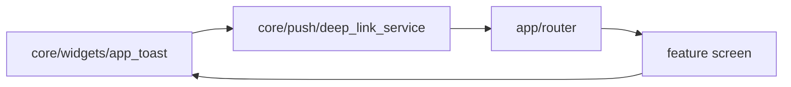

# Rà soát toàn bộ cấu trúc frontend CareSitter

Cập nhật: 12/10/2026, Asia/Saigon. Rà working tree tại commit `972414c`, gồm `customer-app`, `caregiver-app`, `admin-web` và `landing-page`. Một số thay đổi Admin, tài liệu và preview đã local từ trước; chúng được giữ nguyên. Đợt này chỉ kiểm tra, không refactor source, không commit/push và không build APK.

Nguồn chuẩn: [rule.frontend](../frontend/RULE_FRONTEND.md), [quy ước chung](../QUY_UOC_CODE_VA_SECRET.md), các `AGENTS.md` áp dụng và source hiện tại. Rule Flutter không được áp nguyên xi lên React/Next.js.

## Kết luận

Frontend chưa clean về ranh giới, quyền sở hữu state và mức độ chia component. Việc tách năm file lớn trước đó là tiến bộ, nhưng giảm số dòng chưa giải quyết hết kiến trúc. Đợt tách UI trước còn mang tính cơ học: chuyển cây widget sang nhiều file, giữ hàng loạt factory/callback/WidgetRef từ màn hình cha, nên việc lần theo code khó hơn.

Đã tái hiện hai lỗi Customer khi đổi tài khoản và xác nhận một luồng landing báo đã ghi nhận nhưng không lưu/gửi yêu cầu. Cần sửa các lỗi đó trước việc gom/đổi tên file.

## Phạm vi và cách kiểm tra

| App | File trong nguồn được quét | Đặc điểm cấu trúc hiện tại |
| --- | ---: | --- |
| Customer | 717 Dart trong lib; 530 file có widget | Đã có app/core/features/data/domain/presentation; UI chia quá vụn, provider theo phiên chưa đồng đều. |
| Caregiver | 360 Dart trong lib; 261 file có widget | Các use case Shift đã tách; model còn chứa policy/view data, UI còn truyền Ref/factory nhiều tầng. |
| Admin web | 38 TS/TSX/CSS trong src, gồm test | HTTP và DTO đã tập trung; page vẫn gom form, mutation và UI; phần chia App/routes đang local. |
| Landing | 19 TS/TSX/CSS trong src | Server/client tách được credential; booking lead chưa có tầng ghi dữ liệu, CSS chung rất lớn. |

Đã parse AST 1.077 file Dart và 55 file TypeScript, đo hai CSS, dựng graph import/export (bao gồm conditional import), tìm nhóm phụ thuộc vòng, kiểm tra vị trí lớp/state và đọc thủ công các đường cần xác minh. Các candidate không dùng được kiểm tra lại; không coi file nhỏ, một caller hoặc nhiều lớp cùng file là lỗi tự động.

## Các phát hiện cần ưu tiên

### P1-01 — Notification preferences có thể lưu input của tài khoản cũ dưới phiên mới

- Source: [notification_preferences_controller.dart](../../frontend/customer-app/lib/features/settings/presentation/controllers/notification_preferences_controller.dart#L10), đặc biệt timer ở dòng 42 và `_save` ở dòng 45.
- Provider sống toàn cục và không theo dõi user/session. Chuyển tài khoản không dispose/reset notifier hoặc hủy debounce. Token HTTP được đọc tại thời điểm gửi request trong `core/api/dio_client.dart:130`.
- Tái hiện: A đổi preference, chuyển sang B trước 500ms; timer vẫn gọi save dưới identity B. Test yêu cầu không có save, thực tế thu được `['second']`.
- Sửa: scope provider theo identity, hủy timer/request khi đổi phiên, kiểm tra generation trước gửi và sau await; trạng thái lưu lỗi phải có cách thể hiện/đối soát. Thêm regression cho đổi tài khoản và response load/save đến muộn.

### P1-02 — AddressStore ghi response của phiên cũ vào cache phiên mới

- Source: [address_controller.dart](../../frontend/customer-app/lib/features/catalog/presentation/controllers/address_controller.dart#L43), dòng 49–56. `deleteAddress` và `setDefaultAddress` có cùng vấn đề cần kiểm tra khi sửa.
- GET có listener auth/rebuild, nhưng các mutation sau await không giữ identity/generation. `addAddress` lấy `state` hiện tại của phiên mới rồi thêm bản ghi do request phiên cũ trả về.
- Tái hiện: A gửi create, đổi sang B và tải địa chỉ B, response create A về; cache thành `['first-new', 'second']` thay vì `['second']`.
- Sửa: quản lý read/write cùng một scope phiên, bỏ kết quả mutation cũ và không refresh profile của phiên mới từ thao tác cũ. Thêm test cho create/delete/set-default bị xen kẽ đổi tài khoản.

### P1-03 — Landing form thông báo đã ghi nhận khi chưa ghi dữ liệu

- Source: [QuickBookModal.tsx](../../frontend/landing-page/src/components/QuickBookModal.tsx#L56).
- `handleSubmit` chỉ `preventDefault` và `setBookingSuccess(true)`. Không gọi API/Server Action; JSX không có kênh lưu thay thế. UI nói đã ghi nhận và sẽ liên hệ, nhưng không có bản ghi hay thông tin liên hệ được gửi. Giá 120.000/giờ cũng đang là giá phía client tại dòng 54.
- Sửa: định nghĩa hợp đồng lead/request riêng, input liên hệ, adapter ghi dữ liệu và kết quả server. Chỉ hiện đã ghi nhận sau khi server xác nhận; nếu đây là demo, nội dung phải phản ánh demo. Đây là khoảng trống luồng lưu dữ liệu, không thể sửa bằng đổi thư mục.

### P2-04 — Core phụ thuộc ngược App và tạo vòng với feature

- Customer và Caregiver cùng có `core/push/notification_deep_link_service.dart:9` import `app/router/app_router.dart`.
- `core/widgets/app_toast.dart` lại phụ thuộc deep-link service chỉ để lấy messenger key. Router import screen, screen import toast: thành vòng Core/App/Feature ở cả hai app.
- Graph xác nhận hai nhóm phụ thuộc vòng lớn: Customer 10 file, Caregiver 8 file. Dart cho phép import vòng, nên đây không phải khẳng định app lập tức crash; nó làm hạ tầng generic phụ thuộc các screen cụ thể và khiến thay route/notification kéo theo nhiều tầng.

- Sửa: messenger key/toast generic nằm core; route resolution và nối router/session/native links thuộc app. Core nhận port/callback khi cần, không import composition root.

### P2-05 — UI bị chia theo cây build thay vì component có nghĩa

- Customer: 305/530 file UI không quá 50 dòng; 519/530 file chỉ có một importer trong lib. Caregiver: 144/261 file không quá 50 dòng; 255/261 file chỉ có một importer. Các số này chỉ là tín hiệu để rà, không phải lý do xóa/gom mọi widget nhỏ.
- 191 file dùng tên `callbackActionN`; 49 file UI khai báo field `WidgetRef`; có 179 field kiểu chứa `Widget Function(...)` trên hai app.
- [BookingDetailContent](../../frontend/customer-app/lib/features/booking/presentation/widgets/booking_detail_content.dart#L13) có 26 field, gồm 9 `actionN`, Ref và các hàm build. [RegistrationContent](../../frontend/customer-app/lib/features/auth/presentation/widgets/registration_content.dart#L9) có 25 field, gồm các factory UI/validator/controller. Các lớp bọc đang phụ thuộc cách màn hình cha vẽ UI.
- Chuỗi `ActivityRecentRow → ...Inset → ...Row → ...Content/...Fields` cho thấy cây layout cũ được trải qua nhiều file. Tên như `booking_detail_show_extend_shift_sheet_selected_hours_format_currency_content_body.dart` thể hiện biến/cấu trúc cũ hơn là vai trò sản phẩm.
- Sửa: gom theo card/form/section có nghĩa, mỗi component sở hữu layout; nhận view model dẫn xuất và callback có tên như `onCancel/onPay/onTrack`. Widget cần provider tự làm Consumer tại điểm sử dụng; tránh truyền Ref từ ancestor. Widget từng bước wizard và các component tái sử dụng thực sự vẫn giữ riêng.
- Nhóm cần làm trước: Booking detail/list, Auth forms, Beneficiary forms, Customer Activity/Tracking, Caregiver Home/Shift detail. Không sửa bằng tách thêm file để đạt ngưỡng dòng.

### P2-06 — Model và public boundary chưa thống nhất

- [ShiftModel](../../frontend/caregiver-app/lib/features/shifts/data/models/shift_model.dart#L54) ở data/models nhưng có `canAccept/canStartEnRoute/canCheckIn/canWorkChecklist/canRequestCheckout`, cùng date/time/duration đã format và tiền hiển thị. [CareTaskModel](../../frontend/caregiver-app/lib/features/shifts/data/models/care_task_model.dart#L42) có luật evidence/complete. Domain `ShiftActiveRules` cũng có các điều kiện ca riêng.
- `schedule_slot_model.dart` chứa `TimelineShift` dùng cho timeline, và label Sáng/Chiều/Tối. `home/data/models/notification_model.dart` format giờ tương đối lúc parse. Customer `AddressModel` có displayLabel/shortAddress. Chúng không import Flutter, nhưng vẫn trộn trách nhiệm DTO/policy/display.
- `booking_model.dart` export `booking_list_response.dart`, trong khi response import booking_model: một nhóm vòng hai file do barrel tương thích của đợt tách trước.
- Hai UI Customer import `booking_repository.dart` để lấy PaymentIntentModel/PaymentProviderModel. Đã xác minh đây là import loại dữ liệu, chưa phải bằng chứng UI gọi API trực tiếp; vẫn nên import data/models đúng nơi.
- Sửa: DTO giữ hợp đồng API; rule thao tác thuộc domain; labels/view model dẫn xuất thuộc presentation. Public export có chủ đích ở feature entry, tránh DTO làm barrel ngược. Chuyển state riêng khỏi controller khi hai vai trò đã độc lập; các sealed result variants có thể ở cùng file để giữ tính gắn kết.

### P2-07 — Tokens và formatter chưa hoàn thiện toàn app

- Customer `core/theme/app_theme.dart` vẫn 540 dòng/7 lớp public, khác với cấu trúc theme đã chia của Caregiver. Customer/Caregiver vẫn lặp hạ tầng, nhưng chưa có ánh xạ semantic token thống nhất để đối chiếu thiết kế.
- Quét UI thấy 59 file Customer và 23 file Caregiver có `SizedBox` kích thước số; Customer có 23 file dùng radius số. Đây là số file khớp các pattern cụ thể, chưa phải toàn bộ literal.
- Ví dụ OTP radius 18/spacing 36; booking status card spacing 12/runSpacing 8 trong khi đã có token tương ứng. Activity vẫn dùng map động màu/shortLabel song song với BookingStatusPresentation.
- Sửa: gom formatting/status view logic theo chủ sở hữu, chuẩn hóa spacing/radius/text roles và dùng token có tên. Không thay thiết kế để dọn code.

### P2-08 — Architecture guard có khoảng trống thực tế

- Hai suite kiến trúc hiện hữu đều pass 2/2 trong đợt rà này. UI không vượt 300 dòng và build/_build không vượt 80 dòng. Những điều đó chưa chứng minh toàn bộ cấu trúc clean.
- Guard chỉ bắt core import chuỗi `features/`, nên bỏ sót `core → app → feature`. Nó không tính cycle, không kiểm tra session ownership hay model chứa nghiệp vụ/display. Guard UI→repo chỉ tìm `read/watch(...RepositoryProvider)`, nên bỏ sót import repository để lấy DTO. Customer chưa có cùng kiểm tra foreign-feature presentation như Caregiver.
- Sửa: resolve import/export/conditional import qua AST, kiểm tra hướng phụ thuộc và cycle, thống nhất policy giữa hai app. Bổ sung test phiên/lifecycle cho các store còn lại; giữ kiểm tra kích thước như một kiểm tra hỗ trợ.

### P2-09 — Admin có nền tốt nhưng page vẫn gom nhiều trách nhiệm

- `api.ts` tập trung HTTP/error/token; `types.ts` tập trung DTO; `useResource` có abort và sequence/path guard; các helper pricing/dispute đã có test. Không cần ép app React nhỏ thành cây Flutter.
- [ServicesPage.tsx](../../frontend/admin-web/src/pages/ServicesPage.tsx#L34) có 5 component trong 154 dòng; dòng dài nhất 672 ký tự. `ServiceDrawer` 46 dòng nhưng khoảng 7.668 ký tự, gom hai form và mutation dịch vụ/bảng giá. `PromotionEditor` khoảng 11.093 ký tự trong 100 dòng.
- Page chứa resource URLs, async mutation, UI form và drawer; code nén làm số dòng không phản ánh độ phức tạp.
- Sửa: module theo nghiệp vụ lớn như catalog/promotions/disputes; tách API adapter/mutation hook, form state và drawer rõ ràng. Format JSX để review được; giữ components generic và operations thuần dùng chung. DTO có thể tách theo tài nguyên nếu file types tiếp tục tăng.
- Các file App/routes/ErrorBoundary và test liên quan hiện đang local/untracked từ trước; kết quả kiểm tra ở đây áp dụng working tree này, không khẳng định tất cả đã có trên remote.

### P2-10 — Landing CSS và client boundary còn rộng

- `src/app/globals.css` có 2.481 dòng, gom tokens, global/base, section, modal, AI, motion và responsive. Nên để global/base/tokens ở đây và đưa style của component về nơi sở hữu.
- `page.tsx` là client root vì quản lý modal, nên kéo cả các section qua boundary client. Có thể thu gọn phần client vào shell/modal/interaction khi cải thiện cấu trúc; đây là đề xuất giảm phạm vi phụ thuộc, chưa phải số đo hiệu năng.
- Credential AI chỉ đọc ở route server; quét không thấy component client import SDK server AI. Tuy nhiên type Recommendation/schema được khai báo riêng ở client và route, chưa có contract/schema chung và test server cho đầu ra lỗi.
- `CustomCursor.tsx` không có importer trong src hiện tại; cần quyết định có dùng hay bỏ trong lượt dọn.
- CI hiện tại chưa có job landing lint/typecheck/test, dù lint/typecheck local pass. Landing package cũng chưa khai báo script test.

### P3 — File/param dư và thư mục local

- Đã xác minh hai TagInput Customer nhận `setState` nhưng không dùng, SavedSelfRecipient nhận args không dùng, KpiItem Caregiver nhận badgeColor không dùng. Cần bỏ những tham số này khi sửa component liên quan.
- Sáu file lib không có import/export trong app là candidate, không tự động xóa: Customer failure.dart/app_text_field.dart/custom_animations.dart/phone_input_screen.dart; Caregiver phone_formatter.dart/firebase_options.dart. `custom_animations.dart` vẫn được test dùng, và conditional web implementations đã được loại khỏi candidate sau khi resolve AST.
- Customer có cây `frontend/customer-app/frontend/customer-app/lib/core/api` rỗng; Caregiver có package-lock.json npm rỗng dù app Flutter không có package.json tương ứng. Có preview/.kombai/log local ở app root. Đây là việc dọn workspace/nguồn dư sau cùng.
- `.dart_tool`, build, node_modules, .next và các thư mục nền tảng Flutter là đầu ra/dependency hoặc scaffold bình thường; không coi chúng là vi phạm kiến trúc hay xóa hàng loạt.
- Một cạnh domain→core/utils/phone_formatter là helper thuần Dart. Rule hiện viết domain không import tầng khác; cần thống nhất policy shared pure utility, mức ưu tiên thấp hơn các lỗi runtime và core→app.

## Kiểm chứng và giới hạn

| Kiểm tra trong lượt rà | Kết quả |
| --- | --- |
| Parse AST Dart / TypeScript | 1.077 / 55 file |
| Architecture tests Customer / Caregiver | 2/2 / 2/2 pass |
| Hai repro kỳ vọng cách ly phiên Customer | 0 pass, 2 fail; xác nhận hai lỗi nêu trên |
| Admin test | 64/64 pass, 12 file test |
| Admin typecheck | Exit 0 |
| Landing eslint src | Exit 0 |
| Landing typecheck | Exit 0 |
| Flutter source/test diff trong audit | Không thay đổi |

Hai repro dùng repository fake để kiểm tra orchestration/cache/token identity tại biên controller; không gửi request hay sửa dữ liệu backend thật. Chúng nằm ở `backend/artifacts/frontend-logic-20261012/session_audit_test.dart`, ngoài suite ứng dụng và ngoài Git. Log `session-audit.log` ghi rõ expected/actual. Các regression này cần chuyển vào suite chính trong lượt sửa, với assert giữ hành vi an toàn.

Full suite Flutter 232/84 pass là bằng chứng đợt refactor trước trên cùng source; lượt này không chạy full lại vì không sửa source. Không coi số pass đó là bằng chứng phủ hai lỗi vừa phát hiện. Không build web/Android/iOS hoặc test thiết bị thật trong lượt audit; typecheck không thay cho build/runtime.

## Thứ tự sửa tiếp đề xuất

1. Cách ly phiên cho NotificationPrefs và AddressStore; regression cho request/timer của phiên cũ. Hoàn thiện hoặc sửa nội dung của landing lead form.
2. Cắt Core→App và vòng Toast/DeepLink/Router; đưa orchestration về app, tách key/UI generic về core.
3. Chốt ranh giới DTO/domain/view model và feature public API, sửa barrel vòng/import loại qua repository; bổ sung architecture guards tương ứng.
4. Dọn các component chia cơ học: Booking/Auth/Beneficiary trước, rồi Activity/Tracking và Caregiver Home/Shift; đổi callback có nghĩa, bỏ widget factory/Ref truyền nhiều tầng.
5. Chuẩn hóa tokens/formatter; dọn Admin module/page, landing CSS/contract/client shell và CI; cuối cùng xử lý file/param/workspace dư đã xác minh.

Tiêu chí hoàn tất: có test phiên lỗi/lặp/đến muộn; dependency graph không còn core→app/feature; model không chứa policy/UI labels; một component đổi giao diện không buộc sửa một chuỗi wrapper; source vẫn giữ API và thiết kế hiện có. Không tiếp tục lấy việc tất cả file dưới 300 dòng làm tiêu chí hoàn tất kiến trúc.
