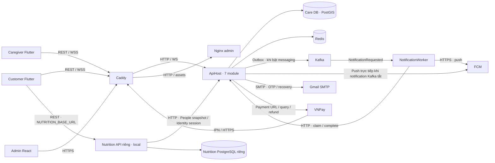

# CareSitter — đối chiếu source với hình container

> Báo cáo này là snapshot trước khi sửa luồng. Sau commit `6c40872`, đã bổ sung façade REST, gRPC và AppHost; xem [báo cáo thay đổi và kiểm chứng](NUTRITION_GRPC_APPHOST_2026-10-11.md). Phần chưa có gRPC/AppHost bên dưới mô tả thời điểm rà soát ban đầu.

Cập nhật 11/10/2026 (Asia/Saigon). Repo kiểm tra: `D:\EXE\CareSitter`. Hình tham chiếu: ảnh customer gửi, tiêu đề “C1 - CARESITTER CONTAINER DIAGRAM”, chú thích dashed / `*` = proposed. Phạm vi: đọc source, manifest và cấu hình route; không thay source, chạy migration, bật feature, khởi động stack hay deploy trong lần rà soát này. Không đọc/ghi secret thực.

## Kết luận

Hình phù hợp như kiến trúc mục tiêu, chưa mô tả chính xác implementation hiện tại. Phần core đã có; Nutrition có host và DB độc lập nhưng giao thức, chiều gọi, đường truy cập của app và cấu hình deploy đang khác hình. Kafka/NotificationWorker đã có code và Compose tùy chọn, nên không còn chỉ là đề xuất ở mức source. Chưa kiểm chứng môi trường chạy thật từ lần đọc này.

Backend chính vẫn là modular monolith: Identity, People, Catalog, Booking, Payments, Support, Promotion cùng process ApiHost và DB CareSitter với schema module. Nutrition và NotificationWorker là các process riêng. Không coi từng module của ApiHost là microservice đã tách.

## Ma trận đối chiếu

| Thành phần/luồng trong hình | Source/cấu hình thực tế | Mức khớp |
| --- | --- | --- |
| Customer/Caregiver Flutter, Admin React | Đủ ba app. Cả customer và caregiver có SignalR `/hubs/care-tracking`; hình chỉ ghi WSS ở customer | Khớp thành phần; bổ sung WSS cho caregiver |
| Edge Proxy Caddy → API/Hub; Caddy → Nginx admin | Caddy route `/api/*`, `/hubs/*`, health/hangfire tới `api:8080`; còn lại tới `admin:8080`; chặn `/internal/*` | Khớp cấu hình deploy core |
| ASP.NET Core 8 Backend API | ApiHost .NET 8 đăng ký bảy module trong một process | Khớp |
| Care DB PostgreSQL/PostGIS | Compose PostGIS 16/3.4; module dùng connection CareSitter + mapping NetTopologySuite | Khớp |
| Auth Cache Redis | Redis cho OTP, auth/cache/blacklist; session bền có PostgreSQL authoritative | Khớp; không coi Redis là nguồn session duy nhất |
| Backend ↔ VNPay/IPN | Có payment URL, query/refund adapters, GET `/api/v1/payments/vnpay/ipn` và `/return` | Khớp ở mức source; không chứng minh provider thực trong lần rà này |
| Nutrition Service + PostgreSQL riêng | Solution/host .NET 8 độc lập, Npgsql, schema và runtime role riêng, Docker/Compose riêng | Thành phần đã có source; chưa tích hợp deploy chung |
| Backend API → Nutrition bằng gRPC/HTTP2 | Chưa có `.proto`, Grpc package/server/client; ApiHost chưa gọi Nutrition. Customer dùng client Nutrition riêng | Chưa khớp |
| Nutrition lấy hồ sơ/phiên | Nutrition → People snapshot và Identity session qua HTTP, owner/revision/session checks; hình chưa thể hiện | Thiếu luồng trong hình |
| Backend → Kafka → NotificationWorker | Có module Outbox và producer Kafka; worker consume NotificationRequested rồi gọi API claim/complete | Đã có code, bật theo flags và Compose override |
| Nutrition → Kafka | Service Nutrition chưa có producer/outbox/Kafka reference. Main chỉ đăng ký MealPlanSelected contract và topic dự phòng | Chưa có luồng nghiệp vụ |
| Nutrition → AI Provider | IHealthDescriptionParser và UnconfiguredHealthParser; khi cần AI trả nutrition.ai_unavailable | Đề xuất/chưa nối provider |
| API → SMTP/FCM; worker → SMTP/FCM | API có Gmail SMTP và Firebase push; worker có hai adapter. Producer Support hiện gửi channels=[push] | Có code; worker email chưa có producer nghiệp vụ được xác nhận |
| AppHost | Chưa có trong CareSitter; chưa có một host chạy ApiHost/Nutrition/NotificationWorker | Backlog phát triển local, hình không yêu cầu AppHost |

## Những chỗ lệch quan trọng

### 1. Customer đang gọi hai API

`NutritionRepository` dùng `people` theo BASE_URL cho GET/PATCH hồ sơ và client `nutrition` theo NUTRITION_BASE_URL cho capabilities/assessment/recommendation/plan. Hình hiện đi Customer → Edge → Backend → Nutrition, nhưng API chính chưa có façade cho các use case Nutrition.

[NutritionRepository](../../frontend/customer-app/lib/features/nutrition/data/nutrition_repository.dart).

### 2. Giao tiếp service hiện là HTTP/JSON và chiều gọi ngược hình

`PeopleHealthClient` gọi `/internal/v1/nutrition/owners/{owner}/beneficiaries/{id}/health-profile` bằng credential service; `IdentitySessionClient` kiểm bearer qua `/api/v1/auth/session`. Đây là các phụ thuộc đang bảo vệ quyền, revision, xóa hồ sơ và thu hồi phiên. Đổi sang gRPC phải giữ các bất biến này, không chỉ thay JSON bằng proto.

[People client](../../backend/services/nutrition/src/CareSitter.Nutrition/Infrastructure/PeopleHealthClient.cs), [Identity client](../../backend/services/nutrition/src/CareSitter.Nutrition/Infrastructure/IdentitySessionClient.cs), [endpoint People](../../backend/caresitter-be/Modules/People/Controllers/InternalNutritionProfileController.cs).

### 3. Nutrition chưa nằm trong deployment stack

`deploy/compose.yml` chỉ khai báo core; `deploy/compose.kafka.yml` thêm Kafka và NotificationWorker. Nutrition nằm ở Compose riêng, dùng Development, bind loopback 5035, mặc định gọi host.docker.internal:5033, flags false. Đây là cấu hình local. Caddy route toàn bộ `/api/*` tới ApiHost nên dùng URL public core cho NUTRITION_BASE_URL hiện sẽ không tự chuyển tới Nutrition.

[Core Compose](../../deploy/compose.yml), [Kafka Compose](../../deploy/compose.kafka.yml), [Caddyfile](../../deploy/Caddyfile), [Nutrition Compose](../../backend/services/nutrition/compose.yml).

### 4. Kafka và worker đã có, Nutrition event chưa có

Notifications dùng Outbox có transaction và worker claim/complete qua HTTP. Khi Kafka notification flag tắt, API vẫn gửi FCM trực tiếp. Payment Kafka có nhánh publish riêng, Booking confirmation vẫn dùng MediatR outbox hiện hữu. Worker hiện subscribe NotificationRequested, không subscribe mọi event payment/booking/Nutrition trong hình. Không coi việc đăng ký MealPlanSelected/topic là đã publish hoặc consume thực.

Worker có SMTP adapter, nhưng nguồn NotificationRequested hiện trong Support chỉ yêu cầu push. Email OTP/recovery vẫn gửi từ process API. Nếu mô tả luồng worker email đã hoàn thành cần thêm và kiểm chứng producer tương ứng.

[Notification producer](../../backend/caresitter-be/Modules/Support/Infrastructure/UserNotificationService.cs), [payment finalization](../../backend/caresitter-be/Modules/Payments/Infrastructure/PaymentFinalizationService.cs), [worker](../../backend/caresitter-be/Services/NotificationWorker/Program.cs), [claim client](../../backend/caresitter-be/Services/NotificationWorker/Infrastructure/Clients/SupportNotificationClient.cs).

## Luồng hiện tại cần thể hiện trong hình as-is

Đây là sơ đồ source/cấu hình có sẵn, không khẳng định mọi nhánh đang bật đồng thời. Nutrition client còn cần BASE_URL để cập nhật hồ sơ. Adapter email worker có source nhưng chưa thể hiện như luồng producer đã vận hành. AI thật và Kafka Nutrition chưa được vẽ như implementation. AppHost là công cụ orchestration local, có thể đặt ở deployment/development view riêng.

## Nếu giữ hình hiện tại làm kiến trúc mục tiêu

1. Bổ sung façade Nutrition ở ApiHost để customer dùng một BASE_URL; giữ service Nutrition triển khai độc lập.
2. Bổ sung contract `.proto` có phiên bản, gRPC client/server, authentication/deadline/cancellation và kiểm owner/revision tương đương hiện tại. Xác định rõ cách xác thực snapshot và kiểm lại dữ liệu nguồn; giữ hoặc thể hiện dependency Nutrition → People/Identity.
3. Thêm Nutrition/API + DB vào cấu hình deploy và network nội bộ; public traffic đi qua Caddy → ApiHost. Dùng config môi trường thật, không ghép nguyên Compose Development.
4. Triển khai Nutrition event bằng outbox ở DB Nutrition nếu nghiệp vụ cần; định nghĩa event ID/version, dữ liệu tối thiểu, handler và idempotency. Chưa chọn consumer mặc nhiên là NotificationWorker.
5. AI provider tiếp tục proposed theo lựa chọn customer; catalog từ sách cần nguồn và review trước khi publish.
6. Thêm AppHost cho local để chạy chung các process/dependency. Việc này không tự đổi protocol hoặc làm hoàn thành các bước trên.

Nếu cần nộp sơ đồ phản ánh source ngay, cập nhật theo as-is: thêm Customer → Nutrition và Nutrition → ApiHost HTTP, bỏ nhãn gRPC, đánh dấu Kafka/worker đã có code nhưng có điều kiện bật, giữ AI/Kafka Nutrition là proposed, thêm WSS cho caregiver. Không dùng một hình để đồng thời tuyên bố source hiện tại và trạng thái deploy production.

## Kiểm chứng và giới hạn

- Đã đọc attachment và đối chiếu source/API clients/routes/DI/project references/Compose/Caddy/Nginx.
- Đã tìm `.proto`, gRPC và AppHost trong backend: chưa có. Service Nutrition không có Kafka/Grpc dependency và chưa có event producer.
- Báo cáo không dựa vào plan để kết luận implementation. Tài liệu container cũ cũng ghi rõ các luồng đề xuất; source mới hơn tài liệu đó.
- Không chạy lại test ứng dụng cho lần review chỉ đọc này. Kết quả kiểm thử Nutrition lần triển khai trước ở [báo cáo local](NUTRITION_SERVICE_IMPLEMENTATION_2026-10-11.md), không thay thế nghiệm thu tất cả kết nối trong hình.
- Chưa truy cập deployment thật, chưa xác nhận các cờ bật, credential, schema hiện hành hoặc provider. Không ghi đã chạy production hay end-to-end chỉ từ source/Compose.
- Chỉ thêm báo cáo local và mục lục tài liệu; không sửa source/config, stage, commit hoặc push.
