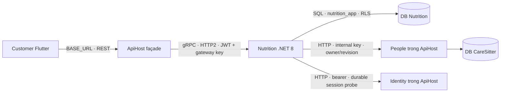

# Nutrition: façade REST, gRPC và AppHost

Cập nhật 11/10/2026. Bổ sung sau [báo cáo đối chiếu container](KIEN_TRUC_CONTAINER_DOI_CHIEU_2026-10-11.md), sau commit `6c40872`. Đã có source, build và test transport local. Đợt thay đổi này chưa commit/push, chưa migrate/deploy môi trường hiện hữu.

> Đây là kết quả tại thời điểm hoàn thành gRPC/AppHost ban đầu. Lượt tiếp theo đã chạy PostgreSQL thật, áp dụng SQL 37–38 lên CareSitter local và smoke AppHost thành công; xem [báo cáo hồ sơ và DB cập nhật](NUTRITION_HEALTH_DATABASE_2026-10-11.md).

## Luồng đã triển khai



- Contract duy nhất ở `backend/services/nutrition/protos/nutrition.proto`, package `caresitter.nutrition.v1`. ApiHost compile client từ cùng file; Nutrition compile server/client. Nutrition không reference project monolith và không query DB People/Identity.
- Protobuf định nghĩa operation/kind, ID, revision, idempotency key, trường nullable, timestamp và lỗi nghiệp vụ. Payload assessment/meal/recipe giữ JSON có version hiện hữu để giữ decimal và nội dung lồng nhau. Không nhận owner ID tự khai từ caller.
- Façade giữ endpoint REST về capabilities, assessment/confirm, recommendation/replacements, meal plan/history; chuyển lỗi sang 400/401/403/404/409/429/503, giữ Location polling trên ApiHost và các trường JSON Flutter đang dùng.
- Main façade yêu cầu CUSTOMER. Nutrition kiểm gateway key, JWT, role, durable session; Application tiếp tục kiểm owner và revision trước/sau I/O. Profile xóa/không thuộc customer không trả tài nguyên. Gateway credential sai trả unavailable về app, không biến lỗi cấu hình server thành logout customer.
- Deadline mặc định 15 giây, cấu hình 1–30 giây; hủy request public hủy RPC. Không đặt retry policy mới cho thao tác ghi. Idempotency key vẫn do Nutrition Store xử lý. Request tối đa 32 KiB, response tối đa 1 MiB; history/options tối đa 20 mục.
- Identity/People/DB lỗi trả unavailable; response sai scope/JSON bị façade chặn. Log không ghi bearer, credential, ghi chú hay response sức khỏe.
- REST Nutrition vẫn có để tương thích/debug. Customer dùng Dio chung và `BASE_URL` main API; không cần URL service riêng. Chỉnh hồ sơ vẫn đi People.

## Chạy chung bằng AppHost

Source: `backend/orchestration/CareSitter.AppHost/`. SDK riêng .NET `10.0.401`, Aspire `13.6.1`. API, Nutrition, NotificationWorker và global.json repository vẫn .NET 8 / SDK `8.0.425`. Cần SDK 8, SDK 10, Aspire CLI 13.6.1 và Docker đang chạy.

Từ repository:

```powershell
./backend/scripts/run-apphost.ps1
```

Launcher tìm SDK/CLI đang cài hoặc bản portable trong `.codex-build/`; có thể chỉ định `-DotnetPath` và `-AspirePath`. PATH/DOTNET_ROOT chỉ thay trong lúc chạy và được khôi phục khi kết thúc. Launcher dùng CLI bundle đã pin, không chuyển qua CLI run hook tự trust certificate.

- Dùng `backend/.env` cho ApiHost, hoặc `AppHost:ApiEnvFile`. API dùng `CARESITTER_ENV_FILE` và NoClobber để cấu hình được inject không bị env file ghi đè.
- DB CareSitter và Redis là dependency hiện hữu, phải có cấu hình và đang chạy. AppHost không tạo/reset/migrate các tài nguyên này. Kafka cũng là dependency ngoài khi notification flow bật.
- Tạo Postgres 16 riêng cho Nutrition, mount schema SQL và runtime-role script; volume `caresitter-apphost-nutrition`. Chỉ bootstrap volume mới, không nâng cấp schema volume cũ.
- Nutrition kết nối bằng `nutrition_app`, không dùng admin connection. Credential admin/runtime/gateway/People sinh một lần trong `appsettings.Development.Local.json` bị ignore và được dùng lại. JWT/core connection/Redis connection là secret parameters, không hardcode hoặc đưa vào client.
- URL nội bộ lấy từ endpoint resource. Không WaitFor hai chiều: Nutrition đợi DB của mình; API đợi Nutrition readiness.
- Mặc định API `5033`, Nutrition REST `5035`, gRPC `5036`, dashboard `15888`. Có thể đổi `AppHost:ApiPort`, `NutritionHttpPort`, `NutritionGrpcPort`, data volume. Đây là orchestration Development.
- Nutrition clinical flags mặc định false. Thêm NotificationWorker khi `KAFKA_ENABLED` và `KAFKA_FLOW_NOTIFICATIONS_ENABLED` đều true; truyền credential/provider config, dùng broker hiện hữu.

## Kiểm chứng 11/10/2026

| Kiểm tra | Kết quả |
| --- | --- |
| Nutrition solution | 34 pass, 0 fail, **9 skip** vì chưa có PostgreSQL test connection; có 3 gRPC auth/owner/dependency tests mới |
| Main integration, filter Nutrition | 29 pass, 0 fail, 0 skip; HTTP2 Kestrel thật và REST façade TestServer, routes/DTO/errors/cancel/deadline |
| Flutter Nutrition/session | 15 pass; analyze không có issue |
| AppHost | Build thành công; launcher xuất manifest thành công với fixture config, đúng 11 resources và URL endpoint references |
| Docker runtime | Chưa chạy lại: Docker engine tắt; công cụ chặn lệnh có thao tác khởi động Docker với `blocked by policy` |

Evidence: `backend/artifacts/nutrition-grpc/api-nutrition-final.trx`, `nutrition-final.trx`, `apphost-launcher-manifest.json`. Manifest fixture không dùng secret ứng dụng hiện hữu. Các lỗi fixture binder và build song song bị khóa file đã sửa, chạy lại tuần tự; không tính các lần lỗi đó là pass.

DB/Compose từng qua ở [báo cáo implementation trước](NUTRITION_SERVICE_IMPLEMENTATION_2026-10-11.md), không thay thế runtime AppHost mới. Cần chạy PostgreSQL tests và smoke toàn bộ AppHost khi Docker khả dụng; chưa chứng nhận startup/shutdown container, provider thật, device end-to-end hoặc production.

## Phần còn khác hình

Main API → Nutrition đã là gRPC và Customer đi qua main API. Nutrition → People/Identity vẫn HTTP, cần thể hiện trong hình. Chưa có shared deployment production cho Nutrition, Nutrition Kafka outbox/producer, AI provider hoặc catalog/công thức trích sách đã duyệt. AppHost không tự hoàn thành các hạng mục này.

Nguồn kỹ thuật: [support policy Aspire](https://aspire.dev/support/), [prerequisites](https://aspire.dev/get-started/prerequisites/), [gRPC ASP.NET Core](https://learn.microsoft.com/en-us/aspnet/core/grpc/aspnetcore), [authentication gRPC](https://learn.microsoft.com/en-us/aspnet/core/grpc/authn-and-authz).
