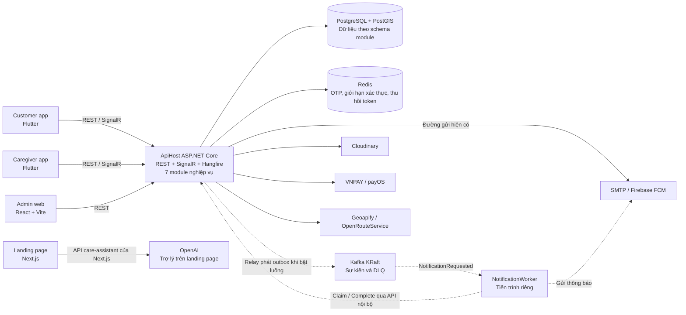
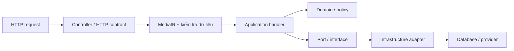

# Kiến trúc hiện tại của dự án CareSitter

**Cập nhật:** 06/10/2026, múi giờ Asia/Saigon.
**Phạm vi:** mã nguồn tại `D:\EXE\CareSitter`, gồm cả thay đổi local chưa commit.
Nhánh đang làm việc là `develop`; commit nền là `2fb0bcb`.

Tài liệu mô tả cấu trúc và hành vi đang có trong mã nguồn. Trạng thái từng
chức năng và các phần còn thiếu nằm trong [báo cáo chức năng riêng](BAOCAO_CHUC_NANG.md).
Cấu hình triển khai có trong repo được phân biệt với những thành phần đã
được quan sát đang chạy trên máy local.

## 1. Tổng quan hệ thống

CareSitter là nền tảng kết nối gia đình với người chăm sóc tại nhà cho nhu
cầu phi y tế. Hệ thống phục vụ ba vai trò nghiệp vụ:

- **Customer:** quản lý người thân, đặt ca, thanh toán và theo dõi chăm sóc.
- **Caregiver:** quản lý hồ sơ, nhận ca, thực hiện công việc và xem thu nhập.
- **Admin:** duyệt hồ sơ, quản lý dịch vụ, theo dõi ca và xử lý các vấn đề vận hành.

Backend sử dụng **modular monolith**: 7 module nghiệp vụ cùng chạy trong
`ApiHost`, dùng chung một database PostgreSQL và tách dữ liệu theo schema.
`NotificationWorker` là tiến trình riêng đã có mã nguồn để xử lý thông báo
qua Kafka khi bật luồng tương ứng.

Frontend gồm 4 ứng dụng: customer app, caregiver app, admin web và landing page.
Nutrition và giao tiếp gRPC đang ở mức kế hoạch; mã nguồn hiện chỉ có contract
sự kiện `MealPlanSelected` và cấu hình topic cho luồng này.

## 2. Sơ đồ các thành phần

Các đường nét đứt mô tả luồng thông báo Kafka cần được bật bằng cấu hình.
Sơ đồ thể hiện quan hệ giữa các thành phần đã có mã nguồn, không khẳng định
tất cả thành phần đang được triển khai trên production.



Landing page hiện có API riêng cho trợ lý AI. Form đặt nhanh trên landing
page chỉ cập nhật trạng thái giao diện; chưa tạo booking trong backend.

## 3. Công nghệ đang sử dụng

| Thành phần | Công nghệ trong source/cấu hình | Vai trò |
| --- | --- | --- |
| Backend API và worker | .NET 8, ASP.NET Core | HTTP, xác thực, tiến trình nền |
| Tổ chức nghiệp vụ | MediatR, FluentValidation | Command/query, handler, kiểm tra dữ liệu |
| Truy cập database | EF Core, Npgsql, NetTopologySuite | Mapping, truy vấn và dữ liệu không gian |
| Database local/triển khai | PostgreSQL 16 + PostGIS, image `postgis/postgis:16-3.4` | Dữ liệu nghiệp vụ và tọa độ |
| Cache | Redis 7 | OTP, trạng thái xác thực và cache |
| Cập nhật trực tiếp | SignalR | Trạng thái ca, timeline, vị trí và tín hiệu đồng bộ |
| Lịch chạy tác vụ nền | Hangfire | Đối soát, nhắc việc, checkout, matching và cleanup |
| Messaging | Confluent.Kafka 2.12.0; Apache Kafka 3.9.1 KRaft | Producer, consumer, retry, DLQ |
| Customer/caregiver app | Flutter, Riverpod, GoRouter, Dio | Giao diện, trạng thái, điều hướng và gọi API |
| Admin web | React 19, TypeScript, Vite 7 | Công cụ quản trị |
| Landing page | Next.js 16, React 19, Tailwind CSS 4 | Giới thiệu dịch vụ và trợ lý AI |
| Triển khai | Docker Compose, Caddy; Nginx trong image admin | Chạy container, HTTPS và phục vụ web |

Các phiên bản frontend nêu trên là dòng phiên bản được khai báo trong manifest.

## 4. Cây source thực tế

```text
D:\EXE\
└── CareSitter/
    ├── plan/                    # tài liệu Markdown tập trung, chỉ lưu local
    │   ├── README.md, QUY_UOC_CODE_VA_SECRET.md, RA_SOAT_QUY_UOC.md
    │   ├── tong-quan/           # ARCHITECTURE.md, BAOCAO_CHUC_NANG.md...
    │   └── backend/, frontend/, deploy/, docs/, bao-cao/, kiem-thu/...
    ├── backend/
    │   ├── CareSitter.sln
    │   ├── Directory.Build.props
    │   ├── caresitter-be/
    │   │   ├── ApiHost/
    │   │   │   ├── Program.cs
    │   │   │   ├── Controllers/, Application/, Endpoints/
    │   │   │   └── Routing/, Security/, OpenApi/, Persistence/
    │   │   ├── Modules/
    │   │   │   ├── Identity/
    │   │   │   ├── People/
    │   │   │   ├── Catalog/
    │   │   │   ├── Booking/
    │   │   │   ├── Payments/
    │   │   │   ├── Support/
    │   │   │   └── Promotion/
    │   │   ├── Shared/
    │   │   │   ├── CareSitter.SharedKernel/
    │   │   │   ├── CareSitter.Contracts/
    │   │   │   ├── CareSitter.Infrastructure/
    │   │   │   ├── CareSitter.Messaging.Contracts/
    │   │   │   ├── CareSitter.Messaging.Abstractions/
    │   │   │   ├── CareSitter.Messaging.Kafka/
    │   │   │   └── CareSitter.Messaging.Persistence/
    │   │   └── Services/NotificationWorker/
    │   ├── init-db/, scripts/, tests/, docs/
    │   ├── docker-compose.yml
    │   └── Dockerfile, NotificationWorker.Dockerfile
    ├── frontend/
    │   ├── customer-app/
    │   ├── caregiver-app/
    │   ├── admin-web/
    │   └── landing-page/
    ├── deploy/
    │   ├── compose.yml, compose.kafka.yml
    │   ├── Caddyfile, migrate.sh, preflight.sh
    │   └── kafka-init.sh, các file env mẫu
    └── .github/workflows/ci.yml
```

## 5. Ranh giới và trách nhiệm của 7 module

| Module / schema | Trách nhiệm chính | Nhóm dữ liệu tiêu biểu |
| --- | --- | --- |
| Identity / `identity` | Tài khoản, đăng nhập, phiên, khôi phục mật khẩu/email, thiết bị, audit | users, refresh_tokens, user_devices, audit_logs, recovery_challenges, recovery_email_outbox |
| People / `people` | Người được chăm sóc, liên hệ gia đình, hồ sơ/KYC caregiver | beneficiaries, family_contacts, caregiver_profiles |
| Catalog / `catalog` | Địa chỉ, dịch vụ, quy tắc giá và tài sản media | addresses, service_types, pricing_rules, media_assets |
| Booking / `booking` | Đặt ca, phân công, matching, checklist, timeline, tracking | bookings, booking_assignments, caregiver_slot_holds, care_tasks, package_task_templates, care_timeline_events, gps_tracks, live_locations, booking_sync_events |
| Payments / `payments` | Payment intent, VNPAY/payOS, escrow, ledger, ví, payout và đối soát | payment_intents, payment_webhooks, outbox_messages, ledger_entries, wallet_accounts, payout_requests |
| Support / `support` | Thông báo, ticket, đánh giá, tranh chấp và trạng thái gửi | notifications, notification_deliveries, support_tickets, reviews, disputes |
| Promotion / `promotion` | Ưu đãi, phạm vi áp dụng, giữ lượt/ghi nhận sử dụng; admin CRUD chiến dịch, bật/tắt, kiểm giới hạn lượt và audit | promotions, promotion_service_scopes, promotion_redemptions |

Support và Payments còn có bảng `kafka_outbox_messages`, `kafka_inbox_messages`
được thêm bằng migration 34. Bảng tồn tại hoặc DTO đã có không tự chứng minh
một luồng nghiệp vụ đã được nối hoàn chỉnh.

Đọc dữ liệu module khác thông qua interface/DTO trong
`CareSitter.Contracts`; adapter được đặt trong module sở hữu dữ liệu.
Các project module không tham chiếu trực tiếp project của module khác.
ApiHost giữ danh sách assembly module và đăng ký bằng `AddModules`.

## 6. Cấu trúc bên trong module

```text
Modules/<TênModule>/
├── <TênModule>Module.cs
├── Domain/              # Entity, trạng thái, quy tắc nghiệp vụ
├── Application/         # Commands, Queries, Ports, Models, Mapping, Errors
├── Infrastructure/      # DbContext, adapter lưu trữ/provider, tác vụ nền
└── Controllers/         # Endpoint HTTP và contract request/response
```

Luồng request thông thường:



Controller chuyển request thành command/query. Handler kiểm tra quyền và
điều phối nghiệp vụ; Domain giữ quy tắc và chuyển trạng thái. Infrastructure
thực hiện IO, khóa, transaction, truy vấn EF và gọi provider.

Quy ước mới nhóm use case theo `Commands/<Feature>/<UseCase>` và
`Queries/<Feature>/<UseCase>`. Một số namespace cũ được giữ để tránh đổi
toàn bộ mã nguồn. Mỗi module hiện là một project chứa các lớp này; ranh
giới được kiểm tra bằng source/architecture tests. Routing tại ApiHost là
adapter tích hợp bản đồ, không phải module nghiệp vụ thứ tám.

### Quản trị chiến dịch ưu đãi

Admin web có trang **Ưu đãi** tại `#/promotions`; điều hướng được trả
về từ API metadata. `AdminPromotionsController` yêu cầu role `ADMIN`,
chuyển HTTP DTO riêng sang command/query MediatR. Các request ghi và truy
vấn phân trang chạy qua validation behavior của Promotion.

`IPromotionAdminStore` là port của Application; `PromotionAdminStore`
thực hiện tìm kiếm, phân trang, thống kê và transaction trong schema
`promotion`. Phạm vi dịch vụ được kiểm tra qua `ICatalogLookupService`
trong Contracts. Handler ghi audit trước/sau qua `IAuditLogger`.

Các thao tác sửa, bật/tắt và xóa khóa hàng chiến dịch bằng `FOR UPDATE`,
cùng khóa được dùng khi reserve. `expectedUpdatedAt` ngăn ghi đè bản sửa
của admin khác. Giới hạn lượt không được thấp hơn tổng lượt redeemed và
reserved còn hạn, hoặc số lượt của mỗi khách. Khi đã có lịch sử, mã và
điều kiện tính tiền được giữ nguyên; chỉ xóa chiến dịch chưa có bất kỳ
redemption nào. Tắt chiến dịch ngừng nhận lượt mới; redeem/release của
lượt giữ hiện có vẫn theo lifecycle booking.

Phần này dùng schema migration 29 hiện có, không cần migration mới.
Chi tiết API và vận hành:
[Promotion admin](../backend/PROMOTION_ADMIN.md).

## 7. Các thư viện dùng chung

| Project | Nội dung |
| --- | --- |
| SharedKernel | Entity, kết quả/lỗi, value object và `IModule` |
| Contracts | Interface giao tiếp giữa module, DTO và integration event trong tiến trình |
| Infrastructure | JWT, email, media, SignalR hub, persistence cơ sở và các tiện ích hạ tầng |
| Messaging.Contracts | Envelope, metadata và DTO sự kiện truyền qua Kafka |
| Messaging.Abstractions | Interface publisher/handler/outbox/inbox và kết quả xử lý |
| Messaging.Kafka | Serializer, event registry, producer, consumer, retry, DLQ và health check |
| Messaging.Persistence | Adapter EF cho outbox/inbox, relay và cleanup |

`Messaging.Kafka` không phụ thuộc EF Core. `Messaging.Persistence` không
phụ thuộc Confluent.Kafka. Các interface dùng trong Application giữ độc
lập với adapter truyền nhận và lưu trữ.

## 8. Database và migration

Dữ liệu nghiệp vụ nằm trong một PostgreSQL database với 7 schema module.
PostGIS phục vụ dữ liệu địa lý. Module sở hữu DbContext và mapping của mình;
khóa ngoại SQL có thể nối UUID giữa schema, còn giao tiếp runtime đi qua contract.

`backend/init-db/*.sql` là nguồn chuẩn quản lý schema. EF Core dùng để
map/query dữ liệu. Database mới chạy các script init; database đã tồn tại
được cập nhật bằng `backend/scripts/update-db.ps1` hoặc runner triển khai.
Migration hiện mới nhất là `35-identity-password-recovery.sql`.

ModuleDbContext hỗ trợ timestamps và context người dùng cho RLS khi lưu
bất đồng bộ. Quyền sở hữu còn được kiểm tra trong handler/adapter.
Hiệu lực RLS cần được đối chiếu với quyền role database và transaction
trên môi trường chạy; không thay thế kiểm tra quyền trong ứng dụng.

Mỗi module quản lý transaction của mình. Handoff giữa Payments và Booking
có bước xử lý bất đồng bộ; không mặc định mọi thao tác xuyên module thuộc
một transaction ACID duy nhất.

## 9. Giao tiếp và các luồng chính

### 9.1 Giao tiếp đồng bộ

Module gọi interface trong `CareSitter.Contracts` khi cần kết quả ngay:
People cung cấp dữ liệu caregiver/người thân, Catalog cung cấp địa chỉ/giá,
Booking cung cấp snapshot và thao tác booking cho Payments.
Các lời gọi này chạy trong cùng tiến trình ApiHost.

### 9.2 Thanh toán và xác nhận booking

1. Customer tạo booking; backend kiểm quyền người thân, địa chỉ, thời gian,
   giá và ưu đãi.
2. Payments tạo payment intent và URL thanh toán VNPAY hoặc payOS theo lựa chọn của khách hàng; số tiền lấy từ snapshot booking.
3. IPN/return/query và đối soát xử lý kết quả theo chữ ký, số tiền và giao dịch.
4. Payments lưu trạng thái thanh toán, ledger và outbox MediatR trong
   transaction của Payments.
5. Dispatcher/worker của Payments phát integration event để Booking
   xác nhận ca và thực hiện bước tiếp theo theo cơ chế eventual consistency.
6. Khi bật cờ Payments Kafka, cùng transaction ghi thêm outbox Kafka riêng.

`PaymentSucceeded` trong `CareSitter.Contracts.IntegrationEvents` phục vụ
luồng MediatR hiện có; DTO cùng tên trong `Messaging.Contracts.Events`
phục vụ Kafka. Hai outbox có trạng thái xử lý riêng.

### 9.3 Thực hiện ca và theo dõi

Caregiver nhận/từ chối ca → bắt đầu di chuyển → check-in GPS và selfie
→ thực hiện checklist, gửi ảnh/ghi chú → yêu cầu checkout
→ customer/admin xác nhận → hoàn tất và cập nhật tài chính nội bộ.
Ngoài luồng chính còn có hủy, dời lịch, matching thất bại, đối soát, SOS
và tranh chấp. BookingStateMachine quản lý các chuyển trạng thái hợp lệ.

SignalR tại `/hubs/care-tracking` gửi trạng thái, timeline và tín hiệu đồng bộ.
Client có REST/sync để tải lại dữ liệu. GPS di chuyển mới lưu vị trí gần
nhất trong `booking.live_locations`; dữ liệu check-in/tracking hiện có
còn được lưu ở nhóm `gps_tracks`. Luồng GPS trực tiếp được điều khiển bằng
`LiveTracking__Enabled`, chỉ hoạt động trong phạm vi trạng thái được phép.

### 9.4 Thông báo qua Kafka

Support lưu notification, trạng thái gửi và `NotificationRequested` vào
outbox trong transaction của mình. Relay phát envelope đã lưu lên Kafka.
Worker nhận sự kiện, gọi API nội bộ claim, gửi qua FCM/SMTP, gọi complete
với token của lượt nhận việc rồi mới commit offset.

Event chỉ mang ID/kênh/khóa mẫu; nội dung và địa chỉ nhận được lấy qua API
nội bộ. Khóa dịch vụ bảo vệ `/internal/messaging/notifications/*`.
Delivery là at-least-once: inbox/endpoint chống xử lý trùng, nhưng một lần
dừng sau khi provider nhận và trước complete vẫn có thể gây gửi lại.

## 10. Tác vụ nền và hạ tầng vận hành

| Cơ chế | Công việc |
| --- | --- |
| Hangfire trong ApiHost | Đối soát thanh toán, cảnh báo check-in trễ, yêu cầu/xác nhận checkout tự động, mở rộng offer matching, hoàn ví cho ca không ghép được và cleanup vị trí |
| PaymentOutboxWorker | Phục hồi và dispatch outbox MediatR của Payments |
| OutboxRelayWorker | Quét outbox Kafka của các module đã đăng ký, dùng lease và thử lại |
| OutboxCleanupWorker | Dọn dữ liệu messaging theo retention |
| KafkaConsumerWorker trong NotificationWorker | Nhận sự kiện tuần tự, retry có giới hạn, DLQ và commit offset |

Hangfire local có thể dùng bộ lưu trữ in-memory theo cấu hình. Môi trường
production được cấu hình dùng PostgreSQL và yêu cầu bộ lưu trữ sẵn sàng.
API có `/health`, `/health/live`, `/health/ready`, Swagger và dashboard
`/hangfire` với kiểm soát truy cập theo môi trường.

Kafka MVP có 1 broker, RF=1, volume lưu log, tạo topic rõ ràng.
Topic chính có 3 partition, DLQ có 1; thời gian giữ topic/outbox đã phát
là 7 ngày, inbox là 14 ngày. Event ID giữ nguyên khi thử lại.

## 11. Xác thực và bảo vệ dữ liệu

- JWT access token, refresh token, logout/thu hồi phiên và giới hạn thử xác thực.
- Vai trò `CUSTOMER`, `CAREGIVER`, `ADMIN` kết hợp kiểm tra chủ sở hữu/phân công.
- OTP được gửi qua email SMTP, lưu và quản lý trong Redis; chưa có adapter SMS thực tế.
- Khôi phục mật khẩu dùng mã/grant riêng trong PostgreSQL, email xác minh,
  HMAC/AES-GCM và outbox SMTP. Đổi hash, audit và thu hồi phiên cùng transaction;
  phiên bản bảo mật chặn login/refresh/OTP cũ sống sót sau reset.
- Hai app có luồng quên mật khẩu và mục Email khôi phục. Đổi email cần
  tái xác thực bằng mật khẩu và mã địa chỉ mới. Tài khoản có ADMIN, bị khóa
  hoặc mất email không được tự cấp lại quyền qua luồng này.
- Care-tracking ngắt kết nối sau reset tại ApiHost xử lý; watchdog kiểm
  các phiên realtime mỗi 5 giây, JWT hết hạn đóng kết nối.
- Google ID token được kiểm tra ở backend; customer có luồng Google web/native.
- CCCD được mã hóa và có HMAC để kiểm tra trùng.
- KYC mới dùng media ID, quyền đọc, ticket có thời hạn và proxy nội dung
  qua backend; API không trả URL legacy để duyệt hồ sơ mới.
- Rate limit, CORS, giới hạn upload và cấu hình reverse proxy nằm tại host.
- API và worker xác thực với nhau bằng khóa messaging.

Thu hồi các URL KYC công khai cũ, kiểm thử Cloudinary thực tế và nghiệm thu
quyền dữ liệu trên môi trường triển khai vẫn là phần cần hoàn thiện.

## 12. Chạy local và cấu hình triển khai

### Local hiện tại

`backend/docker-compose.yml` quản lý PostgreSQL, Redis, RedisInsight,
ngrok, Kafka và hai container khởi tạo Kafka trong nhóm `backend`.
API/frontend được chạy bằng .NET/Flutter/npm trên máy phát triển.

Tại lượt kiểm tra ngày 06/10/2026, DB, Redis và Kafka đều `healthy`;
hai container khởi tạo Kafka kết thúc thành công với mã 0.
Kafka có 6 topic event/DLQ và giữ nguyên topic sau khi restart.

| Cấu hình local | Giá trị đã đối chiếu |
| --- | --- |
| Kết nối API Windows tới Kafka | `localhost:9092` |
| Kết nối container cùng mạng tới Kafka | `kafka:29092` |
| `KAFKA_ENABLED` | `true` |
| Các cờ luồng Notification/Payments/Nutrition | `false` |
| `LiveTracking__Enabled` | `false` |
| NotificationWorker trong Compose local | Chưa được khởi động bởi file Compose này |

Migration 34 đã được áp dụng cho DB local trong lượt cấu hình Kafka.
Migration 35 đã áp dụng và feature khôi phục bật ở local. Chi tiết:
[Khôi phục mật khẩu trong app](../backend/PASSWORD_RECOVERY.md).
API cần được khởi động lại để nạp thay đổi env.

### Cấu hình triển khai có trong repo

`deploy/compose.yml` mô tả DB, Redis, migration runner, API, admin và Caddy.
`deploy/compose.kafka.yml` bổ sung broker, tạo topic và NotificationWorker.
Landing page có cấu hình/luồng triển khai riêng. Manifest có trong repo
chưa chứng minh một bản production đã nghiệm thu hoặc đang chạy đủ thành phần.

SignalR hiện chưa có backplane phân tán được đăng ký. Redis cache và Kafka
hiện không giải quyết fanout SignalR giữa nhiều API instance.

## 13. Kiểm thử và CI

Có 11 project kiểm thử backend: 7 unit suite cho module nghiệp vụ, Routing
unit tests, IntegrationTests, ArchitectureTests và Messaging.Tests.
Frontend có test Flutter và Vitest cho admin.

Workflow GitHub Actions được cấu hình cho push/PR của `main` và `develop`,
chạy baseline backend, analyze/test hai app Flutter và test/build admin.
Workflow hiện không có job deploy.

Đợt viết tài liệu này đối chiếu source, cấu hình local và bằng chứng test
đã lưu; không chạy lại toàn bộ bộ test hay xác nhận trạng thái CI remote.
Kiểm tra local Kafka trước đó đã xác nhận kết nối Windows, topic và restart.

Lượt bổ sung Promotion admin ngày 06/10/2026 đã chạy và đạt 25 test unit
Promotion, 32 test integration được chọn, 30 test kiến trúc và test/build
admin web. Sáu test admin integration dùng PostgreSQL trong database tạm
riêng, gồm quyền HTTP và xử lý đồng thời. Giao diện được xem trên ba kích
thước desktop/tablet/mobile bằng dữ liệu HTTP kiểm thử. Đây là kiểm tra
theo phạm vi thay đổi, chưa phải chạy lại toàn bộ hệ thống.

## 14. Các phần kiến trúc đang mở

| Phần | Hiện trạng |
| --- | --- |
| Nutrition / gRPC | Kế hoạch và contract/topic đã có; chưa có dịch vụ, `.proto`, DbContext hoặc nghiệp vụ thực tế |
| Refund về phương thức thanh toán gốc | Có adapter refund/query; chưa có workflow bền vững nối từ hủy booking |
| Payout qua VNPAY | Có yêu cầu/duyệt payout nội bộ; chưa có tích hợp chi hộ và xác nhận chuyển tiền |
| Kafka Notification | Có đầy đủ source worker/luồng; local hiện tắt cờ và chưa chạy worker |
| GPS nền Android/iOS | Chưa triển khai; luồng hiện tại dành cho khi ứng dụng đang mở |
| Nhiều API instance | Cần backplane và kiểm thử phân tán trước khi mở rộng |
| Quan sát/khôi phục production | Có log/health/runbook; nghiệm thu giám sát, backup/restore, tải và release còn mở |

## 15. Nguồn đối chiếu

- [Program.cs và composition root](../../backend/caresitter-be/ApiHost/Program.cs)
- [Bản đồ module](../backend/module.md)
- [Quy trình migration SQL](../backend/docs/MIGRATIONS.md)
- [Luồng GPS trực tiếp](../backend/docs/LIVE_TRACKING.md)
- [Kiến trúc messaging Kafka](../docs/architecture/adr-kafka-messaging.md)
- [Kafka local](../backend/KAFKA_LOCAL.md)
- [Tiến độ và khoảng trống production](../backend/PRODUCTION_PROGRESS.md)
- [Workflow CI](../../.github/workflows/ci.yml)


## Bổ sung payOS ngày 07/10/2026

Payments có adapter payOS riêng và dùng chung dịch vụ hoàn tất thanh toán, ledger, outbox và đối soát với VNPAY. Mã đơn payOS được lưu trước khi gọi API; PostgreSQL chỉ cho một intent đang mở trên mỗi booking, dùng chung cho mọi cổng. Webhook và phản hồi API được xác minh chữ ký, mã đơn/link, tiền tệ và số tiền trước khi cập nhật.

App khách hàng lấy danh sách phương thức khả dụng từ backend, khóa nút trong lúc tạo thanh toán và chỉ báo thành công sau khi tải được booking đã xác nhận. Callback trình duyệt chỉ điều hướng. Các khoản thiếu/thừa, chuyển thêm hoặc đến sau khi booking đóng được giữ biên nhận để admin đối soát; không tự mở lại lịch hẹn hoặc ghi có thêm.

Migration `36-payos-payments.sql` đã chạy local. payOS mặc định tắt đến khi có kênh thanh toán, khóa và URL HTTPS. Hướng dẫn: [Thanh toán payOS](../backend/PAYOS.md).
