# CARE4EVER / CareSitter — Business Flow

> Tài liệu mô tả luồng nghiệp vụ end-to-end của nền tảng **chăm sóc người cao tuổi tại nhà (PHI Y TẾ / non-medical)**.
> Nguồn tham chiếu: `CareSitter_SRS_v1_0_2.docx`, `db.md`.
> Phạm vi dịch vụ: hỗ trợ sinh hoạt hằng ngày (ADL) và sinh hoạt công cụ (IADL). **KHÔNG** thủ thuật y tế, tiêm truyền, kê đơn, can thiệp điều trị.

---

## 1. Các bên tham gia (Actors)

| Actor                             | Vai trò                                              | Lợi ích                                            |
| --------------------------------- | ---------------------------------------------------- | -------------------------------------------------- |
| **Customer** (Gia đình)           | Đặt & chi trả dịch vụ, giám sát ca, đánh giá         | An tâm, minh bạch, được bảo vệ thanh toán          |
| **Beneficiary** (Người thụ hưởng) | Người cao tuổi được chăm sóc                         | Được hỗ trợ sinh hoạt tại nhà                      |
| **Caregiver / CSV**               | Nhận ca, thực hiện chăm sóc, cập nhật timeline       | Việc làm linh hoạt, thu nhập theo ca, hồ sơ uy tín |
| **CARE4EVER** (Platform)          | Xác thực CSV, matching, giữ Escrow, xử lý tranh chấp | Hoa hồng/booking                                   |
| **Admin** (Ops/CSKH/Kế toán)      | Duyệt KYC, điều phối, xử lý dispute & payout         | Vận hành nền tảng                                  |

---

## 2. Trụ cột giá trị → cơ chế hệ thống

| Trụ cột             | Cơ chế hiện thực                                                         |
| ------------------- | ------------------------------------------------------------------------ |
| 🔒 **Trust**        | KYC caregiver (CCCD, lý lịch tư pháp, chứng chỉ đào tạo), rating 2 chiều |
| 👁️ **Transparency** | Care Timeline real-time, timestamp/GPS, ảnh bằng chứng khi cần, GPS check-in |
| 🛡️ **Safety**       | Geo-fencing 50m, checkout Customer/Admin xác nhận, Escrow + Dispute Window 48h, nút SOS |

---

## 2.1. Phạm vi gói dịch vụ (MVP)

CareSitter là nền tảng **phi y tế**, nên gói dịch vụ phải đặt theo nhu cầu sinh hoạt (ADL/IADL), không đặt theo bệnh lý hoặc hành vi điều trị.

Gói nên xuất hiện trong MVP:

| Gói dịch vụ | Phạm vi phi y tế |
| --- | --- |
| **Chăm sóc cơ bản theo giờ** | Trò chuyện, quan sát an toàn, hỗ trợ sinh hoạt nhẹ, cập nhật Care Timeline |
| **Hỗ trợ sinh hoạt hằng ngày** | Hỗ trợ ăn uống, vệ sinh cá nhân, thay đồ, đi lại nhẹ trong nhà |
| **Đồng hành vận động nhẹ** | Dắt đi bộ nhẹ, hỗ trợ đứng/ngồi, nhắc vận động theo hướng dẫn sẵn từ gia đình |
| **Trông nom ban đêm** | Túc trực, quan sát an toàn, hỗ trợ đi vệ sinh, báo người nhà nếu bất thường |
| **Gói định kỳ tuần/tháng** | Lặp lịch 3 buổi/tuần, 5 buổi/tuần hoặc hằng ngày; ưu tiên cùng một CSV |

Không bán thành gói riêng:

- **Nhắc uống thuốc**: không đưa thành `service_type` chính vì dễ bị hiểu là can thiệp y tế. Nếu cần, chỉ lưu như **ghi chú sinh hoạt do gia đình khai báo**; CSV chỉ được đánh dấu “đã nhắc / người thụ hưởng từ chối / cần báo người nhà”, không chuẩn bị thuốc, chia liều, tư vấn hoặc xác nhận đúng thuốc.
- **Sau xuất viện / hậu phẫu / phục hồi chức năng**: để Phase 2 hoặc đổi wording rất cẩn thận, vì dễ tạo kỳ vọng y tế.

---

## 3. Booking State Machine

Trạng thái đơn (`bookings.status`):

```
DRAFT
  │ (customer xác nhận yêu cầu)
  ▼
PENDING_PAYMENT ──(timeout/hủy)──► CANCELLED
  │ (thanh toán vào Escrow thành công)
  ▼
CONFIRMED
  │ (matching → CSV nhận offer)
  ▼
CAREGIVER_ACCEPTED ──(customer hủy)──► CANCELLED ─► REFUNDED
  │
  ├──(CSV hủy)──► BACKUP_DISPATCH (nhãn vận hành; booking vẫn chờ tìm CSV thay thế)
  │ (CSV bắt đầu di chuyển)
  ▼
CAREGIVER_EN_ROUTE
  │ (GPS check-in trong bán kính 50m)
  ▼
IN_PROGRESS ──(sự cố nghiêm trọng / SOS)──► CRISIS
  │ (CSV bấm checkout; status vẫn IN_PROGRESS, tạo event CHECKOUT_REQUESTED)
  ▼
Customer xác nhận checkout ─────────────────────────────► COMPLETED
  │
  ├──(customer báo vấn đề)──► DISPUTED / Admin review
  │
  └──(timeout / bất thường)──► CHECKOUT_PENDING_REVIEW ─► COMPLETED / IN_PROGRESS / DISPUTED
                               (admin duyệt hoặc từ chối)
  │ (khách khiếu nại trong 48h)        (hết Dispute Window, không khiếu nại)
  ▼                                     │
DISPUTED ──(admin phán quyết)──► REFUNDED / COMPLETED   ─► giải ngân CSV
```

Mọi lần đổi trạng thái ghi vào `audit_logs` (`entity_type='booking'`).

> **Chốt checkout:** OTP không còn là luồng chính trong MVP. Checkout là quy trình xác nhận: CSV yêu cầu kết thúc ca → customer xác nhận; nếu customer không phản hồi hoặc có bất thường, Admin xử lý qua `CHECKOUT_PENDING_REVIEW`.

---

## 4. Luồng A — Onboarding & KYC Caregiver

> **Ngữ cảnh:** Một người chăm sóc (CSV) muốn tham gia nền tảng để nhận ca chăm sóc người cao tuổi tại nhà. Gia đình chỉ giao người thân cho CSV khi danh tính, sức khỏe và năng lực đã được xác minh — nên KYC là cửa ngõ bắt buộc trước khi CSV được nhận bất kỳ ca nào.

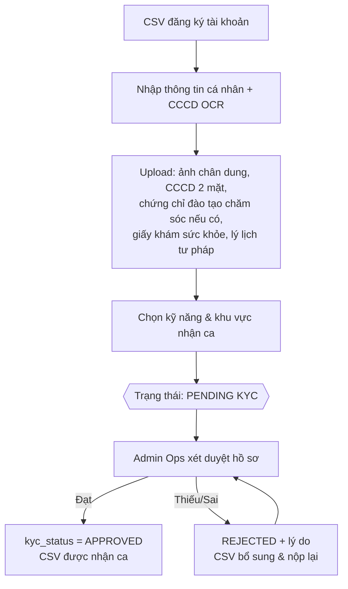

- CSV không thể nhận ca cho đến khi `kyc_status = APPROVED`.
- CCCD lưu mã hóa (`cccd_number_encrypted`) + `cccd_hash` (HMAC) chống trùng người.
- Tài liệu KYC là `media_assets` nhạy cảm → chỉ Admin xem qua signed URL.

Cơ chế làm việc của CSV sau khi được duyệt:

- CSV có trạng thái **Sẵn sàng / Ngoại tuyến** để bật/tắt nhận ca on-demand.
- CSV tự quản lý lịch rảnh/bận; hệ thống không offer ca trùng slot đã block.
- Khi có ca phù hợp, app CSV hiển thị khoảng cách, thời gian, gói dịch vụ, ghi chú người thụ hưởng và thù lao dự kiến.
- CSV có thời gian phản hồi ngắn (gợi ý 2 phút) để nhận/từ chối; không phản hồi thì offer chuyển sang CSV kế tiếp.
- CSV chỉ thấy dữ liệu người thụ hưởng cần cho ca đã nhận; dữ liệu nhạy cảm không hiển thị đại trà.

---

## 5. Luồng B — Customer & Hồ sơ người thụ hưởng

> **Ngữ cảnh:** Một người con muốn đặt dịch vụ chăm sóc cho cha/mẹ tại nhà. Để CSV chăm sóc đúng nhu cầu và an toàn, gia đình cần khai báo hồ sơ người thụ hưởng (tình trạng sức khỏe, thuốc đang dùng, thói quen, liên hệ khẩn cấp) trước khi có thể đặt lịch.

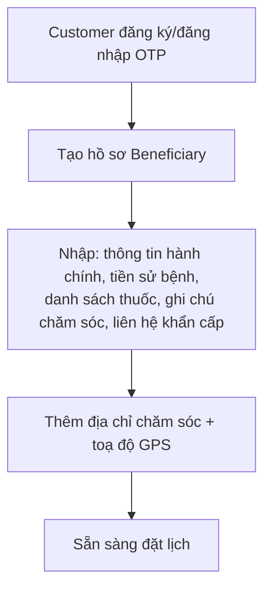

- 1 Customer quản lý nhiều Beneficiary (cha, mẹ, ông, bà…).
- Dữ liệu sức khỏe mã hóa AES-256, chỉ chia sẻ với CSV được phân công ca.

---

## 6. Luồng C — Đặt lịch & Matching

> **Ngữ cảnh:** Gia đình cần đặt một ca chăm sóc cụ thể cho người thân (đúng beneficiary, dịch vụ, ngày giờ, địa chỉ). Hệ thống phải ghép đúng CSV phù hợp — gần vị trí, đủ kỹ năng, còn lịch trống, uy tín tốt — dù khách tự chọn hay để hệ thống matching.

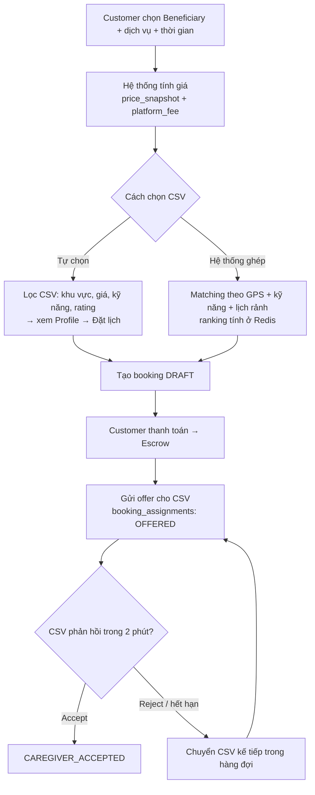

- Chỉ candidate được offer/chỉ định mới ghi xuống `booking_assignments` (ranking tạm ở Redis).
- Hệ thống không phân phối đơn trùng lịch CSV đã block (`caregiver_availability` + EXCLUDE gist chống double-book).
- Nếu đã thanh toán nhưng tất cả CSV từ chối/hết timeout, CRM phải chuyển sang Admin dispatch. Nếu vẫn không tìm được CSV thay thế thì booking `CANCELLED → REFUNDED` và hoàn 100% cho customer.

### 6.1. CSV hủy / im lặng / no-show sau khi đã nhận ca — Backup Dispatch

CSV đã `ACCEPTED` mà hủy ca, không bấm bắt đầu di chuyển, không phản hồi nhắc việc hoặc không check-in đúng giờ là sự cố điều phối, **không phải CRISIS/SOS**. Booking chưa nên hủy ngay; hệ thống phải thử tìm CSV thay thế trước, đồng thời cho customer quyền hủy miễn phí nếu không chấp nhận người thay.

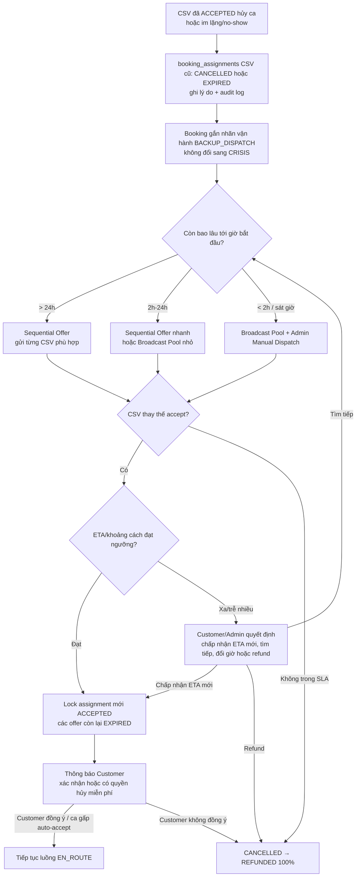

Phát hiện CSV im lặng/no-show:

| Mốc tín hiệu | Điều kiện cảnh báo | Hành động |
| --- | --- | --- |
| T-60/T-30 phút | CSV chưa mở app/không xác nhận nhắc việc | Push + SMS nhắc chuẩn bị ca |
| T-15 phút | CSV chưa bấm **Bắt đầu di chuyển** hoặc không có GPS gần đây | Cảnh báo Live Dispatch, gọi/ping CSV |
| T-5 phút | Vẫn không phản hồi hoặc ETA không kịp | Bắt đầu tìm CSV dự phòng song song |
| Giờ bắt đầu + grace 5-10 phút | Không check-in, không liên hệ được | Đánh dấu no-show, chạy Backup Dispatch khẩn; customer có quyền refund 100% nếu không chấp nhận thay thế |

> No-show nên được xử lý như lỗi nghiêm trọng của CSV: giảm reliability score, có thể phạt/tạm khóa nhận ca sau khi Admin xác minh.

Chế độ dispatch:

| Chế độ | Khi dùng | Cách hoạt động |
| --- | --- | --- |
| **Sequential Offer** | Ca còn nhiều thời gian | Gửi offer cho CSV phù hợp nhất, chờ phản hồi ngắn; từ chối/hết hạn thì gửi người kế tiếp |
| **Broadcast Pool** | Ca gấp, cần thay nhanh | Gửi cùng lúc cho 5-10 CSV đủ điều kiện; người accept đầu tiên được lock assignment |
| **Admin Manual Dispatch** | Ca sát giờ/rủi ro cao | CRM gợi ý danh sách CSV, Admin gọi/xác minh rồi gửi offer/chỉ định |

Điều kiện CSV được đưa vào pool thay thế:

- `kyc_status = APPROVED`.
- Đang online hoặc có lịch rảnh, không trùng ca khác.
- Trong bán kính hợp lý, ETA phù hợp thời gian bắt đầu.
- Kỹ năng/gói dịch vụ phù hợp hồ sơ người thụ hưởng.
- Reliability score đạt ngưỡng; không bị customer block hoặc từng có report nghiêm trọng.

Quy tắc customer:

- Nếu customer tự chọn CSV ban đầu và ca còn xa giờ bắt đầu, nên yêu cầu customer xác nhận CSV thay thế.
- Nếu ca gấp, hệ thống có thể tiếp tục với CSV mới sau khi CSV đó accept, nhưng customer phải nhận thông báo rõ và có quyền hủy miễn phí nếu không đồng ý.
- Nếu không tìm được CSV trong SLA hoặc customer không chấp nhận người thay, booking `CANCELLED → REFUNDED 100%`.

ETA rule cho CSV thay thế:

| ETA của CSV thay thế | Xử lý |
| --- | --- |
| Kịp giờ hoặc trễ nhẹ (gợi ý <= 10-15 phút) | Có thể lock assignment và thông báo customer |
| Trễ 15-30 phút | Customer xác nhận: chấp nhận ETA mới, chờ người khác, đổi giờ hoặc hủy hoàn tiền |
| Trễ > 30 phút | Không auto assign; Admin review hoặc tiếp tục tìm CSV khác |
| Không còn CSV gần hơn | Customer chọn nhận CSV xa với ETA mới, đổi lịch, hoặc refund 100% |
| Ca nhạy cảm/gấp | Không tự động nhận CSV xa; Admin xử lý thủ công |

Nguyên tắc tính tiền nếu CSV thay thế đến trễ:

- Không tính giờ từ `scheduled_start` nếu CSV chưa check-in.
- Timer thực tế bắt đầu từ `actual_start`.
- Nếu customer đồng ý dời ca đủ thời lượng, hệ thống kéo `scheduled_end` tương ứng nếu CSV mới còn lịch.
- Nếu customer chỉ dùng phần thời gian còn lại, refund phần thời lượng thiếu theo policy.

---

## 7. Luồng D — Thanh toán & Escrow

> **Ngữ cảnh:** Gia đình phải thanh toán trước nhưng vẫn muốn được bảo vệ nếu ca không diễn ra đúng cam kết. Escrow giữ cân bằng quyền lợi: khách an tâm vì tiền chưa chuyển thẳng cho CSV, còn CSV an tâm vì ca đã được thanh toán trước khi bắt đầu.

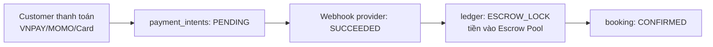

- Escrow ở MVP là **ledger nội bộ** (provider chỉ charge/refund), không phải ví giữ tiền thật trên cổng.
- Mọi giao dịch dùng `idempotency_key` chống trừ tiền trùng.
- `ledger_entries` **bất biến**: sai thì tạo entry REVERSE, không sửa/xóa.
- MVP chỉ hỗ trợ **thanh toán online trả trước qua escrow**. Tiền mặt/COD không đưa vào MVP vì làm mất cơ chế giữ tiền, dispute, refund và payout tự động. Nếu Phase 2 hỗ trợ tiền mặt thì chỉ nên áp dụng giới hạn (khách đã xác minh/khách thân thiết/booking nhỏ), có đặt cọc online và có trạng thái công nợ khi customer không thanh toán.

---

## 8. Luồng E — Thực thi ca làm việc

> **Ngữ cảnh:** CSV đã nhận ca và bắt đầu chăm sóc tại nhà, trong khi người nhà thường ở xa và không trực tiếp giám sát. Luồng này tạo minh bạch bằng GPS check-in, Care Timeline, timestamp/GPS và ảnh bằng chứng khi cần để gia đình theo dõi mà không tạo quá nhiều thao tác hoặc xâm phạm riêng tư.

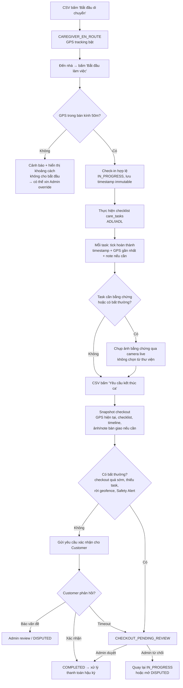

Ví dụ checklist (`care_tasks`) — tự sinh từ hồ sơ sức khỏe của cụ:

- 7:00 – Hỗ trợ vệ sinh cá nhân buổi sáng
- 7:30 – Chuẩn bị & hỗ trợ ăn sáng
- 9:00 – Trò chuyện, đọc báo hoặc sinh hoạt tinh thần nhẹ
- 10:00 – Hỗ trợ đi lại nhẹ trong nhà (15 phút)

> Ảnh **không bắt buộc cho mọi task**. Mặc định mỗi task lưu checkbox, timestamp, GPS gần nhất và note khi cần. Ảnh chỉ dùng khi task được customer yêu cầu trước, checkout sớm/bất thường, Safety Alert, hoặc dispute. Nếu có ảnh bằng chứng thì phải chụp live qua camera (không chọn từ thư viện), lưu metadata giờ/vị trí và tránh chụp tình huống nhạy cảm như vệ sinh cá nhân, thay đồ, giấy tờ, thuốc hoặc hồ sơ bệnh án.

Chốt vận hành checkout:

- CSV bấm checkout **chưa** làm booking `COMPLETED`; đó chỉ là yêu cầu kết thúc ca.
- Customer xác nhận thì `COMPLETED`.
- Customer không phản hồi sau timeout (gợi ý: nhắc sau 15 phút, đưa Admin review sau 30 phút) thì booking vào `CHECKOUT_PENDING_REVIEW`.
- Checkout sớm được phép nếu task bắt buộc đã xong, CSV còn trong geofence, có note/ảnh bàn giao và customer xác nhận. Nếu checkout sớm nhiều (vd >30 phút hoặc dưới 80% thời lượng ca), nên bắt Admin review.
- MVP giữ nguyên giá booking khi customer đồng ý checkout sớm, vì CSV đã giữ slot lịch. Refund phần thời gian chưa dùng để Phase 2.

Safety Alert trong ca:

- Nếu CSV rời geofence quá lâu, tắt GPS, không cập nhật timeline, ảnh bằng chứng thiếu metadata live, checkout quá sớm bất thường hoặc người nhà báo hành vi khả nghi → tạo `support_tickets` priority `HIGH/CRITICAL` và event timeline tương ứng (`GPS_LOST`, `NOTE`, `SOS` hoặc metadata `SAFETY_ALERT`).
- Safety Alert khác SOS: Safety Alert là rủi ro hành vi/quy trình; SOS là nguy cơ an toàn tức thời.
- Ca có Safety Alert nghiêm trọng chưa xử lý thì không tự động chuyển earning sang available sau 48h; giữ pending để Admin review.

---

## 9. Luồng F — Giải ngân (Settlement)

> **Ngữ cảnh:** Ca chăm sóc đã hoàn tất, CSV cần được ghi nhận thu nhập. Nhưng tiền chỉ thực sự an toàn để rút sau khi hết Dispute Window 48h — nên doanh thu đi qua `pending_balance` trước khi chuyển sang `available_balance`.

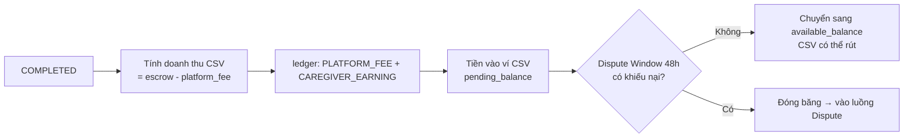

- `PLATFORM_FEE` và `CAREGIVER_EARNING` sau `COMPLETED` nên ở trạng thái pending trong Dispute Window 48h; chỉ chuyển thành available khi không có dispute/Safety Alert nghiêm trọng.
- Nếu dispute phát sinh, không sửa ledger cũ; tạo entry reverse/refund/penalty theo phán quyết.

---

## 10. Luồng G — Hủy ca & Hoàn tiền

> **Ngữ cảnh:** Một bên muốn hủy ca trước khi diễn ra hoặc trong quá trình điều phối. Chính sách hủy/hoàn/phạt phải rõ ràng để tránh tranh chấp và đảm bảo công bằng cho cả gia đình lẫn CSV.

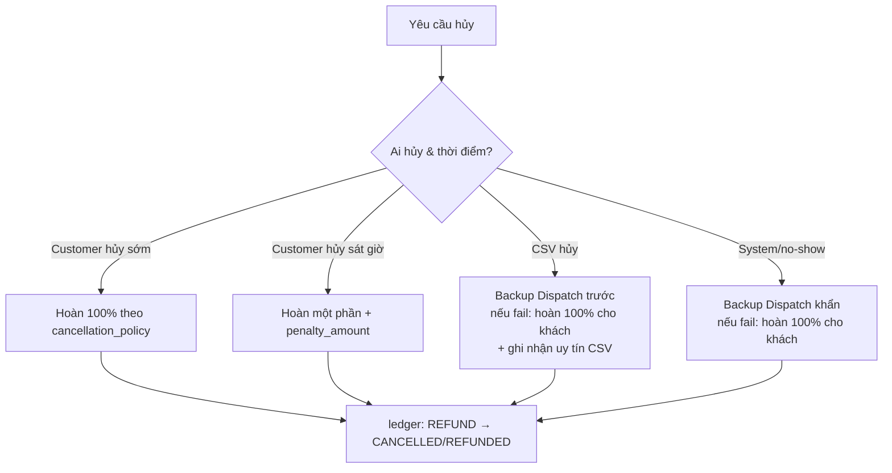

- Tier hủy/hoàn/phạt cấu hình ở `pricing_rules.cancellation_policy` (jsonb).
- Sau khi booking đã `IN_PROGRESS`, không xử lý bằng hủy thường nữa. Trường hợp này đi theo kết thúc sớm, Admin review, SOS hoặc dispute.

Policy MVP gợi ý:

| Thời điểm hủy | Customer nhận lại | Bù/ảnh hưởng CSV | Ghi chú |
| --- | ---: | ---: | --- |
| Trên 24h trước giờ bắt đầu | 100% | 0 | Hủy tự do |
| 2h-24h | 80-90% | 0-10% | Có thể trừ phí giữ lịch |
| Dưới 2h | 50-70% | 20-40% | Vì CSV đã giữ lịch |
| CSV đã `CAREGIVER_EN_ROUTE` | 40-60% | 30-50% | Có thể tính bù di chuyển |
| CSV hủy/no-show và Backup Dispatch thất bại / platform không tìm được CSV | 100% | 0 | CSV bị giảm reliability hoặc platform chịu trách nhiệm |

Rủi ro cần kiểm soát:

- Customer đặt giữ lịch rồi hủy sát giờ nhiều lần → tracking tỷ lệ hủy, giới hạn hủy miễn phí, risk flag.
- CSV hủy sát giờ hoặc no-show → reliability score, cảnh báo CRM, tự động tìm CSV thay thế, có thể phạt/tạm khóa nhận ca.
- Tranh cãi “CSV đã đến hay chưa” → dựa vào GPS, timestamp, audit log, notification log.
- Refund chậm từ provider → cần trạng thái refund rõ trong ledger/ticket để CSKH giải thích.

---

## 11. Luồng H — Khiếu nại (Dispute)

> **Ngữ cảnh:** Sau ca, customer không hài lòng hoặc cho rằng CSV không thực hiện đúng cam kết. Trong 48h, khách có thể mở khiếu nại; tiền trong Escrow bị đóng băng cho đến khi Admin phán quyết dựa trên bằng chứng (timeline, ảnh bằng chứng nếu có, GPS, thời gian check-in/out).

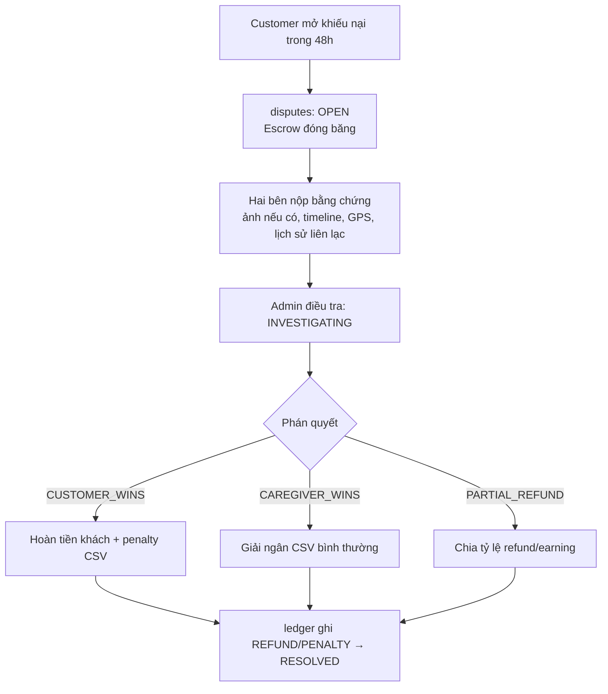

---

## 12. Luồng I — SOS / Khủng hoảng (Crisis)

> **Ngữ cảnh:** Trong ca chăm sóc xảy ra tình huống khẩn cấp — người cao tuổi té ngã, khó thở, mất liên lạc hoặc có sự cố an toàn. Cần một kênh báo động tức thì đưa booking vào trạng thái CRISIS và kéo Admin/CSKH vào xử lý theo SLA.

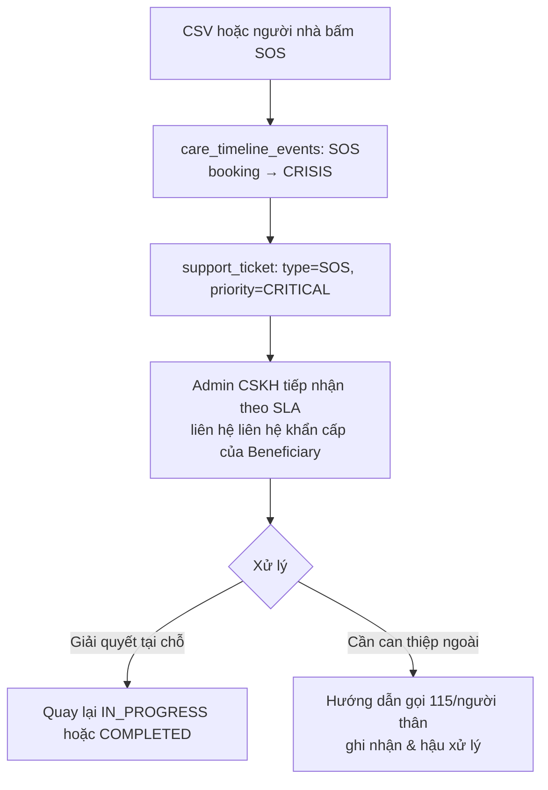

> CARE4EVER là dịch vụ phi y tế: khi có tình huống y tế khẩn cấp, vai trò là **báo động & kết nối** người thân/cấp cứu, không trực tiếp xử lý y khoa.

Chốt an toàn:

- `CRISIS` chỉ dùng cho SOS/nguy cơ an toàn tức thời, không dùng cho tình huống vận hành như CSV hủy sát giờ. Ca thiếu CSV nên xử lý bằng Admin dispatch hoặc cancellation/refund.
- SOS nên có SLA tiếp nhận rất ngắn (gợi ý 1-3 phút); quá hạn thì escalation cho nhiều Admin/CSKH.
- Nút SOS có thể dùng cơ chế giữ 2 giây để giảm bấm nhầm, nhưng không được làm quy trình quá chậm.
- Nếu SOS xảy ra trong ca, tiền không tự động settle; sau khi xử lý xong phải kết luận về một nhánh rõ: tiếp tục ca, checkout/kết thúc sớm, thay CSV, hoặc dispute.

---

## 13. Luồng J — Rút tiền (Payout)

> **Ngữ cảnh:** CSV đã tích lũy số dư khả dụng (`available_balance`) sau các ca hoàn tất và muốn rút về tài khoản ngân hàng. Kế toán duyệt từng yêu cầu để kiểm soát dòng tiền ra và xử lý lỗi chuyển khoản.

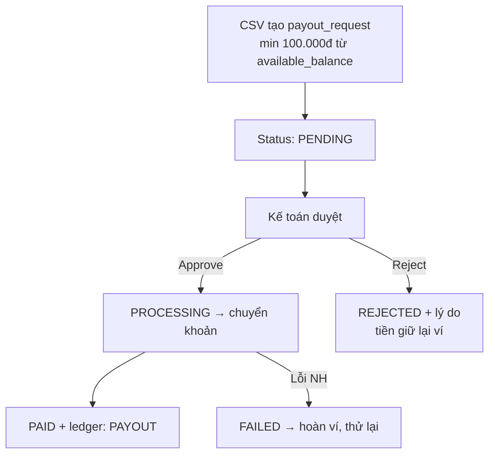

- Số tài khoản ngân hàng lưu mã hóa (`account_number_encrypted`), snapshot tại thời điểm rút.

---

## 14. Money Flow tổng quát (Escrow → Ledger)

```
Customer ──charge──► [Provider] ──webhook──► ESCROW_LOCK (Escrow Pool)
                                                   │
                              ca COMPLETED ────────┤
                                                   ├─► PLATFORM_FEE  ─► ví Platform
                                                   └─► CAREGIVER_EARNING ─► ví CSV (pending)
                                                                              │ +48h
                                                                              ▼
                                                                     available_balance
                                                                              │ payout
                                                                              ▼
                                                                        Ngân hàng CSV

Hủy/Dispute ─► REFUND ─► trả lại Customer (± PENALTY)
```

Nguyên tắc: **ledger là sự thật tài chính bất biến**, `wallet_accounts.balance` chỉ là cache; job reconcile đối soát ledger vs balance hằng ngày.

---

## 15. Tóm tắt vòng đời 1 booking (happy path)

```
Customer đặt lịch
  → Thanh toán vào Escrow (CONFIRMED)
  → Matching CSV (CAREGIVER_ACCEPTED)
  → CSV di chuyển (EN_ROUTE)
  → GPS check-in 50m (IN_PROGRESS)
  → Thực hiện ADL/IADL + cập nhật Care Timeline
  → CSV yêu cầu checkout → Customer/Admin xác nhận (COMPLETED)
  → Dispute Window 48h
  → Giải ngân CSV (available_balance)
  → Đánh giá 2 chiều
  → CSV rút tiền (Payout)
```

---

## 16. Phần CRM — Admin Operations Panel

> **Ngữ cảnh:** Mọi luồng A–J ở trên đều có một "phía vận hành" do đội ngũ nội bộ điều khiển. CRM (`caresitter-crm`, Next.js) là bảng điều khiển để **Admin Ops / CSKH / Kế toán** xác minh CSV, điều phối ca real-time, xử lý khủng hoảng & tranh chấp, và kiểm soát dòng tiền. Đây không phải app cho khách/CSV — nó là công cụ back-office biến các state machine thành thao tác bấm nút.

### 16.1 Người dùng & điều hướng

| Vai trò         | Trách nhiệm chính trong CRM                                   |
| --------------- | ------------------------------------------------------------ |
| **Admin Ops**   | Duyệt KYC, điều phối Live Dispatch, xử lý CRISIS              |
| **CSKH**        | Tiếp nhận SOS/ticket, theo dõi Customer 360, hỗ trợ tranh chấp |
| **Kế toán**     | Duyệt payout, đối soát Ledger & quỹ tạm giữ                  |

Sidebar gồm 6 module: **Dashboard KPI · Customer 360 · KYC · Live Dispatch · Dispute Center · Tạm giữ & Sổ cái**. Badge trên menu hiển thị số việc cần xử lý (vd KYC chờ duyệt, ca CRISIS, dispute đang mở).

### 16.2 Bản đồ module CRM ↔ Luồng nghiệp vụ ↔ Dữ liệu

| Module CRM                    | Phục vụ luồng        | Thao tác Admin                                      | Bảng dữ liệu chính                              |
| ----------------------------- | -------------------- | -------------------------------------------------- | ----------------------------------------------- |
| **Dashboard KPI**             | Toàn hệ thống        | Giám sát realtime, cảnh báo CRISIS                 | (đọc tổng hợp `bookings`, `ledger_entries`)     |
| **Customer 360**              | Luồng B, H           | Xem hồ sơ KH + beneficiary, review, ticket, dispute | `customers`, `beneficiaries`, `reviews`         |
| **KYC**                       | Luồng A              | Duyệt / từ chối hồ sơ + lý do                       | `caregiver_profiles`, `media_assets`, `audit_logs` |
| **Live Dispatch**             | Luồng C, E, I        | Theo dõi GPS, xử lý CRISIS, điều phối CSV thay thế khi thiếu CSV | `bookings`, `booking_assignments`, `gps_tracks` |
| **Dispute Center**            | Luồng H              | Điều tra → phán quyết → chia tiền                  | `disputes`, `ledger_entries`                     |
| **Tạm giữ & Sổ cái**          | Luồng D, F, J        | Xem ledger bất biến, duyệt/từ chối payout         | `ledger_entries`, `payout_requests`, `wallet_accounts` |

### 16.3 Dashboard KPI vận hành

- **KPI realtime:** Booking hôm nay, ca đang diễn ra, hoàn thành, **CRISIS** (highlight đỏ), CSV online, GMV, CSAT, tăng trưởng.
- **Biểu đồ booking theo giờ** + **Tổng quan tài chính** (Quỹ tạm giữ / Platform Wallet / CSV Pending 48h / Chờ rút tiền).
- **Banner CRISIS** ở đầu trang → nút nhảy thẳng sang Live Dispatch.
- Bảng booking gần nhất, click khách → mở Customer 360.

### 16.4 Customer 360

Tổng hợp toàn cảnh một khách theo **phân khúc** (`segment`): 💎 Thân thiết · 🌱 Mới · ⚠️ Nguy cơ rời bỏ · Chưa đặt đơn (lead). Mỗi hồ sơ gồm: thống kê chi tiêu (tổng/đơn/avg tháng), danh sách beneficiary (bệnh nền, thuốc, ghi chú di chuyển), lịch sử review, support ticket và dispute. → Phục vụ CSKH chăm sóc & giữ chân khách.

### 16.5 KYC — Duyệt hồ sơ CSV

- 3 tab: **Chờ duyệt / Đã duyệt / Từ chối** (có đếm số).
- Panel chi tiết: bio, kỹ năng, khu vực, **tiến độ tài liệu** (CCCD 2 mặt, ảnh chân dung, chứng chỉ điều dưỡng, giấy khám sức khỏe, lý lịch tư pháp).
- Hành động: **Duyệt KYC** (`kyc_status = APPROVED` → CSV mới được nhận ca) hoặc **Từ chối** (bắt buộc nhập lý do → CSV bổ sung & nộp lại). Mọi quyết định ghi `audit_logs` (`action='kyc.approve'/'kyc.reject'`).

### 16.6 Live Dispatch

- **Bản đồ TP.HCM (Leaflet)** hiển thị các ca đang hoạt động theo màu: 🟢 Đang làm · 🔵 Đang đến · 🔴 CRISIS.
- Danh sách ca ưu tiên **CRISIS lên đầu** (SOS / sự cố an toàn) kèm lý do; ca thiếu CSV do hủy sát giờ nên tách nhãn vận hành riêng, không gộp vào CRISIS.
- **Modal "Tìm CSV thay thế":** hệ thống xếp hạng 5 CSV phù hợp trong bán kính ~5km (rating, khoảng cách, ETA, kỹ năng) → Admin chọn & **Chỉ định ngay** → khách nhận push notification. Đây là phần "người" của Luồng C (matching), dùng cho thiếu CSV vận hành hoặc sau CRISIS nếu CSV không thể tiếp tục.

### 16.7 Dispute Center

- 3 tab: **Đang mở / Đang điều tra / Đã giải quyết**.
- Mỗi tranh chấp: lý do, mô tả, **escrow đang đóng băng**, bằng chứng (ảnh, timeline, GPS…), thông tin KH & CSV.
- Luồng: **Bắt đầu điều tra** (`INVESTIGATING`) → **Ra phán quyết** qua modal:
  - 🏆 **CUSTOMER_WINS** — hoàn 100%
  - 🏆 **CAREGIVER_WINS** — giải ngân bình thường
  - ⚖️ **PARTIAL_REFUND** — kéo thanh % hoàn, hệ thống tính trước số tiền chia (hoàn khách vs CSV nhận)
- Ghi chú phán quyết lưu vào audit log; xác nhận → cập nhật `ledger_entries` (REFUND/PENALTY) và đóng `disputes` (`RESOLVED`).

### 16.8 Tạm giữ & Sổ cái (Ledger + Payout)

- **4 thẻ tổng quan:** Quỹ tạm giữ · Platform Wallet · CSV Pending (48h) · Chờ rút tiền.
- **Máy tính minh họa chia tiền 1 ca:** vd 4h × 90.000đ = 360.000đ → phí nền tảng 15% → CSV nhận → sau 48h thành khả dụng. Ghi rõ 3 ledger entries: `ESCROW_LOCK → PLATFORM_FEE → CAREGIVER_EARNING`.
- **Bảng Ledger** (bất biến): loại giao dịch, booking, số tiền, trạng thái `POSTED/PENDING/REVERSED`, thời gian.
- **Yêu cầu rút tiền (payout):** Kế toán **Duyệt** (→ chuyển khoản tới TK CSV) hoặc **Từ chối** (bắt buộc lý do → tiền giữ lại ví). Số TK hiển thị dạng mask (`****1234`).

> **Lưu ý nhất quán:** giới tính CSV dùng enum tiếng Anh `FEMALE/MALE` (khớp UI KYC và `db.md`) — giữ nguyên quy ước này khi nối API thật.
