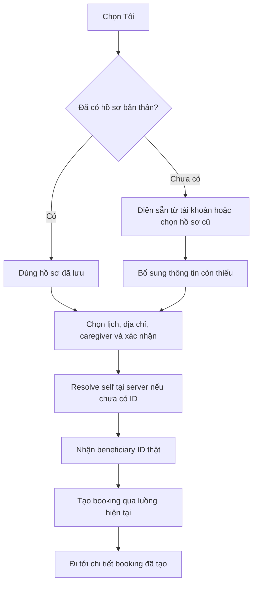

# Kế hoạch “Đặt cho tôi”

> Cập nhật: 11/10/2026. Trạng thái: **đã triển khai trong source và kiểm thử local; chưa nâng cấp DB môi trường ứng dụng/chưa phát hành**. Phạm vi: People, luồng booking của customer và hợp đồng đọc hồ sơ Identity. Tài liệu lưu local; không commit/push. Kết quả: [báo cáo triển khai](../kiem-thu/SELF_BOOKING_IMPLEMENTATION_2026_10_11.md).

## 1. Mục tiêu và quyết định chính

Customer chọn **“Tôi”** ngay trong booking, dùng thông tin tài khoản đã có và chỉ bổ sung thông tin chăm sóc còn thiếu. Hệ thống tự tạo hoặc dùng lại hồ sơ bản thân; người dùng không phải vào “Thêm người thân” để nhập lại mình.

- Tiếp tục lưu người nhận chăm sóc tại `people.beneficiaries`; thêm `is_self` để nhận diện bản thân của `customer_id`.
- Mỗi customer có tối đa một hồ sơ bản thân đang hoạt động, được bảo đảm bằng unique index trong PostgreSQL.
- **Chỉ tạo hồ sơ mới khi người dùng bấm xác nhận đặt lịch cuối cùng.** Mở wizard, chọn “Tôi”, chuyển người nhận hoặc thoát trước xác nhận chỉ thay đổi draft trong bộ nhớ.
- Khi đã có hồ sơ bản thân, dùng dữ liệu People đang lưu. Không chép đè từ tài khoản mỗi lần booking.
- `booking.bookings.beneficiary_id` tiếp tục bắt buộc và luôn trỏ tới một beneficiary thật; không dùng `users.id` thay thế, không gửi UUID giả.
- Phần sức khỏe phục vụ Nutrition sau này vẫn nằm trên cùng `beneficiary_id`. Không tạo module Nutrition hoặc cấu trúc bệnh lý mới trong đợt này.

## 2. Hiện trạng đã đối chiếu source

| Thành phần | Hiện có | Việc còn thiếu |
| --- | --- | --- |
| Hồ sơ tài khoản | `GET /api/v1/profile` có họ tên, ngày sinh, giới tính, điện thoại, ảnh, địa chỉ mặc định | Luồng đọc dữ liệu mới, có trạng thái loading/error, để điền sẵn cho booking |
| Hồ sơ người nhận | CRUD `people.beneficiaries`, customer sở hữu nhiều hồ sơ | `is_self`, truy vấn hồ sơ bản thân, thao tác tạo/dùng lại an toàn khi gửi đồng thời |
| Tạo beneficiary | Backend yêu cầu địa chỉ thuộc customer và đã xác minh | Gom thông tin thiếu ngay trong wizard trước khi tự tạo |
| Cập nhật beneficiary | Đã có sửa code giữ trường bị bỏ qua, phân biệt `null`, giữ ngày sinh/giới tính | Bảo vệ dấu bản thân và giữ nguyên các sửa này |
| Wizard | Chọn hồ sơ có sẵn, sáu bước từ dịch vụ đến xác nhận | Lựa chọn “Tôi”, draft chưa có ID, xử lý tạo hồ sơ trước tạo booking |
| Booking backend | Kiểm tra owner, địa chỉ, dịch vụ, lịch; DB có bảo vệ trùng lịch beneficiary | Dùng lại luồng hiện tại sau khi resolve đúng beneficiary |

Hai lỗi có sẵn trong wizard cần xử lý cùng tính năng:

1. `_selectedBeneficiary` đang fallback sang hồ sơ đầu tiên khi ID không tồn tại. Phải trả trạng thái chưa chọn/không tìm thấy và chặn submit.
2. Sau khi mở màn hình thêm người thân, wizard đang chọn phần tử cuối danh sách và lọc ID demo. Phải nhận ID vừa tạo từ kết quả navigation; hủy thêm thì giữ lựa chọn cũ. Không được vô tình chọn hồ sơ bản thân vừa được tải về.

Việc sửa hồ sơ trước đó đã được ghi riêng tại [báo cáo cập nhật hồ sơ](../kiem-thu/BENEFICIARY_UPDATE_2026_10_11.md). Kết quả test của đợt đó không được tính là nghiệm thu tính năng “Đặt cho tôi”.

## 3. Luồng giao diện

Giữ sáu bước hiện tại, đổi tên bước **“Người thân” → “Người nhận”**. Câu hỏi: **“Bạn đặt dịch vụ cho ai?”**, hai lựa chọn **“Tôi” / “Người thân”**.

### Lần đầu chọn “Tôi”

1. Đọc hồ sơ bản thân. Nếu chưa có, lấy dữ liệu tài khoản từ `/profile` và điền sẵn vào draft.
2. Hiển thị họ tên, ngày sinh, giới tính để kiểm tra; người dùng sửa thông tin cho hồ sơ chăm sóc ngay tại bước này. Ngày sinh/giới tính chưa biết được để trống.
3. Thu thập mức hỗ trợ, ghi chú và hai liên hệ khẩn cấp theo yêu cầu form hiện tại; cho chọn từ danh bạ gia đình. Không buộc nhập bệnh nền, thuốc hoặc tự coi trường trống là “không có bệnh/dị ứng”.
4. Bước “Lịch & địa chỉ” dùng địa chỉ mặc định nếu nó còn tồn tại và đã xác minh. Nếu chưa có địa chỉ hợp lệ, dùng bộ chọn địa chỉ hiện có. Không tạo beneficiary trước bước này.
5. Bước xác nhận hiển thị **“Người nhận: Tôi — <họ tên>”**, lịch, địa chỉ và thông tin chăm sóc đã xác nhận.
6. Bấm đặt lịch: tạo/dùng lại hồ sơ bản thân trước, nhận ID thật, rồi gọi luồng tạo booking hiện tại.

### Những lần sau

- Chọn “Tôi” hiển thị hồ sơ bản thân đã lưu, không yêu cầu nhập lại và không tạo thêm bản ghi.
- Địa chỉ cho riêng một booking có thể khác địa chỉ mặc định của hồ sơ; đổi địa chỉ booking không tự sửa địa chỉ mặc định.
- Liên kết **“Sửa thông tin chăm sóc”** mở form của đúng beneficiary, dùng PUT giữ trường bỏ qua. Khi quay lại phải nạp lại đúng ID trước xác nhận.
- Nếu một thiết bị khác vừa tạo hồ sơ trong lúc người dùng điền draft, nhận hồ sơ đó từ server. Nếu nội dung khác draft, hiển thị lại để kiểm tra; không âm thầm ghi đè hoặc đặt lịch với thông tin chưa được nhìn thấy.

### Hồ sơ bản thân đã được nhập thủ công từ trước

- Khi chưa có `is_self=true`, cung cấp lựa chọn phụ **“Dùng hồ sơ đã có của tôi”** trong nhánh “Tôi”. Người dùng chọn và xác nhận hồ sơ mình đã tạo trước đây.
- Đến bước xác nhận cuối, backend đánh dấu đúng hồ sơ đã chọn là bản thân, giữ nguyên ID và thông tin sức khỏe. Không đoán dựa trên tên, ngày sinh hoặc quan hệ “Khác”.
- Nếu đã tồn tại một hồ sơ bản thân khác, trả lỗi xung đột; không gộp, xóa hoặc chuyển booking giữa hai hồ sơ tự động.

### Bố cục, trạng thái và nội dung

Tái sử dụng theme của customer app, bộ chọn dạng radio và các form hiện có. Người dùng thao tác trên điện thoại trong bối cảnh cần đặt dịch vụ nhanh; giữ giao diện sáng, chữ dễ đọc và màu teal cho hành động chính. Các điểm tham chiếu là bước chọn người nhận hiện tại, bộ chọn địa chỉ đã xác minh và form sửa beneficiary. Không cần thiết kế lại toàn bộ wizard hoặc tạo ảnh minh họa.

| Trạng thái | Hành vi |
| --- | --- |
| Đang đọc dữ liệu | Loading tại vùng thông tin; chưa cho tiếp tục với hồ sơ chưa xác định |
| Chưa có self, không có người thân | “Tôi” vẫn dùng được; nhánh “Người thân” có nút thêm hồ sơ |
| API đọc lỗi | Giữ lựa chọn/draft, hiển thị “Không tải được thông tin. Thử lại”; không suy thành chưa có hồ sơ |
| Thiếu họ tên/địa chỉ/liên hệ | Đánh dấu đúng trường và bước cần bổ sung; không điều hướng sang “Thêm người thân” |
| Đang xác nhận | Khóa nút, thông báo lần lượt “Đang lưu thông tin chăm sóc…” và “Đang đặt lịch…” |
| Đổi “Tôi” ↔ “Người thân” | Giữ draft từng nhánh trong phiên, xóa lựa chọn người nhận cũ khỏi request; kiểm tra lại địa chỉ |
| Hồ sơ bị xóa/không còn truy cập | Yêu cầu chọn lại; không lấy hồ sơ đầu tiên thay thế |
| Đăng xuất/đổi tài khoản | Xóa draft, selection và response chờ của tài khoản trước |

Hồ sơ bản thân hiển thị một lần dưới “Thông tin chăm sóc của tôi”; danh sách người thân dùng `isSelf=false`. Với điều hướng có `initialBeneficiaryId`, đợi resolve đúng bản ghi rồi chọn nhánh theo `isSelf`; không bỏ qua bước chỉ vì có chuỗi ID.

Kiểm tra ở chiều rộng 320/390 px, text scale 1.3/2.0, bàn phím mở, nhãn trợ năng và vùng chạm tối thiểu 44 px. Không đưa các từ `beneficiary`, `is_self`, idempotency hoặc chi tiết DB vào nội dung giao diện.

## 4. Dữ liệu và quyền sở hữu

### Schema dự kiến

Thêm migration tại `backend/init-db/`, dùng số tiếp theo khi triển khai; hiện dãy SQL kết thúc ở `36-*`, nên tên dự kiến là **`37-beneficiary-self-profile.sql`**. Không tạo file SQL trong bước lập kế hoạch này, không sửa migration đã áp dụng.

| Thay đổi | Quy tắc |
| --- | --- |
| `people.beneficiaries.is_self boolean NOT NULL DEFAULT false` | Bản ghi cũ đều là false; chỉ use case dành cho self được đặt true |
| Unique index `ux_beneficiaries_active_self_customer` trên `customer_id` | Điều kiện `is_self = true AND deleted_at IS NULL` |
| `Beneficiary.IsSelf` và mapping EF | Setter không công khai, thao tác đánh dấu qua phương thức nghiệp vụ |
| `BeneficiaryResponse.IsSelf` và Flutter `isSelf` | Trường bổ sung; app đọc mặc định false nếu server cũ chưa có |

`customer_id` của self luôn lấy từ phiên xác thực. `relationship_to_customer` hiển thị **“Bản thân”**, nhưng logic phải dùng `is_self`, không so sánh chuỗi quan hệ.

Backend giữ nguyên owner/RLS và không nhận `customerId` hay cờ `isSelf` từ DTO tạo/sửa thông thường. PUT hồ sơ self không được đổi loại self hoặc đổi thành quan hệ người thân; trả lỗi validation rõ ràng nếu request cố làm điều đó.

### Nguồn dữ liệu

- Identity sở hữu thông tin tài khoản; People sở hữu thông tin chăm sóc. Lần đầu chỉ dùng `/profile` để điền sẵn, người dùng xác nhận trước khi lưu sang People.
- Form chỉ sao chép họ tên, ngày sinh, giới tính, điện thoại, ảnh và ID địa chỉ mặc định. Không sao chép email đăng nhập, role, token hoặc dữ liệu xác thực vào beneficiary.
- Địa chỉ điền sẵn luôn phải được kiểm tra lại qua Catalog; ảnh/ngày sinh/giới tính dùng validator hiện có.
- Không dùng cache rỗng hoặc fallback dữ liệu cũ trong `ProfileStore` để kết luận về dữ liệu thật. Cần adapter đọc DTO mới có loading/error; gọi API qua repository, không import presentation của Settings vào Booking để lấy logic.
- Sửa tài khoản sau này không tự ghi đè hồ sơ chăm sóc. Đồng bộ hai chiều không nằm trong V1; người dùng sửa hồ sơ chăm sóc qua form hiện có.
- Hồ sơ cũ chỉ được gắn self sau lựa chọn rõ của owner; không backfill từ thông tin giống nhau.

### Vòng đời

V1 giữ hồ sơ self ổn định để booking và Nutrition dùng lại cùng ID. Bỏ dở booking sau khi hồ sơ đã lưu vẫn giữ hồ sơ, không rollback bằng DELETE.

Hồ sơ self không có nút xóa trong luồng “xóa người thân”; API DELETE thông thường trả `409 beneficiary.self_managed` và hướng sửa thông tin chăm sóc. Quy trình xóa tài khoản/dữ liệu là phạm vi riêng. Điều này tránh xóa rồi tạo self mới để vượt kiểm tra trùng lịch trên ID cũ. Bản ghi self đã soft-delete bởi một quy trình quản trị sau này không được tự phục hồi cùng dữ liệu sức khỏe; cần quy trình xử lý rõ trước khi hỗ trợ trường hợp đó.

## 5. API và tính lặp an toàn

Tất cả endpoint mới yêu cầu customer đã đăng nhập, lấy owner từ `ICurrentUser`. Vai trò và ownership được kiểm tra tại server.

| Endpoint | Hành vi dự kiến |
| --- | --- |
| `GET /api/v1/beneficiaries/self` | Chỉ đọc self đang hoạt động; `200 BeneficiaryResponse`, hoặc `404 beneficiary.self_not_found` khi chưa có. Không tạo dữ liệu |
| `POST /api/v1/beneficiaries/self` | Tạo self nếu chưa có; `201` kèm Location và BeneficiaryResponse. Nếu đã có, `200` cùng bản ghi hiện tại, không ghi đè bằng payload cũ |
| `PUT /api/v1/beneficiaries/self/link` | Body chỉ có `beneficiaryId`; đánh dấu hồ sơ hiện có thuộc owner thành self. Cùng owner/cùng ID gửi lại trả cùng kết quả; nếu self khác đã tồn tại trả `409 beneficiary.self_exists` |
| `PUT /api/v1/beneficiaries/{id}` | Giữ hợp đồng cập nhật hiện có, bảo vệ cờ self/quan hệ và giữ các trường bị bỏ qua |
| `POST /api/v1/bookings` | Tiếp tục nhận `beneficiaryId` thật; không thêm `isSelf` hoặc nhánh ghi bảng People trực tiếp vào Booking |

DTO tạo self gồm `FullName`, `DateOfBirth`, `Gender`, `Phone`, `AvatarUrl`, `DefaultAddressId`, `CareLevel`, `GeneralNote`, `CareInstructions`, `EmergencyContacts`. `FullName`, địa chỉ đã xác minh và hai liên hệ khác số điện thoại phải hợp lệ khi tạo lần đầu; yêu cầu liên hệ hiện đã có trên form, cần enforce ở use case self. Các trường sức khỏe chưa thu thập giữ unknown/null, không tự sinh mảng rỗng hoặc dữ kiện mặc định.

Khi self đã tồn tại, POST chỉ đọc và trả bản ghi đó; không dùng request cũ để cập nhật. Người dùng muốn sửa dùng PUT riêng. Khi POST thành công nhưng response mất, gửi lại vẫn nhận cùng beneficiary ID. Khi hai thiết bị gửi nội dung khác nhau đồng thời, một bản ghi thắng; thiết bị còn lại nhận bản đã lưu để kiểm tra lại, không áp dụng “request đến sau ghi đè”.

Thao tác tạo/link được tuần tự hóa theo customer trong transaction tại Repository/Store, với unique index là lớp bảo vệ cuối. Nếu xử lý vi phạm unique, chỉ bắt đúng constraint self, rollback/reset trạng thái transaction rồi đọc lại dưới cùng owner. Không nuốt mọi lỗi DB thành “đã tồn tại”. Link kiểm tra lại owner, deleted state và khóa hàng mục tiêu trong cùng transaction.

Thông tin lỗi cần tách biệt: `self_not_found`, `self_exists`, `self_managed`, `self_relationship`, lỗi địa chỉ/liên hệ và lỗi booking. `_showSubmitApiError` đang coi mọi `409` là xung đột caregiver; phải chuyển sang xử lý theo mã lỗi, không đẩy người dùng chọn lại caregiver khi lỗi nằm ở hồ sơ.

## 6. Điều phối xác nhận và lỗi giữa chừng

Controller/use case phía app giữ trạng thái lựa chọn rõ ràng: `SelfDraft`, `ExistingSelf`, `ExistingBeneficiary`; tránh suy ra loại người nhận từ ID null hoặc tên. Không giữ đồng thời một ID người thân và draft self trong request cuối.

| Tình huống | Cách xử lý |
| --- | --- |
| Tạo/link self lỗi | Giữ draft, không gọi tạo booking; cho sửa thông tin/thử lại |
| Timeout tạo/link self | GET self để xác định kết quả trước; có thể lặp thao tác an toàn trên cùng customer |
| Self đã có nhưng thiếu thông tin cần dùng | Yêu cầu bổ sung và lưu qua PUT trước khi tạo booking; không tạo self thứ hai |
| Self lưu thành công, booking bị từ chối | Giữ self ID, hiển thị lỗi booking; lần thử sau dùng lại ID đó |
| Booking đã tạo, bước chọn caregiver thất bại | Giữ booking ID theo luồng hiện tại, xử lý trên booking đó; không gọi tạo mới |
| Timeout khi gửi tạo booking | Không tự lặp POST booking; chuyển sang kiểm tra danh sách/chi tiết từ server và giữ trạng thái chưa xác định nếu chưa xác minh được |
| Session thay đổi trong lúc chờ | Bỏ response đối với tài khoản cũ, không cập nhật store hoặc tiếp tục tạo booking |

**Giới hạn cần ghi đúng:** singleton self chỉ chống trùng hồ sơ. Source hiện chưa có khóa idempotency bền cho toàn bộ `CreateBooking`; trigger/constraint chống trùng lịch beneficiary không phải cơ chế trả lại booking cũ khi retry. V1 không thêm retry tự động cho POST booking. Nếu muốn retry booking tự động, cần thiết kế riêng khóa theo customer + request, so sánh payload và xử lý promotion/side effect trước khi bật.

## 7. Công việc triển khai và thứ tự

| Giai đoạn | Công việc | Điều kiện hoàn thành |
| --- | --- | --- |
| 1. DB và domain | Migration mới, `IsSelf`, unique index, mapping, bảo vệ loại self và vòng đời | Bootstrap/upgrade đều đúng; chỉ một self hoạt động/customer |
| 2. People API | Get/create-or-get/link self, validator, repository transaction, mở rộng response | Test quyền, null, link hồ sơ cũ và race PostgreSQL thật qua |
| 3. Model và form app | Model `isSelf`, đọc profile có trạng thái, draft người nhận, form bổ sung tại chỗ | Chọn “Tôi” không cần màn hình thêm người thân; giữ nguyên ngày sinh/giới tính |
| 4. Booking và quản lý hồ sơ | Resolve trước submit, reuse ID, sửa fallback, navigation trả ID, lỗi theo code, mục thông tin chăm sóc của tôi | Đặt cho mình/người thân đúng ID; lỗi giữa chừng không làm mất dữ liệu |
| 5. Kiểm thử và phát hành | Regression, race DB, build, kiểm thử thiết bị, rollout có kiểm soát | Đạt tiêu chí nghiệm thu bên dưới, có bằng chứng DB migration và flow thật |

Các vị trí source chính, tính từ gốc repository:

- `backend/init-db/`: migration kế tiếp; không dùng EF migration/EnsureCreated.
- `backend/caresitter-be/Modules/People/Domain/Beneficiary.cs`, `IPeopleRepository.cs`.
- `backend/caresitter-be/Modules/People/Infrastructure/PeopleDbContext.cs`, `PeopleRepository.cs`.
- `backend/caresitter-be/Modules/People/Application/Commands/Beneficiaries/`, `Queries/Beneficiaries/`, response và mapper.
- `backend/caresitter-be/Modules/People/Controllers/BeneficiariesController.cs` và DTO.
- `frontend/customer-app/lib/features/beneficiary/`: model/repository/store, form và danh sách hồ sơ.
- `frontend/customer-app/lib/features/booking/`: state người nhận và wizard/submit.
- `frontend/customer-app/lib/features/settings/data/`: adapter đọc tài khoản nếu cần tách dùng chung; không kéo presentation qua feature khác.

Caregiver/admin tiếp tục nhận booking với beneficiary bình thường. Kiểm tra consumer DTO để trường bổ sung không phá parsing; không đưa toàn bộ hồ sơ sức khỏe sang response booking ngoài phạm vi đang có.

## 8. Kiểm thử và tiêu chí nghiệm thu

| Nhóm | Ca bắt buộc |
| --- | --- |
| DB | DB mới + DB nâng cấp có dữ liệu cũ; default false; unique đúng điều kiện; không mất health JSONB |
| Race | Nhiều POST đồng thời cùng customer chỉ một self; POST vs link; hai link khác ID; hai customer độc lập; thử lại sau response mất |
| Quyền | Không đăng nhập; role không phù hợp; link ID người khác/đã xóa; giả mạo owner/isSelf; truy vấn self của đúng người dùng |
| Dữ liệu | Ngày sinh thật, gender enum, unknown giữ nguyên; đổi tên/địa chỉ không xóa dị ứng/thuốc; dữ liệu account không ghi đè self đã có |
| Vòng đời | DELETE self bị chặn đúng mã; sửa quan hệ/cờ self bị từ chối; liên kết hồ sơ cũ giữ ID và booking lịch sử |
| UX lần đầu | Tài khoản đầy đủ/thiếu thông tin; địa chỉ chưa xác minh; không có người thân; hai liên hệ trùng số; không tạo trước xác nhận |
| UX lần sau | Không nhập lại; “Tôi” xuất hiện một lần; đổi nhánh không gửi sai ID; địa chỉ booking không sửa mặc định |
| Navigation | Deep link tới self/người thân; ID không tồn tại; danh sách tải chậm; hủy/thêm người thân trả đúng selection |
| Submit | Self lỗi không tạo booking; self thành công + booking lỗi giữ ID; timeout phân biệt giai đoạn; không hiển thị thành công khi chưa xác nhận |
| Regression | Booking người thân, chọn caregiver, thanh toán, hủy lịch và màn hình chi tiết giữ hành vi hiện có |

Chạy unit/contract test trong các project People và IntegrationTests, cộng test kiến trúc. Race/constraint/RLS phải dùng PostgreSQL test tạm theo [hướng dẫn PostgreSQL](../backend/tests/POSTGRESQL_TESTS.md); test mock hoặc test bị skip không chứng minh unique/race đã đúng.

Trong `frontend/customer-app`, chạy `flutter analyze`, test beneficiary/booking và build nền tảng chịu tác động. Bổ sung kiểm tra widget ở màn hình nhỏ/text scale lớn và nghiệm thu thao tác trên thiết bị. Khi triển khai ghi ngày, lệnh, môi trường, số pass/fail/skip; không dùng số test ở báo cáo cũ cho đợt này.

Tiêu chí chốt: người dùng hoàn tất đặt lịch cho mình mà không phải tự thêm hồ sơ; chỉ một self hoạt động; đúng owner/beneficiary ID; không mất dữ liệu sức khỏe; lỗi mạng có đường khôi phục rõ ràng; booking cho người thân vẫn hoạt động.

## 9. Phát hành và phạm vi chưa làm

Triển khai theo thứ tự **migration → backend → app/bật lựa chọn “Tôi”**. Xác minh schema/index thật sau migration; không coi restart container là đã nâng cấp DB. Trước khi bật cần giữ bản sửa PUT bỏ qua/null đã có trong working tree.

Khi rollback UI, giữ cột/index và dữ liệu self. Không rollback backend về phiên bản làm mất bảo vệ cập nhật/xóa self trong lúc app mới còn hoạt động. App cũ vẫn dùng CRUD/booking theo ID; `isSelf` là trường bổ sung, tự động tạo self chỉ xuất hiện trong luồng mới.

Chưa bao gồm: đồng bộ hai chiều Identity–People, gộp tự động hồ sơ trùng, khôi phục dữ liệu bị mất từ trước, Nutrition/RAG, thay đổi giá/thanh toán hoặc retry booking tự động. Migration 37 đã được chạy trên DB test PostgreSQL tạm, chưa áp dụng vào DB của ứng dụng hay production. Luồng self đã có code và test local; cần nghiệm thu trên thiết bị và rollout đúng thứ tự migration → backend → app.

## 10. Tham chiếu đã đọc

- [Schema People](../../backend/init-db/03-people.sql), [schema booking](../../backend/init-db/04-booking.sql), [bảo vệ giao dịch và trùng lịch](../../backend/init-db/27-phase8-transaction-integrity.sql).
- [Tạo beneficiary](../../backend/caresitter-be/Modules/People/Application/Commands/Beneficiaries/CreateBeneficiary/CreateBeneficiaryCommandHandler.cs), [API beneficiary](../../backend/caresitter-be/Modules/People/Controllers/BeneficiariesController.cs).
- [Tạo booking](../../backend/caresitter-be/Modules/Booking/Application/Commands/Bookings/CreateBooking/CreateBookingCommandHandler.cs), [booking wizard](../../frontend/customer-app/lib/features/booking/presentation/screens/booking_wizard_screen.dart).
- [Profile repository](../../frontend/customer-app/lib/features/settings/data/repositories/profile_repository.dart), [quy tắc sản phẩm](../frontend/customer-app/PRODUCT.md), [theme hiện có](../frontend/customer-app/DESIGN.md).
- [Plan Nutrition](MEAL_RECOMMENDATION_PLAN.md), [quy ước dự án](../QUY_UOC_CODE_VA_SECRET.md).
